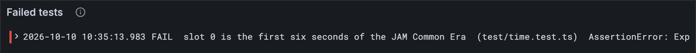

# The JAM clock

Your first piece of real JAM. It's tiny, and it is everywhere: every block in JAM says
*when* it belongs, and that "when" comes from this clock.

## New words

- **Timeslot (slot).** One tick of JAM's clock: six seconds, numbered from 0. *Example:*
  slot 1 runs from 12:00:06 to 12:00:12 UTC on 1 January 2025.
- **JAM Common Era.** The moment JAM's clock starts: 12:00 UTC on 1 January 2025.
  *Example:* slot 0 begins right then.
- **Unix epoch.** The moment most computer clocks count from: 00:00 UTC on 1 January
  1970. (Nothing to do with a JAM epoch, which arrives in lesson 7.1.) *Example:* the JAM
  Common Era is 1,735,732,800 seconds after it.
- **Header.** A block's cover page; among other things, it names the block's slot
  (lesson 4.6). *Example:* a header saying slot 43.
- **Test-first.** Writing a test before the code it tests, watching it fail, then making it
  pass. *Example:* this lesson's `slotAt`.
- **Assertion.** One check inside a test: if the value isn't what it should be, the test
  fails and says what it got. *Example:* `assert.equal(at("2025-01-01T13:00:00Z"), 600)`.

## What the Gray Paper says

JAM keeps time in six-second **timeslots**, counted from the **JAM Common Era**: 12:00
UTC on 1 January 2025 (GP §4, *Time*), which is 1,735,732,800 seconds after the Unix
epoch. One slot lasts P = 6 seconds (§4, *Epochs and Slots*). So slot 0 is the first six
seconds of the era, slot 1 the next six, and slot 600 starts exactly one hour in.

Every block header names its slot, and a block may not come from the future: its slot
times P can't be later than the current time (§5). Why midday? So that all the major
time zones share the same date at every whole day of the era. The Gray Paper thinks of
everything.

## The test comes first

You are about to write a test for a function that doesn't exist yet. That's the plan,
not a typo: the test says what `slotAt` must do, and then you write `slotAt` to make it
true.

**New file** `test/time.test.ts`

```ts
import { test } from "node:test";
import assert from "node:assert/strict";
import { slotAt } from "../src/time.ts";

const at = (iso: string) => slotAt(new Date(iso));

test("slot 0 is the first six seconds of the JAM Common Era", () => {
  assert.equal(at("2025-01-01T12:00:00Z"), 0);
  assert.equal(at("2025-01-01T12:00:05.999Z"), 0);
  assert.equal(at("2025-01-01T12:00:06Z"), 1);
});

test("an hour is 600 slots", () => {
  assert.equal(at("2025-01-01T13:00:00Z"), 600);
});
```

`node:test` gives you `test(name, fn)`. `node:assert/strict` gives you assertions that
compare exactly, so `assert.equal(1, "1")` fails, as it should.

**Run, expect it to fail**

```sh
npm test
# fails with: Cannot find module
```

Red! Node can't find `src/time.ts`, because there isn't one. Good: now you know the test
really runs, and really fails without the code.

Two small conventions you'll see in every lesson: a line starting with `#` in a **Run**
block is a comment (the shell skips it), and `# fails with:` or `# prints:` tells you
what to look for in the output. The tutorial's own checks look for exactly that text.

Over in Grafana, this failed run is already there: *Tests failed* is no longer 0, and
*Test results* says which test failed and why.

## The code

**New file** `src/time.ts`

```ts
// Time: JAM counts six-second timeslots from the JAM Common Era (GP §4).

/** The JAM Common Era began at 12:00 UTC on 1 January 2025: seconds after the Unix epoch. */
export const JAM_COMMON_ERA = 1_735_732_800;

/** P: a timeslot lasts six seconds. */
export const SLOT_SECONDS = 6;

/** The timeslot a moment falls in: whole slots since the JAM Common Era. */
export function slotAt(date: Date): number {
  const ms = date.getTime() - JAM_COMMON_ERA * 1000;
  return Math.round(ms / (SLOT_SECONDS * 1000));
}
```

Milliseconds since the era, divided by the milliseconds in a slot, rounded to a whole
number. Run the tests:

**Run, expect it to fail**

```sh
npm test
# fails with: Expected values to be strictly equal
```

## Bug hunt

Red again, and this time the file is there. Something in it is wrong. (On purpose: every
so often a lesson hands you a bug, so that finding one becomes a habit before it matters.)
Three places tell you what happened:

1. **The test output.** One test failed, `slot 0 is the first six seconds of the JAM
   Common Era`, and below it: `1 !== 0`. Your code said 1 where the test wanted 0. The
   other test, *an hour is 600 slots*, passed.
2. **The dashboard.** *Tests failed* now says 1, and *Test results* has a `FAIL` line
   with the same message. Every run is kept, so you can put this run next to the last
   one.

   
3. **The line.** The failing test has three assertions; the output points at the second,
   `at("2025-01-01T12:00:05.999Z")`: 5.999 seconds into the era. In slots that's
   5.999 / 6 = 0.9998, and `Math.round` turns 0.9998 into 1. But slot 1 doesn't start
   until the sixth second. A slot number counts the *whole* slots that have gone by, so
   it must round *down*.

The fix is one word:

**Replace in** `src/time.ts`

```ts
/** The timeslot a moment falls in: whole slots since the JAM Common Era. */
export function slotAt(date: Date): number {
  const ms = date.getTime() - JAM_COMMON_ERA * 1000;
  return Math.floor(ms / (SLOT_SECONDS * 1000));
}
```

**Run**

```sh
npm test
# prints: fail 0
# prints: reported
npm run typecheck
```

Green, and on the dashboard *Tests passed* jumps to 2 and *Tests failed* drops back to
0. Milliseconds since the era, divided by the milliseconds in a slot, rounded down: that's
the whole JAM clock.

Why two commands? Node strips the types and runs the code without ever looking at them,
so a type error would sail straight through `npm test`. `npm run typecheck` is the one
that catches it. Run both after every change.

## What time is it in JAM?

**New file** `bin/now.ts`

```ts
// Prints the JAM timeslot it is right now, and reports it to the observability stack.

import { Run } from "../src/obs.ts";
import { slotAt } from "../src/time.ts";

const run = new Run("now");
const slot = slotAt(new Date());
console.log(`It is JAM timeslot ${slot}.`);
run.event("slot", { slot });
run.number("slot", slot);
const link = await run.report();
if (link) console.log(`reported to Grafana: ${link}`);
```

**Run**

```sh
node bin/now.ts
# prints: It is JAM timeslot
# prints: reported to Grafana
```

A number in the millions: every six-second slot since the start of 2025. On the
dashboard, *JAM timeslot* shows the same number. Run it again after six seconds and
watch it tick up by one. That's JAM's heartbeat.

<details>
<summary>lasair: the same clock, in <code>lib/overview.ml</code></summary>

```ocaml
(** Unix timestamp of JAM Common Era start *)
let jam_common_era_unix : int64 = 1_735_732_800L

(** Convert Unix timestamp to JAM timeslot *)
let timeslot_of_unix (unix_ts : int64) : timeslot option =
  let open Int64 in
  let diff = sub unix_ts jam_common_era_unix in
  if diff < 0L then None
  else Some (Int32.of_int (to_int (div diff (of_int Constants.c_slot_seconds))))
```

The same division. lasair also refuses moments before the era: it returns `None`, OCaml's
"no value here", and the caller must deal with it. (Your clock will learn that in the
hardening pass; nobody is importing blocks from 2024.) `let open Int64 in` lets the
function write `sub` and `div` for `Int64.sub` and `Int64.div`.

JAM time is this simple on purpose: every node works out the same slot from its own
clock, without sending a single message.

</details>

## What you have

Your first JAM rule, its tests, and a program that reports what it found. From here on,
every lesson's `npm test` lands in Grafana.

Next: [Part 1 · Bytes and numbers](../01-bytes-and-numbers/index.md)
