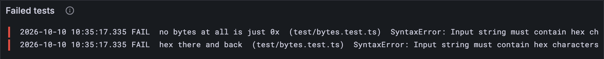

# Bytes and hex

Before JAM can be clever, it has to be bytes. Hashes, keys, blocks, whole states: all
bytes in the end. This lesson gives your client a word for bytes and a way to read and
write them the way the test vectors do. It also hands you your second bug to catch.

## New words

- **Byte.** Eight bits: a whole number from 0 to 255. The Gray Paper says *octet*.
  *Example:* 255 is the biggest byte there is.
- **Hex.** Writing bytes as text, two digits per byte, with the digits 0-9 and a-f.
  *Example:* the bytes 1, 2 and 255 are `0x0102ff`.
- **`Uint8Array`.** JavaScript's row of bytes. *Example:* `Uint8Array.of(1, 2, 255)`.
- **Type alias.** A second name for a type you already have. *Example:*
  `type Bytes = Uint8Array`.
- **Stack trace.** When a program crashes, the list of function calls it was in the
  middle of, innermost first. *Example:* `at fromHex (src/bytes.ts:13:21)`.

All five are in the [glossary](../glossary.md).

## Bytes in TypeScript

A `Uint8Array`: a row of numbers from 0 to 255, stored as raw bytes. (A plain `number[]`
would take eight times the memory and happily hold 300 or −1.5. Node's `Buffer` is a
`Uint8Array` with a few surprises, and only exists in Node. `Uint8Array` it is.)

## Hex

The test vectors write bytes as text: `0x`, then two hex digits per byte. The bytes 1, 2
and 255 become `"0x0102ff"`. Node 26 speaks hex already: `bytes.toHex()` gives
`"0102ff"`, and `Uint8Array.fromHex("0102ff")` gives the bytes back. Your client's job is
the `0x`.

## What the Gray Paper says

Section 3 (*Notational Conventions*) names the building blocks. Two you'll meet on nearly
every page:

- **𝔹**, the octet strings, which the paper calls *blobs*. 𝔹ₙ are the ones of length n.
- **ℍ = 𝔹₃₂**, 32-byte values. Every hash in JAM is one.

It also draws a firm line: *"an octet is always serialized to itself, whereas a natural
number may be serialized as a sequence of potentially several octets"*. The byte 5 and
the number 5 are different creatures in JAM. Your client keeps them apart from the start.

## The tests

Test-driven development, as always: the test first.

**New file** `test/bytes.test.ts`

```ts
import { test } from "node:test";
import assert from "node:assert/strict";
import { fromHex, toHex } from "../src/bytes.ts";

test("hex there and back", () => {
  const bytes = Uint8Array.of(1, 2, 255);
  assert.equal(toHex(bytes), "0x0102ff");
  assert.deepEqual(fromHex("0x0102ff"), bytes);
});

test("no bytes at all is just 0x", () => {
  assert.equal(toHex(new Uint8Array(0)), "0x");
  assert.deepEqual(fromHex("0x"), new Uint8Array(0));
});
```

`assert.deepEqual` compares two arrays byte by byte. (Plain `===` would only ask whether
they are the very same object, which two separate arrays never are.)

As in [lesson 0.4](../00-start/04-the-jam-clock.md), give the test the smallest file that
runs, with answers that are wrong on purpose:

**New file** `src/bytes.ts`

```ts
// Bytes: the Gray Paper's octet strings (GP §3).

/** An octet string: the GP's 𝔹, and fixed-length kinds of it such as ℍ (32 bytes). */
export type Bytes = Uint8Array;

/** The bytes as the test vectors write them: "0x", then two hex digits per byte. */
export function toHex(bytes: Bytes): string {
  return "";
}

/** The bytes back from "0x" hex. */
export function fromHex(hex: string): Bytes {
  return new Uint8Array(0);
}
```

`type Bytes = Uint8Array` is a *type alias*. It checks nothing extra, but from now on
every function that takes bytes says so out loud.

**Run, expect it to fail**

```sh
npm test
```

```text
...
✖ hex there and back (0.9ms)
✖ no bytes at all is just 0x (0.1ms)
✔ slot 0 is the first six seconds of the JAM Common Era (1.3ms)
✔ an hour is 600 slots (0.1ms)
ℹ tests 4
ℹ suites 0
ℹ pass 2
ℹ fail 2
...
test at test/bytes.test.ts:5:1
✖ hex there and back (0.9ms)
  AssertionError [ERR_ASSERTION]: Expected values to be strictly equal:

  '' !== '0x0102ff'

...
```

Red, and both tests caught the stub: `'' !== '0x0102ff'`, the empty text the stub gave
against the hex the test wanted. (Text comes in quotes, so an empty answer still shows.)

## The code

**Replace in** `src/bytes.ts`

```ts
/** The bytes as the test vectors write them: "0x", then two hex digits per byte. */
export function toHex(bytes: Bytes): string {
  return "0x" + bytes.toHex();
}

/** The bytes back from "0x" hex. */
export function fromHex(hex: string): Bytes {
  return Uint8Array.fromHex(hex);
}
```

Node does the hex, your client does the `0x`.

**Run, expect it to fail**

```sh
npm test
```

```text
...
test at test/bytes.test.ts:5:1
✖ hex there and back (0.5ms)
  SyntaxError [Error]: Input string must contain hex characters in even length
      at Uint8Array.fromHex (<anonymous>)
      at fromHex (…/client/src/bytes.ts:13:21)
      at TestContext.<anonymous> (…/client/test/bytes.test.ts:8:20)
...
```

## Bug hunt

Red again, with the file right there. (On purpose: your second planted bug, after 0.4's.)
Last time the code gave a wrong answer. This time it crashes, and a crash leaves a trail.

1. **The test output.** Both tests failed, with the same message: `SyntaxError: Input
   string must contain hex characters in even length`. Under it is a *stack trace*. Skip
   the lines inside Node and find the first one in your own code: `at fromHex
   (…/client/src/bytes.ts:13:21)`. That's line 13, the inside of `fromHex`. The line below
   it, in `test/bytes.test.ts`, is the test that called it.
2. **The dashboard.** *Tests failed* says 2, and *Test results* has two `FAIL` lines with
   the same message. Two tests, one cause: both call `fromHex`. And `toHex` is fine: its
   assertions come first, and they passed.

   
3. **The reasoning.** The message is odd: `"0x0102ff"` has eight characters, and eight is
   even. An error message is a clue, not a verdict: Node gives this one for any text it
   can't read as hex. So what can't it read? The `x`. `toHex` puts `0x` on the front, so
   `fromHex` has to take it off before Node sees the rest.
4. **The debugger.** See it for yourself, as in [lesson 0.4](../00-start/04-the-jam-clock.md): a breakpoint on line 13
   of `src/bytes.ts`, then *Tests: bytes (1.1)* in *Run and Debug*, and <kbd>F5</kbd>.
   In *Variables*, `hex` is the whole `0x0102ff`, `0x` and all, about to go to Node.

The fix:

**Replace in** `src/bytes.ts`

```ts
/** The bytes back from "0x" hex. */
export function fromHex(hex: string): Bytes {
  return Uint8Array.fromHex(hex.slice(2)); // slice(2) skips the "0x"
}
```

**Run**

```sh
npm test
npm run typecheck
```

```text
...
✔ hex there and back (1.1ms)
✔ no bytes at all is just 0x (0.1ms)
✔ slot 0 is the first six seconds of the JAM Common Era (1.4ms)
✔ an hour is 600 slots (0.1ms)
ℹ tests 4
ℹ suites 0
ℹ pass 4
ℹ fail 0
...
reported 4 tests to Grafana: http://127.0.0.1:3300/d/gray-tutorial?var-client=you&var-run_id=test-1791726098816
...
```

Green. Four tests on the dashboard now. Keep the trick from step 1: when something
crashes, find the first line of the stack trace that's yours.

<details>
<summary>lasair: hex by hand, in <code>lib/serialization.ml</code></summary>

OCaml has no hex built in, so lasair does it one *nibble* (half a byte) at a time:

```ocaml
(** Convert bytes to hex string for debugging *)
let bytes_to_hex (bs : bytes) : string =
  let hex = Bytes.create (Bytes.length bs * 2) in
  for i = 0 to Bytes.length bs - 1 do
    let b = Char.code (Bytes.get bs i) in
    let hi = b lsr 4 in
    let lo = b land 0xF in
    Bytes.set hex (i * 2) (if hi < 10 then Char.chr (hi + 48) else Char.chr (hi + 87));
    Bytes.set hex (i * 2 + 1) (if lo < 10 then Char.chr (lo + 48) else Char.chr (lo + 87))
  done;
  Bytes.to_string hex
```

`b lsr 4` is the top four bits, `b land 0xF` the bottom four. Then a little ASCII magic:
48 is the character `0`, and adding 87 turns 10 into `a`. This is what `toHex` does for
you, inside Node.

</details>

## What you have

A word for bytes, `Bytes`, and the two functions that turn them into the test vectors'
hex and back, tested both ways. Bytes are half of what JAM is made of; the other half is
numbers, and JavaScript has a trap waiting there. [Lesson 1.2](./02-numbers.md) shows it.

Next: [1.2 Numbers](./02-numbers.md)
