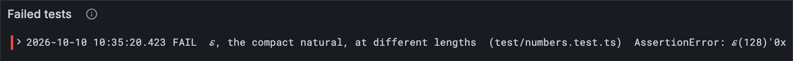

# Compact naturals

Fixed widths are wasteful: writing the number 3 in eight bytes is seven bytes of nothing.
And JAM writes a *lot* of small numbers, because every list carries its length in front.
So the Gray Paper has a second way to write a number, one that shrinks to fit.

## New words

- **Compact natural.** A whole number written in as few bytes as it needs, from one to
  nine, with the first byte saying how many more follow. *Example:* 5 is `0x05`, one
  byte; 128 takes two, `0x8080`.
- **Leading ones.** The one-bits at the very start of a byte, before its first zero.
  *Example:* `110xxxxx` has two leading ones: two more bytes follow.
- **Off-by-one.** A bug that's wrong by exactly one, usually at the edge of a range.
  *Example:* a loop over ten items that runs eleven times.

All three are in the [glossary](../glossary.md).

## Shrink to fit

The first byte does two jobs. Its first bits say how many more bytes follow, and the rest
of its bits carry the start of the number.

**Below 128: one byte.** The first bit is 0: no more bytes follow. That leaves 7 bits for
x, enough for 0 to 127.

Why 127? A byte's eight bits are worth 128, 64, 32, 16, 8, 4, 2 and 1, left to right, as
in [lesson 1.1](../01-bytes-and-numbers/01-bytes-and-hex.md#hex), and the number is the sum of the places holding a 1. `01111111` has a 1 in every place but the
first: 64 + 32 + 16 + 8 + 4 + 2 + 1 = 127. Add 1 and every 1 carries, as 999 + 1 does in
decimal: `10000000`, 128. So seven bits reach 127 and no further, and 128 is the first
number that needs the eighth. Click the bits to try it:

<BitPlaces />

**128 to 16,383: two bytes.** 128 needs 8 bits, one too many. So the first byte starts
`10`: one more byte follows. That leaves 6 bits in the first byte and 8 in the second, 14
in all. Write x in 14 bits, put its top 6 after the `10`, and its low 8 in the second
byte.

The 14 places go on doubling past 128: 256, 512, up to 8,192, so the most they hold is
16,383, one less than 16,384 (2^14), as 127 is one less than 128. Click x's bits and watch
its two bytes:

<TwoBytes />

> [!NOTE]
> **A leading 0, or all 8 bits?** It depends on what the byte is, not on its value.
>
> - **A byte that is just a byte uses all 8 bits: 0 to 255.** Every byte of a hash (ℍ,
>   [lesson 1.1](../01-bytes-and-numbers/01-bytes-and-hex.md)), every byte of a
>   fixed-width number such as a block's timeslot (ℰ₄, [lesson
>   2.1](./01-fixed-width-integers.md)), and every byte after a compact natural's first:
>   300's second byte is `0x2c`, and 16,383's is `0xff`, all eight bits x's own.
> - **The first byte of a compact natural gives its first bits to the marker.** One byte
>   alone starts with the 0 that says "no more follow", so it holds only 0 to 127. In JAM
>   every list carries its length as a compact natural: a list of 127 items costs one byte
>   of length, `0x7f`, and a list of 128 costs two, `0x8080`.
>
> The byte `0xff` is 255 in a hash, but as a compact natural's first byte it means "eight
> more bytes follow". Nothing in the byte says which: the Gray Paper's types say what comes
> where, and the decoder reads in that order.

In the picture, each small square is one bit, a 0 or a 1, and each thick box is one byte
of eight bits. The top row of each pair is x itself: a number, written as one unbroken
strip of bits, not yet bytes. The bottom row is ℰ(x), the bytes that go on the wire. The
shading shows where each group of x's bits ends up.


128's two bytes are both `0x80`, but only by coincidence. The first is the marker `10`
with 128's top bits after it, which are all zero. The second is 128's low 8 bits. 300 has
a top bit set, so its two bytes differ: `0x812c`.

**Bigger numbers.** Each extra byte brings 8 more bits for x but costs one more 1 at the
start of the first byte, so each length holds 7 bits more than the last:

| x is below | bytes | first byte | bits for x |
| --- | --- | --- | --- |
| 2^7 | 1 | `0xxxxxxx` | 7 |
| 2^14 | 2 | `10xxxxxx` | 6 + 8 = 14 |
| 2^21 | 3 | `110xxxxx` | 5 + 16 = 21 |
| ... | ... | ... | ... |
| 2^56 | 8 | `11111110` | 0 + 56 = 56 |
| 2^64 | 9 | `11111111` | 0 + 64 = 64 |

When two or more bytes follow, they're little-endian, lowest first, as in [lesson
2.1](./01-fixed-width-integers.md): 16,384 is `c0 00 40`. The last row breaks the
pattern: eight ones and no zero, then all of x in eight bytes.

Try any x. Step from 127 to 128 and a second byte appears; from 16,383 to 16,384, a
third. The colours are the picture's: the marker, x's top bits, its low bits.

<CompactNatural />

A decoder reads the first byte, counts its *leading ones*, and knows exactly how many
bytes to read. Anything below 128 fits in one byte, so a short list costs one byte of
length.

> [!NOTE]
> If you know UTF-8, this is a cousin of its trick, but count with care. In UTF-8 the
> leading ones count the first byte too, so `110xxxxx` means two bytes in all. Here it
> means two *more*: three in all.

## What the Gray Paper says

Appendix C defines ℰ without a subscript, for any natural below 2^64, in one to nine
bytes. Here is the table above, in the Gray Paper's words:

$$
\mathcal{E} \colon \left\{
\begin{aligned}
\mathbb{N}_{2^{64}} &\to \mathbb{B}_{1:9} \\
x &\mapsto \begin{cases}
[0] & \text{if } x = 0 \\
\left[2^8 - 2^{8-l} + \left\lfloor \frac{x}{2^{8l}} \right\rfloor\right] \frown \mathcal{E}_l\left(x \bmod 2^{8l}\right) & \text{if } \exists l \in \mathbb{N}_8 : 2^{7l} \le x < 2^{7(l+1)} \\
[2^8 - 1] \frown \mathcal{E}_8(x) & \text{otherwise if } x < 2^{64}
\end{cases}
\end{aligned}
\right.
$$

| Symbol | Say it | Here |
| --- | --- | --- |
| [$\mathcal{E}$](../symbols.md#encode) | script E | x in 1 to 9 bytes |
| [$\mathbb{N}_{2^{64}}$](../symbols.md#naturals) | N sub 2 to the 64 | any whole number below $2^{64}$ |
| [$\to$](../symbols.md#to) | to | what goes in, to what comes out |
| [$\mathbb{B}_{1:9}$](../symbols.md#blobs) | B sub 1 to 9 | 1 to 9 bytes |
| [$\mapsto$](../symbols.md#maps-to) | maps to | x becomes... |
| [$[\,]$](../symbols.md#sequence) | the sequence | [0] is the one byte 0 |
| [$\lfloor\,\rfloor$](../symbols.md#floor) | floor | round down |
| [$\bmod$](../symbols.md#mod) | mod | the remainder |
| [$\frown$](../symbols.md#concat) | concatenate | followed by |
| [$\mathcal{E}_l$](../symbols.md#encode-fixed) | E sub l | [lesson 2.1](./01-fixed-width-integers.md)'s fixed width: exactly l bytes |
| [$\exists$](../symbols.md#exists) | there exists | there is some l... |
| [$\in$](../symbols.md#in) | in | $l \in \mathbb{N}_8$: l is one of 0 to 7 |

Each case is a row of the table above:

- **x = 0** is the byte 0. It needs a line of its own because the middle case asks for x
  to be at least $2^{7l}$, and for l = 0 that's 1.
- **The middle case** is every row up to eight bytes, in three pieces:
  - $2^8 - 2^{8-l}$ is the marker: l ones, then zeros. For l = 1 it's 256 − 128 = 128,
    `10000000`; for l = 2 it's 256 − 64 = 192, `11000000`.
  - $\lfloor x / 2^{8l} \rfloor$ is x's top bits, added into the zeros after the marker.
  - $\mathcal{E}_l(x \bmod 2^{8l})$ is x's low l bytes, little-endian, from [lesson
    2.1](./01-fixed-width-integers.md).

  Its condition says there is some l from 0 to 7 with x at least $2^{7l}$ and below
  $2^{7(l+1)}$. Exactly one l fits each x: the number of bytes after the first.
- **Otherwise** is the nine-byte row: $2^8 - 1$ is 255, `11111111`, and then all of x
  in eight bytes.

## The tests

One value at each of a few lengths, including our old friend 2^64 − 70 from [lesson 1.2](../01-bytes-and-numbers/02-numbers.md):

**Add to** `test/numbers.test.ts`

```ts
import { toHex } from "../src/bytes.ts";
import { decodeNatural, encodeNatural } from "../src/codec/numbers.ts";

const NATURALS: [bigint, string][] = [
  [0n, "0x00"],
  [127n, "0x7f"],
  [128n, "0x8080"],
  [16384n, "0xc00040"],
  [2n ** 64n - 70n, "0xffbaffffffffffffff"],
];

test("ℰ, the compact natural, at different lengths", () => {
  for (const [x, hex] of NATURALS) {
    const encodedHex: string = toHex(encodeNatural(x));
    assert.equal(encodedHex, hex, `ℰ(${x})`);
    const decoded: { value: bigint; length: number } = decodeNatural(fromHex(hex));
    const expected: { value: bigint; length: number } = { value: x, length: (hex.length - 2) / 2 };
    assert.deepEqual(decoded, expected);
  }
});

test("decodeNatural can start in the middle of the bytes", () => {
  const decoded: { value: bigint; length: number } = decodeNatural(fromHex("0xaa8080"), 1);
  assert.deepEqual(decoded, { value: 128n, length: 2 });
});
```

Check 128 by hand. It's at least 2^7 and below 2^14, so l = 1. The first byte is
2^8 − 2^7 + ⌊128 / 2^8⌋ = 128 + 0 = `0x80`, then ℰ₁(128 mod 256) = `0x80`. Together:
`0x8080`. 300 the same way: 128 + ⌊300 / 256⌋ = 129 = `0x81`, then ℰ₁(300 mod 256) =
ℰ₁(44) = `0x2c`. Together: `0x812c`, the picture's bytes. You just did the Gray Paper's
arithmetic in your head.

The test's two longer rows, the same way:

```text
c0 00 40                    16,384 = 2^14: past 14 bits, so l = 2 bytes follow
c0                            first byte: 2^8 − 2^6 = 192 = c0, plus ⌊16,384 / 2^16⌋ = 0
00 40                         ℰ₂(16,384): 16,384 is 0x4000, little end first
ff ba ff ff ff ff ff ff ff  2^64 − 70: at least 2^56, so the 9-byte form
ff                            first byte: 255, "eight full bytes follow"
ba ff ff ff ff ff ff ff       ℰ₈(x): x is 0xffffffffffffffba, little end first
```

The last test starts reading at offset 1 of `aa 80 80`: it skips `aa` and reads `80 80`,
128, two bytes long.

The tests import two names `numbers.ts` doesn't have yet. Stubs again, so the tests run
and fail on the rule:

**Add to** `src/codec/numbers.ts`

```ts
/** ℰ(x): x below 2^64 in 1 to 9 bytes; the first byte says how many follow. */
export function encodeNatural(x: bigint): Bytes {
  return new Uint8Array(0);
}

/** The natural encoded at bytes[offset], and how many bytes it took. */
export function decodeNatural(bytes: Bytes, offset = 0): { value: bigint; length: number } {
  return { value: 0n, length: 0 };
}
```

**Run, expect it to fail**

```sh
npm test
```

```text
...
ℹ tests 11
ℹ suites 0
ℹ pass 9
ℹ fail 2
...
test at test/numbers.test.ts:31:1
✖ ℰ, the compact natural, at different lengths (0.6ms)
  AssertionError [ERR_ASSERTION]: ℰ(0)

  '0x' !== '0x00'
...
```

Both new tests are red, and the first failure carries a label: `ℰ(0)`, the third argument
to `assert.equal`. The test checks five numbers in a loop, and the label says which one
it was on. Here the very first, 0: the stub gave no bytes at all.

## The code

A compact natural is a first byte glued to the rest, so first a little glue. The Gray
Paper writes joining byte strings as ⌢:

**Add to** `src/bytes.ts`

```ts
/** The parts one after another: the GP's ⌢. */
export function concatBytes(...parts: Bytes[]): Bytes {
  const out = new Uint8Array(parts.reduce((n, p) => n + p.length, 0));
  let at = 0;
  for (const p of parts) {
    out.set(p, at);
    at += p.length;
  }
  return out;
}
```

One array big enough for every part, then each part copied in after the last.

**Replace in** `src/codec/numbers.ts`

```ts
import { concatBytes } from "../bytes.ts";

/** ℰ(x): x below 2^64 in 1 to 9 bytes; the first byte says how many follow. */
export function encodeNatural(x: bigint): Bytes {
  for (let l = 0; l < 8; l++) {
    if (x <= 1n << BigInt(7 * (l + 1))) {
      const top = Number(x >> BigInt(8 * l)); // ⌊x / 2^(8l)⌋
      const rest = x & ((1n << BigInt(8 * l)) - 1n); // x mod 2^(8l)
      return concatBytes(Uint8Array.of(256 - (256 >> l) + top), encodeFixed(rest, l));
    }
  }
  return concatBytes(Uint8Array.of(255), encodeFixed(x, 8));
}

/** The natural encoded at bytes[offset], and how many bytes it took. */
export function decodeNatural(bytes: Bytes, offset = 0): { value: bigint; length: number } {
  const first = bytes[offset];
  let l = 0;
  while (l < 8 && first & (0x80 >> l)) l++; // count the leading one-bits
  const rest = decodeFixed(bytes.subarray(offset + 1, offset + 1 + l));
  if (l === 8) return { value: rest, length: 9 };
  const top = BigInt(first & (0x7f >> l)); // the bits after the l ones and the zero
  return { value: (top << BigInt(8 * l)) | rest, length: l + 1 };
}
```

`encodeNatural` tries l = 0, 1, 2 and so on, and takes the first l where x fits below
2^(7(l+1)). (The smaller ones didn't fit, so x is at least 2^(7l): exactly the Gray
Paper's condition.) `256 - (256 >> l)` is 2^8 − 2^(8−l), the l leading ones. If nothing
up to l = 7 fits, x gets `0xff` and all eight bytes.

`decodeNatural` takes an `offset` because it will soon read from the middle of a block,
and returns the `length` so the caller knows where the next value starts.

**Run, expect it to fail**

```sh
npm test
```

```text
...
test at test/numbers.test.ts:31:1
✖ ℰ, the compact natural, at different lengths (0.8ms)
  AssertionError [ERR_ASSERTION]: ℰ(128)

  '0x80' !== '0x8080'
...
```

## Bug hunt

Red, with all the code in place. (Yes: your third planted bug.) This one hides at the
edge of a range, where bugs like to live. Your tools:

1. **The test output.** One test failed, *ℰ, the compact natural, at different lengths*,
   with `ℰ(128)` and `'0x80' !== '0x8080'`. The label tells you which of the five
   numbers broke. 0 and 127 passed (they come first, and the loop stops at the first
   failure).
2. **The dashboard.** *Tests failed* says 1, and *Test results* has the `FAIL` line, label
   and all.

   
3. **The reasoning.** 128 is 2^7: the very first number too big for one byte. One byte
   holds 7 bits of x after its leading zero, so 0 to 127, and nothing more. Your code
   gave 128 one byte, `0x80`, whose first bit is a one: a decoder would expect another
   byte after it. So the code let 128 in at l = 0. Look at the condition: `x <= ...`,
   "at most 2^7". The Gray Paper says x < 2^(7(l+1)): *strictly* below.

`<=` where `<` was meant: an *off-by-one*, a bug that's wrong by exactly one, right at a
boundary. It's why the test list has 127 and 128 side by side. The fix is one character:

**Replace in** `src/codec/numbers.ts`

```ts
/** ℰ(x): x below 2^64 in 1 to 9 bytes; the first byte says how many follow. */
export function encodeNatural(x: bigint): Bytes {
  for (let l = 0; l < 8; l++) {
    if (x < 1n << BigInt(7 * (l + 1))) {
      const top = Number(x >> BigInt(8 * l)); // ⌊x / 2^(8l)⌋
      const rest = x & ((1n << BigInt(8 * l)) - 1n); // x mod 2^(8l)
      return concatBytes(Uint8Array.of(256 - (256 >> l) + top), encodeFixed(rest, l));
    }
  }
  return concatBytes(Uint8Array.of(255), encodeFixed(x, 8));
}
```

**Run**

```sh
npm test
npm run typecheck
```

```text
...
✔ ℰ, the compact natural, at different lengths (0.6ms)
✔ decodeNatural can start in the middle of the bytes (0.1ms)
...
ℹ tests 11
ℹ suites 0
ℹ pass 11
ℹ fail 0
...
reported 11 tests to Grafana: http://127.0.0.1:3300/d/gray-tutorial?var-client=you&var-run_id=test-1791726350442
...
```

Green. Your client now writes numbers the way JAM likes them: small when small. And when
you write a test for a range, put a value on each side of every edge.

<details>
<summary>lasair: <code>decode_compact</code> (comments trimmed)</summary>

```ocaml
let decode_compact (bs : bytes) (offset : int) : int64 * int =
  let first = Char.code (Bytes.get bs offset) in
  if first = 0 then
    (0L, 1)
  else if first < 0x80 then
    (Int64.of_int first, 1)
  else if first = 0xFF then
    let v = decode_fixed_int bs (offset + 1) 8 in
    (v, 9)
  else
    let rec count_leading_ones byte count =
      if count >= 8 then count
      else if byte land (0x80 lsr count) <> 0 then count_leading_ones byte (count + 1)
      else count
    in
    let l = count_leading_ones first 0 in
    let total_len = l + 1 in
    let high_mask = (1 lsl (8 - l)) - 1 in
    let high_part = Int64.of_int (first land high_mask) in
    let low_part = decode_fixed_int bs (offset + 1) l in
    let shift = l * 8 in
    let value = Int64.logor (Int64.shift_left high_part shift) low_part in
    (value, total_len)
```

Same dance: count the leading ones, mask off the top bits, glue them above the rest. It
returns a pair, `(value, bytes_consumed)`, where yours returns an object.

</details>

## What you have

ℰ both ways: any natural below 2^64 in one to nine bytes, its first byte saying how many
follow, read back from anywhere in a row of bytes. Two encodings, and a JAM structure
mixes them, field after field. [Lesson 2.3](./03-writer-and-reader.md) builds the two
helpers that keep track of where you are in the bytes.

Next: [2.3 Writer and Reader](./03-writer-and-reader.md)
