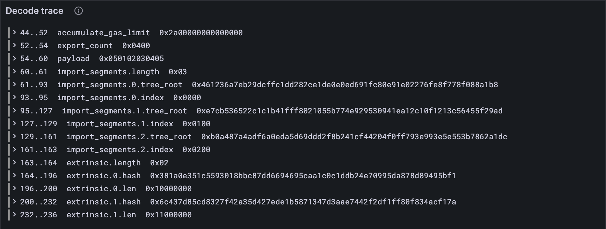

# Watch a decode

In [lesson 2.6](./06-the-first-test-vectors.md) you moved one field and three values went haywire. The test told you
*that* they were wrong. It couldn't tell you *where the bytes went*. Time to give the
decoder a voice: for every field, which bytes it read and where they sit. The trace goes
to your terminal and to Grafana, like everything else your client does.

## New words

- **Decode trace.** A list of every field a decoder read, with where its bytes were.
  (Not a block trace, the recorded run of blocks you'll meet in [lesson 5.1](../05-hashing-and-signatures/01-hashes.md).) *Example:*
  `0..4 service`.
- **Field path.** A field's place inside a value, from the outside in, with dots.
  *Example:* `import_segments.0.index`: the index of the first imported segment.
- **Innermost field.** A field with no fields inside it: a number, a hash, a length.
  *Example:* `service` is one; `import_segments` isn't.

All three are in the [glossary](../glossary.md).

## The idea

A decode trace is a list of the *innermost fields* of a value, in the order they are
read. Each says its path (`import_segments.0.index`), where its bytes start and end, and
the bytes themselves. Lengths count as fields too (`import_segments.length`),
so the trace covers every byte of the encoding exactly once. That's easy to test, and
it's what makes a trace trustworthy: no byte sneaks past unreported.

The Reader does the work. A record names each field as it reads it, a sequence names each
item by its index, and the Reader reports a field when nothing inside it was named.

## What the Reader reports to

The Reader shouldn't depend on the observability stack: it is part of the codec, and the
codec is part of everything. So it reports to anything with an `event` method. A `Run`
([lesson 0.3](../00-start/03-watch-your-client.md)) has one.

**Add to** `src/codec/reader.ts`

```ts
/** What a Reader can report to: anything with an event method, such as a Run (src/obs.ts). */
export interface Trace {
  event(step: string, fields: Record<string, unknown>): void;
}
```

The Reader now takes a trace and has one new method, `field`. Everything else is as in
[lesson 2.3](./03-writer-and-reader.md).

**Replace in** `src/codec/reader.ts`

```ts
export class Reader {
  #bytes: Bytes;
  #at = 0; // where the next read starts
  #trace: Trace | null;
  #path: string[] = []; // the names of the fields being read, outermost first
  #inner = false; // whether the field being read has named fields of its own

  constructor(bytes: Bytes, trace: Trace | null = null) {
    this.#bytes = bytes;
    this.#trace = trace;
  }

  /** The next n bytes. */
  bytes(n: number): Bytes {
    const out = this.#bytes.slice(this.#at, this.#at + n);
    this.#at += n;
    return out;
  }

  /** The inverse of ℰ_l. */
  fixed(l: number): bigint {
    return decodeFixed(this.bytes(l));
  }

  /** The inverse of ℰ. */
  natural(): bigint {
    const { value, length } = decodeNatural(this.#bytes, this.#at);
    this.#at += length;
    return value;
  }

  /**
   * Reads one named part of a value. With a trace, every innermost part is reported: its
   * path (import_segments.0.index), where its bytes start and end, and the bytes.
   */
  field<T>(name: string, read: () => T): T {
    const from = this.#at;
    this.#path.push(name);
    this.#inner = false;
    const value = read();
    if (this.#trace && !this.#inner) {
      const bytes = this.#bytes.subarray(from, this.#at);
      this.#trace.event("decode", { field: this.#path.join("."), from, to: this.#at, bytes });
    }
    this.#path.pop();
    this.#inner = true; // tell the enclosing field it had a named field inside
    return value;
  }
}
```

`#inner` is how the Reader knows a field is innermost. Starting a field sets it to
`false`; finishing one sets it to `true`, which is what the *enclosing* field sees when
its own `read` returns. A field that named nothing inside it still sees `false`, and is
reported.

## Naming the fields

`decode` passes the trace on, and the composite codecs name what they read. Only the
`decode` lines change in each of these.

**Replace in** `src/codec/codec.ts`

```ts
import type { Trace } from "./reader.ts";

/** The value these bytes encode. A trace gets every field. */
export function decode<T>(codec: Codec<T>, bytes: Bytes, trace: Trace | null = null): T {
  return codec.decode(new Reader(bytes, trace));
}

/** ↕[...]: a sequence of any length, its length first. */
export function seq<T>(item: Codec<T>): Codec<T[]> {
  return {
    encode: (w, items) => {
      w.natural(BigInt(items.length));
      for (const x of items) item.encode(w, x);
    },
    decode: (r) => {
      const n = r.field("length", () => Number(r.natural()));
      return Array.from({ length: n }, (_, i) => r.field(String(i), () => item.decode(r)));
    },
    fromJson: (json) => (json as unknown[]).map((j) => item.fromJson(j)),
  };
}

/** A tuple with named fields, encoded field after field in the order they are written. */
export function record<F extends Fields>(fields: F): Codec<{ [K in keyof F]: Value<F[K]> }> {
  type T = { [K in keyof F]: Value<F[K]> };
  const names = Object.keys(fields) as (keyof F & string)[];
  return {
    encode: (w, value) => {
      for (const name of names) fields[name].encode(w, value[name]);
    },
    decode: (r) => {
      const value: Partial<T> = {};
      for (const name of names) value[name] = r.field(name, () => fields[name].decode(r));
      return value as T;
    },
    fromJson: (json) => {
      const object = json as Record<string, unknown>;
      const value: Partial<T> = {};
      for (const name of names) value[name] = fields[name].fromJson(object[name]);
      return value as T;
    },
  };
}
```

A sequence names its length `length` and its items `0`, `1`, `2`.

## The tests

The second test is the promise that matters: the trace covers every byte, once, in
order. Glue the bytes of every reported field back together and you get the whole
encoding.

**New file** `test/trace.test.ts`

```ts
import { test } from "node:test";
import assert from "node:assert/strict";
import type { Bytes } from "../src/bytes.ts";
import { concatBytes } from "../src/bytes.ts";
import { decode } from "../src/codec/codec.ts";
import { WorkItem } from "../src/work.ts";
import { vectorBytes } from "./vectors.ts";

type Field = { field: string; from: number; to: number; bytes: Bytes };

function traced(bytes: Bytes): Field[] {
  const fields: Field[] = [];
  decode(WorkItem, bytes, { event: (_step, f) => fields.push(f as Field) });
  return fields;
}

test("a decode trace names every innermost field, with where its bytes are", () => {
  const fields: Field[] = traced(vectorBytes("codec/tiny/work_item.bin"));
  const first: Field = fields[0];
  const service: Field = { field: "service", from: 0, to: 4, bytes: Uint8Array.of(4, 3, 2, 1) };
  assert.deepEqual(first, service);
  const names: string[] = fields.map((f) => f.field);
  for (const name of ["code_hash", "payload", "import_segments.length", "extrinsic.1.len"]) {
    const named: boolean = names.includes(name);
    assert.ok(named, name);
  }
});

test("the trace covers every byte, once, in order", () => {
  const bytes: Bytes = vectorBytes("codec/tiny/work_item.bin");
  const fields: Field[] = traced(bytes);
  for (let i = 1; i < fields.length; i++) {
    const from: number = fields[i].from;
    const previousTo: number = fields[i - 1].to;
    assert.equal(from, previousTo);
  }
  const joined: Bytes = concatBytes(...fields.map((f) => f.bytes));
  assert.deepEqual(joined, bytes);
});
```

The tests pass a plain object with an `event` method as the trace and collect what it's
handed. That's all a `Trace` is: something that listens.

**Run**

```sh
npm test
npm run typecheck
```

```text
...
✔ a decode trace names every innermost field, with where its bytes are (1.3ms)
✔ the trace covers every byte, once, in order (0.3ms)
...
ℹ tests 23
ℹ suites 0
ℹ pass 23
ℹ fail 0
...
reported 23 tests to Grafana: http://127.0.0.1:3300/d/the-gray-tutor?var-client=you&var-run_id=test-1791726654909
...
```

## Bytes in events

One snag before the program: `JSON.stringify` has never heard of bytes. Hand it a
`Uint8Array` and you get `{"0":4,"1":3,"2":2,"3":1}`, which is accurate and completely
useless. Teach `line` to write bytes the way the test vectors do:

**Replace in** `src/obs.ts`

```ts
import { toHex } from "./bytes.ts";

/** An event as Loki stores it: one line of JSON, with bytes written as 0x hex. */
function line(step: string, fields: Record<string, unknown>): string {
  return JSON.stringify({ step, ...fields }, (_key, value) =>
    value instanceof Uint8Array ? toHex(value) : value,
  );
}
```

The second argument to `JSON.stringify` is a *replacer*: it sees every value on the way
out and may swap it for another. Bytes become hex; everything else passes through.

## A program to watch any decode

**New file** `bin/decode.ts`

```ts
// Decodes a structure's bytes and shows, field by field, which bytes became what.
// Usage: node bin/decode.ts <structure> <file.bin>, e.g.
//        node bin/decode.ts work_item ../vectors/codec/tiny/work_item.bin

import { readFileSync } from "node:fs";
import { toHex } from "../src/bytes.ts";
import type { Codec } from "../src/codec/codec.ts";
import { decode } from "../src/codec/codec.ts";
import { Run } from "../src/obs.ts";
import { RefineContext, WorkItem } from "../src/work.ts";

/** The structures this program knows, by the test vectors' names for them. */
const CODECS: Record<string, Codec<unknown>> = {
  refine_context: RefineContext,
  work_item: WorkItem,
};

const [name, file] = process.argv.slice(2);
const codec = CODECS[name];
if (!codec || !file) {
  throw new Error(`usage: node bin/decode.ts <${Object.keys(CODECS).join("|")}> <file.bin>`);
}

const bytes = new Uint8Array(readFileSync(file));
const run = new Run("decode");
run.event("input", { structure: name, file, length: bytes.length });
decode(codec, bytes, {
  event(step, fields) {
    run.event(step, fields);
    const { field, from, to } = fields as { field: string; from: number; to: number };
    const where = `${String(from).padStart(5)}..${String(to).padEnd(5)}`;
    console.log(`${where} ${field.padEnd(30)} ${toHex(bytes.subarray(from, to))}`);
  },
});
const link = await run.report();
if (link) console.log(`reported to Grafana: ${link}`);
```

**Run**

```sh
node bin/decode.ts work_item ../vectors/codec/tiny/work_item.bin
```

```text
    0..4     service                        0x04030201
    4..36    code_hash                      0x70a50829851e8f6a8c80f92806ae0e95eb7c06ad064e311cc39107b3219e532e
   36..44    refine_gas_limit               0x2a00000000000000
   44..52    accumulate_gas_limit           0x2a00000000000000
   52..54    export_count                   0x0400
   54..60    payload                        0x050102030405
   60..61    import_segments.length         0x03
   61..93    import_segments.0.tree_root    0x461236a7eb29dcffc1dd282ce1de0e0ed691fc80e91e02276fe8f778f088a1b8
   93..95    import_segments.0.index        0x0000
   95..127   import_segments.1.tree_root    0xe7cb536522c1c1b41fff8021055b774e929530941ea12c10f1213c56455f29ad
  127..129   import_segments.1.index        0x0100
  129..161   import_segments.2.tree_root    0xb0a487a4adf6a0eda5d69ddd2f8b241cf44204f0ff793e993e5e553b7862a1dc
  161..163   import_segments.2.index        0x0200
  163..164   extrinsic.length               0x02
  164..196   extrinsic.0.hash               0x381a0e351c5593018bbc87dd6694695caa1c0c1ddb24e70995da878d89495bf1
  196..200   extrinsic.0.len                0x10000000
  200..232   extrinsic.1.hash               0x6c437d85cd8327f42a35d427ede1b5871347d3aae7442f2df1ff80f834acf17a
  232..236   extrinsic.1.len                0x11000000
reported to Grafana: http://127.0.0.1:3300/d/the-gray-tutor?var-client=you&var-run_id=decode-1791726655368
```

Read the output against the hex dump from [lesson 2.6](./06-the-first-test-vectors.md): `service` is bytes 0 to 4, then
`code_hash` 4 to 36, `refine_gas_limit` 36 to 44. On the **1 · Basics** dashboard,
*Decode trace* shows the same list for the run.



## Break it again

Now move `export_count` above the gas limits in `WorkItem` again, as in [lesson 2.6](./06-the-first-test-vectors.md), and
rerun `bin/decode.ts`:

```text
    0..4     service                        0x04030201
    4..36    code_hash                      0x70a50829851e8f6a8c80f92806ae0e95eb7c06ad064e311cc39107b3219e532e
   36..38    export_count                   0x2a00
   38..46    refine_gas_limit               0x0000000000002a00
   46..54    accumulate_gas_limit           0x0000000000000400
   54..60    payload                        0x050102030405
```

The trace shows exactly what happened: `export_count` read bytes 36 to 38, `2a00`, the
first two bytes of the refine gas limit, and both gas limits then started two bytes
late. `payload` starts at 54 either way, which is why everything after
it still decoded correctly. Put `export_count` back afterwards.

This is how you'll debug every failing vector from here on: don't just stare at what
your client got wrong, watch what it *read*.

<details>
<summary>lasair: <code>Trace_runner</code></summary>

lasair grew its own trace after the fact: when a block import's state root is wrong, its
trace runner prints which state keys differ and the first differing byte, as in the
banked fuzzer sessions:

```text
  FAIL: Post-state root verification failed
  Diff: added=0, removed=0, modified=1
  Modified key: 0x0d (expected 526 bytes, got 526 bytes)
    First diff at byte 349: expected 0x1c, got 0x1e
```

That says *where* the result is wrong, after the whole import. A decode trace, and the
step traces of later parts, say *which step* made it wrong, while it happens.

</details>

## What you have

A codec that can tell you, byte by byte, what it read, and a program that shows any
decode in the terminal and in Grafana. The codec is all but done ([lesson 4.5](../04-blocks/05-maybe-and-exactly-n.md) adds two last
shapes). [Part 3](../03-work-and-reports/index.md) uses it on the
paperwork JAM's work travels in: work-packages, their results, and the reports that
bind them.

Next: [Part 3 · Work and reports](../03-work-and-reports/index.md)
