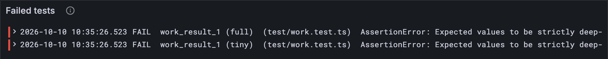

# Work digests

A core has crunched a work item. What does it send back? Not the whole computation:
a *work digest*, a small summary card that says which service it was for, how it went,
and how hard the core had to work. Every validator will read these cards, so they are
kept small.

There's one genuinely new idea here: a value that is *either* one thing *or* another.

## New words

- **Work digest.** One work item's result card: which service, how it went, how hard the
  core worked. The vectors still call it a *work result*. *Example:* `work_result_1`, a
  digest whose item panicked.
- **Union type.** A TypeScript type that is one shape *or* another. *Example:*
  `{ ok: Bytes } | { error: WorkError }`.
- **Tag.** A number in front of an encoded value that says which case follows.
  *Example:* tag 0 is "here comes the output", tag 2 is "it panicked".
- **Refine and accumulate.** A work-item's two stages. *Refine* runs the service's code on
  a core, off the chain, and gets a result; *accumulate*, later and on the chain, folds
  that result into the service's state ([Part 16](../16-host-calls/index.md)). *Example:* refine sums some
  numbers, and accumulate adds the sum to a total the service keeps.

All four are in the [glossary](../glossary.md).

## What the Gray Paper says

§11 (*Work Digest*) defines a digest as ten things:

- the **service** it is for, that service's **code hash**, and the hash of the item's
  **payload**;
- the **gas limit** for accumulating it later (the vectors call it `accumulate_gas`);
- the **result**: the output bytes if refine succeeded, or one of six errors if not:
  out of gas, panic, bad exports, oversize, bad code (BAD) and code too big (BIG);
- the **load**: gas used, segments imported, extrinsics read and their total size, and
  segments exported.

Appendix C encodes the result with its own function, O: a successful result is the tag 0
and then the output as a blob; a failure is just its tag, 1 to 6. The five load numbers
are compact naturals. (The Gray Paper's own comment on why: "space is at a premium here".)

One naming wrinkle: the test vectors call digests `work_result`, the name the Gray Paper
used before it renamed them.

## Either this or that

TypeScript has the perfect tool for "either output or an error": a union of two object
shapes. A result is `{ ok: Bytes }` or `{ error: WorkError }`, and `"ok" in result` tells
you which one you're holding. After that check TypeScript *knows*, so `result.ok` only
compiles where it's safe.

## The tests

**Add to** `test/work.test.ts`

```ts
import assert from "node:assert/strict";
import { fromHex, toHex } from "../src/bytes.ts";
import { encode } from "../src/codec/codec.ts";
import { WorkDigest, WorkResult } from "../src/work.ts";

test("a result is tag 0 and the output, or just an error's tag", () => {
  assert.equal(toHex(encode(WorkResult, { ok: fromHex("0xaabbcc") })), "0x0003aabbcc");
  assert.equal(toHex(encode(WorkResult, { error: "out_of_gas" })), "0x01");
  assert.equal(toHex(encode(WorkResult, { error: "panic" })), "0x02");
});

for (const spec of ["tiny", "full"]) {
  const dir = `codec/${spec}`;
  test(`work_result_0 (${spec})`, () => checkCodecVector(WorkDigest, `${dir}/work_result_0`));
  test(`work_result_1 (${spec})`, () => checkCodecVector(WorkDigest, `${dir}/work_result_1`));
}
```

`0x00 03 aabbcc`: tag 0, length 3, the three output bytes. A panic is the single byte
`0x02`. The two vectors are one of each: `work_result_0` succeeded, `work_result_1`
panicked.

**Run, expect it to fail**

```sh
npm test
```

```text
...
SyntaxError: The requested module '../src/work.ts' does not provide an export named 'WorkDigest'
...
✖ test/work.test.ts (171.3ms)
...
ℹ tests 20
ℹ suites 0
ℹ pass 19
ℹ fail 1
...
```

Red: `src/work.ts` doesn't export `WorkDigest` yet, nor the codecs that go with it.

## The code

**Add to** `src/work.ts`

```ts
import type { Bytes } from "./bytes.ts";
import { fromHex } from "./bytes.ts";
import type { Codec } from "./codec/codec.ts";
import { natural, natural32 } from "./codec/codec.ts";

/** The six ways refine can fail, in tag order 1 to 6 (GP §11 and Appendix C, O). */
const ERRORS = [
  "out_of_gas", "panic", "bad_exports", "output_oversize", "bad_code", "code_oversize",
] as const;
export type WorkError = (typeof ERRORS)[number];

/** What refine produced: its output, or why there is none. */
export type WorkResult = { ok: Bytes } | { error: WorkError };

/** O(result): tag 0 and the output as a blob, or just the error's tag. */
export const WorkResult: Codec<WorkResult> = {
  encode: (w, result) => {
    if ("ok" in result) {
      w.natural(0n);
      blob.encode(w, result.ok);
    } else {
      w.natural(BigInt(ERRORS.indexOf(result.error) + 1));
    }
  },
  decode: (r) => {
    const tag = Number(r.natural());
    return tag === 0 ? { ok: blob.decode(r) } : { error: ERRORS[tag] };
  },
  fromJson: (json) => {
    const [name, value] = Object.entries(json as object)[0];
    return name === "ok" ? { ok: fromHex(value as string) } : { error: name as WorkError };
  },
};

/** How hard refine worked: gas used, segments imported and exported, extrinsics read. */
export const RefineLoad = record({
  gas_used: natural,
  imports: natural32,
  extrinsic_count: natural32,
  extrinsic_size: natural32,
  exports: natural32,
});
export type RefineLoad = Value<typeof RefineLoad>;

/** A work digest (GP §11): one work item's result, as a work-report carries it. */
export const WorkDigest = record({
  service_id: u32,
  code_hash: hash,
  payload_hash: hash,
  accumulate_gas: u64, // the gas this result may use when it is accumulated
  result: WorkResult,
  refine_load: RefineLoad,
});
export type WorkDigest = Value<typeof WorkDigest>;
```

The tour:

- `ERRORS` lists the failures in tag order, so a tag is just a position in the list (plus
  one, because 0 means success). `as const` tells TypeScript the list will never change,
  which lets `WorkError` be exactly those six names and nothing else.
- `WorkResult` is a hand-made codec, the first since [lesson 2.4](../02-codec/04-codecs.md). A union doesn't fit
  `record` or `seq`, so it gets written out: on the way in, check which shape you hold; on
  the way out, read the tag and build the right shape.
- In the vectors' JSON a result is `{"ok": "0xaabbcc"}` or `{"panic": null}`: one key,
  named after the case. `Object.entries(...)[0]` grabs that key and its value.
- `RefineLoad` is a record inside the digest, matching the JSON's `refine_load` object. On
  the wire there's no nesting, just five compact numbers in a row, and a nested record
  encodes to exactly that.

**Run, expect it to fail**

```sh
npm test
```

```text
...
test at test/work.test.ts:27:3
✖ work_result_1 (tiny) (1.5ms)
  AssertionError [ERR_ASSERTION]: Expected values to be strictly deep-equal:
  + actual - expected
  ... Skipped lines

    {
      accumulate_gas: 33n,
      code_hash: Uint8Array(32) [
        252,
        252,
  ...
      result: {
  +     error: 'bad_exports'
  -     error: 'panic'
      },
      service_id: 84281096
    }

      at checkCodecVector (…/client/test/vectors.ts:26:10)
      at TestContext.<anonymous> (…/client/test/work.test.ts:27:41)
...
```

## Bug hunt

Red, and your own new test passed. (Your fourth planted bug, and a new kind: a codec
whose two directions disagree.) Here's the trail:

1. **The test output.** *a result is tag 0 and the output, or just an error's tag* passed.
   So did `work_result_0`, the successful digest. Only `work_result_1` failed, tiny and
   full, and its diff points at one line:

   ```text
   result: {
   +     error: 'bad_exports'
   -     error: 'panic'
   ```

   `+` is what your code produced, `-` what the vector expected. Your client read a panic
   as "bad exports".
2. **The dashboard.** *Tests failed* says 2, and *Test results* has the two `FAIL` lines,
   both `work_result_1`.

   
3. **The reasoning.** Your encode test proved a panic *writes* as `0x02`, and the vector's
   bytes say `02` too. So the bytes are right and the *reading* is wrong. `decode` turns
   tag 2 into `ERRORS[2]`, the third name in the list: `"bad_exports"`. But tags start at
   1 (0 means success), and list positions start at 0. Encoding remembered the `+ 1`;
   decoding forgot the `- 1`.

That's why the vectors check both directions: decode the bytes into the value, *and*
encode the value back into the bytes. A test of one direction can't catch the other.
The fix:

**Replace in** `src/work.ts`

```ts
/** O(result): tag 0 and the output as a blob, or just the error's tag. */
export const WorkResult: Codec<WorkResult> = {
  encode: (w, result) => {
    if ("ok" in result) {
      w.natural(0n);
      blob.encode(w, result.ok);
    } else {
      w.natural(BigInt(ERRORS.indexOf(result.error) + 1));
    }
  },
  decode: (r) => {
    const tag = Number(r.natural());
    return tag === 0 ? { ok: blob.decode(r) } : { error: ERRORS[tag - 1] };
  },
  fromJson: (json) => {
    const [name, value] = Object.entries(json as object)[0];
    return name === "ok" ? { ok: fromHex(value as string) } : { error: name as WorkError };
  },
};
```

**Run**

```sh
npm test
npm run typecheck
```

```text
...
✔ work_result_0 (tiny) (0.2ms)
✔ work_result_1 (tiny) (0.2ms)
✔ work_result_0 (full) (0.2ms)
✔ work_result_1 (full) (0.1ms)
...
ℹ tests 30
ℹ suites 0
ℹ pass 30
ℹ fail 0
...
reported 30 tests to Grafana: http://127.0.0.1:3300/d/gray-tutorial?var-client=you&var-run_id=test-1791727155485
...
```

## Watch it

**Replace in** `bin/decode.ts`

```ts
import { WorkDigest } from "../src/work.ts";

/** The structures this program knows, by the test vectors' names for them. */
const CODECS: Record<string, Codec<unknown>> = {
  refine_context: RefineContext,
  work_item: WorkItem,
  work_package: WorkPackage,
  work_result: WorkDigest,
};
```

**Run**

```sh
node bin/decode.ts work_result ../vectors/codec/tiny/work_result_1.bin
```

```text
    0..4     service_id                     0x08070605
    4..36    code_hash                      0xfcfc857dab216daf41f409c2012685846e4d34aedfeacaf84d9adfebda73fae6
   36..68    payload_hash                   0xd55e07438aeeeb0d6509ab28af8a758d1fb70424db6b27c7e1ef6473e721c328
   68..76    accumulate_gas                 0x2100000000000000
   76..77    result                         0x02
   77..78    refine_load.gas_used           0x00
   78..79    refine_load.imports            0x00
   79..80    refine_load.extrinsic_count    0x00
   80..81    refine_load.extrinsic_size     0x00
   81..82    refine_load.exports            0x00
reported to Grafana: http://127.0.0.1:3300/d/gray-tutorial?var-client=you&var-run_id=decode-1791727155961
```

There it is, the whole sad story of `work_result_1` in one byte: `result 0x02`, a panic.
Then five compact zeros for the load, one byte each. Small numbers, small bytes: [lesson
2.2](../02-codec/02-compact-naturals.md) paying off.

<details>
<summary>lasair: a variant and a <code>match</code>, in <code>lib/serialization.ml</code></summary>

OCaml has either-or values built in. A *variant* type lists its cases, and `match`
handles each one:

```ocaml
type work_result =
  | ResultOk of bytes
  | ResultOOG        (* Out of gas / ∞ *)
  | ResultPanic
  | ResultBadExports
  | ResultOversize
  | ResultBAD
  | ResultBIG

let encode_work_result (r : work_result) : bytes =
  match r with
  | ResultOk data ->
    let inner = encode_var data in
    let result = Bytes.create (1 + Bytes.length inner) in
    Bytes.set result 0 '\x00';
    Bytes.blit inner 0 result 1 (Bytes.length inner);
    result
  | ResultOOG -> Bytes.make 1 '\x01'
  | ResultPanic -> Bytes.make 1 '\x02'
  | ResultBadExports -> Bytes.make 1 '\x03'
  | ResultOversize -> Bytes.make 1 '\x04'
  | ResultBAD -> Bytes.make 1 '\x05'
  | ResultBIG -> Bytes.make 1 '\x06'
```

Seven cases, seven tags: the same O function as yours, with the tags written out one by
one where yours count along the `ERRORS` list.

</details>

## What you have

The summary card a core sends back for every work item, including the first value in
your client that can be one thing *or* another. The chain doesn't take a core's results
on its word: [lesson 3.3](./03-a-work-report.md) wraps them in the work-report that
guarantors sign.

Next: [3.3 A work-report](./03-a-work-report.md)
