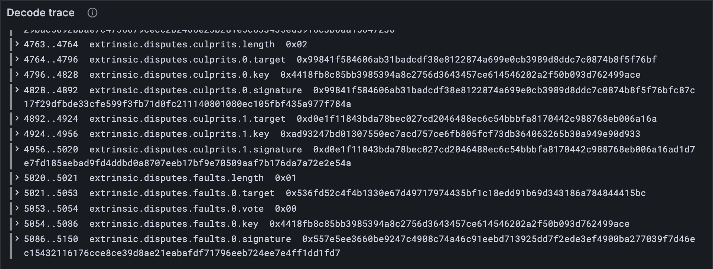

# The block

Drumroll. You have a header (4.6) and all five parts of an extrinsic (4.1 to 4.4). A
block is just the two together. This lesson is short on purpose: after everything you've
built, the whole block is two little records, and then your client reads real JAM blocks.

## New words

- **Block.** A header plus an extrinsic: everything the chain adds in one slot.
  *Example:* `block.bin` in the codec vectors.

It's in the [glossary](../glossary.md).

## What the Gray Paper says

§4 says a block B is a header H and an extrinsic E, and the extrinsic is its five parts.
Appendix C writes the block as the header, then the five parts in its own order: tickets,
preimages, guarantees, assurances, disputes ([lesson 4.1](./01-tickets-and-preimages.md) had the table). Nothing in
between, no lengths around the parts beyond their own.

## The tests

**Add to** `test/block.test.ts`

```ts
import { Block, Extrinsic } from "../src/block.ts";

testCodecVector("extrinsic", Extrinsic);
testCodecVector("block", Block);
```

**Run, expect it to fail**

```sh
npm test
```

```text
...
SyntaxError: The requested module '../src/block.ts' does not provide an export named 'Block'
...
✖ test/block.test.ts (124.5ms)
...
ℹ tests 35
ℹ suites 0
ℹ pass 34
ℹ fail 1
...
```

Red: `src/block.ts` doesn't export `Block` yet.

## The code

**Add to** `src/block.ts`

```ts
/** A block's extrinsic (GP §4): the five parts, in Appendix C's order. */
export function Extrinsic(config: Config) {
  return record({
    tickets: TicketsExtrinsic,
    preimages: PreimagesExtrinsic,
    guarantees: GuaranteesExtrinsic,
    assurances: AssurancesExtrinsic(config),
    disputes: DisputesExtrinsic,
  });
}
export type Extrinsic = Value<ReturnType<typeof Extrinsic>>;

/** A block (GP §4): a header and an extrinsic. */
export function Block(config: Config) {
  return record({
    header: Header(config),
    extrinsic: Extrinsic(config),
  });
}
export type Block = Value<ReturnType<typeof Block>>;
```

That's the whole thing. Both are functions of the config because two of their bricks
are: the assurances' bitfield (4.2) and the header's tickets mark (4.6).

**Run**

```sh
npm test
npm run typecheck
```

```text
...
✔ block (tiny) (0.8ms)
✔ block (full) (7.4ms)
...
ℹ tests 52
ℹ suites 0
ℹ pass 52
ℹ fail 0
...
reported 52 tests to Grafana: http://127.0.0.1:3300/d/gray-tutorial?var-client=you&var-run_id=test-1791728275436
...
```

`block (tiny)` and `block (full)`: your client decodes complete JAM blocks, byte for
byte, at both sizes. Take a moment. That's every structure a block can carry.

## Watch a whole block

**Replace in** `bin/decode.ts`

```ts
import { Block, Extrinsic } from "../src/block.ts";

/** The structures this program knows, by the test vectors' names; some depend on the size. */
const CODECS = (config: Config): Record<string, Codec<unknown>> => ({
  refine_context: RefineContext,
  work_item: WorkItem,
  work_package: WorkPackage,
  work_result: WorkDigest,
  work_report: WorkReport,
  tickets_extrinsic: TicketsExtrinsic,
  preimages_extrinsic: PreimagesExtrinsic,
  assurances_extrinsic: AssurancesExtrinsic(config),
  guarantees_extrinsic: GuaranteesExtrinsic,
  disputes_extrinsic: DisputesExtrinsic,
  header: Header(config),
  extrinsic: Extrinsic(config),
  block: Block(config),
});
```

**Run**

```sh
node bin/decode.ts block ../vectors/codec/tiny/block.bin
```

```text
    0..32    header.parent                  0x5c743dbc514284b2ea57798787c5a155ef9d7ac1e9499ec65910a7a3d65897b7
   32..64    header.parent_state_root       0x2591ebd047489f1006361a4254731466a946174af02fe1d86681d254cfd4a00b
...
 5086..5150  extrinsic.disputes.faults.0.signature 0x557e5ee3660be9247c4908c74a46c91eebd713925dd7f2ede3ef4900ba277039f7d46ec15432116176cce8ce39d8ae21eabafdf71796eeb724ee7e4ff1dd1fd7
reported to Grafana: http://127.0.0.1:3300/d/gray-tutorial?var-client=you&var-run_id=decode-1791728275906
```

145 fields, from `header.parent` at byte 0 to the last fault's signature ending at byte
5,150: every byte of a tiny block, accounted for. Now try the full one,
`../vectors/codec/full/block.bin`: 161,177 bytes, most of them a 1,023-validator epoch
mark and two juries of 683. It scrolls by in a blink, and the whole trace lands in
Grafana's *Decode trace* panel, where you can search it.



<details>
<summary>lasair: <code>decode_block</code>, in <code>conformance/block_codec.ml</code></summary>

```ocaml
let decode_block b off : raw_block * int =
  let (header, off) = decode_header b off in
  let (extrinsic, off) = decode_extrinsic b off in
  ({ rb_header = header; rb_extrinsic = extrinsic }, off)
```

Three lines at the top, sitting on a few hundred lines of hand-written decoders below.
Yours sits on `record`, `seq` and friends: the same block, a lot less code to get wrong.

</details>

## What you have

[Part 4](./index.md), done: your client reads any JAM block, at either size, and can show you every
byte of it. What it can't do yet is check one. A block names its parent by *hash*, and
promises its extrinsic by hash, and is sealed with signatures. [Part 5](../05-hashing-and-signatures/index.md) brings the
cryptography.

Next: [Part 5 · Hashing and signatures](../05-hashing-and-signatures/index.md)
