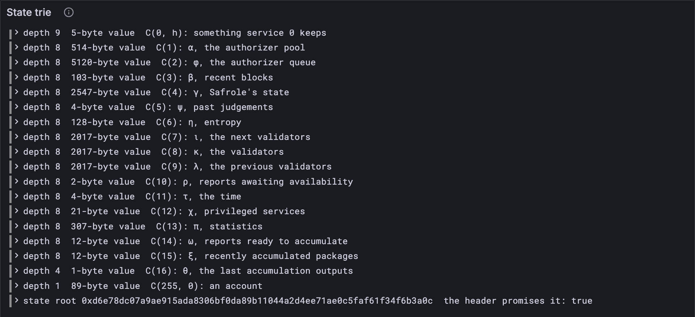

# State keys

Lesson 6.1's keys looked suspiciously *designed*: `0x01` and thirty zeros, `0xff` and
thirty zeros, and then a few that looked like noise. They are designed. Every key in a
JAM state is made by one of three recipes, which the Gray Paper calls C. Learn the
recipes, and you know where to find anything: the validators, the clock, a service's
code.


## New words

- **State key.** The 31-byte key an entry of the state is filed under. *Example:* `0x0b`
  and 30 zeros is the time.
- **State component.** One of the 16 parts of the state, each with a Greek letter.
  *Example:* C(11) is τ, the time.

Both are in the [glossary](../glossary.md).
## What the Gray Paper says

Appendix D. Every key is 31 bytes, made one of three ways:

| Recipe | Where it puts | The 31 bytes |
| --- | --- | --- |
| C(i) | state component i | i, then 30 zeros |
| C(255, s) | service s's account | 255, then ℰ₄(s) with a zero after each byte, then zeros |
| C(s, h) | something service s keeps | ℰ₄(s) woven into H(h): n₀ a₀ n₁ a₁ n₂ a₂ n₃ a₃ a₄ … a₂₆ |

(In the last row, n = ℰ₄(s) and a = H(h): the service's four bytes take turns with the
hash's first four, then 23 more bytes of the hash follow.)

The state has **16 components**, C(1) to C(16), each a Greek letter in the Gray Paper.
Here they are, with their sizes in the state you met in lesson 6.1:

| Key | Letter | What it is | Bytes |
| --- | --- | --- | --- |
| C(1) | α | the authorizer pool | 514 |
| C(2) | ϕ | the authorizer queue | 5,120 |
| C(3) | β | recent blocks | 103 |
| C(4) | γ | Safrole's state: the ticket lottery | 2,547 |
| C(5) | ψ | past judgements, from disputes | 4 |
| C(6) | η | entropy | 128 |
| C(7) | ι | the next validators | 2,017 |
| C(8) | κ | the validators | 2,017 |
| C(9) | λ | the previous validators | 2,017 |
| C(10) | ρ | reports awaiting availability | 2 |
| C(11) | τ | the time | 4 |
| C(12) | χ | privileged services | 21 |
| C(13) | π | statistics | 307 |
| C(14) | ω | reports ready to accumulate | 12 |
| C(15) | ξ | recently accumulated packages | 12 |
| C(16) | θ | the last accumulation outputs | 1 |

You can already read a few of those sizes. τ is 4 bytes: ℰ₄ of a timeslot (lesson 0.4).
η is 128: four 32-byte hashes. The three validator sets are 2,017 each: a length byte,
then six validators of 336 bytes. Reading what's *inside* comes next lesson.

What a service keeps comes in three kinds, and each makes its h differently:

- a **preimage** p: h = ℰ₄(2^32 − 2) ⌢ H(p);
- a **request** for a preimage of hash H(p) and length l: h = ℰ₄(l) ⌢ H(p);
- a **storage** item with key k: h = ℰ₄(2^32 − 1) ⌢ k.

Hashing h makes every key exactly 31 bytes, whatever went in, and the Gray Paper points
out the bonus: a client never needs the original storage key back, only its hash. This
lesson builds preimages and requests. Storage arrives in Part 14, when your client
starts writing it.

## The tests

**New file** `test/state.test.ts`

```ts
import { test } from "node:test";
import assert from "node:assert/strict";
import { toHex } from "../src/bytes.ts";
import { blake2b256 } from "../src/hash.ts";
import { accountKey, componentKey, preimageKey, requestKey } from "../src/state.ts";
import { traceState } from "./vectors.ts";

test("C(i): a component's key is its number, then 30 zero bytes", () => {
  assert.equal(toHex(componentKey(11)), "0x0b" + "00".repeat(30));
});

test("C(255, s): an account's key spreads the service id out, with zeros between", () => {
  assert.equal(toHex(accountKey(0x04030201)), "0xff0100020003000400" + "00".repeat(22));
});

test("every key of a real state, named: 16 components, an account, preimages, requests", () => {
  const { entries } = traceState("fallback", 1);
  const keys = entries.map((e) => toHex(e.key));
  const named = [accountKey(0)];
  for (let i = 1; i <= 16; i++) named.push(componentKey(i));
  for (const { value } of entries) {
    const key = preimageKey(0, value);
    if (!keys.includes(toHex(key))) continue; // not a preimage of service 0
    named.push(key, requestKey(0, blake2b256(value), value.length)); // and its request
  }
  assert.deepEqual(named.map(toHex).sort(), keys.sort());
});
```

The first two pin the byte layouts with small examples: service `0x04030201` has ℰ₄ bytes
`01 02 03 04`, so its account key reads `ff 01 00 02 00 03 00 04 00`, then zeros.

The third names every key of a real state, the one before the first block of the
`fallback` trace. It lists the 16 components and service 0's account. Then, for every
value in the state, it asks: is this value sitting exactly where a preimage of *itself*
would sit? If so, it's a preimage, and its request has to be there too. At the end, the
keys named this way and the keys in the state must be the same 21, no more, no fewer.

**Run, expect it to fail**

```sh
npm test
# fails with: Cannot find module
```

## The code

**New file** `src/state.ts`

```ts
// State keys (GP App. D): where in the state trie each part of the state lives.

import type { Bytes } from "./bytes.ts";
import { concatBytes } from "./bytes.ts";
import { encodeFixed } from "./codec/numbers.ts";
import { blake2b256 } from "./hash.ts";

/** C(i): the key of state component i. The byte i, then 30 zeros. */
export function componentKey(i: number): Bytes {
  const key = new Uint8Array(31);
  key[0] = i;
  return key;
}

/** C(255, s): the key of service s's account. 255, then ℰ₄(s) with a zero after each byte. */
export function accountKey(s: number): Bytes {
  const n = encodeFixed(BigInt(s), 4);
  const key = new Uint8Array(31);
  key[0] = 255;
  for (let i = 0; i < 4; i++) key[1 + 2 * i] = n[i];
  return key;
}

/** C(s, h): the key of something service s keeps. ℰ₄(s) woven into the hash of h. */
export function serviceItemKey(s: number, h: Bytes): Bytes {
  const n = encodeFixed(BigInt(s), 4);
  const a = blake2b256(h);
  const key = new Uint8Array(31);
  for (let i = 0; i < 4; i++) {
    key[2 * i] = n[i]; // the service's bytes at 0, 2, 4, 6
    key[2 * i + 1] = a[i]; // the hash's first four at 1, 3, 5, 7
  }
  key.set(a.subarray(4, 27), 8); // and 23 more of the hash after them
  return key;
}

/** Where service s keeps the preimage p: C(s, ℰ₄(2^32 − 2) ⌢ H(p)). */
export function preimageKey(s: number, p: Bytes): Bytes {
  return serviceItemKey(s, concatBytes(encodeFixed(2n ** 32n - 2n, 4), blake2b256(p)));
}

/** Where service s records its request for the preimage of hash h, l bytes long. */
export function requestKey(s: number, h: Bytes, l: number): Bytes {
  return serviceItemKey(s, concatBytes(encodeFixed(BigInt(l), 4), h));
}
```

`encodeFixed` is ℰ₄ from lesson 2.1, and `2n ** 32n - 2n` is 2^32 − 2 as a `bigint`.
`a.subarray(4, 27)` is a₄ to a₂₆: from index 4 up to, but not including, 27.

**Run**

```sh
npm test
# prints: C(i): a component's key is its number, then 30 zero bytes
# prints: every key of a real state, named: 16 components, an account, preimages, requests
# prints: fail 0
# prints: reported
npm run typecheck
```

All 21 keys, accounted for. Two of the service's entries are preimages (the
159,322-byte one is its code, as lesson 6.1 found), and two are the requests that asked
for them.

## Watch it

`bin/state.ts` learns to read a key back: which recipe made it, and for whom.

**Rewrite** `bin/state.ts`

```ts
// Builds the trie of the state before a trace's block, shows where each entry lands and
// what it is, and checks the root against the one the block's header promises.
// Usage: node bin/state.ts <trace.json>, e.g.
//        node bin/state.ts ../vectors/traces/fallback/00000001.json

import { readFileSync } from "node:fs";
import type { Bytes } from "../src/bytes.ts";
import { fromHex, toHex } from "../src/bytes.ts";
import { decodeFixed } from "../src/codec/numbers.ts";
import { Run } from "../src/obs.ts";
import { stateRoot } from "../src/trie.ts";

/** The state's 16 components, by i in C(i), with their Gray Paper letters (GP App. D). */
const COMPONENTS = [
  "",
  "α, the authorizer pool",
  "ϕ, the authorizer queue",
  "β, recent blocks",
  "γ, Safrole's state",
  "ψ, past judgements",
  "η, entropy",
  "ι, the next validators",
  "κ, the validators",
  "λ, the previous validators",
  "ρ, reports awaiting availability",
  "τ, the time",
  "χ, privileged services",
  "π, statistics",
  "ω, reports ready to accumulate",
  "ξ, recently accumulated packages",
  "θ, the last accumulation outputs",
];

/** A service id from four bytes spread out with gaps, starting at byte `at` of a key. */
function serviceIn(key: Bytes, at: number): bigint {
  return decodeFixed(new Uint8Array([key[at], key[at + 2], key[at + 4], key[at + 6]]));
}

/** What a state key is: C(255, s), C(i) or C(s, h), read back from its bytes. */
function describe(key: Bytes): string {
  const zerosFrom = (i: number) => key.subarray(i).every((b) => b === 0);
  if (key[0] === 255 && zerosFrom(8)) return `C(255, ${serviceIn(key, 1)}): an account`;
  if (zerosFrom(1)) return `C(${key[0]}): ${COMPONENTS[key[0]]}`;
  return `C(${serviceIn(key, 0)}, h): something service ${serviceIn(key, 0)} keeps`;
}

const [file] = process.argv.slice(2);
const trace = JSON.parse(readFileSync(file, "utf8"));
const entries = trace.pre_state.keyvals.map((e: { key: string; value: string }) => ({
  key: fromHex(e.key),
  value: fromHex(e.value),
}));
const run = new Run("state");
const root = stateRoot(entries, {
  event(step, fields) {
    const { depth, key, size } = fields as { depth: number; key: Bytes; size: number };
    const name = describe(key);
    run.event(step, { ...fields, name });
    const where = `depth ${String(depth).padStart(2)}  ${String(size).padStart(6)}-byte value`;
    console.log(`${where}  ${name}`);
  },
});
const promised = trace.block.header.parent_state_root;
const matches = toHex(root) === promised;
console.log(`${entries.length} entries, state root ${toHex(root)}`);
console.log(`the header promises it: ${matches}`);
run.event("root", { root, promised, matches });
const link = await run.report();
if (link) console.log(`reported to Grafana: ${link}`);
```

`describe` runs the recipes backwards. A key that's 255 and then zeros from byte 8 on is
an account, and the service id is in bytes 1, 3, 5 and 7. A key that's zeros from byte 1
on is a component. Anything else is woven, with the service id in bytes 0, 2, 4 and 6.
The account check goes *first* for a reason: service 0's account key is `0xff` and 30
zeros, which also looks like a component 255. There's no component 255, so it's the
account.

**Run**

```sh
node bin/state.ts ../vectors/traces/fallback/00000001.json
# prints: C(8): κ, the validators
# prints: C(255, 0): an account
# prints: the header promises it: true
# prints: reported to Grafana
```

The same 21 leaves as lesson 6.1, now with names. The one alone at depth 1 is service
0's account. The *State trie* panel shows the names too. Then try a state a hundred
blocks on, `../vectors/traces/storage/00000100.json`: 164 entries. The same 16
components, the same account, the same two preimages and requests, and 143 new things
service 0 keeps. That's its storage, filling up block by block.



<details>
<summary>lasair: <code>make_service_key</code>, in <code>lib/state_keys.ml</code></summary>

```ocaml
let make_service_key (service_id : int) : bytes =
  let key = Bytes.make 31 '\x00' in
  Bytes.set_uint8 key 0 Prefix.service_account;
  Bytes.set_uint8 key 1 (service_id land 0xff);
  Bytes.set_uint8 key 3 ((service_id lsr 8) land 0xff);
  Bytes.set_uint8 key 5 ((service_id lsr 16) land 0xff);
  Bytes.set_uint8 key 7 ((service_id lsr 24) land 0xff);
  key
```

C(255, s), byte by byte: `land 0xff` keeps the low byte, `lsr 8` shifts the next one
down. Your `accountKey` lets `encodeFixed` split the bytes and a loop place them. lasair
has the same recipe a second time, as `state_key_from_index_service` in
`lib/merklization.ml`: two copies to keep in step, like its headers in lesson 4.6.

</details>

## What you have

A map of the state: for any key, which part of JAM it holds, and for any part of JAM,
its key.

Next: [6.3 Reading the state](./03-reading-the-state.md)
