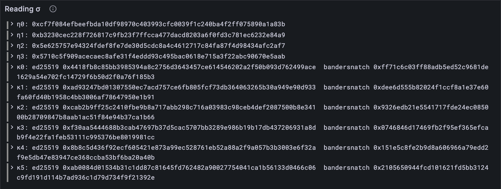

# Reading the state

You know where everything in the state lives (lesson 6.2). Time to open the boxes. Each
value in the state is an *encoding*, so the codecs you built in Part 2 can read it. This
lesson reads three components, the time, the entropy and the validators, and checks each
one against something completely independent: the blocks themselves.


## New words

- **Validator key.** Everything the chain knows about one validator: four keys for four
  jobs, 336 bytes in all. *Example:* its Ed25519 key signs assurances.
- **Bandersnatch key.** The key a validator uses for the ticket lottery and to seal
  blocks (Part 8). *Example:* the first 32 of the 336 bytes.
- **BLS key.** A 144-byte key for signatures that can be combined into one. *Example:*
  bytes 64 to 207 of a validator key.

All three are in the [glossary](../glossary.md).
## What the Gray Paper says

Appendix D's T says what each key's value is. Three of them:

| Key | Value | Codec |
| --- | --- | --- |
| C(11) | τ, the time: ℰ₄ of the slot of the most recent block | `u32` |
| C(6) | η, entropy: four hashes, newest first, no length in front | `seqN(hash, 4)` |
| C(8) | κ, this epoch's validators, with their length in front | `seq(ValidatorKey)` |

A **validator key** (§6) is 336 bytes, four keys for four jobs: Bandersnatch (32 bytes),
Ed25519 (32), BLS (144) and metadata (128). You met the first two in lesson 4.6, where
an epoch mark carries just those. The state keeps all four.

And three facts from elsewhere in the Gray Paper, to check your reading against:

- **τ** (§6): after a block, the time *is* that block's slot. So the time in the state
  before block n is the slot of block n − 1.
- **η** (§6): an epoch mark (lesson 4.6) is η₀, η₁ and the next validators, with η₀ and η₁
  as they stood before its block. So `epoch_mark.entropy` must be the state's η₀, and
  `epoch_mark.tickets_entropy` its η₁.
- **κ** (§11): assurances are signed with the validators' Ed25519 keys (lesson 5.3). So
  the keys in κ must check out against real assurances.

## The tests

The tests need each trace step's block as well as its state, so `traceState` hands it
over too.

**Replace in** `test/vectors.ts`

```ts
/** The state before block n of a tiny trace, the state root its header promises, the block. */
export function traceState(family: string, n: number) {
  const name = `traces/${family}/${String(n).padStart(8, "0")}.json`;
  const trace = vectorJson(name) as {
    pre_state: { keyvals: { key: string; value: string }[] };
    block: { header: { parent_state_root: string } };
  };
  const entries = trace.pre_state.keyvals.map((e) => ({
    key: fromHex(e.key),
    value: fromHex(e.value),
  }));
  return { entries, promised: trace.block.header.parent_state_root, block: trace.block };
}
```

**Add to** `test/state.test.ts`

```ts
import { Block, assuranceSigned } from "../src/block.ts";
import { TINY } from "../src/config.ts";
import { readEntropy, readTime, readValidators } from "../src/state.ts";

test("τ: the time before each block is the slot of the block before it", () => {
  for (let n = 2; n <= 100; n++) {
    const before = Block(TINY).fromJson(traceState("fallback", n - 1).block);
    assert.equal(readTime(traceState("fallback", n).entries), before.header.slot);
  }
});

test("η: each epoch mark carries η₀ and η₁ from the state before its block", () => {
  let marks = 0;
  for (let n = 1; n <= 100; n++) {
    const { entries, block } = traceState("safrole", n);
    const mark = Block(TINY).fromJson(block).header.epoch_mark;
    if (mark === null) continue;
    const entropy = readEntropy(entries);
    assert.deepEqual([mark.entropy, mark.tickets_entropy], [entropy[0], entropy[1]]);
    marks++;
  }
  assert.ok(marks > 0);
});

test("κ: real assurances check out with the validators' keys from the state", () => {
  let checked = 0;
  for (let n = 1; n <= 100; n++) {
    const { entries, block } = traceState("preimages", n);
    const keys = readValidators(entries).map((v) => v.ed25519);
    for (const assurance of Block(TINY).fromJson(block).extrinsic.assurances) {
      assert.ok(assuranceSigned(keys, assurance), `block ${n}`);
      checked++;
    }
  }
  assert.equal(checked, 524);
});
```

Three components, three independent witnesses: 99 headers for τ, the 8 epoch marks of
the `safrole` trace (one every 12 slots, at the start of each tiny epoch) for η, and all
524 assurances of the `preimages` trace for κ. The `assert.ok(marks > 0)` and
`assert.equal(checked, 524)` lines are there so a loop that silently checks nothing
can't pass.

**Run, expect it to fail**

```sh
npm test
# fails with: does not provide an export named
```

## The code

**Add to** `src/state.ts`

```ts
import { toHex } from "./bytes.ts";
import type { Codec, Value } from "./codec/codec.ts";
import { decode, fixedBytes, hash, record, seq, seqN, u32 } from "./codec/codec.ts";
import type { KeyValue } from "./trie.ts";

/** A validator's keys (GP §6): 336 bytes, the four keys it uses for different jobs. */
export const ValidatorKey = record({
  bandersnatch: fixedBytes(32), // for sealing blocks and the ticket lottery
  ed25519: fixedBytes(32), // for signing everything else
  bls: fixedBytes(144), // for BEEFY, which bridges to other chains
  metadata: fixedBytes(128), // where to reach it on the network
});
export type ValidatorKey = Value<typeof ValidatorKey>;

/** State component i, read from the state's entries with its codec. */
function component<T>(entries: KeyValue[], i: number, codec: Codec<T>): T {
  const key = toHex(componentKey(i));
  const entry = entries.find((e) => toHex(e.key) === key);
  if (!entry) throw new Error(`the state has no component ${i}`);
  return decode(codec, entry.value);
}

/** τ, C(11): the time, as the slot of the most recent block. */
export function readTime(entries: KeyValue[]): number {
  return component(entries, 11, u32);
}

/** η, C(6): four 32-byte hashes of fresh randomness, the newest first. */
export function readEntropy(entries: KeyValue[]): Bytes[] {
  return component(entries, 6, seqN(hash, 4));
}

/** κ, C(8): the validators of this epoch. */
export function readValidators(entries: KeyValue[]): ValidatorKey[] {
  return component(entries, 8, seq(ValidatorKey));
}
```

`component` does the work: build the key with C(i), find its entry, decode the value.
The three readers just say which component and which codec. Reading the state is
nothing new: it's Part 2's decoding, pointed at Part 6's keys.

**Run**

```sh
npm test
# prints: τ: the time before each block is the slot of the block before it
# prints: η: each epoch mark carries η₀ and η₁ from the state before its block
# prints: κ: real assurances check out with the validators' keys from the state
# prints: fail 0
# prints: reported
npm run typecheck
```

Look at what the κ test just did: real assurances from real blocks (Part 4), checked
with Ed25519 (Part 5) against keys your client read out of a real state (Part 6) with its
own codecs (Part 2). And lesson 6.1 already proved that state is the one the header
promised. Four parts of the tutorial, in one `assert`.

One honest footnote. The rule says assurances are signed by κ′, the validators *after*
the block, and your test used κ, *before* it. In these traces the validators never change
(ι, κ and λ hold the same six), so the two agree. When sets start rotating, in Part 8,
the difference will matter.

## Watch it

**New file** `bin/read-state.ts`

```ts
// Reads three components of the state before a trace's block: τ, η and κ.
// Usage: node bin/read-state.ts <trace.json>, e.g.
//        node bin/read-state.ts ../vectors/traces/safrole/00000012.json

import { readFileSync } from "node:fs";
import { fromHex, toHex } from "../src/bytes.ts";
import { Run } from "../src/obs.ts";
import { readEntropy, readTime, readValidators } from "../src/state.ts";

const [file] = process.argv.slice(2);
const trace = JSON.parse(readFileSync(file, "utf8"));
const entries = trace.pre_state.keyvals.map((e: { key: string; value: string }) => ({
  key: fromHex(e.key),
  value: fromHex(e.value),
}));
const run = new Run("read-state");

const slot = readTime(entries);
console.log(`τ, the time: slot ${slot}`);
run.event("time", { slot });

readEntropy(entries).forEach((hash, index) => {
  console.log(`η${index}: ${toHex(hash)}`);
  run.event("entropy", { index, hash });
});

readValidators(entries).forEach((v, index) => {
  console.log(`κ${index}: ed25519 ${toHex(v.ed25519)}`);
  run.event("validator", { index, ed25519: v.ed25519, bandersnatch: v.bandersnatch });
});

const link = await run.report();
if (link) console.log(`reported to Grafana: ${link}`);
```

**Run**

```sh
node bin/read-state.ts ../vectors/traces/safrole/00000012.json
# prints: τ, the time: slot 11
# prints: η0: 0xcf7f084efbeefbda10df98970c403993cfc0039f1c240ba4f2ff075890a1a83b
# prints: κ0: ed25519 0x4418fb8c85bb3985394a8c2756d3643457ce614546202a2f50b093d762499ace
# prints: reported to Grafana
```

Block 12 of the `safrole` trace starts an epoch, and its state says the time is slot 11:
one block earlier, as promised. Compare η0 and η1 with that block's epoch mark, in the
trace file: same hashes. And κ0's key, `0x4418fb8c…`, is an old friend: it's validator 0
from lesson 5.3's assurance vectors. The test vectors share one cast of six validators.
The *Reading σ* panel shows all three components.



<details>
<summary>lasair: <code>type validator_keys</code>, in <code>lib/definitions.ml</code></summary>

```ocaml
type validator_keys = {
  ed: ed_key;           (* Ed25519 key for signing *)
  bs: bs_key;           (* Bandersnatch key for VRF *)
  bls: bls_key;         (* BLS key for aggregation *)
  metadata: bytes;      (* Additional metadata *)
}
```

Ed25519 first, Bandersnatch second: the opposite of the bytes. In lasair that's fine,
because its decoders are written by hand and read the bytes in their own order. In your
client the record *is* the byte order (lesson 2.5): swap two fields of `ValidatorKey`
and every key comes out wrong. Try it, and watch the κ test go red.

</details>

## What you have

Your client can read the state: find any component by its key, decode it with the codecs
it already has, and trust it, because three independent witnesses agree.

Next: [Part 7 · Time and shuffling](../07-time-and-shuffling/index.md)
