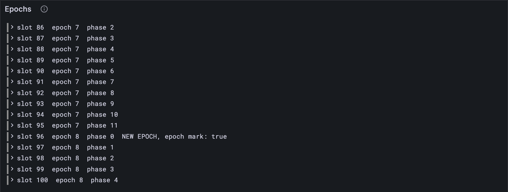

# Epochs

A slot is six seconds. An **epoch** is a run of slots, 600 of them on the full network:
one hour. On tiny it's 12 slots, a brisk 72 seconds. Most of JAM happens slot by slot,
but a few things happen only when a new epoch begins: the validator set can change, the
ticket lottery starts over, and the chain's randomness is set aside for later. This
lesson teaches your client to tell epochs apart, and to spot the moment one turns over.

## What the Gray Paper says

§6 (*Timekeeping*): a slot's epoch is e = ⌊slot / E⌋, and its **phase**, where it falls
within the epoch, is m = slot mod E. A block starts a new epoch when its epoch, e′, is
greater than the epoch of the block before it, e. (The block before it is the one whose
slot is τ, the time in the state: lesson 6.3.)

Two things happen exactly then:

- **The header carries an epoch mark** (lesson 4.6): η₀, η₁ and the next validators.
- **The entropy history moves along one.** η (lesson 6.3) is four hashes. η₀ is the
  *accumulator*: every block stirs fresh randomness into it. η₁, η₂ and η₃ are what η₀
  was at the end of each of the last three epochs. So at a new epoch, η′₁ is the old η₀,
  η′₂ the old η₁, η′₃ the old η₂, and the oldest is forgotten. In any other block, they
  stay as they are.

Why keep old randomness? Some decisions must use randomness nobody could have steered
when the decision was set up. Randomness from a finished epoch is fixed, and the ticket
lottery and the block sealers lean on it. (η₀ itself changes every block, using a
Bandersnatch VRF output. That's Part 8.)

## The tests

**New file** `test/epoch.test.ts`

```ts
import { test } from "node:test";
import assert from "node:assert/strict";
import { Block } from "../src/block.ts";
import { FULL, TINY } from "../src/config.ts";
import { entropyHistory, epochOf, phaseOf } from "../src/epoch.ts";
import { readEntropy, readTime } from "../src/state.ts";
import { traceState } from "./vectors.ts";

test("an epoch is E slots: 12 on tiny, 600 on full", () => {
  assert.deepEqual([epochOf(TINY, 25), phaseOf(TINY, 25)], [2, 1]);
  assert.deepEqual([epochOf(FULL, 1234), phaseOf(FULL, 1234)], [2, 34]);
});

/** Block n of the tiny "safrole" trace, the time before it, and whether it starts an epoch. */
function step(n: number) {
  const { entries, block } = traceState("safrole", n);
  const header = Block(TINY).fromJson(block).header;
  const time = readTime(entries);
  const newEpoch = epochOf(TINY, header.slot) > epochOf(TINY, time);
  return { header, entries, newEpoch };
}

test("an epoch mark is in exactly the blocks that start a new epoch", () => {
  let marks = 0;
  for (let n = 1; n <= 100; n++) {
    const { header, newEpoch } = step(n);
    assert.equal(header.epoch_mark !== null, newEpoch, `block ${n}`);
    if (newEpoch) marks++;
  }
  assert.equal(marks, 8);
});

test("at a new epoch the entropy history moves along one; otherwise it stays", () => {
  for (let n = 1; n < 100; n++) {
    const { entries, newEpoch } = step(n);
    const after = readEntropy(traceState("safrole", n + 1).entries); // the state after block n
    assert.deepEqual(after.slice(1), entropyHistory(readEntropy(entries), newEpoch), `block ${n}`);
  }
});
```

The `safrole` trace's state after block n is the state before block n + 1, so
`traceState("safrole", n + 1)` is block n's *after*. And `after.slice(1)` is η′₁ to η′₃:
η′₀ is left out on purpose, since it changes every block and needs Part 8.

**Run, expect it to fail**

```sh
npm test
# fails with: Cannot find module
```

## The code

**New file** `src/epoch.ts`

```ts
// Epochs (GP §6): the chain's hours. A slot belongs to an epoch, and a few things change
// only when a new epoch begins.

import type { Bytes } from "./bytes.ts";
import type { Config } from "./config.ts";

/** e: the epoch a slot falls in, ⌊slot / E⌋. */
export function epochOf(config: Config, slot: number): number {
  return Math.floor(slot / config.epoch_length);
}

/** m: where a slot falls within its epoch, slot mod E, from 0 to E − 1. */
export function phaseOf(config: Config, slot: number): number {
  return slot % config.epoch_length;
}

/** η′₁, η′₂, η′₃: at a new epoch, the entropy history moves along one; otherwise it stays. */
export function entropyHistory(entropy: Bytes[], newEpoch: boolean): Bytes[] {
  return newEpoch ? entropy.slice(0, 3) : entropy.slice(1, 4);
}
```

`entropy.slice(0, 3)` is η₀, η₁, η₂: shifted along by one, ready to become η′₁ to η′₃.
`entropy.slice(1, 4)` is η₁, η₂, η₃, unchanged.

**Run**

```sh
npm test
# prints: an epoch mark is in exactly the blocks that start a new epoch
# prints: at a new epoch the entropy history moves along one; otherwise it stays
# prints: fail 0
# prints: reported
npm run typecheck
```

Eight epochs began in those 100 blocks, at slots 12, 24, 36 and so on to 96, and the
headers and the state agree about every one of them.

## Watch it

**New file** `bin/epochs.ts`

```ts
// Walks the 100 blocks of the tiny "safrole" trace and shows where each new epoch begins:
// the header carries an epoch mark, and the entropy history moves along one.

import { readFileSync } from "node:fs";
import { Block } from "../src/block.ts";
import { fromHex, toHex } from "../src/bytes.ts";
import { TINY } from "../src/config.ts";
import { epochOf, phaseOf } from "../src/epoch.ts";
import { Run } from "../src/obs.ts";
import { readEntropy, readTime } from "../src/state.ts";

const run = new Run("epochs");
let epochs = 0;
for (let n = 1; n <= 100; n++) {
  const file = `../vectors/traces/safrole/${String(n).padStart(8, "0")}.json`;
  const trace = JSON.parse(readFileSync(file, "utf8"));
  const entries = trace.pre_state.keyvals.map((e: { key: string; value: string }) => ({
    key: fromHex(e.key),
    value: fromHex(e.value),
  }));
  const { slot, epoch_mark } = Block(TINY).fromJson(trace.block).header;
  const epoch = epochOf(TINY, slot);
  const newEpoch = epoch > epochOf(TINY, readTime(entries));
  const mark = epoch_mark !== null;
  run.event("block", { slot, epoch, phase: phaseOf(TINY, slot), newEpoch, mark });
  if (!newEpoch) continue;
  epochs++;
  const eta0 = toHex(readEntropy(entries)[0]).slice(0, 18); // η₀, shortened
  console.log(`slot ${slot}: epoch ${epoch} begins. Epoch mark: ${mark}. η₁ is now ${eta0}…`);
}
console.log(`${epochs} new epochs in 100 blocks.`);
const link = await run.report();
if (link) console.log(`reported to Grafana: ${link}`);
```

**Run**

```sh
node bin/epochs.ts
# prints: slot 12: epoch 1 begins. Epoch mark: true. η₁ is now 0xcf7f084efbeefbda…
# prints: 8 new epochs in 100 blocks.
# prints: reported to Grafana
```

`0xcf7f084e…` should look familiar: it's the η₀ that `bin/read-state.ts` showed you in
lesson 6.3, in the state before this very block. One block later it has retired to η₁.
The *Epochs* panel lists every block with its epoch and phase, and flags the eight where
a new epoch begins: watch the phase run 0 to 11, then start again.



<details>
<summary>lasair: <code>rotate_entropy</code>, in <code>lib/safrole.ml</code></summary>

```ocaml
let is_new_epoch ~(prior : timeslot) ~(current : timeslot) : bool =
  epoch_of_timeslot current > epoch_of_timeslot prior

let rotate_entropy (state : entropy_state) : entropy_state =
  {
    accumulator = state.accumulator;
    epoch_1 = state.accumulator;
    epoch_2 = state.epoch_1;
    epoch_3 = state.epoch_2;
  }
```

The same rule, in a record with a name for each slot of η. Spelled out like that, it's
hard to get wrong, and easy to read against the Gray Paper. Your `entropyHistory` says it
with one `slice`. Both work; notice which one you'd rather check at 2 a.m.

</details>

## What you have

Your client knows what epoch it is, where in the epoch it is, and what has to change when
a new one begins.

Next: [7.2 The shuffle](./02-the-shuffle.md)
