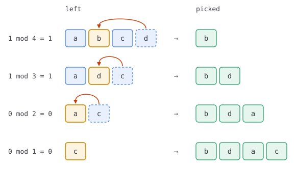
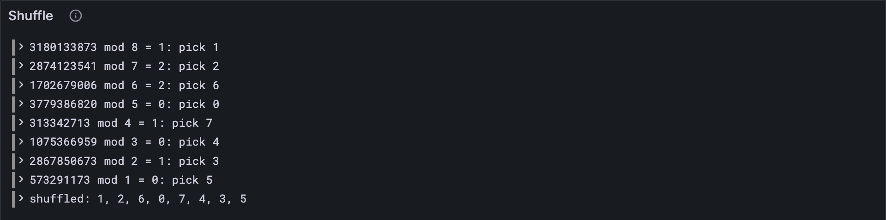

# The shuffle

JAM regularly deals its validators out to cores: these three guarantee core 0 for a while,
those three core 1, and so on. The deal has to be **random**, so nobody can arrange to
sit on the core where their friends' work is. And it has to be **the same on every
node**, or they'd all disagree about who's allowed to do what. Random, and yet
everybody gets the same answer: that's a shuffle driven by a hash everyone shares. This
lesson builds it.

## What the Gray Paper says

Appendix F defines F, a Fisher-Yates shuffle, in two layers.

**F(s, r)** shuffles a sequence s with a sequence of numbers r. Take the first number,
r₀, and l, how many items are left:

1. pick the item at index r₀ mod l;
2. put the *last* item into the gap it leaves, and drop the last place;
3. go again with what's left and the rest of the numbers.

The picks, in order, are the shuffled sequence. Here are four letters shuffled with the
numbers 1, 1, 0, 0:

| Step | Left | Number | Index | Pick | Then |
| --- | --- | --- | --- | --- | --- |
| 1 | a b c d | 1 | 1 mod 4 = 1 | b | d fills b's gap |
| 2 | a d c | 1 | 1 mod 3 = 1 | d | c fills d's gap |
| 3 | a c | 0 | 0 mod 2 = 0 | a | c fills a's gap |
| 4 | c | 0 | 0 mod 1 = 0 | c | nothing left |

Result: b, d, a, c.



**Q_l(h)** makes the numbers: l of them, from a 32-byte hash h. Hash h together with
ℰ₄(0), and the 32 bytes that come out are eight 4-byte numbers, read with ℰ₄⁻¹. Hash h
with ℰ₄(1) for the next eight, and so on. **F(s, h)** is F(s, Q_l(h)): the shuffle as JAM
uses it, with l the length of s.

## The tests

**New file** `test/shuffle.test.ts`

```ts
import { test } from "node:test";
import assert from "node:assert/strict";
import { fromHex } from "../src/bytes.ts";
import { shuffle, shuffleWithHash } from "../src/shuffle.ts";
import { vectorJson } from "./vectors.ts";

test("a shuffle by hand: four letters, four numbers", () => {
  const shuffled: string[] = shuffle(["a", "b", "c", "d"], [1, 1, 0, 0]);
  assert.deepEqual(shuffled, ["b", "d", "a", "c"]);
});

test("the shuffle vectors: 0 to 341 items, shuffled by a hash", () => {
  const vectors = vectorJson("shuffle/shuffle_tests.json") as {
    input: number; // how many items: 0, 1, 2, ... input − 1
    entropy: string;
    output: number[];
  }[];
  for (const { input, entropy, output } of vectors) {
    const items: number[] = Array.from({ length: input }, (_, i) => i);
    const shuffled: number[] = shuffleWithHash(items, fromHex(`0x${entropy}`));
    assert.deepEqual(shuffled, output);
  }
});
```

The first test is the table above. The vectors give just a length and a hash; the items
are always 0, 1, 2 and so on, so the test builds them. 341 items is the full network's
core count.

A stub that doesn't shuffle at all: every list comes back as it went in.

**New file** `src/shuffle.ts`

```ts
// The shuffle (GP App. F): a Fisher-Yates shuffle that every node can repeat, because the
// randomness it uses comes from a hash they all share.

import type { Bytes } from "./bytes.ts";

export function shuffle<T>(items: T[], numbers: number[]): T[] {
  return items;
}

export function numbersFromHash(h: Bytes, l: number): number[] {
  return [];
}

export function shuffleWithHash<T>(items: T[], h: Bytes): T[] {
  return items;
}
```

**Run, expect it to fail**

```sh
npm test
```

```text
...
✖ a shuffle by hand: four letters, four numbers (3.9ms)
✖ the shuffle vectors: 0 to 341 items, shuffled by a hash (1.0ms)
...
ℹ tests 71
ℹ suites 0
ℹ pass 69
ℹ fail 2
...
test at test/shuffle.test.ts:7:1
✖ a shuffle by hand: four letters, four numbers (3.9ms)
  AssertionError [ERR_ASSERTION]: Expected values to be strictly deep-equal:
  + actual - expected

    [
  +   'a',
      'b',
  +   'c',
      'd',
  -   'a',
  -   'c'
    ]

      at TestContext.<anonymous> (…/client/test/shuffle.test.ts:9:10)
...
    actual: [ 'a', 'b', 'c', 'd' ],
    expected: [ 'b', 'd', 'a', 'c' ],
...
```

Red: the stub hands every list back as it was, `a b c d`, where the table above says
`b d a c`.

## The code

**Replace in** `src/shuffle.ts`

```ts
import { concatBytes } from "./bytes.ts";
import type { Trace } from "./codec/reader.ts";
import { decodeFixed, encodeFixed } from "./codec/numbers.ts";
import { blake2b256 } from "./hash.ts";

/** F(s, r): pick item r₀ mod l, put the last item in its place, and go again with r₁... */
export function shuffle<T>(items: T[], numbers: number[], trace?: Trace): T[] {
  const left = [...items]; // what's still to be picked
  const out: T[] = [];
  for (const number of numbers.slice(0, items.length)) {
    const index = number % left.length;
    const picked = left[index];
    trace?.event("pick", { number, left: left.length, index, picked });
    out.push(picked);
    left[index] = left[left.length - 1]; // the last item fills the gap
    left.pop();
  }
  return out;
}

/** Q_l(h): l numbers from a hash. Each Blake2b of h and a counter gives eight of them. */
export function numbersFromHash(h: Bytes, l: number): number[] {
  const numbers: number[] = [];
  for (let i = 0; i < l; i++) {
    const block = blake2b256(concatBytes(h, encodeFixed(BigInt(Math.floor(i / 8)), 4)));
    const at = (4 * i) % 32; // number i is bytes 4i to 4i + 4 of its block, wrapping at 32
    numbers.push(Number(decodeFixed(block.subarray(at, at + 4))));
  }
  return numbers;
}

/** F(s, h): the shuffle as JAM uses it, with its numbers drawn from a hash. */
export function shuffleWithHash<T>(items: T[], h: Bytes, trace?: Trace): T[] {
  return shuffle(items, numbersFromHash(h, items.length), trace);
}
```

The Gray Paper writes F as a recursion: pick one, then F of the rest. `shuffle` does
the same thing as a loop, one pick per number, which is easier to follow and never runs
out of stack. `numbersFromHash` hashes for every number, recomputing each block eight
times; that's wasteful, but it reads exactly like Q.

**Run**

```sh
npm test
npm run typecheck
```

```text
...
✔ a shuffle by hand: four letters, four numbers (0.8ms)
✔ the shuffle vectors: 0 to 341 items, shuffled by a hash (30.4ms)
...
ℹ tests 71
ℹ suites 0
ℹ pass 71
ℹ fail 0
...
reported 71 tests to Grafana: http://127.0.0.1:3300/d/gray-tutorial?var-client=you&var-run_id=test-1791729471524
...
```

### Break it on purpose

Step 2 can look like an odd choice. Why move the last item into the gap, rather than just
close it up? Find out: in `shuffle`, replace the two lines

```ts
    left[index] = left[left.length - 1]; // the last item fills the gap
    left.pop();
```

with the more obvious

```ts
    left.splice(index, 1);
```

and run `npm test`. Both tests go red: the letters come out b, c, a, d. That's still a
perfectly fair shuffle, but it isn't *JAM's* shuffle, and a shuffle that every node must
agree on has to agree down to the last detail. (Moving the last item in is also faster: no
shifting everything after the gap.) Put the two lines back.

## Watch it

**New file** `bin/shuffle.ts`

```ts
// Shuffles the numbers 0 to n − 1 with a hash, as the shuffle vectors do, and shows each
// pick on the way.
// Usage: node bin/shuffle.ts <how many> <hash>, e.g.
//        node bin/shuffle.ts 8 0xffffffffffffffffffffffffffffffffffffffffffffffffffffffffffffffff

import { fromHex } from "../src/bytes.ts";
import { Run } from "../src/obs.ts";
import { shuffleWithHash } from "../src/shuffle.ts";

const [count, hash] = process.argv.slice(2);
const items = Array.from({ length: Number(count) }, (_, i) => i);
const run = new Run("shuffle");
const shuffled = shuffleWithHash(items, fromHex(hash), {
  event(step, fields) {
    run.event(step, fields);
    const { number, left, index, picked } = fields as Record<string, number>;
    const sum = `${String(number).padStart(10)} mod ${String(left).padStart(3)} = ${index}`;
    console.log(`${sum}: pick ${picked}`);
  },
});
const order = shuffled.join(", ");
console.log(`shuffled: ${order}`);
run.event("shuffled", { order });
const link = await run.report();
if (link) console.log(`reported to Grafana: ${link}`);
```

**Run**

```sh
node bin/shuffle.ts 8 0xffffffffffffffffffffffffffffffffffffffffffffffffffffffffffffffff
```

```text
3180133873 mod   8 = 1: pick 1
2874123541 mod   7 = 2: pick 2
1702679006 mod   6 = 2: pick 6
3779386820 mod   5 = 0: pick 0
 313342713 mod   4 = 1: pick 7
1075366959 mod   3 = 0: pick 4
2867850673 mod   2 = 1: pick 3
 573291173 mod   1 = 0: pick 5
shuffled: 1, 2, 6, 0, 7, 4, 3, 5
reported to Grafana: http://127.0.0.1:3300/d/gray-tutorial?var-client=you&var-run_id=shuffle-1791729474845
```

That's the second shuffle vector, worked out step by step. Look at the third pick: the
number lands on index 2, and the item there is 6, not 2. The first two picks moved items
7 and 6 into their gaps. The *Shuffle* panel has every pick and the final order; try a
hash of your own, and a longer list.



<details>
<summary>lasair: <code>sequence_from_hash</code>, in <code>lib/utilities.ml</code></summary>

```ocaml
  (* Cache for blake hashes - one hash covers 8 integers *)
  let cached_hash = ref Bytes.empty in
  let cached_block = ref (-1) in

  for i = 0 to len - 1 do
    let block = i / 8 in

    (* Compute hash for this block if not cached *)
    if block <> !cached_block then begin
```

lasair hashes once per eight numbers and keeps the result; your `numbersFromHash` hashes
once per number. Same numbers, an eighth of the work. Its shuffle, next door, moves the
last item into the gap exactly as yours does: `work.(index) <- work.(remaining - 1)`.

</details>

## What you have

A shuffle every node agrees on: give it a list and a hash, and every JAM client in the
world deals the same hand. [Part 8](../08-safrole/index.md) puts epochs, entropy and shuffles to work in
Safrole, the lottery that picks who makes each block.

Next: [Part 8 · Safrole](../08-safrole/index.md)
