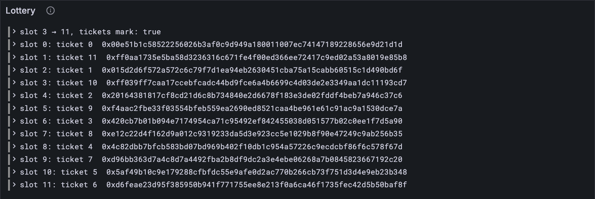

# The lottery's winners

Here's Safrole's big idea. For the first Y slots of every epoch, validators enter a
**lottery** with anonymous tickets: each ticket proves "a validator made me" without
saying which one. The best tickets win, and each winner gets a slot in the *next* epoch
to seal. Nobody knows who holds a winning ticket until that validator makes its block, so
nobody can plan an attack on the next block's author. This lesson handles the lottery's
result: closing it, announcing the winners, and handing out their slots.

(Entering a ticket takes a Bandersnatch ring proof, which waits for its library. The
winners, though, are already in the state, so everything here works today.)

## What the Gray Paper says

§6. The state keeps γ_A, the **ticket accumulator**: the best tickets entered so far,
at most E of them, sorted by id. A ticket's id is random (a VRF output), and lower is
better.

**Y** is the phase at which the lottery closes: slot 500 of a 600-slot epoch on full, 10
of 12 on tiny. Then two things can happen:

- **The tickets mark** (*The Markers*): the block that crosses phase Y, in the same epoch
  (m < Y ≤ m′), puts the winners in its header, if the lottery filled up, with all E
  tickets. Everyone learns the winning *tickets*, though still not who holds them.
- **The sealers** (*The Slot-Sealer Sequence*): at the next epoch, if it follows on
  directly (e′ = e + 1), the block before was past the close (m ≥ Y), and the lottery
  was full, then γ′_S is the winners. Otherwise it's lesson 8.3's fallback.

Either way the winners go in **outside-in** order, Z: the first, the last, the second,
the second to last, and so on inwards. Slot 0 gets the best ticket, slot 1 the worst of
the winners, slot 2 the second best.

## The size grows again

**Replace in** `src/config.ts`

```ts
/** The protocol constants that depend on the size of the network. */
export type Config = {
  name: string;
  validators_count: number; // V: validators in a set
  core_count: number; // C: cores doing work in parallel
  epoch_length: number; // E: timeslots in an epoch
  epoch_tail_start: number; // Y: the slot of an epoch at which the ticket lottery closes
};

export const TINY: Config = {
  name: "tiny",
  validators_count: 6,
  core_count: 2,
  epoch_length: 12,
  epoch_tail_start: 10,
};

export const FULL: Config = {
  name: "full",
  validators_count: 1023,
  core_count: 341,
  epoch_length: 600,
  epoch_tail_start: 500,
};
```

## The tests

The tests read the accumulator, the sealers' tickets, and the tickets mark from the
vectors:

**Replace in** `test/safrole.test.ts`

```ts
/** The parts of a safrole vector's state the lessons use so far. */
type SafroleState = {
  tau: number;
  eta: string[];
  iota: unknown[];
  gamma_k: unknown[];
  kappa: unknown[];
  lambda: unknown[];
  post_offenders: string[];
  gamma_a: unknown[]; // γ_A: the lottery's best tickets so far
  gamma_s: { keys?: string[]; tickets?: unknown[] }; // γ_S: the sealers, keys or tickets
};

/** A safrole test vector: the parts of it the lessons use so far. */
type SafroleVector = {
  input: { slot: number; entropy: string };
  pre_state: SafroleState;
  post_state: SafroleState;
  output: { err?: string; ok?: { tickets_mark: unknown[] | null } };
};
```

**Add to** `test/safrole.test.ts`

```ts
import { outsideIn, sealedByTickets, ticketsMark } from "../src/safrole.ts";
import { TicketBody } from "../src/block.ts";

test("Z: outside in, from both ends to the middle", () => {
  assert.deepEqual(outsideIn([1, 2, 3, 4, 5]), [1, 5, 2, 4, 3]);
  assert.deepEqual(outsideIn([1, 2, 3, 4]), [1, 4, 2, 3]);
});

/** Tickets from a vector's JSON. */
const tickets = (json: unknown[]) => json.map((ticket) => TicketBody.fromJson(ticket));

test("the lottery closes as phase Y is reached: slot 9 → 10 on tiny, but not 10 → 11", () => {
  const full = Array.from({ length: 12 }, () => ({ id: new Uint8Array(32), attempt: 0 }));
  assert.notEqual(ticketsMark(TINY, 9, 10, full), null);
  assert.equal(ticketsMark(TINY, 10, 11, full), null); // closed already
  assert.equal(ticketsMark(TINY, 9, 10, full.slice(1)), null); // not full
});

test("the tickets mark: in the block that closes a full lottery, and in no other", () => {
  let marks = 0;
  for (const { config, name, vector } of acceptedVectors()) {
    const { input, pre_state, output } = vector;
    const mark = ticketsMark(config, pre_state.tau, input.slot, tickets(pre_state.gamma_a));
    const expected = output.ok?.tickets_mark;
    assert.deepEqual(mark, expected ? tickets(expected) : null, name);
    if (mark) marks++;
  }
  assert.equal(marks, 2); // 1 tiny, 1 full
});

test("γ′_S: a new epoch is sealed by the winners, outside in, if the lottery closed full", () => {
  let ticketed = 0;
  for (const { config, name, vector, newEpoch } of acceptedVectors()) {
    if (!newEpoch) continue;
    const { input, pre_state, post_state } = vector;
    const accumulator = tickets(pre_state.gamma_a);
    if (sealedByTickets(config, pre_state.tau, input.slot, accumulator)) {
      assert.deepEqual(tickets(post_state.gamma_s.tickets ?? []), outsideIn(accumulator), name);
      ticketed++;
    } else {
      assert.ok(post_state.gamma_s.keys, name); // the fallback, as in lesson 8.3
    }
  }
  assert.equal(ticketed, 2); // 1 tiny, 1 full
});
```

The second test pins the boundaries, because "m < Y ≤ m′" is exactly where off-by-one
bugs live: the block from slot 9 to 10 closes tiny's lottery, and the one from 10 to 11
doesn't, since by then it's closed. The vectors only cross Y from further away (slot 3 to
11, say), so without this test a `<=` where a `<` belongs would slip through.

**Run, expect it to fail**

```sh
npm test
# fails with: does not provide an export named
```

## The code

**Add to** `src/safrole.ts`

```ts
import { epochOf, phaseOf } from "./epoch.ts";
import type { TicketBody } from "./block.ts";

/** Z: outside in. The first, the last, the second, the second to last, and so on inwards. */
export function outsideIn<T>(items: T[]): T[] {
  const out: T[] = [];
  let front = 0;
  let back = items.length - 1;
  while (front <= back) {
    out.push(items[front]);
    if (front < back) out.push(items[back]);
    front++;
    back--;
  }
  return out;
}

/** Whether the lottery closes in this block: the same epoch, and phase Y is reached now. */
function lotteryCloses(config: Config, before: number, after: number): boolean {
  const Y = config.epoch_tail_start;
  const sameEpoch = epochOf(config, after) === epochOf(config, before);
  return sameEpoch && phaseOf(config, before) < Y && Y <= phaseOf(config, after);
}

/** H_W, the tickets mark: in the block that closes a full lottery, the winners, outside in. */
export function ticketsMark(
  config: Config,
  before: number, // the slot of the block before, τ
  after: number, // this block's slot, τ′
  accumulator: TicketBody[], // γ_A: the best tickets so far, by id
): TicketBody[] | null {
  const full = accumulator.length === config.epoch_length;
  return lotteryCloses(config, before, after) && full ? outsideIn(accumulator) : null;
}

/**
 * Whether a new epoch is sealed by the lottery's winners rather than the fallback: the
 * last epoch's lottery closed full, and this block follows on from that epoch directly.
 */
export function sealedByTickets(
  config: Config,
  before: number,
  after: number,
  accumulator: TicketBody[],
): boolean {
  const next = epochOf(config, after) === epochOf(config, before) + 1;
  const closed = phaseOf(config, before) >= config.epoch_tail_start;
  return next && closed && accumulator.length === config.epoch_length;
}
```

`outsideIn` walks in from both ends at once: `front` and `back` take turns until they
meet. `if (front < back)` stops the middle item of an odd-length list from going in
twice.

**Run**

```sh
npm test
# prints: Z: outside in, from both ends to the middle
# prints: the tickets mark: in the block that closes a full lottery, and in no other
# prints: fail 0
# prints: reported
npm run typecheck
```

The tickets mark is right in every accepted vector: present in the two that close a full
lottery, absent in the other 31. And both epochs sealed by tickets got their winners
outside in.

## Watch it

**New file** `bin/lottery.ts`

```ts
// Shows a lottery's result from a safrole test vector: if this block closes a full lottery,
// which slot of the next epoch each winning ticket will seal, outside in.
// Usage: node bin/lottery.ts <vector.json>, e.g.
//        node bin/lottery.ts ../vectors/stf/safrole/tiny/publish-tickets-with-mark-4.json

import { readFileSync } from "node:fs";
import { TicketBody } from "../src/block.ts";
import { toHex } from "../src/bytes.ts";
import { FULL, TINY } from "../src/config.ts";
import { Run } from "../src/obs.ts";
import { ticketsMark } from "../src/safrole.ts";

const [file] = process.argv.slice(2);
const config = file.includes("/full/") ? FULL : TINY;
const { input, pre_state } = JSON.parse(readFileSync(file, "utf8"));
const accumulator = pre_state.gamma_a.map((ticket: unknown) => TicketBody.fromJson(ticket));
const mark = ticketsMark(config, pre_state.tau, input.slot, accumulator);
const run = new Run("lottery");
const closesAt = config.epoch_tail_start; // Y
console.log(`slot ${pre_state.tau} → ${input.slot}, the lottery closes at phase ${closesAt}`);
const verdict = mark ? "a tickets mark" : "no mark";
console.log(`${accumulator.length} of ${config.epoch_length} tickets: ${verdict}`);
run.event("lottery", { before: pre_state.tau, after: input.slot, mark: mark !== null });
mark?.forEach((ticket, phase) => {
  const rank = accumulator.indexOf(ticket); // 0: the best ticket, with the lowest id
  const id = `${toHex(ticket.id).slice(0, 10)}…`;
  console.log(`slot ${String(phase).padStart(3)} of the next epoch: ticket ${rank}, ${id}`);
  run.event("seat", { phase, rank, id: ticket.id });
});
const link = await run.report();
if (link) console.log(`reported to Grafana: ${link}`);
```

**Run**

```sh
node bin/lottery.ts ../vectors/stf/safrole/tiny/publish-tickets-with-mark-4.json
# prints: 12 of 12 tickets: a tickets mark
# prints: slot   1 of the next epoch: ticket 11, 0xff0aa173…
# prints: reported to Grafana
```

Read the ticket column down: 0, 11, 1, 10, 2, 9, … the zip of two lists, one counting
up, one counting down, meeting at 5 and 6 in the middle. And the ids show what "best"
means: ticket 0's id starts `0x00e5`, ticket 11's `0xff0a`. The *Lottery* panel has every
seat. Try `publish-tickets-with-mark-3.json`, one block earlier: no mark yet.



<details>
<summary>lasair: outside in, in <code>conformance/stf_transitions.ml</code></summary>

```ocaml
          for slot = 0 to (epoch_length ()) - 1 do
            let ticket_idx =
              if slot mod 2 = 0 then slot / 2
              else (epoch_length ()) - 1 - (slot / 2)
            in
```

lasair works out each slot's ticket with a formula instead of walking two pointers: an
even slot s takes ticket s / 2 from the front, an odd one ticket E − 1 − s / 2 from the
back. Same order, a different way to see it. Try a few slots by hand: both give 0, 11,
1, 10…

</details>

## What you have

The lottery's endgame: closing on time, announcing the winners, and seating them, outside
in, in the epoch they'll seal.

Next: [8.5 One step of Safrole](./05-one-step-of-safrole.md)
