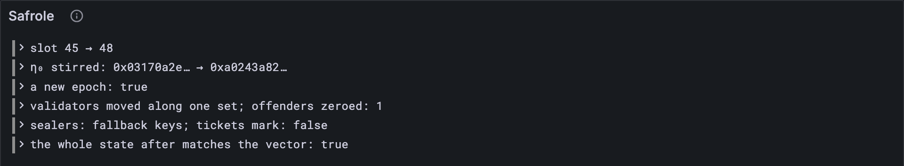

# One step of Safrole

Four lessons, four pieces: entropy, rotation, fallback sealers, the lottery's winners.
Time to snap them together. This lesson writes `safroleStep`: give it Safrole's state and
one block, and it hands back the state after the block, plus the two marks the block's
header must carry. Then the test throws the whole post-state of every vector it can at it.

## What the Gray Paper says

Nothing new in principle: it's §6, all at once. A few last rules join in:

- **τ′** is the block's slot ([lesson 7.1](../07-time-and-shuffling/01-epochs.md)).
- **The epoch mark** ([lesson 4.6](../04-blocks/06-the-header.md)) appears exactly at a new epoch ([lesson 7.1](../07-time-and-shuffling/01-epochs.md)), and carries
  η₀ and η₁ *as they were* ([lesson 6.3](../06-state-and-merklization/03-reading-the-state.md)), and the Bandersnatch and Ed25519 keys of γ′_P,
  the newly pending validators ([lesson 8.2](./02-rotating-the-validators.md)).
- **γ′_A**: a new epoch starts a new lottery, so the accumulator empties. Otherwise it
  keeps its tickets, plus any the block brings.

And three things this step can't do yet, all for the same reason, Bandersnatch:

- **blocks that bring tickets**: a ticket's id is the output of its ring proof;
- **γ′_Z**, the ring root of the new pending set;
- **rejecting bad blocks**, most of which come down to checking tickets.

So `safroleStep` takes blocks with no tickets, and its test skips the rest, honestly
counted.

## The tests

The vector type learns about the block's tickets and the epoch mark:

**Replace in** `test/safrole.test.ts`

```ts
/** A safrole test vector: the parts of it the lessons use so far. */
type SafroleVector = {
  input: { slot: number; entropy: string; extrinsic: unknown[] }; // extrinsic: tickets
  pre_state: SafroleState;
  post_state: SafroleState;
  output: { err?: string; ok?: { epoch_mark: unknown; tickets_mark: unknown[] | null } };
};
```

**Add to** `test/safrole.test.ts`

```ts
import { safroleFromJson, safroleStep } from "../src/safrole.ts";
import { EpochMark } from "../src/block.ts";

test("a whole step of Safrole: the state and both marks, for each block without tickets", () => {
  let steps = 0;
  for (const { config, name, vector } of acceptedVectors()) {
    const { input, pre_state, post_state, output } = vector;
    if (input.extrinsic.length > 0) continue; // reading tickets needs Bandersnatch
    const vrfOutput = fromHex(input.entropy);
    const offenders = pre_state.post_offenders.map(fromHex);
    const before = safroleFromJson(pre_state);
    const step = safroleStep(config, before, input.slot, vrfOutput, offenders);
    assert.deepEqual(step.after, safroleFromJson(post_state), name);
    const epochMark = output.ok?.epoch_mark;
    const ticketsMark = output.ok?.tickets_mark;
    assert.deepEqual(step.epochMark, epochMark ? EpochMark.fromJson(epochMark) : null, name);
    assert.deepEqual(step.ticketsMark, ticketsMark ? tickets(ticketsMark) : null, name);
    steps++;
  }
  assert.equal(steps, 22); // 10 tiny, 12 full
});
```

One `deepEqual` checks the *entire* state after the block: τ, η, all four validator sets,
the accumulator and the sealers. Only γ_Z is left out. Two more check the marks.

**Run, expect it to fail**

```sh
npm test
# fails with: does not provide an export named
```

## The code

**Add to** `src/safrole.ts`

```ts
import { TicketBody } from "./block.ts";
import type { EpochMark } from "./block.ts";
import { ValidatorKey } from "./state.ts";
import { fromHex } from "./bytes.ts";

/** γ_S, who seals each slot of this epoch: the lottery's winning tickets, or fallback keys. */
export type Sealers = { tickets: TicketBody[] } | { keys: Bytes[] };

/** Safrole's part of the state (GP §6), as your client keeps it. */
export type Safrole = {
  time: number; // τ: the slot of the most recent block
  entropy: Bytes[]; // η
  validators: ValidatorSets; // ι, γ_P, κ, λ
  accumulator: TicketBody[]; // γ_A: the lottery's best tickets so far
  sealers: Sealers; // γ_S
};

/**
 * One block of Safrole (GP §6), for a block that brings no tickets: the state after it,
 * and the two marks its header must carry.
 */
export function safroleStep(
  config: Config,
  before: Safrole,
  slot: number, // the block's slot, τ′
  vrfOutput: Bytes, // Y(H_v), from the block's entropy source
  offenders: Bytes[], // ψ′_O: Ed25519 keys convicted in disputes
) {
  const newEpoch = epochOf(config, slot) > epochOf(config, before.time);
  const entropy = nextEntropy(before.entropy, vrfOutput, newEpoch);
  const validators = newEpoch ? rotateValidators(before.validators, offenders) : before.validators;
  let sealers = before.sealers;
  if (sealedByTickets(config, before.time, slot, before.accumulator)) {
    sealers = { tickets: outsideIn(before.accumulator) };
  } else if (newEpoch) {
    sealers = { keys: fallbackKeys(config, entropy[2], validators.active) };
  }
  const after: Safrole = {
    time: slot,
    entropy,
    validators,
    accumulator: newEpoch ? [] : before.accumulator, // a new epoch starts a new lottery
    sealers,
  };
  // the epoch mark: η₀ and η₁ as they were, and γ′_P, the validators after next, by two keys
  const keys = validators.pending.map(({ bandersnatch, ed25519 }) => ({ bandersnatch, ed25519 }));
  const epochMark: EpochMark | null = newEpoch
    ? { entropy: before.entropy[0], tickets_entropy: before.entropy[1], validators: keys }
    : null;
  const tickets = ticketsMark(config, before.time, slot, before.accumulator);
  return { after, epochMark, ticketsMark: tickets };
}

/** Safrole's state as the test vectors write it, under the Gray Paper's Greek names. */
export type SafroleJson = {
  tau: number;
  eta: string[];
  iota: unknown[];
  gamma_k: unknown[];
  kappa: unknown[];
  lambda: unknown[];
  gamma_a: unknown[];
  gamma_s: { keys?: string[]; tickets?: unknown[] };
};

/** Safrole's state, from the vectors' JSON. */
export function safroleFromJson(json: SafroleJson): Safrole {
  const keys = (list: unknown[]) => list.map((key) => ValidatorKey.fromJson(key));
  const tickets = (list: unknown[]) => list.map((ticket) => TicketBody.fromJson(ticket));
  const { keys: fallback, tickets: winners } = json.gamma_s;
  return {
    time: json.tau,
    entropy: json.eta.map(fromHex),
    validators: {
      staging: keys(json.iota),
      pending: keys(json.gamma_k),
      active: keys(json.kappa),
      previous: keys(json.lambda),
    },
    accumulator: tickets(json.gamma_a),
    sealers: winners ? { tickets: tickets(winners) } : { keys: (fallback ?? []).map(fromHex) },
  };
}
```

Two imports change shape here. `src/safrole.ts` already imports the *types* `TicketBody`
and `ValidatorKey` (lessons [8.2](./02-rotating-the-validators.md) and [8.4](./04-the-lotterys-winners.md)). Now it needs their *values* too, for `fromJson`,
and a value import brings the type along. So take those two names out of the
`import type` lines, and drop a line that's left empty. TypeScript would complain about a
name imported twice.

`Sealers` is either tickets or keys: `{ tickets } | { keys }`. The `"tickets" in sealers`
check in the next program tells them apart. `safroleFromJson` is to Safrole's state what
`fromJson` is to a codec: the vectors' form, with its Greek names, turned into your
client's.

`safroleStep` itself reads like a summary of Part 8: stir, rotate, choose the sealers,
reset the lottery, write the marks. Every line of it is a lesson you've done.

**Run**

```sh
npm test
# prints: a whole step of Safrole: the state and both marks, for each block without tickets
# prints: fail 0
# prints: reported
npm run typecheck
```

22 whole steps, every field right: 10 on tiny, 12 on full. The 11 accepted vectors left
over all bring tickets.

## Watch it

**New file** `bin/safrole.ts`

```ts
// Runs one block of Safrole from a safrole test vector (one whose block brings no tickets),
// tells what happened, and checks the result against the vector.
// Usage: node bin/safrole.ts <vector.json>, e.g.
//        node bin/safrole.ts ../vectors/stf/safrole/tiny/enact-epoch-change-with-padding-1.json

import { readFileSync } from "node:fs";
import { isDeepStrictEqual } from "node:util";
import { fromHex, toHex } from "../src/bytes.ts";
import { FULL, TINY } from "../src/config.ts";
import { Run } from "../src/obs.ts";
import { safroleFromJson, safroleStep } from "../src/safrole.ts";

const [file] = process.argv.slice(2);
const config = file.includes("/full/") ? FULL : TINY;
const { input, pre_state, post_state } = JSON.parse(readFileSync(file, "utf8"));
if (input.extrinsic.length > 0) {
  const count = input.extrinsic.length;
  console.log(`this block brings ${count} tickets: reading them needs Bandersnatch`);
  process.exit(0);
}
const before = safroleFromJson(pre_state);
const offenders = pre_state.post_offenders.map(fromHex);
const step = safroleStep(config, before, input.slot, fromHex(input.entropy), offenders);
const { after, epochMark, ticketsMark } = step;

const run = new Run("safrole");
const told = (what: string) => {
  console.log(what);
  run.event("told", { what });
};
told(`slot ${before.time} → ${after.time}`);
const short = (hash: Uint8Array) => `${toHex(hash).slice(0, 10)}…`;
told(`η₀ stirred: ${short(before.entropy[0])} → ${short(after.entropy[0])}`);
told(`a new epoch: ${epochMark !== null}`);
const zeroed = after.validators.pending.filter((k) => k.ed25519.every((b) => b === 0)).length;
if (epochMark) told(`validators moved along one set; offenders zeroed: ${zeroed}`);
const sealers = "tickets" in after.sealers ? "the lottery's winners" : "fallback keys";
told(`sealers: ${sealers}; tickets mark: ${ticketsMark !== null}`);
const matches = isDeepStrictEqual(after, safroleFromJson(post_state));
told(`the whole state after matches the vector: ${matches}`);
const link = await run.report();
if (link) console.log(`reported to Grafana: ${link}`);
```

**Run**

```sh
node bin/safrole.ts ../vectors/stf/safrole/tiny/enact-epoch-change-with-padding-1.json
# prints: a new epoch: true
# prints: validators moved along one set; offenders zeroed: 1
# prints: the whole state after matches the vector: true
# prints: reported to Grafana
```

That's the busiest vector of all: a new epoch, an offender, fallback sealers. Try the
others too: `enact-epoch-change-with-no-tickets-1.json` (one slot on, and only η₀
stirs), and `publish-tickets-with-mark-5.json` (a new epoch sealed by tickets). A vector
whose block brings tickets, such as `publish-tickets-no-mark-2.json`, gets a polite
refusal. The *Safrole* panel tells each step's story.



<details>
<summary>lasair: the missing piece, in <code>conformance/stf_transitions.ml</code></summary>

```ocaml
      (* Update η[0] with new accumulation *)
      let eta0 = Bytes.sub entropy 0 32 in
      let gamma = Bytes.sub entropy_source 0 32 in
      let banderout = Bandersnatch_ffi.banderout gamma in
      let new_eta0 = Lasair.Merklization.blake2b256 (Bytes.cat eta0 banderout) in
```

Here's what your client still trusts the vectors for. lasair takes the first 32 bytes of
the header's 96-byte entropy source, a point on the Bandersnatch curve, and asks its
Bandersnatch library (`Bandersnatch_ffi`, Rust underneath) for the VRF output. The
vectors handed you that output as `input.entropy`. The line after it is your
`nextEntropy`, word for word.

</details>

## What you have

Safrole, end to end, for every block that brings no tickets: the whole state after it, and
both marks for its header, right on every vector it can run.

Next: [Part 9 · Recent history](../09-recent-history/index.md)
