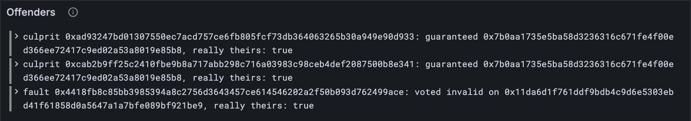

# Culprits and faults

A verdict says what's true. Now for the consequences. Anyone who put their name to a
falsehood gets named in the block as an **offender**, with their own signature as the
evidence. Two kinds of offender, two kinds of evidence:

- a **culprit** guaranteed a report that turned out *bad*. Exhibit A: their guarantee.
- a **fault** voted against the verdict: "valid" on a bad report, or "invalid" on a good
  one. Exhibit A: their vote.

Offenders are remembered forever in ψ_O, and lesson 8.2's Φ keeps them out of the next
validator set. This lesson checks the evidence and keeps the record.

## What the Gray Paper says

§10 again.

- A **culprit** (r, k, s) is valid if s is k's Ed25519 signature on `$jam_guarantee` ⌢ r,
  the very message a guarantor signs when vouching for report r. (The `$` is notation;
  the bytes are `jam_guarantee`.)
- A **fault** (r, v, k, s) is valid if s is k's signature on the vote v about r:
  `$jam_valid` or `$jam_invalid`, then r, exactly like lesson 10.1's votes.
- **ψ′_O**, the offenders, gains every culprit's and every fault's key.
- **The offenders mark** (lesson 4.6's `offenders_mark`) lists the same keys: the
  culprits' first, then the faults', in the order the block gives them.

There are more rules about *which* offenders may appear: a culprit's report must really
be bad, a fault's vote must really contradict the verdict, an offender must be a current
or previous validator and not already punished. Each one rejects a block. They're the
base rule's fine print, and they go to the hardening pass.

## The tests

The vector type learns about the offenders mark:

**Replace in** `test/disputes.test.ts`

```ts
/** A disputes test vector: the parts of it this lesson uses. */
type DisputesVector = {
  input: { disputes: unknown };
  pre_state: { psi: unknown; tau: number; kappa: unknown[]; lambda: unknown[] };
  post_state: { psi: unknown };
  output: { err?: string; ok?: { offenders_mark: string[] } };
};
```

**Add to** `test/disputes.test.ts`

```ts
import { culpritSigned, faultSigned, offendersMark, recordOffenders } from "../src/disputes.ts";
import { toHex } from "../src/bytes.ts";

test("every culprit's guarantee and every fault's vote is really theirs", () => {
  for (const config of [TINY, FULL]) {
    for (const { name, vector } of acceptedVectors(config)) {
      const { culprits, faults } = DisputesExtrinsic.fromJson(vector.input.disputes);
      for (const culprit of culprits) assert.ok(culpritSigned(culprit), name);
      for (const fault of faults) assert.ok(faultSigned(fault), name);
    }
  }
});

test("a forged guarantee is caught", () => {
  const vector = vectorJson("stf/disputes/tiny/progress_with_bad_signatures-2.json");
  const { culprits } = DisputesExtrinsic.fromJson((vector as DisputesVector).input.disputes);
  assert.deepEqual(culprits.map(culpritSigned), [true, false]);
});

test("the offenders mark names this block's offenders, and ψ′_O keeps them all", () => {
  let offenders = 0;
  for (const config of [TINY, FULL]) {
    for (const { name, vector } of acceptedVectors(config)) {
      const disputes = DisputesExtrinsic.fromJson(vector.input.disputes);
      const mark = offendersMark(disputes);
      assert.deepEqual(mark.map(toHex), vector.output.ok?.offenders_mark, name);
      const after = recordOffenders(PastJudgements.fromJson(vector.pre_state.psi), disputes);
      const expected = PastJudgements.fromJson(vector.post_state.psi);
      assert.deepEqual(after.offenders, expected.offenders, name);
      offenders += mark.length;
    }
  }
  assert.equal(offenders, 28); // 14 tiny, 14 full
});
```

**Run, expect it to fail**

```sh
npm test
# fails with: does not provide an export named
```

## The code

**Add to** `src/disputes.ts`

```ts
import type { Culprit, DisputesExtrinsic, Fault } from "./block.ts";

/** X_G: "$jam_guarantee" in the GP, what a guarantor signs before a report's hash. */
const GUARANTEE = new TextEncoder().encode("jam_guarantee");

/** Whether a culprit's signature really is its guarantee of the report: the evidence. */
export function culpritSigned(culprit: Culprit): boolean {
  return verifyEd25519(culprit.key, concatBytes(GUARANTEE, culprit.target), culprit.signature);
}

/** Whether a fault's signature really is its vote on the report, the way it voted. */
export function faultSigned(fault: Fault): boolean {
  return verifyEd25519(fault.key, voteMessage(fault.vote, fault.target), fault.signature);
}

/** H_O, the offenders mark: the keys of this block's offenders, culprits first, then faults. */
export function offendersMark(disputes: DisputesExtrinsic): Bytes[] {
  return [...disputes.culprits.map((c) => c.key), ...disputes.faults.map((f) => f.key)];
}

/** ψ′_O: the offenders so far, and this block's. */
export function recordOffenders(
  before: PastJudgements,
  disputes: DisputesExtrinsic,
): PastJudgements {
  return { ...before, offenders: sorted([...before.offenders, ...offendersMark(disputes)]) };
}
```

`faultSigned` reuses lesson 10.1's `voteMessage`: a fault's evidence *is* a vote, just
one on the losing side. And `recordOffenders` reuses `sorted`, since ψ_O is a set like
the other three.

**Run**

```sh
npm test
# prints: every culprit's guarantee and every fault's vote is really theirs
# prints: a forged guarantee is caught
# prints: the offenders mark names this block's offenders, and ψ′_O keeps them all
# prints: fail 0
# prints: reported
npm run typecheck
```

28 offenders named across the accepted vectors, 14 at each size, every one with real
evidence and in the right place.

## Watch it

**New file** `bin/offenders.ts`

```ts
// Shows the offenders in a disputes test vector: each culprit (a guarantor of a bad report)
// and each fault (a vote against the verdict), and whether the evidence is real.
// Usage: node bin/offenders.ts <vector.json>, e.g.
//        node bin/offenders.ts ../vectors/stf/disputes/tiny/progress_with_verdicts-4.json

import { readFileSync } from "node:fs";
import { DisputesExtrinsic } from "../src/block.ts";
import type { Bytes } from "../src/bytes.ts";
import { toHex } from "../src/bytes.ts";
import { culpritSigned, faultSigned, offendersMark } from "../src/disputes.ts";
import { Run } from "../src/obs.ts";

const [file] = process.argv.slice(2);
const { input } = JSON.parse(readFileSync(file, "utf8"));
const disputes = DisputesExtrinsic.fromJson(input.disputes);
const short = (bytes: Bytes) => `${toHex(bytes).slice(0, 10)}…`;
const run = new Run("offenders");
for (const culprit of disputes.culprits) {
  const signed = culpritSigned(culprit);
  console.log(`culprit ${short(culprit.key)}: guaranteed report ${short(culprit.target)}`);
  console.log(`  the guarantee is really theirs: ${signed}`);
  run.event("culprit", { key: culprit.key, report: culprit.target, signed });
}
for (const fault of disputes.faults) {
  const signed = faultSigned(fault);
  const said = fault.vote ? "valid" : "invalid";
  console.log(`fault ${short(fault.key)}: voted ${said} on report ${short(fault.target)}`);
  console.log(`  the vote is really theirs: ${signed}`);
  run.event("fault", { key: fault.key, report: fault.target, said, signed });
}
console.log(`offenders mark: ${offendersMark(disputes).map(short).join(", ") || "none"}`);
const link = await run.report();
if (link) console.log(`reported to Grafana: ${link}`);
```

**Run**

```sh
node bin/offenders.ts ../vectors/stf/disputes/tiny/progress_with_verdicts-4.json
# prints: culprit 0xad93247b…: guaranteed report 0x7b0aa173…
# prints: fault 0x4418fb8c…: voted invalid on report 0x11da6d1f…
# prints: reported to Grafana
```

Put it next to lesson 10.1's `bin/verdicts.ts` on the same vector, and the whole trial
reads like a story. Report `0x7b0a…` was judged bad, so the two validators who
guaranteed it are culprits. Report `0x11da…` was judged good, and validator `0x4418…`
(validator 0, from lesson 5.3) had voted "invalid" on it: a fault. Now try
`progress_with_bad_signatures-2.json`, where the second culprit's "evidence" is a
forgery. The *Offenders* panel lists every offender.



<details>
<summary>lasair: signing contexts, in <code>conformance/disputes_stf.ml</code></summary>

```ocaml
let valid_context = Bytes.of_string "jam_valid"
let invalid_context = Bytes.of_string "jam_invalid"
let guarantee_context = Bytes.of_string "jam_guarantee"

let create_judgment_payload (vote : bool) (target : bytes) : bytes =
  let context = if vote then valid_context else invalid_context in
  Bytes.cat context target

let create_guarantee_payload (target : bytes) : bytes =
  Bytes.cat guarantee_context target
```

Your `voteMessage` and `culpritSigned`, in OCaml, down to the missing dollar signs.
Right next to these, lasair has a comment worth a read: every vote threshold is relative
to the size of the set the verdict cites, κ or λ, because the validator set can change
size between epochs. That's why your `outcome` takes the judges' count.

</details>

## What you have

The consequences of a trial: offenders named with evidence that checks out, kept in ψ_O,
and announced in the block's header.

Next: [10.3 Clearing the cores](./03-clearing-the-cores.md)
