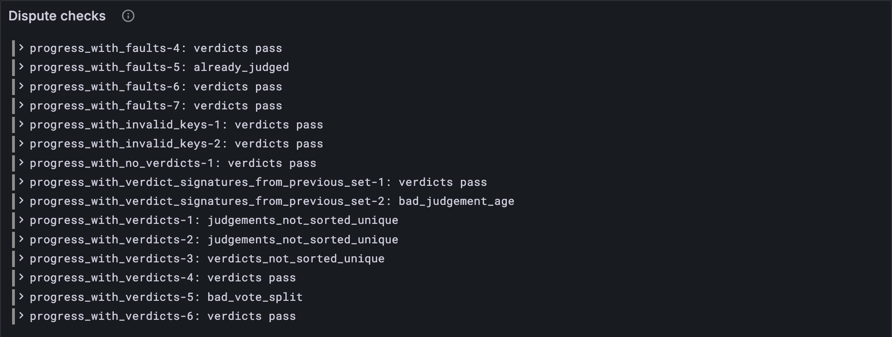

# Bad verdicts

Your court from lessons [10.1](./01-votes-and-verdicts.md) to [10.3](./03-clearing-the-cores.md) believes every verdict it's handed. A real block can
carry a broken one: the wrong number of votes, votes out of order, a judge who never
signed, a report that was judged long ago. Any of them sinks the whole block. This lesson
writes down the rules a verdict must keep, and checks them against every disputes test
vector. [Lesson 10.5](./05-bad-culprits-and-faults.md) does the same for culprits and faults.

## New words

- **Judges.** The validators whose votes a verdict carries: this epoch's (κ) if the
  verdict's age is this epoch, last epoch's (λ) if it's the one before. *Example:* on
  tiny, 6 judges, so a verdict needs ⌊2·6/3⌋ + 1 = 5 votes.
- **Verdict age.** The epoch a verdict's votes were cast in. Only this epoch or the last
  one will do. *Example:* in epoch 3, ages 3 and 2 are fine, age 1 isn't.
- **Vote split.** How many of a verdict's votes say "valid". Only three splits mean
  anything: all of them (good), none (bad), or a third of the judges (wonky).
  *Example:* on tiny, 5, 0 or 2.

All three are in the [glossary](../glossary.md).

## What the Gray Paper says

§10, *Disputes*. Every verdict in a block must keep seven rules:

1. **In order.** Verdicts are sorted by report hash, with no report twice.
   (`verdicts_not_sorted_unique`)
2. **New.** No report judged before: not in ψ's good, bad or wonky sets.
   (`already_judged`)
3. **Recent.** Its age is this epoch or the last. (`bad_judgement_age`)
4. **The right number of votes.** Exactly two thirds of its judges, plus one.
   (`bad_votes_count`)
5. **Votes in order.** Sorted by judge index, no judge twice.
   (`judgements_not_sorted_unique`)
6. **Signed.** Every vote by the judge it names ([lesson 10.1](./01-votes-and-verdicts.md)'s `votesSigned`), and every
   judge index a real one. (`bad_signature`)
7. **A meaningful split.** All, none, or a third of the judges said "valid".
   (`bad_vote_split`)

Rule 7 changes [lesson 10.1](./01-votes-and-verdicts.md)'s `outcome`: it called every split that wasn't all or none
"wonky". Now any other split never gets that far, and only the third is left.

The Gray Paper's names: the judges are **K(a)**, κ if a = ⌊τ/E⌋ and λ otherwise; the
count is **⌊⅔|K|⌋ + 1**; the three splits are **V**'s three cases.

## The tests

**Add to** `test/disputes.test.ts`

```ts
import { verdictError } from "../src/disputes.ts";

/** What the verdict rules say of disputes vector `name`: null (they pass) or the rule broken. */
function verdictVerdict(config: typeof TINY, name: string) {
  const { input, pre_state } = vectorJson(name) as DisputesVector;
  const keys = (list: unknown[]) => list.map((key) => ValidatorKey.fromJson(key));
  const { verdicts } = DisputesExtrinsic.fromJson(input.disputes);
  const before = PastJudgements.fromJson(pre_state.psi);
  const [active, previous] = [keys(pre_state.kappa), keys(pre_state.lambda)];
  return verdictError(config, verdicts, before, pre_state.tau, active, previous);
}

/** The disputes vectors whose verdicts break a rule, and the rule they break. */
const BAD_VERDICTS = new Map([
  ["progress_with_verdicts-3", "verdicts_not_sorted_unique"],
  ["progress_with_culprits-3", "already_judged"],
  ["progress_with_faults-5", "already_judged"],
  ["progress_with_verdict_signatures_from_previous_set-2", "bad_judgement_age"],
  ["progress_with_bad_votes_count-1", "bad_votes_count"],
  ["progress_with_verdicts_from_resized_previous_set-2", "bad_votes_count"], // full only
  ["progress_with_verdicts-1", "judgements_not_sorted_unique"],
  ["progress_with_verdicts-2", "judgements_not_sorted_unique"],
  ["progress_with_bad_signatures-1", "bad_signature"],
  ["progress_with_verdicts-5", "bad_vote_split"],
]);

test("a split that's neither good, bad nor wonky is refused", () => {
  const name = "stf/disputes/tiny/progress_with_verdicts-5.json";
  assert.equal(verdictVerdict(TINY, name), "bad_vote_split");
});

/**
 * Every tiny disputes vector, and the full ones tiny can't have (a resized λ). A full
 * verdict carries 683 signed votes, and checking every full vector takes the better part
 * of a minute; `node bin/check-disputes.ts full` does that whenever you like.
 */
const VERDICT_VECTORS = [
  ...vectorFiles("stf/disputes/tiny").map((name) => ({ config: TINY, name })),
  ...vectorFiles("stf/disputes/full")
    .filter((name) => name.includes("resized"))
    .map((name) => ({ config: FULL, name })),
];

for (const { config, name } of VERDICT_VECTORS) {
  const short = name.split("/").at(-1)!.replace(".json", "");
  test(`${name}: its verdicts pass, or break the rule the vector names`, () => {
    assert.equal(verdictVerdict(config, name), BAD_VERDICTS.get(short) ?? null);
  });
}
```

`BAD_VERDICTS` lists the vectors whose verdicts break a rule, and which rule. Every other
disputes vector's verdicts must pass, including those the vector refuses for a culprit or
a fault ([lesson 10.5](./05-bad-culprits-and-faults.md)'s business). The test runs every tiny vector, and only the two full
ones that tiny can't have: a full verdict carries 683 signed votes, and checking every
full vector takes the better part of a minute, on every `npm test`. Watch it, below,
checks them all whenever you ask. One error name comes up in both lessons: in
`progress_with_bad_signatures-2` the bad signature is a culprit's, so its verdicts pass
here. The full vectors have one case tiny can't have: in
`progress_with_verdicts_from_resized_previous_set-2`, λ has 6 validators and κ has 1,023.
Its verdict is aged this epoch, so its judges are κ, and 5 votes are far short of 683.

**Run, expect it to fail**

```sh
npm test
# fails with: does not provide an export named
```

## The code

**Add to** `src/disputes.ts`

```ts
/**
 * Are a block's verdicts valid (GP §10)? The first rule they break, under the test vectors'
 * name for it, or null if they keep every rule. `time` is τ, the slot before the block;
 * `active` and `previous` are κ and λ.
 */
export function verdictError(
  config: Config,
  verdicts: Verdict[],
  before: PastJudgements, // ψ
  time: number,
  active: ValidatorKey[],
  previous: ValidatorKey[],
): string | null {
  const epoch = epochOf(config, time);
  const keysOf = (v: Verdict) => judges(config, time, v.age, active, previous); // K
  const judged = new Set([...before.good, ...before.bad, ...before.wonky].map(toHex));
  const targetsInOrder = verdicts.every(
    (v, i) => i === 0 || toHex(verdicts[i - 1].target) < toHex(v.target),
  );
  const votesInOrder = (v: Verdict) =>
    v.votes.every((j, i) => i === 0 || v.votes[i - 1].index < j.index);
  const twoThirdsPlusOne = (v: Verdict) => Math.floor((2 * keysOf(v).length) / 3) + 1;
  const signed = (v: Verdict) =>
    v.votes.every((j) => j.index < keysOf(v).length) && votesSigned(v, keysOf(v));
  const split = (v: Verdict) => {
    const valid = v.votes.filter((j) => j.vote).length;
    return [twoThirdsPlusOne(v), 0, Math.floor(keysOf(v).length / 3)].includes(valid);
  };
  if (!targetsInOrder) return "verdicts_not_sorted_unique";
  if (verdicts.some((v) => judged.has(toHex(v.target)))) return "already_judged";
  if (!verdicts.every((v) => v.age === epoch || v.age === epoch - 1)) return "bad_judgement_age";
  if (!verdicts.every((v) => v.votes.length === twoThirdsPlusOne(v))) return "bad_votes_count";
  if (!verdicts.every(votesInOrder)) return "judgements_not_sorted_unique";
  if (!verdicts.every(signed)) return "bad_signature";
  if (!verdicts.every(split)) return "bad_vote_split";
  return null;
}
```

Seven rules, seven lines at the end, in the order above. The helpers before them each
answer one question about one verdict: who its judges are, whether its votes are in
order, how many votes it needs, whether it's signed, whether its split means anything.
This order passes every disputes vector, tiny and full.

**Run**

```sh
npm test
# prints: a split that's neither good, bad nor wonky is refused
# prints: fail 0
# prints: reported
npm run typecheck
```

## Watch it

**New file** `bin/check-disputes.ts`

```ts
// Checks the verdicts of every disputes test vector of one size against the rules, and
// shows what the rules say next to what the vector says.
// Usage: node bin/check-disputes.ts [tiny or full], tiny if not given

import { readdirSync, readFileSync } from "node:fs";
import { DisputesExtrinsic } from "../src/block.ts";
import { FULL, TINY } from "../src/config.ts";
import { PastJudgements, verdictError } from "../src/disputes.ts";
import { Run } from "../src/obs.ts";
import { ValidatorKey } from "../src/state.ts";

const config = process.argv[2] === "full" ? FULL : TINY;
const dir = `../vectors/stf/disputes/${config.name}`;
const keys = (list: unknown[]) => list.map((key) => ValidatorKey.fromJson(key));
const run = new Run("dispute-check");
for (const file of readdirSync(dir).filter((f) => f.endsWith(".json")).sort()) {
  const { input, pre_state, output } = JSON.parse(readFileSync(`${dir}/${file}`, "utf8"));
  const { verdicts } = DisputesExtrinsic.fromJson(input.disputes);
  const before = PastJudgements.fromJson(pre_state.psi);
  const [active, previous] = [keys(pre_state.kappa), keys(pre_state.lambda)];
  const ours = verdictError(config, verdicts, before, pre_state.tau, active, previous);
  const theirs = output.err ?? "accepted";
  const name = file.replace(".json", "");
  console.log(`${name}: ${ours ?? "verdicts pass"} (the vector: ${theirs})`);
  run.event("vector", { name, ours: ours ?? "verdicts pass", theirs });
}
const link = await run.report();
if (link) console.log(`reported to Grafana: ${link}`);
```

**Run**

```sh
node bin/check-disputes.ts
# prints: progress_with_verdicts-5: bad_vote_split (the vector: bad_vote_split)
# prints: progress_with_culprits-1: verdicts pass (the vector: culprits_not_sorted_unique)
```

Every line where the rules found a bad verdict agrees with the vector, and
`node bin/check-disputes.ts full` says the same of the full vectors. The others show
what's left for [lesson 10.5](./05-bad-culprits-and-faults.md): blocks whose verdicts are fine, refused for their culprits or
faults. The *Dispute checks* panel keeps the list.



<details>
<summary>lasair: the split, in <code>conformance/disputes_stf.ml</code></summary>

```ocaml
let classify_verdict (k : validator_key list) (judgements : judgement_vote list) : verdict_result =
  let valid_count = List.length (List.filter (fun j -> j.is_valid) judgements) in
  if valid_count = verdict_threshold_for k then VerdictGood
  else if valid_count = 0 then VerdictBad
  else if valid_count = wonky_tally_for k then VerdictWonky
  else VerdictBadSplit
```

lasair gives a verdict four possible outcomes, the fourth being "this split means
nothing", where your client keeps rule 7 in `verdictError` and leaves `outcome` with three.
The comment above it in lasair admits that an earlier version called every other split
wonky, just as your [lesson 10.1](./01-votes-and-verdicts.md) did, and says why that stayed hidden: no vector has a
split between a third and two thirds of the judges.

</details>

## What you have

Verdicts that are checked, not trusted: seven rules, and every disputes vector's verdicts
passed or refused as they should be, tiny in the tests and full with the bin.

Next: [10.5 Bad culprits and faults](./05-bad-culprits-and-faults.md)
