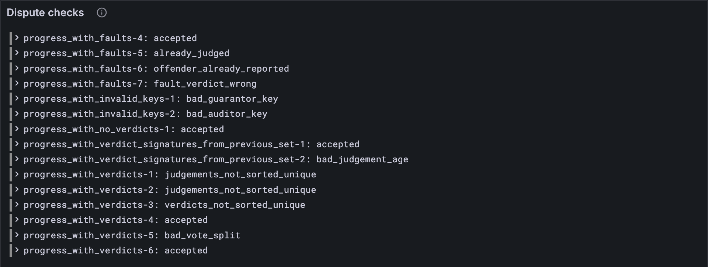

# Bad culprits and faults

[Lesson 10.4](./04-bad-verdicts.md) checked the verdicts. Now the accusations. A culprit says "this validator
vouched for a report that turned out bad", a fault says "this validator voted the wrong
way", and either one gets a validator punished. So they had better be true: about a real
validator, backed by that validator's own signature, and not about someone already
punished. This lesson writes down those rules, and with [lesson 10.4](./04-bad-verdicts.md)'s, your client's
disputes now agree with every disputes vector.

## New words

- **Evidence.** What makes an accusation stick: the accused's own signature. *Example:* a
  culprit carries the guarantee its validator signed; a fault, the vote.
- **Offender (ψ_O).** A validator found guilty; ψ_O holds the keys of every one so far.
  Nobody already found guilty can be accused again. *Example:* a culprit naming a key
  already in ψ_O sinks the block.
- **If and only if (⇔).** The Gray Paper's ⇔ says two things are true together or false
  together. *Example:* "the report is bad ⇔ the fault voted valid".

All three are in the [glossary](../glossary.md).

## What the Gray Paper says

§10 again, after the verdicts. ψ′ here means the judged sets *after* this block's verdicts
([lesson 10.1](./01-votes-and-verdicts.md)'s `recordVerdicts`). Every culprit must keep four rules:

1. **In order.** Culprits sorted by key, no key twice. (`culprits_not_sorted_unique`)
2. **About a bad report.** Its report is in ψ′'s bad set. (`culprits_verdict_not_bad`)
3. **About a validator.** Its key is one of κ's or λ's (`bad_guarantor_key`), and not
   already an offender (`offender_already_reported`).
4. **With evidence.** Its signature is the validator's guarantee of that report ([lesson
   10.2](./02-culprits-and-faults.md)'s `culpritSigned`). (`bad_signature`)

Every fault keeps the same kinds of rule, with the report rule turned round, and the
faults together keep one more:

5. **In order**, by key. (`faults_not_sorted_unique`)
6. **Against the verdict.** It voted valid on a report now judged bad, or invalid on one
   now judged good. (`fault_verdict_wrong`)
7. **About a validator**, not yet an offender (`bad_auditor_key`,
   `offender_already_reported`), **with evidence** (`faultSigned`, `bad_signature`).
8. **Every good verdict has a fault.** A dispute only starts when someone calls a report
   invalid. If it's judged good after all, that someone was wrong, and at least one fault
   must name the report. (`not_enough_faults`)

The Gray Paper writes rule 6 as a double ⇔: r ∈ ψ′_B ⇔ r ∉ ψ′_G ⇔ v. All three are true
together or false together, so a fault on a wonky report (neither bad nor good) fails it
too. A culprit is a guarantor, a fault an auditor, which is where the vectors' names
`bad_guarantor_key` and `bad_auditor_key` come from.

## The tests

**Add to** `test/disputes.test.ts`

```ts
import { disputesError } from "../src/disputes.ts";

/** What every disputes rule says of vector `name`: null (accepted) or the rule broken. */
function disputesVerdict(config: typeof TINY, name: string) {
  const { input, pre_state } = vectorJson(name) as DisputesVector;
  const keys = (list: unknown[]) => list.map((key) => ValidatorKey.fromJson(key));
  const disputes = DisputesExtrinsic.fromJson(input.disputes);
  const before = PastJudgements.fromJson(pre_state.psi);
  const [active, previous] = [keys(pre_state.kappa), keys(pre_state.lambda)];
  return disputesError(config, disputes, before, pre_state.tau, active, previous);
}

test("a fault must have voted against the verdict", () => {
  const name = "stf/disputes/tiny/progress_with_faults-7.json";
  const broken: string | null = disputesVerdict(TINY, name);
  assert.equal(broken, "fault_verdict_wrong");
});

for (const { config, name } of VERDICT_VECTORS) {
  test(`${name}: accepted or refused, as the vector says`, () => {
    const { output } = vectorJson(name) as DisputesVector;
    const broken: string | null = disputesVerdict(config, name);
    const expected: string | null = output.err ?? null;
    assert.equal(broken, expected);
  });
}
```

This time no list of bad vectors is needed. `disputesError` runs every rule, [lesson
10.4](./04-bad-verdicts.md)'s and these, so its answer must be exactly the vector's: accepted, or the error the
vector names. The same vectors as [lesson 10.4](./04-bad-verdicts.md): every tiny one, and the full ones tiny
can't have.

`disputesError` is two lines, so write it for real now: [lesson 10.4](./04-bad-verdicts.md)'s rules first, then
`offenseError`, the rules of this lesson. That one starts as a stub that believes every
accusation:

**Add to** `src/disputes.ts`

```ts
export function offenseError(
  config: Config,
  disputes: DisputesExtrinsic,
  before: PastJudgements, // ψ
  time: number,
  active: ValidatorKey[],
  previous: ValidatorKey[],
): string | null {
  return null;
}

/** Every disputes rule (GP §10): the verdicts' first (lesson 10.4), then the offenders'. */
export function disputesError(
  config: Config,
  disputes: DisputesExtrinsic,
  before: PastJudgements,
  time: number,
  active: ValidatorKey[],
  previous: ValidatorKey[],
): string | null {
  const verdicts = verdictError(config, disputes.verdicts, before, time, active, previous);
  return verdicts ?? offenseError(config, disputes, before, time, active, previous);
}
```

**Run, expect it to fail**

```sh
npm test
```

```text
...
✖ a fault must have voted against the verdict (75.0ms)
...
ℹ tests 157
ℹ suites 0
ℹ pass 146
ℹ fail 11
...
test at test/disputes.test.ts:231:1
✖ a fault must have voted against the verdict (75.0ms)
  AssertionError [ERR_ASSERTION]: Expected values to be strictly equal:
  + actual - expected

  + null
  - 'fault_verdict_wrong'
...
```

Eleven reds again: the fault test, and the ten vectors refused for a culprit or a fault.
Their verdicts are fine, so [lesson 10.4](./04-bad-verdicts.md)'s rules pass them, and the stub believes the
accusation. Every vector refused for its verdicts is green already: `disputesError` is real.

## The code

**Replace in** `src/disputes.ts`

```ts
/**
 * Are a block's culprits and faults valid (GP §10)? The first rule they break, under the
 * test vectors' name for it, or null. Its verdicts are taken as valid: `verdictError`
 * comes first.
 */
export function offenseError(
  config: Config,
  disputes: DisputesExtrinsic,
  before: PastJudgements, // ψ
  time: number,
  active: ValidatorKey[],
  previous: ValidatorKey[],
): string | null {
  const { verdicts, culprits, faults } = disputes;
  const judged = verdicts.map((v) => ({
    target: v.target,
    outcome: outcome(v, judges(config, time, v.age, active, previous).length),
  }));
  const after = recordVerdicts(before, judged); // ψ′
  const [bad, good] = [new Set(after.bad.map(toHex)), new Set(after.good.map(toHex))];
  const validators = new Set([...active, ...previous].map((k) => toHex(k.ed25519))); // κ ∪ λ
  const punished = new Set(before.offenders.map(toHex)); // ψ_O
  const byKey = (list: { key: Bytes }[]) =>
    list.every((x, i) => i === 0 || toHex(list[i - 1].key) < toHex(x.key));
  const known = (x: { key: Bytes }) => validators.has(toHex(x.key));
  const fresh = (x: { key: Bytes }) => !punished.has(toHex(x.key));
  const wrong = (f: Fault) => (f.vote ? bad : good).has(toHex(f.target)); // voted against it
  const faulted = (target: Bytes) => faults.some((f) => toHex(f.target) === toHex(target));
  if (!byKey(culprits)) return "culprits_not_sorted_unique";
  if (!culprits.every((c) => bad.has(toHex(c.target)))) return "culprits_verdict_not_bad";
  if (!culprits.every(known)) return "bad_guarantor_key";
  if (!culprits.every(fresh)) return "offender_already_reported";
  if (!culprits.every(culpritSigned)) return "bad_signature";
  if (!byKey(faults)) return "faults_not_sorted_unique";
  if (!faults.every(wrong)) return "fault_verdict_wrong";
  if (!faults.every(known)) return "bad_auditor_key";
  if (!faults.every(fresh)) return "offender_already_reported";
  if (!faults.every(faultSigned)) return "bad_signature";
  if (!judged.every((j) => j.outcome !== "good" || faulted(j.target))) return "not_enough_faults";
  return null;
}
```

`offenseError` works out ψ′'s bad and good sets the way [lesson 10.1](./01-votes-and-verdicts.md) does, then the rules,
in the order above. `wrong` is rule 6 in one line:

```ts
  const wrong = (f: Fault) => (f.vote ? bad : good).has(toHex(f.target)); // voted against it
```

A fault that voted valid must name a bad report, and one that voted invalid a good
report.

**Run**

```sh
npm test
npm run typecheck
```

```text
...
✔ a fault must have voted against the verdict (6.9ms)
...
ℹ tests 157
ℹ suites 0
ℹ pass 157
ℹ fail 0
...
reported 157 tests to Grafana: http://127.0.0.1:3300/d/gray-tutorial?var-client=you&var-run_id=test-1791732278807
...
```

## Watch it

`bin/check-disputes.ts` checks every rule now, and only mentions the vector when the two
disagree:

**Rewrite** `bin/check-disputes.ts`

```ts
// Checks the disputes of every disputes test vector of one size against the rules (the
// verdicts', then the culprits' and faults'), and shows each verdict next to the vector's:
// accepted, or the first rule broken.
// Usage: node bin/check-disputes.ts [tiny or full], tiny if not given

import { readdirSync, readFileSync } from "node:fs";
import { DisputesExtrinsic } from "../src/block.ts";
import { FULL, TINY } from "../src/config.ts";
import { disputesError, PastJudgements } from "../src/disputes.ts";
import { Run } from "../src/obs.ts";
import { ValidatorKey } from "../src/state.ts";

const config = process.argv[2] === "full" ? FULL : TINY;
const dir = `../vectors/stf/disputes/${config.name}`;
const keys = (list: unknown[]) => list.map((key) => ValidatorKey.fromJson(key));
const run = new Run("dispute-check");
for (const file of readdirSync(dir).filter((f) => f.endsWith(".json")).sort()) {
  const { input, pre_state, output } = JSON.parse(readFileSync(`${dir}/${file}`, "utf8"));
  const disputes = DisputesExtrinsic.fromJson(input.disputes);
  const before = PastJudgements.fromJson(pre_state.psi);
  const [active, previous] = [keys(pre_state.kappa), keys(pre_state.lambda)];
  const error = disputesError(config, disputes, before, pre_state.tau, active, previous);
  const ours = error ?? "accepted";
  const theirs = output.err ?? "accepted";
  const name = file.replace(".json", "");
  console.log(`${name}: ${ours}${ours === theirs ? "" : ` (the vector says ${theirs})`}`);
  run.event("vector", { name, ours, theirs, agree: ours === theirs });
}
const link = await run.report();
if (link) console.log(`reported to Grafana: ${link}`);
```

**Run**

```sh
node bin/check-disputes.ts
```

```text
progress_invalidates_avail_assignments-1: accepted
progress_with_bad_signatures-1: bad_signature
progress_with_bad_signatures-2: bad_signature
progress_with_bad_verdict_without_culprits-1: accepted
progress_with_bad_verdict_without_culprits-2: accepted
progress_with_bad_votes_count-1: bad_votes_count
progress_with_culprits-1: culprits_not_sorted_unique
progress_with_culprits-2: accepted
progress_with_culprits-3: already_judged
progress_with_culprits-4: offender_already_reported
progress_with_culprits-5: culprits_verdict_not_bad
progress_with_faults-1: not_enough_faults
progress_with_faults-2: accepted
progress_with_faults-3: faults_not_sorted_unique
progress_with_faults-4: accepted
progress_with_faults-5: already_judged
progress_with_faults-6: offender_already_reported
progress_with_faults-7: fault_verdict_wrong
progress_with_invalid_keys-1: bad_guarantor_key
progress_with_invalid_keys-2: bad_auditor_key
progress_with_no_verdicts-1: accepted
progress_with_verdict_signatures_from_previous_set-1: accepted
progress_with_verdict_signatures_from_previous_set-2: bad_judgement_age
progress_with_verdicts-1: judgements_not_sorted_unique
progress_with_verdicts-2: judgements_not_sorted_unique
progress_with_verdicts-3: verdicts_not_sorted_unique
progress_with_verdicts-4: accepted
progress_with_verdicts-5: bad_vote_split
progress_with_verdicts-6: accepted
reported to Grafana: http://127.0.0.1:3300/d/gray-tutorial?var-client=you&var-run_id=dispute-check-1791732283740
```

Twenty-nine vectors and not one "the vector says": your client's disputes agree with all
of them. `node bin/check-disputes.ts full` says the same of the full ones (give it a
minute). The *Dispute checks* panel, on **4 · Checks**, keeps the list.



<details>
<summary>lasair: rule 6 word for word, in <code>conformance/disputes_stf.ml</code></summary>

```ocaml
    let fault_consistent (f : fault) =
      let in_bad = List.exists (Bytes.equal f.target) psi_after_verdicts.bad in
      let not_good = not (List.exists (Bytes.equal f.target) psi_after_verdicts.good) in
      in_bad = not_good && not_good = f.vote in
```

lasair copies the Gray Paper's double ⇔ term by term: in the bad set, equals not in the
good set, equals the vote. Your `wrong` says the same in fewer words, because it leans on
one more fact: a report is never judged both good and bad. Both ways, a fault on a wonky
report is refused.

</details>

## What you have

The whole court, checked: every verdict, culprit and fault in a block follows the rules,
and every disputes vector is accepted or refused just as it should be. Disputes are for
the rare report that's wrong. [Part 11](../11-assurances/index.md) is what happens to every report on a core:
validators vouching that its data really is available.

Next: [Part 11 · Assurances](../11-assurances/index.md)
