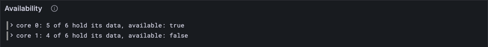

# Available

A guaranteed work-report sits on its core ([lesson 10.3](../10-disputes/03-clearing-the-cores.md)) until JAM is sure its data won't
vanish: enough validators must hold their pieces of it. Every block, validators send
*assurances*, [lesson 4.2](../04-blocks/02-tiny-and-full.md)'s bitfields: one bit per core, 1 meaning "I hold my share of
this core's data". Count the 1s for a core, and if more than two thirds of the
validators say so, the report is *available*. This lesson counts.

## New words

- **Assurance and availability.** Each validator signs one bit per core: "I hold my piece
  of this core's data". When more than two thirds of them do, the core's report is
  *available*. *Example:* on tiny, 5 of the 6 validators.

It's in the [glossary](../glossary.md).

## What the Gray Paper says

§11 (*Package Availability Assurances*). Each assurance carries a bitfield of C bits.

**Which bit is which core?** Appendix C packs bits into bytes **least significant
first**: core 0 is the lowest bit of byte 0, core 7 the highest, core 8 the lowest bit
of byte 1. So `0x05`, `0000 0101`, means cores 0 and 2.

Careful: that's the *opposite* of [lesson 6.1](../06-state-and-merklization/01-the-state-trie.md)'s trie, which reads key bits most
significant first. JAM uses both orders, each in its own place. Mixing them up is a
classic way to spend an afternoon.

**When is a report available?** 𝐑, the newly available reports, takes the cores in
order, and a core's report joins 𝐑 if the number of assurances with its bit set is
greater than ⅔·|κ|: more than two thirds of the current validators. With 6 validators
that's 5 or more; with 1,023, it's 683 or more.

To stay in whole numbers, multiply both sides by 3: assured × 3 > validators × 2. No
fractions, no rounding, no floating point.

## The tests

**New file** `test/assurances.test.ts`

```ts
import { test } from "node:test";
import assert from "node:assert/strict";
import { assuredCount, bitAt, nowAvailable } from "../src/assurances.ts";
import { Assurance } from "../src/block.ts";
import { fromHex } from "../src/bytes.ts";
import type { Config } from "../src/config.ts";
import { FULL, TINY } from "../src/config.ts";
import { PendingReports } from "../src/cores.ts";
import { WorkReport } from "../src/work.ts";
import { vectorFiles, vectorJson } from "./vectors.ts";

test("bits are packed least significant first: 0x05 is cores 0 and 2", () => {
  const bitfield = fromHex("0x05"); // 0000 0101
  assert.deepEqual([0, 1, 2, 3].map((c) => bitAt(bitfield, c)), [true, false, true, false]);
  assert.equal(bitAt(fromHex("0x0001"), 8), true); // core 8: the lowest bit of byte 1
});

/** An assurances test vector: the parts of it this lesson uses. */
type AssurancesVector = {
  input: { assurances: unknown[]; slot: number };
  pre_state: { avail_assignments: unknown; curr_validators: unknown[] };
  output: { err?: string; ok?: { reported: unknown[] } };
};

/** The accepted assurances vectors of a size: a rejected block changes nothing. */
function acceptedVectors(config: Config): { name: string; vector: AssurancesVector }[] {
  return vectorFiles(`stf/assurances/${config.name}`)
    .map((name) => ({ name, vector: vectorJson(name) as AssurancesVector }))
    .filter(({ vector }) => !vector.output.err);
}

test("𝐑: a report becomes available when more than two thirds of κ hold its data", () => {
  let available = 0;
  for (const config of [TINY, FULL]) {
    for (const { name, vector } of acceptedVectors(config)) {
      const { input, pre_state, output } = vector;
      const cores = PendingReports(config).fromJson(pre_state.avail_assignments);
      const assurances = input.assurances.map((a) => Assurance(config).fromJson(a));
      const reports = nowAvailable(cores, assurances, pre_state.curr_validators.length);
      const expected = (output.ok?.reported ?? []).map((r) => WorkReport.fromJson(r));
      assert.deepEqual(reports, expected, name);
      available += reports.length;
    }
  }
  assert.equal(available, 53); // 4 on tiny, 49 on full
});

test("on tiny, 5 of 6 validators make a report available, and 4 don't", () => {
  // 3 × 5 = 15 > 12 = 2 × 6, but 3 × 4 = 12 is not
  const vector = vectorJson("stf/assurances/tiny/some_assurances-1.json") as AssurancesVector;
  const assurances = vector.input.assurances.map((a) => Assurance(TINY).fromJson(a));
  assert.deepEqual([0, 1].map((core) => assuredCount(assurances, core)), [5, 4]);
});
```

The second test checks 𝐑, the list of newly available reports, against every accepted
vector, in core order. The third looks inside one tiny vector: core 0 gets 5 assurances
and core 1 gets 4, just either side of the line.

**Run, expect it to fail**

```sh
npm test
```

```text
...
Error [ERR_MODULE_NOT_FOUND]: Cannot find module '…/client/src/assurances.ts' imported from …/client/test/assurances.test.ts
...
✖ test/assurances.test.ts (191.1ms)
...
ℹ tests 158
ℹ suites 0
ℹ pass 157
ℹ fail 1
...
```

Red: `src/assurances.ts` doesn't exist yet. It's three small functions that build on one
another, so they come together, and the next Run turns the new tests green at once.

## The code

**New file** `src/assurances.ts`

```ts
// Assurances (GP §11): validators say which cores' data they hold, and a report whose data
// enough of them hold becomes available.

import type { Assurance } from "./block.ts";
import type { Bytes } from "./bytes.ts";
import type { PendingReport } from "./cores.ts";
import type { WorkReport } from "./work.ts";

/** Bit c of a bitfield. Bits are packed least significant first (GP App. C). */
export function bitAt(bitfield: Bytes, c: number): boolean {
  return ((bitfield[Math.floor(c / 8)] >> (c % 8)) & 1) === 1;
}

/** How many assurances say "I hold this core's data". */
export function assuredCount(assurances: Assurance[], core: number): number {
  return assurances.filter((assurance) => bitAt(assurance.bitfield, core)).length;
}

/** 𝐑: the reports that become available, core by core: more than 2/3 of κ assure them. */
export function nowAvailable(
  cores: (PendingReport | null)[],
  assurances: Assurance[],
  validators: number, // |κ|
): WorkReport[] {
  const available: WorkReport[] = [];
  cores.forEach((pending, core) => {
    const assured = assuredCount(assurances, core);
    if (pending !== null && 3 * assured > 2 * validators) available.push(pending.guarantee.report);
  });
  return available;
}
```

`bitAt` is [lesson 6.1](../06-state-and-merklization/01-the-state-trie.md)'s `bit`, flipped:

```ts
  return ((bitfield[Math.floor(c / 8)] >> (c % 8)) & 1) === 1;
```

`>> (c % 8)` instead of `>> (7 - (i % 8))`: least significant first instead of most. (And
it answers `true` or `false`.)

**Run**

```sh
npm test
npm run typecheck
```

```text
...
✔ bits are packed least significant first: 0x05 is cores 0 and 2 (10.1ms)
✔ 𝐑: a report becomes available when more than two thirds of κ hold its data (144.7ms)
✔ on tiny, 5 of 6 validators make a report available, and 4 don't (1.1ms)
...
ℹ tests 160
ℹ suites 0
ℹ pass 160
ℹ fail 0
...
reported 160 tests to Grafana: http://127.0.0.1:3300/d/gray-tutorial?var-client=you&var-run_id=test-1791733586523
...
```

53 reports became available across the accepted vectors, every one of them in the right
order: 4 on tiny, 49 on full.

## Watch it

**New file** `bin/available.ts`

```ts
// Counts, core by core, how many validators of an assurances test vector hold each pending
// report's data, and which reports become available.
// Usage: node bin/available.ts <vector.json>, e.g.
//        node bin/available.ts ../vectors/stf/assurances/tiny/some_assurances-1.json

import { readFileSync } from "node:fs";
import { assuredCount } from "../src/assurances.ts";
import { Assurance } from "../src/block.ts";
import { FULL, TINY } from "../src/config.ts";
import { PendingReports } from "../src/cores.ts";
import { Run } from "../src/obs.ts";

const [file] = process.argv.slice(2);
const config = file.includes("/full/") ? FULL : TINY;
const { input, pre_state } = JSON.parse(readFileSync(file, "utf8"));
const cores = PendingReports(config).fromJson(pre_state.avail_assignments);
const assurances = input.assurances.map((a: unknown) => Assurance(config).fromJson(a));
const validators = pre_state.curr_validators.length;
const run = new Run("available");
let available = 0;
cores.forEach((pending, core) => {
  if (pending === null) return;
  const assured = assuredCount(assurances, core);
  const now = 3 * assured > 2 * validators;
  if (now) available++;
  const verdict = now ? "available!" : "still waiting";
  const where = `core ${String(core).padStart(3)}`;
  console.log(`${where}: ${assured} of ${validators} hold its data: ${verdict}`);
  run.event("core", { core, assured, validators, available: now });
});
console.log(`reports that became available: ${available}`);
const link = await run.report();
if (link) console.log(`reported to Grafana: ${link}`);
```

**Run**

```sh
node bin/available.ts ../vectors/stf/assurances/tiny/some_assurances-1.json
```

```text
core   0: 5 of 6 hold its data: available!
core   1: 4 of 6 hold its data: still waiting
reports that became available: 1
reported to Grafana: http://127.0.0.1:3300/d/gray-tutorial?var-client=you&var-run_id=available-1791733590339
```

Now the full-size version, `../vectors/stf/assurances/full/some_assurances-1.json`. Its
cores alternate: 683 of 1023, *available*; 682 of 1023, *still waiting*. The test
vectors sit exactly on the line, one validator either side, which is precisely where a
`>=` instead of a `>` would be caught. The *Availability* panel lists every core.



<details>
<summary>lasair: the threshold, in <code>conformance/assurances_stf.ml</code></summary>

```ocaml
      (* Determine threshold for availability (strict 2/3 supermajority)
         Need MORE than 2/3, so: floor(2n/3) + 1
         For n=6: floor(12/3) + 1 = 4 + 1 = 5 *)
      (* GP 0.8.0: relative to |kappa| (the set the assurers signed under) *)
      let threshold = (2 * List.length pre.curr_validators) / 3 + 1 in
```

"More than two thirds", written another way: at least ⌊2n/3⌋ + 1, compared with `>=`.
Your `3 * assured > 2 * validators` and lasair's threshold agree for every n: two
whole-number spellings of the same fraction. Pick the one you can check in your head.

</details>

## What you have

Your client can read a bitfield the right way round, count assurances per core, and say
which reports just became available. A report that never gets there can't sit on its
core forever, though: [lesson 11.2](./02-timeouts.md) decides when a core lets go.

Next: [11.2 Timeouts](./02-timeouts.md)
