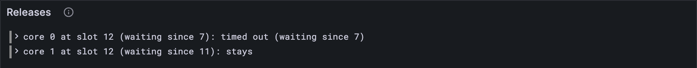

# Timeouts

A core holds one report at a time, so a report that never becomes available would block
its core forever. JAM won't allow that. This lesson writes the rule for when a core lets
go: the report made it, the report took too long, or the ground shifted under it.
Then Part 11 is done.

## What the Gray Paper says

§11 again: ρ‡, the cores after the assurances. A core's pending report p is dropped
when any of these holds:

1. **p became available** (lesson 11.1): its job on the core is done. It moves on to be
   accumulated (Part 17).
2. **p timed out**: the block's slot is at least p's `registered_slot` + U, where
   **U = 5** slots. Thirty seconds to gather its assurances, or it's out.
3. **The validator set changed size**: |κ| ≠ |κ′|. Every pending report goes. The Gray
   Paper calls it "timed out early": the assurances were counted against the old set,
   and with a new number of validators the arithmetic no longer means anything.

Otherwise p stays, and waits another block.

## Splitting a function

`clearCores` needs to know *which cores* became available, and lesson 11.1's
`nowAvailable` already works that out, but only hands back the reports. So split it:
`availableCores` finds the cores, and `nowAvailable` turns them into reports. Same
behaviour, and now both users share the counting.

**Add to** `src/assurances.ts`

```ts
/** The cores whose pending report becomes available: more than 2/3 of κ hold its data. */
export function availableCores(
  cores: (PendingReport | null)[],
  assurances: Assurance[],
  validators: number, // |κ|
): number[] {
  const available: number[] = [];
  cores.forEach((pending, core) => {
    const assured = assuredCount(assurances, core);
    if (pending !== null && 3 * assured > 2 * validators) available.push(core);
  });
  return available;
}
```

**Replace in** `src/assurances.ts`

```ts
/** 𝐑: the reports that become available, core by core. */
export function nowAvailable(
  cores: (PendingReport | null)[],
  assurances: Assurance[],
  validators: number,
): WorkReport[] {
  const available = availableCores(cores, assurances, validators);
  return available.map((core) => (cores[core] as PendingReport).guarantee.report);
}
```

`cores[core] as PendingReport` tells TypeScript what you already know: `availableCores`
only returns cores that hold a report.

## The tests

**Replace in** `test/assurances.test.ts`

```ts
/** An assurances test vector: the parts of it this lesson uses. */
type AssurancesVector = {
  input: { assurances: unknown[]; slot: number };
  pre_state: { avail_assignments: unknown; curr_validators: unknown[]; post_validators: unknown[] };
  post_state: { avail_assignments: unknown };
  output: { err?: string; ok?: { reported: unknown[] } };
};
```

**Add to** `test/assurances.test.ts`

```ts
import { availableCores, clearCores } from "../src/assurances.ts";
import type { PendingReport } from "../src/cores.ts";

test("ρ‡: a core lets go of a report once available, timed out, or the set resizes", () => {
  let released = 0;
  for (const config of [TINY, FULL]) {
    for (const { name, vector } of acceptedVectors(config)) {
      const { input, pre_state, post_state } = vector;
      const cores = PendingReports(config).fromJson(pre_state.avail_assignments);
      const assurances = input.assurances.map((a) => Assurance(config).fromJson(a));
      const validators = pre_state.curr_validators.length;
      const available = availableCores(cores, assurances, validators);
      const resized = validators !== pre_state.post_validators.length;
      const after = clearCores(cores, available, input.slot, resized);
      assert.deepEqual(after, PendingReports(config).fromJson(post_state.avail_assignments), name);
      released += cores.filter((p) => p !== null).length - after.filter((p) => p !== null).length;
    }
  }
  assert.equal(released, 87); // 6 on tiny, 81 on full
});

test("a report registered at slot 7 may wait through slot 11, and times out at 12", () => {
  const vector = vectorJson("stf/assurances/tiny/no_assurances-1.json") as AssurancesVector;
  const cores = PendingReports(TINY).fromJson(vector.pre_state.avail_assignments);
  const pending = { ...(cores[0] as PendingReport), registered_slot: 7 };
  assert.deepEqual(clearCores([pending], [], 11, false), [pending]);
  assert.deepEqual(clearCores([pending], [], 12, false), [null]); // 12 ≥ 7 + 5
});
```

The second test pins the timeout's edge: a report registered at slot 7 is still welcome
at slot 11 (11 < 12), and gone at 12. The vector `no_assurances_with_stale_report-1`
has exactly that case at tiny size. `{ ...pending, registered_slot: 7 }` copies a real
pending report with one field changed.

**Run, expect it to fail**

```sh
npm test
# fails with: does not provide an export named
```

## The code

**Add to** `src/assurances.ts`

```ts
/** U: the slots a report may wait on its core for its data to become available. */
export const AVAILABILITY_TIMEOUT = 5;

/**
 * ρ‡ (GP §11): a core lets go of its report when the report became available, when it
 * has waited U slots, or when the number of validators changed.
 */
export function clearCores(
  cores: (PendingReport | null)[],
  available: number[], // the cores whose report became available
  slot: number, // this block's slot
  resized: boolean, // |κ| ≠ |κ′|
): (PendingReport | null)[] {
  return cores.map((pending, core) => {
    if (pending === null) return null;
    const timedOut = slot >= pending.registered_slot + AVAILABILITY_TIMEOUT;
    return available.includes(core) || timedOut || resized ? null : pending;
  });
}
```

**Run**

```sh
npm test
# prints: ρ‡: a core lets go of a report once available, timed out, or the set resizes
# prints: a report registered at slot 7 may wait through slot 11, and times out at 12
# prints: fail 0
# prints: reported
npm run typecheck
```

87 cores freed across the accepted vectors, 6 on tiny and 81 on full, and every core
that should keep its report kept it.

## Watch it

**New file** `bin/release.ts`

```ts
// Shows what happens to each core's pending report in an assurances test vector: it
// became available, it timed out, the validator set resized, or it stays.
// Usage: node bin/release.ts <vector.json>, for example:
//   node bin/release.ts ../vectors/stf/assurances/tiny/no_assurances_with_stale_report-1.json

import { readFileSync } from "node:fs";
import { AVAILABILITY_TIMEOUT, availableCores } from "../src/assurances.ts";
import { Assurance } from "../src/block.ts";
import { FULL, TINY } from "../src/config.ts";
import { PendingReports } from "../src/cores.ts";
import { Run } from "../src/obs.ts";

const [file] = process.argv.slice(2);
const config = file.includes("/full/") ? FULL : TINY;
const { input, pre_state } = JSON.parse(readFileSync(file, "utf8"));
const cores = PendingReports(config).fromJson(pre_state.avail_assignments);
const assurances = input.assurances.map((a: unknown) => Assurance(config).fromJson(a));
const validators = pre_state.curr_validators.length;
const available = availableCores(cores, assurances, validators);
const next = pre_state.post_validators.length; // |κ′|
const resized = validators !== next;
const run = new Run("release");
cores.forEach((pending, core) => {
  if (pending === null) return;
  const since = pending.registered_slot;
  let fate = "stays";
  if (available.includes(core)) fate = "became available";
  else if (input.slot >= since + AVAILABILITY_TIMEOUT) fate = `timed out (waiting since ${since})`;
  else if (resized) fate = `cleared: κ goes from ${validators} to ${next}`;
  console.log(`core ${String(core).padStart(3)} at slot ${input.slot}: ${fate}`);
  run.event("core", { core, slot: input.slot, since, fate });
});
const link = await run.report();
if (link) console.log(`reported to Grafana: ${link}`);
```

**Run**

```sh
node bin/release.ts ../vectors/stf/assurances/tiny/no_assurances_with_stale_report-1.json
# prints: core   0 at slot 12: timed out (waiting since 7)
# prints: core   1 at slot 12: stays
# prints: reported to Grafana
```

Two reports, nobody assuring either, and two different fates: one has waited its five
slots, the other has only waited one. Try
`val_set_size_change_clears_pending_reports-1.json`, where κ goes from 6 validators to
3 and the waiting report is swept away. The *Releases* panel shows each core's fate.



<details>
<summary>lasair: one pass, in <code>conformance/assurances_stf.ml</code></summary>

```ocaml
      let new_assignments = List.mapi (fun core assignment ->
        match assignment with
        | None -> None
        | Some ({ report = r; registered_slot; _ } as a) ->
          (* GP: cleared when tau' >= registered_slot + U (U = 5 slots) *)
          let is_stale = input.slot >= registered_slot + 5 in
          (* Check if core has achieved availability *)
          if core_counts.(core) >= threshold then begin
            available_reports := r :: !available_reports;
            None  (* Remove from assignments *)
          end else if is_stale || set_resized then
            None  (* Remove stale reports / early timeout on set resize *)
          else
            Some a
      ) pre.avail_assignments in
```

lasair does 𝐑 and ρ‡ in a single pass: each core either hands its report to the
available list and empties, or empties for a timeout or a resize, or keeps it. Yours
takes two smaller steps. Both are fine. One pass is a little faster; two steps are
easier to test one at a time.

</details>

## What you have

Part 11, done: your client reads every assurance, makes reports available, and frees
the cores of reports that made it, ran out of time, or outlived their validator set.

Next: [11.3 Bad assurances](./03-bad-assurances.md)
