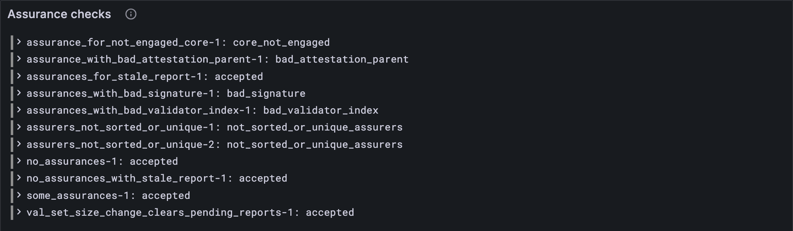

# Bad assurances

So far your client has believed every assurance it was handed. A real block can carry a
broken one: signed with the wrong key, anchored on the wrong block, claiming a core that
has nothing on it. A client must refuse such a block outright. This lesson writes down
the five rules an assurance must keep, and checks them against every assurances test
vector, including the six that are meant to fail.

## New words

- **Anchor.** The block an assurance was made on top of: it must be the parent of the
  block carrying it. *Example:* an assurance anchored two blocks back is refused.
- **Rejected block.** A block that breaks any rule. It's refused whole: nothing in it
  counts, and the state stays exactly as it was. *Example:* one bad signature among six
  assurances sinks the block.
- **Error name.** The test vectors' name for the rule a rejected block breaks.
  *Example:* `bad_signature`.

All three are in the [glossary](../glossary.md).

## What the Gray Paper says

§11.2, *The Assurances Extrinsic*. Every assurance in a block must keep five rules:

1. **Anchored on the parent.** Its anchor is H_P, the hash of the block before this one.
   (`bad_attestation_parent`)
2. **From a real validator.** Its index is below |κ|: there's no validator 6 among 6.
   (`bad_validator_index`)
3. **One per validator, in order.** The indices go strictly up: sorted, and no validator
   twice. (`not_sorted_or_unique_assurers`)
4. **Only cores with something on them.** A bit may be set only for a core with a report
   pending in ρ†, the cores after the judgments. (`core_not_engaged`)
5. **Signed.** By that validator's Ed25519 key in κ, over [lesson 5.3](../05-hashing-and-signatures/03-signatures.md)'s message: `jam_available`
   and the hash of the parent and the bitfield. (`bad_signature`)

Break any one and the whole block is invalid.

The Gray Paper says which rules hold, not which one to name first when several break.
The vectors pin that down in one place: an index past the end is named before an
unsorted list. Fair enough, since the Gray Paper's own type for an assurance (an index
*below |κ|*) makes such an assurance not even an assurance. The other choice is this
client's own: the signatures come last, because checking one is far slower than
comparing two numbers, so it's worth doing only once everything cheap has passed.

## The tests

The vectors give the block's parent too, so the test vector type grows a field:

**Replace in** `test/assurances.test.ts`

```ts
/** An assurances test vector: the parts of it this lesson uses. */
type AssurancesVector = {
  input: { assurances: unknown[]; slot: number; parent: string };
  pre_state: {
    avail_assignments: unknown;
    curr_validators: { ed25519: string }[];
    post_validators: unknown[];
  };
  post_state: { avail_assignments: unknown };
  output: { err?: string; ok?: { reported: unknown[] } };
};
```

**Add to** `test/assurances.test.ts`

```ts
import { assuranceError } from "../src/assurances.ts";

/** What the rules say of assurances vector `name`: null (accepted) or the rule broken. */
function verdict(config: Config, name: string) {
  const { input, pre_state } = vectorJson(name) as AssurancesVector;
  const assurances = input.assurances.map((a) => Assurance(config).fromJson(a));
  const keys = pre_state.curr_validators.map((k) => fromHex(k.ed25519)); // κ
  const cores = PendingReports(config).fromJson(pre_state.avail_assignments); // ρ†
  return assuranceError(assurances, fromHex(input.parent), keys, cores);
}

test("an assurance for a core with nothing on it is refused", () => {
  const name = "stf/assurances/tiny/assurance_for_not_engaged_core-1.json";
  assert.equal(verdict(TINY, name), "core_not_engaged");
});

for (const config of [TINY, FULL]) {
  for (const name of vectorFiles(`stf/assurances/${config.name}`)) {
    test(`${name}: accepted or refused, as the vector says`, () => {
      const { output } = vectorJson(name) as AssurancesVector;
      assert.equal(verdict(config, name), output.err ?? null);
    });
  }
}
```

`verdict` reads a vector the way the rules need it: the assurances, the parent, κ's keys
(the vectors' `curr_validators`) and the cores. Every vector then gets one test: accepted
(`null`) or refused for the reason the vector gives.

**Run, expect it to fail**

```sh
npm test
# fails with: does not provide an export named
```

## The code

**Add to** `src/assurances.ts`

```ts
import { assuranceSigned } from "./block.ts";
import { toHex } from "./bytes.ts";

/**
 * Are a block's assurances valid (GP §11.2)? The first rule they break, under the test
 * vectors' name for it, or null if they keep every rule. `keys` is κ's Ed25519 keys and
 * `cores` is ρ†, the cores after the judgments. The signatures go last: they're the slow
 * check.
 */
export function assuranceError(
  assurances: Assurance[],
  parent: Bytes, // H_P: the parent block's hash
  keys: Bytes[],
  cores: (PendingReport | null)[],
): string | null {
  const ordered = (a: Assurance, i: number) =>
    i === 0 || assurances[i - 1].validator_index < a.validator_index;
  const engaged = (a: Assurance) =>
    cores.every((pending, c) => pending !== null || !bitAt(a.bitfield, c));
  if (!assurances.every((a) => toHex(a.anchor) === toHex(parent))) return "bad_attestation_parent";
  if (!assurances.every((a) => a.validator_index < keys.length)) return "bad_validator_index";
  if (!assurances.every(ordered)) return "not_sorted_or_unique_assurers";
  if (!assurances.every(engaged)) return "core_not_engaged";
  if (!assurances.every((a) => assuranceSigned(keys, a))) return "bad_signature";
  return null;
}
```

Five rules, five lines, in the order above. `every` asks whether all the assurances keep
a rule. `ordered` compares each assurance with the one before it, and `engaged` walks
every core and asks: a bit set here, with nothing on the core?

**Run**

```sh
npm test
# prints: an assurance for a core with nothing on it is refused
# prints: fail 0
# prints: reported
npm run typecheck
```

## Watch it

**New file** `bin/check-assurances.ts`

```ts
// Checks the assurances of every assurances test vector of one size against the rules, and
// shows each verdict next to the vector's: accepted, or the rule it breaks.
// Usage: node bin/check-assurances.ts [tiny or full], tiny if not given

import { readdirSync, readFileSync } from "node:fs";
import { assuranceError } from "../src/assurances.ts";
import { Assurance } from "../src/block.ts";
import { fromHex } from "../src/bytes.ts";
import { FULL, TINY } from "../src/config.ts";
import { PendingReports } from "../src/cores.ts";
import { Run } from "../src/obs.ts";

const config = process.argv[2] === "full" ? FULL : TINY;
const dir = `../vectors/stf/assurances/${config.name}`;
const run = new Run("assurance-check");
for (const file of readdirSync(dir).filter((f) => f.endsWith(".json")).sort()) {
  const { input, pre_state, output } = JSON.parse(readFileSync(`${dir}/${file}`, "utf8"));
  const assurances = input.assurances.map((a: unknown) => Assurance(config).fromJson(a));
  const keys = pre_state.curr_validators.map((k: { ed25519: string }) => fromHex(k.ed25519));
  const cores = PendingReports(config).fromJson(pre_state.avail_assignments);
  const ours = assuranceError(assurances, fromHex(input.parent), keys, cores) ?? "accepted";
  const theirs = output.err ?? "accepted";
  const name = file.replace(".json", "");
  console.log(`${name}: ${ours}${ours === theirs ? "" : ` (the vector says ${theirs})`}`);
  run.event("vector", { name, ours, theirs, agree: ours === theirs });
}
const link = await run.report();
if (link) console.log(`reported to Grafana: ${link}`);
```

**Run**

```sh
node bin/check-assurances.ts
# prints: assurances_with_bad_signature-1: bad_signature
# prints: some_assurances-1: accepted
```

Eleven vectors, eleven verdicts, and no "the vector says" anywhere: your rules and the
vectors agree on every one. `node bin/check-assurances.ts full` does the same for the full
vectors. The *Assurance checks* panel keeps the list.



<details>
<summary>lasair: the same rules, in <code>conformance/assurances_stf.ml</code></summary>

The index first, then the order:

```ocaml
      if a.validator_index < 0 || a.validator_index >= List.length pre.curr_validators then
        Result.Error "bad_validator_index"
```

```ocaml
    if not (check_assurers_sorted_unique input.assurances) then
      Result.Error "not_sorted_or_unique_assurers"
```

Then lasair takes one assurance at a time: its anchor, its cores, its signature. Its own
comment on the cores check says why that one comes early:

```ocaml
        (* Check that ALL cores in bitfield have an assignment (before signature) *)
```

The same two choices as yours: an index past the end is named first, and the signature
waits for everything cheaper.

</details>

## What you have

Assurances that are checked, not trusted: five rules, and every official assurances
vector, tiny and full, accepted or refused just as it should be.

Next: [Part 12 · Guarantees](../12-guarantees/index.md)
