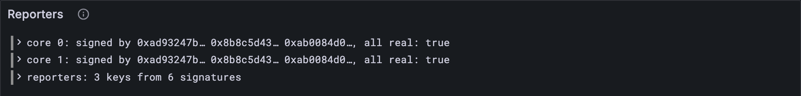

# Signed and counted

A guarantee is a promise with signatures on it: "we ran this work, and this is the
report". This lesson checks that every signature is real and made by a guarantor of the
right core. Then it writes down who signed: the **reporters**, which the statistics
(Part 18) will credit for the work.

## What the Gray Paper says

§11 (*Work Report Guarantees*). For each signature (v, s) on a guarantee, with (c, k)
the assignment the guarantee answers to ([lesson 12.1](./01-who-guarantees-what.md)):

- s must be the Ed25519 signature of k[v], validator v's key, on `$jam_guarantee` ⌢ H(the
  report). That's the same message a culprit's evidence carries ([lesson 10.2](../10-disputes/02-culprits-and-faults.md)): a
  guarantee is exactly the signature that convicts its signers if the report turns out
  bad.
- k is the assignment's keys *after* Φ ([lesson 8.2](../08-safrole/02-rotating-the-validators.md)): an offender's key is all zeros.
  So even a genuine signature from an offender can't check out. Banned means banned.

**𝐆, the reporters**, is the set of Ed25519 keys of everyone who signed any guarantee
in the block. A *set*: each key once, however many guarantees it signed.

## Sharing a message

Culprits ([lesson 10.2](../10-disputes/02-culprits-and-faults.md)) and guarantees sign the same message, so it gets one home:

**Add to** `src/disputes.ts`

```ts
/** What a guarantor signs about a report: X_G, then the report's hash. */
export function guaranteeMessage(reportHash: Bytes): Bytes {
  return concatBytes(GUARANTEE, reportHash);
}
```

**Replace in** `src/disputes.ts`

```ts
/** Whether a culprit's signature really is its guarantee of the report: the evidence. */
export function culpritSigned(culprit: Culprit): boolean {
  return verifyEd25519(culprit.key, guaranteeMessage(culprit.target), culprit.signature);
}
```

## The tests

[Lesson 12.1](./01-who-guarantees-what.md)'s `signerCores` worked out each guarantee's assignment inline; the new tests
need that too. So `assigned` does it once, and `signerCores` is rebuilt on top:

**Replace in** `test/guarantors.test.ts`

```ts
/** A reports test vector: the parts of it this lesson uses. */
type ReportsVector = {
  input: { guarantees: unknown[]; slot: number };
  pre_state: {
    curr_validators: unknown[];
    prev_validators: unknown[];
    entropy: string[];
    offenders: string[];
  };
  output: { err?: string; ok?: { reporters: string[] } };
};

/** For each guarantee in a reports vector: its report's core, and the signers' cores. */
function signerCores(config: Config, vector: ReportsVector) {
  return assigned(config, vector).map(({ guarantee, assignment }) => ({
    core: guarantee.report.core_index,
    signers: guarantee.signatures.map((s) => assignment.cores[s.validator_index]),
  }));
}
```

**Add to** `test/guarantors.test.ts`

```ts
import { guaranteeSigned, reporters, signerKeys } from "../src/guarantors.ts";
import type { Bytes } from "../src/bytes.ts";
import { toHex } from "../src/bytes.ts";

/** Each guarantee in a reports vector, with the assignment, M or M*, it answers to. */
function assigned(config: Config, vector: ReportsVector) {
  const { input, pre_state } = vector;
  const keys = (list: unknown[]) => list.map((key) => ValidatorKey.fromJson(key));
  const assignments = guarantorAssignments(
    config,
    input.slot,
    pre_state.entropy.map(fromHex),
    keys(pre_state.curr_validators),
    keys(pre_state.prev_validators),
    pre_state.offenders.map(fromHex),
  );
  return GuaranteesExtrinsic.fromJson(input.guarantees).map((guarantee) => ({
    guarantee,
    assignment: assignmentFor(config, input.slot, guarantee.slot, assignments),
  }));
}

test("every accepted guarantee is signed by its guarantors, and 𝐆 lists them once each", () => {
  let checked = 0;
  for (const config of [TINY, FULL]) {
    for (const name of vectorFiles(`stf/reports/${config.name}`)) {
      const vector = vectorJson(name) as ReportsVector;
      if (vector.output.err) continue;
      const signers: Bytes[] = [];
      for (const { guarantee, assignment } of assigned(config, vector)) {
        assert.ok(guaranteeSigned(guarantee, assignment.keys), name);
        signers.push(...signerKeys(guarantee, assignment.keys));
        checked++;
      }
      assert.deepEqual(reporters(signers).map(toHex), vector.output.ok?.reporters, name);
    }
  }
  assert.equal(checked, 44); // 21 guarantees on tiny, 23 on full
});

test("a forged guarantee signature is caught", () => {
  const vector = vectorJson("stf/reports/tiny/bad_signature-1.json") as ReportsVector;
  const [{ guarantee, assignment }] = assigned(TINY, vector);
  assert.equal(guaranteeSigned(guarantee, assignment.keys), false);
});
```

`assigned` is a plain `function` declaration, so it can sit below the tests that use it:
JavaScript lifts ("hoists") function declarations to the top of their file.

**Run, expect it to fail**

```sh
npm test
# fails with: does not provide an export named
```

## The code

**Add to** `src/guarantors.ts`

```ts
import { fromHex, toHex } from "./bytes.ts";
import type { ReportGuarantee } from "./block.ts";
import { encode } from "./codec/codec.ts";
import { guaranteeMessage } from "./disputes.ts";
import { blake2b256 } from "./hash.ts";
import { verifyEd25519 } from "./signature.ts";
import { WorkReport } from "./work.ts";

/** The Ed25519 keys of a guarantee's signers, from the assignment's keys. */
export function signerKeys(guarantee: ReportGuarantee, keys: ValidatorKey[]): Bytes[] {
  return guarantee.signatures.map((s) => keys[s.validator_index].ed25519);
}

/** Whether every signature on a guarantee is its guarantor's, over the report's hash. */
export function guaranteeSigned(guarantee: ReportGuarantee, keys: ValidatorKey[]): boolean {
  const message = guaranteeMessage(blake2b256(encode(WorkReport, guarantee.report)));
  const signers = signerKeys(guarantee, keys);
  return guarantee.signatures.every((s, i) => verifyEd25519(signers[i], message, s.signature));
}

/** 𝐆, the reporters (GP §11): every guarantor who signed in the block, once each, sorted. */
export function reporters(signers: Bytes[]): Bytes[] {
  return [...new Set(signers.map(toHex))].sort().map(fromHex);
}
```

`reporters` makes a set the quick way: turn each key into hex, let a `Set` drop the
repeats, sort, and turn the hex back into bytes.

**Run**

```sh
npm test
# prints: every accepted guarantee is signed by its guarantors, and 𝐆 lists them once each
# prints: a forged guarantee signature is caught
# prints: fail 0
# prints: reported
npm run typecheck
```

44 accepted guarantees, every signature real, and 𝐆 right in every vector.

## Watch it

**New file** `bin/reporters.ts`

```ts
// Checks the signatures on every guarantee of a reports test vector and lists the
// reporters: everyone who signed, once each.
// Usage: node bin/reporters.ts <vector.json>, e.g.
//        node bin/reporters.ts ../vectors/stf/reports/tiny/multiple_reports-1.json

import { readFileSync } from "node:fs";
import { GuaranteesExtrinsic } from "../src/block.ts";
import type { Bytes } from "../src/bytes.ts";
import { fromHex, toHex } from "../src/bytes.ts";
import { FULL, TINY } from "../src/config.ts";
import { assignmentFor, guaranteeSigned, guarantorAssignments } from "../src/guarantors.ts";
import { reporters, signerKeys } from "../src/guarantors.ts";
import { Run } from "../src/obs.ts";
import { ValidatorKey } from "../src/state.ts";

const [file] = process.argv.slice(2);
const config = file.includes("/full/") ? FULL : TINY;
const { input, pre_state } = JSON.parse(readFileSync(file, "utf8"));
const keys = (list: unknown[]) => list.map((key) => ValidatorKey.fromJson(key));
const assignments = guarantorAssignments(
  config,
  input.slot,
  pre_state.entropy.map(fromHex),
  keys(pre_state.curr_validators),
  keys(pre_state.prev_validators),
  pre_state.offenders.map(fromHex),
);
const short = (bytes: Bytes) => `${toHex(bytes).slice(0, 10)}…`;
const run = new Run("reporters");
const everyone: Bytes[] = [];
for (const guarantee of GuaranteesExtrinsic.fromJson(input.guarantees)) {
  const assignment = assignmentFor(config, input.slot, guarantee.slot, assignments);
  const signers = signerKeys(guarantee, assignment.keys);
  const signed = guaranteeSigned(guarantee, assignment.keys);
  everyone.push(...signers);
  const core = guarantee.report.core_index;
  console.log(`core ${core}: signed by ${signers.map(short).join(", ")}; all real: ${signed}`);
  run.event("guarantee", { core, signers: signers.map(short).join(" "), signed });
}
const G = reporters(everyone);
console.log(`𝐆, the reporters: ${G.length} of ${everyone.length} signatures' keys`);
for (const key of G) console.log(`  ${toHex(key)}`);
run.event("reporters", { count: G.length, signatures: everyone.length });
const link = await run.report();
if (link) console.log(`reported to Grafana: ${link}`);
```

**Run**

```sh
node bin/reporters.ts ../vectors/stf/reports/tiny/different_core_same_guarantors-1.json
# prints: 𝐆, the reporters: 3 of 6 signatures' keys
# prints: reported to Grafana
```

The same three guarantors signed for core 0 *and* core 1: one guarantee from this
rotation, one from the last, when they sat on the other core. Six signatures, three
reporters. Then try `bad_signature-1.json` (`all real: false`) and
`banned_validator_guarantee-1.json`, where one signer's key prints as `0x00000000…`:
an offender, zeroed by Φ, and the guarantee sinks with it.
The *Reporters* panel shows every check.



<details>
<summary>lasair: what a test checks, in <code>conformance/reports_stf.ml</code></summary>

```ocaml
  match test.output, result with
  | Output_ok (expected_reported, _), Result.Ok (actual_reported, _, _) ->
    if List.length expected_reported <> List.length actual_reported then
      Alcotest.fail (Printf.sprintf "Expected %d reported, got %d"
        (List.length expected_reported) (List.length actual_reported))
```

This is how lasair's own adapter checks these same vectors when a block is accepted, and
it compares just one thing: *how many* packages were reported. The reporters, the `_`,
are never looked at. And lasair's adapter builds them as a plain list, repeats and all:
on `different_core_same_guarantors-1` it would have six keys where 𝐆 has three, and no
test would say a word. A test is only as strong as what it compares. Yours compares the
whole set.

</details>

## What you have

Guarantees you can trust: every signature real, every signer the right guarantor, no
offender's word accepted, and the reporters counted once each.

Next: [12.3 Onto the cores](./03-onto-the-cores.md)
