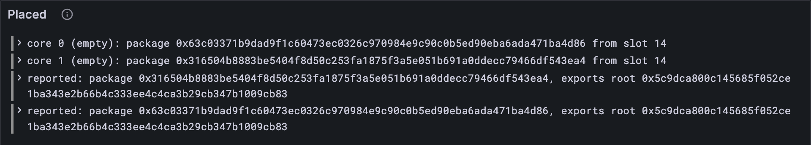

# Onto the cores

The guarantors are the right ones (12.1), their signatures are real (12.2). Time to
seat the report: each guaranteed report takes its core and starts waiting for its data
to become available, which is where Part 11 picks it up next block. And the block makes
a note of the packages it reported, for the recent history (Part 9) to remember. Then
Part 12 is done.

## What the Gray Paper says

§11. ρ′, the cores after the guarantees: each guarantee's report goes on the core it
names, as a pending report: the whole guarantee, registered at τ′, this block's slot. A
core can only take a report if it's free, after the disputes (10.3) and the assurances
(11.2) have done their clearing. Every other core keeps what it had.

**The reported packages** are a dictionary: each reported work-package's hash, mapped to
the root of the segments it exports. Lesson 9.2's `recordBlock` takes exactly these, as
`work_packages`. A dictionary is kept **sorted by key**, so they're listed by package
hash, not in the order the guarantees came. (Lesson 9.2 left sorting to the hardening
pass. Here the vectors insist on it.)

## The tests

**Replace in** `test/guarantors.test.ts`

```ts
/** A reports test vector: the parts of it this lesson uses. */
type ReportsVector = {
  input: { guarantees: unknown[]; slot: number };
  pre_state: {
    curr_validators: unknown[];
    prev_validators: unknown[];
    entropy: string[];
    offenders: string[];
    avail_assignments: unknown;
  };
  post_state: { avail_assignments: unknown };
  output: { err?: string; ok?: { reporters: string[]; reported: unknown[] } };
};
```

**Add to** `test/guarantors.test.ts`

```ts
import { PendingReports, placeReports, reportedPackages } from "../src/cores.ts";

/** The accepted reports vectors of a size: a rejected block changes nothing. */
function acceptedVectors(config: Config): { name: string; vector: ReportsVector }[] {
  return vectorFiles(`stf/reports/${config.name}`)
    .map((name) => ({ name, vector: vectorJson(name) as ReportsVector }))
    .filter(({ vector }) => !vector.output.err);
}

test("ρ′: each guaranteed report takes its core, registered at the block's slot", () => {
  let placed = 0;
  for (const config of [TINY, FULL]) {
    for (const { name, vector } of acceptedVectors(config)) {
      const { input, pre_state, post_state } = vector;
      const before = PendingReports(config).fromJson(pre_state.avail_assignments);
      const guarantees = GuaranteesExtrinsic.fromJson(input.guarantees);
      const after = placeReports(before, guarantees, input.slot);
      assert.deepEqual(after, PendingReports(config).fromJson(post_state.avail_assignments), name);
      placed += guarantees.length;
    }
  }
  assert.equal(placed, 44); // 21 on tiny, 23 on full
});

test("the reported packages: each one's hash and exports root, sorted by hash", () => {
  for (const config of [TINY, FULL]) {
    for (const { name, vector } of acceptedVectors(config)) {
      const guarantees = GuaranteesExtrinsic.fromJson(vector.input.guarantees);
      const reported = reportedPackages(guarantees).map((p) => ({
        work_package_hash: toHex(p.hash),
        segment_tree_root: toHex(p.exports_root),
      }));
      assert.deepEqual(reported, vector.output.ok?.reported, name);
    }
  }
});
```

The vectors write the reported packages as `work_package_hash` and `segment_tree_root`;
the history vectors called the same two things `hash` and `exports_root`. Your client
picks one pair of names, and the test translates.

**Run, expect it to fail**

```sh
npm test
# fails with: does not provide an export named
```

## The code

**Add to** `src/cores.ts`

```ts
import { toHex } from "./bytes.ts";
import type { ReportedPackage } from "./history.ts";

/** ρ′ (GP §11): each guaranteed report takes its core, registered at this block's slot. */
export function placeReports(
  cores: (PendingReport | null)[],
  guarantees: ReportGuarantee[],
  slot: number, // τ′
): (PendingReport | null)[] {
  const after = [...cores];
  for (const guarantee of guarantees) {
    after[guarantee.report.core_index] = { guarantee, registered_slot: slot };
  }
  return after;
}

/** The packages a block reports: each one's hash and exports root, sorted by hash. */
export function reportedPackages(guarantees: ReportGuarantee[]): ReportedPackage[] {
  const packages = guarantees.map(({ report }) => ({
    hash: report.package_spec.hash,
    exports_root: report.package_spec.exports_root,
  }));
  return packages.sort((a, b) => toHex(a.hash).localeCompare(toHex(b.hash))); // a dictionary
}
```

`[...cores]` copies the list first, so the cores before the block stay as they were.
`({ report }) =>` picks the one field it needs out of each guarantee.

**Run**

```sh
npm test
# prints: ρ′: each guaranteed report takes its core, registered at the block's slot
# prints: the reported packages: each one's hash and exports root, sorted by hash
# prints: fail 0
# prints: reported
npm run typecheck
```

44 reports seated, and every reported list in order. Take the `.sort(…)` away and run
the tests again: `high_work_report_gas-1` fails, at both sizes. Its guarantees list
package `0x63c0…` before `0x3165…`, and the dictionary wants them the other way round.

## Watch it

**New file** `bin/placed.ts`

```ts
// Puts the guaranteed reports of a reports test vector onto their cores, and lists the
// packages the block reports, sorted by hash.
// Usage: node bin/placed.ts <vector.json>, e.g.
//        node bin/placed.ts ../vectors/stf/reports/tiny/high_work_report_gas-1.json

import { readFileSync } from "node:fs";
import { GuaranteesExtrinsic } from "../src/block.ts";
import type { Bytes } from "../src/bytes.ts";
import { toHex } from "../src/bytes.ts";
import { FULL, TINY } from "../src/config.ts";
import { PendingReports, placeReports, reportedPackages } from "../src/cores.ts";
import { Run } from "../src/obs.ts";

const [file] = process.argv.slice(2);
const config = file.includes("/full/") ? FULL : TINY;
const { input, pre_state } = JSON.parse(readFileSync(file, "utf8"));
const before = PendingReports(config).fromJson(pre_state.avail_assignments);
const guarantees = GuaranteesExtrinsic.fromJson(input.guarantees);
const after = placeReports(before, guarantees, input.slot);
const short = (bytes: Bytes) => `${toHex(bytes).slice(0, 10)}…`;
const run = new Run("placed");
for (const guarantee of guarantees) {
  const core = guarantee.report.core_index;
  const was = before[core] === null ? "empty" : "taken";
  const spec = guarantee.report.package_spec;
  console.log(`core ${core} (${was}): now holds package ${short(spec.hash)}, since ${input.slot}`);
  run.event("placed", { core, was, package: spec.hash, slot: input.slot });
}
const waiting = after.filter((pending) => pending !== null).length;
console.log(`cores holding a report now: ${waiting} of ${config.core_count}`);
for (const { hash, exports_root } of reportedPackages(guarantees)) {
  console.log(`reported: package ${short(hash)}, exports root ${short(exports_root)}`);
  run.event("reported", { package: hash, exports_root });
}
const link = await run.report();
if (link) console.log(`reported to Grafana: ${link}`);
```

**Run**

```sh
node bin/placed.ts ../vectors/stf/reports/tiny/high_work_report_gas-1.json
# prints: core 0 (empty): now holds package 0x63c03371…, since 14
# prints: reported: package 0x316504b8…
# prints: reported to Grafana
```

Core 0 gets `0x63c0…` and core 1 gets `0x3165…`, but the reported list starts with
`0x3165…`: cores in core order, packages in hash order. Try `with_avail_assignments-1`,
where one core is already taken and the new report takes a free one. The *Placed* panel
shows both lists.



<details>
<summary>lasair: placing reports, in <code>conformance/reports_stf.ml</code></summary>

```ocaml
    let new_assignments = List.mapi (fun core assignment ->
      match List.find_opt (fun (g : guarantee) -> g.report.core_index = core) input.guarantees with
      | Some g ->
        Some { guarantee = g; registered_slot = input.slot }
      | None -> assignment
    ) pre.avail_assignments in
```

The same rule, turned around: lasair walks the cores and looks for a guarantee for each
one, where yours walks the guarantees and drops each on its core. Both seat the same
reports. A few lines above this, in the same adapter, the reported list's segment roots
are still `TODO: compute properly` and written as zeros. Lesson 12.2 showed why no test
noticed: the adapter only counts the reported packages.

</details>

## What you have

Part 12, done: guarantors dealt, signatures checked, reporters counted, and every good
report seated on its core with its package noted for the history.

Next: [12.4 Bad guarantees](./04-bad-guarantees.md)
