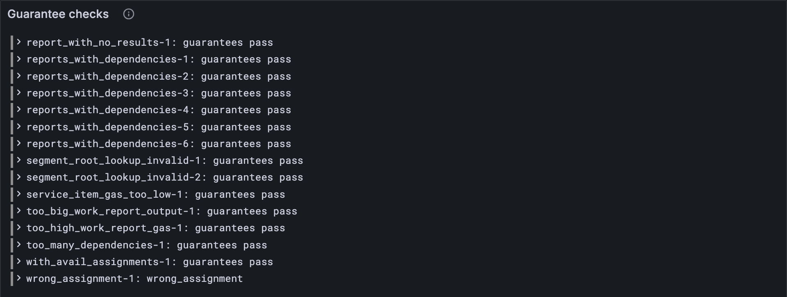

# Bad guarantees

A guarantee is a promise with signatures on it: "we, the validators on this core, vouch
for this report". Lessons [12.1](./01-who-guarantees-what.md) to [12.3](./03-onto-the-cores.md) believed every one. A real block can carry a
guarantee signed by the wrong validators, signed too long ago, signed by someone who's
been banned, or aimed at a core that's busy. This lesson writes down the rules a guarantee
must keep, the first of two lessons on what makes a reports block invalid. [Lesson 12.5](./05-bad-reports.md)
checks the reports themselves.

## New words

- **Authorizer pool.** The authorizers a core accepts right now ([lesson 13.1](../13-authorization/01-the-authorizer-pools.md)'s α).
  *Example:* a report whose authorizer isn't in its core's pool is refused.

It's in the [glossary](../glossary.md), with *rotation* and *active core*, the words from
[lesson 12.1](./01-who-guarantees-what.md) the rules below lean on.

## What the Gray Paper says

§11, *Work Report Guarantees*. Thirteen rules, in three groups.

**The guarantee's shape:**

1. Guarantees in order of core, no core twice. (`out_of_order_guarantee`)
2. The core exists and is active: below C, and below |κ′|/3. (`bad_core_index`)
3. Two or three signatures. (`insufficient_guarantees`)
4. Signers in order of validator index, nobody twice. (`not_sorted_or_unique_guarantors`)

**Who signed it, and when:**

5. Each signer is a validator of the assignment the guarantee answers to ([lesson 12.1](./01-who-guarantees-what.md)'s M,
   or M* for the rotation before). (`bad_validator_index`)
6. Not from the future: its slot is at most τ′. (`future_report_slot`)
7. Recent: from this rotation or the last one. (`report_epoch_before_last`)
8. No offenders: [lesson 8.2](../08-safrole/02-rotating-the-validators.md)'s Φ blanks an offender's keys to zeros in the assignment, and
   a blank signer is banned. (`banned_validator`)
9. Every signer was assigned to this core. (`wrong_assignment`)
10. Every signature is real ([lesson 12.2](./02-signed-and-counted.md)'s `guaranteeSigned`). (`bad_signature`)

**The core it goes on:**

11. The report's data is cut into one erasure shard per validator: exactly |κ′|.
    (`bad_erasure_shards`)
12. The core is free: nothing waiting on it in ρ‡, after this block's assurances.
    (`core_engaged`)
13. Its authorizer is in the core's pool. (`core_unauthorized`)

Rule 2 has a twist the Gray Paper spells out: a core that isn't active now is refused even
if the guarantee cites a slot from the rotation before, when it *was* active. And rule 7
in symbols is R(⌊τ′/R⌋ − 1) ≤ slot ≤ τ′. On tiny, in a block at slot 13 (the rotation of
slots 12 to 15), a guarantee from slot 8 is fine and one from slot 7 is too old.

## The tests

The vectors keep the pools too, so the test vector type grows a field. A pool is just a
list of hashes, one list per core, so the test reads them straight from the JSON ([Part
13](../13-authorization/index.md) gives them a codec of their own):

**Replace in** `test/guarantors.test.ts`

```ts
/** A reports test vector: the parts of it this lesson uses. */
type ReportsVector = {
  input: { guarantees: unknown[]; slot: number };
  pre_state: {
    curr_validators: unknown[];
    prev_validators: unknown[];
    entropy: string[];
    offenders: string[];
    avail_assignments: unknown;
    auth_pools: string[][];
  };
  post_state: { avail_assignments: unknown };
  output: { err?: string; ok?: { reporters: string[]; reported: unknown[] } };
};
```

**Add to** `test/guarantors.test.ts`

```ts
import { guaranteeError } from "../src/guarantors.ts";

/** The rules lesson 12.4 checks, under the test vectors' names for them. */
const GUARANTEE_RULES = new Set([
  "out_of_order_guarantee", "bad_core_index", "insufficient_guarantees",
  "not_sorted_or_unique_guarantors", "bad_validator_index", "future_report_slot",
  "report_epoch_before_last", "banned_validator", "wrong_assignment", "bad_signature",
  "bad_erasure_shards", "core_engaged", "core_unauthorized",
]);

/** What the guarantee rules say of reports vector `name`: null (they pass) or the rule broken. */
function guaranteeVerdict(config: Config, name: string) {
  const { input, pre_state } = vectorJson(name) as ReportsVector;
  const keys = (list: unknown[]) => list.map((key) => ValidatorKey.fromJson(key));
  const assignments = guarantorAssignments(
    config,
    input.slot,
    pre_state.entropy.map(fromHex),
    keys(pre_state.curr_validators),
    keys(pre_state.prev_validators),
    pre_state.offenders.map(fromHex),
  );
  const guarantees = GuaranteesExtrinsic.fromJson(input.guarantees);
  const cores = PendingReports(config).fromJson(pre_state.avail_assignments); // ρ‡
  const pools = pre_state.auth_pools.map((pool) => pool.map(fromHex)); // α, core by core
  const validators = pre_state.curr_validators.length; // |κ′|
  return guaranteeError(config, guarantees, input.slot, assignments, cores, pools, validators);
}

test("a guarantee signed by an offender is refused", () => {
  const name = "stf/reports/tiny/banned_validator_guarantee-1.json";
  assert.equal(guaranteeVerdict(TINY, name), "banned_validator");
});

for (const config of [TINY, FULL]) {
  for (const name of vectorFiles(`stf/reports/${config.name}`)) {
    test(`${name}: its guarantees pass, or break the rule the vector names`, () => {
      const { err } = (vectorJson(name) as ReportsVector).output;
      assert.equal(guaranteeVerdict(config, name), err && GUARANTEE_RULES.has(err) ? err : null);
    });
  }
}
```

The thirteen error names are this lesson's alone: [lesson 12.5](./05-bad-reports.md)'s rules have names of their
own. So each vector's expected answer is its error if that's one of these thirteen, and
"pass" otherwise.

A stub that passes every guarantee, with `BLANK`, the mark Φ leaves on an offender's key,
already in place:

**Add to** `src/guarantors.ts`

```ts
import type { PendingReport } from "./cores.ts";

/** An offender's key, as Φ leaves it in an assignment: blanked to zeros (lesson 8.2). */
const BLANK = toHex(new Uint8Array(32));

export function guaranteeError(
  config: Config,
  guarantees: ReportGuarantee[],
  slot: number, // τ′
  assignments: { current: Assignment; last: Assignment },
  cores: (PendingReport | null)[],
  pools: Bytes[][],
  validators: number,
): string | null {
  return null;
}
```

**Run, expect it to fail**

```sh
npm test
```

```text
...
✖ a guarantee signed by an offender is refused (1.6ms)
...
ℹ tests 285
ℹ suites 0
ℹ pass 254
ℹ fail 31
...
test at test/guarantors.test.ts:169:1
✖ a guarantee signed by an offender is refused (1.6ms)
  AssertionError [ERR_ASSERTION]: Expected values to be strictly equal:
  + actual - expected

  + null
  - 'banned_validator'
...
```

Thirty-one reds: the offender test, and the thirty vectors that break a guarantee rule,
fourteen tiny and sixteen full (full has two that tiny can't, below). Each one reads like the first: the vector names a rule (`-`), and the
stub, passing everything, says `null` (`+`). The vectors refused for their *reports*
stay green, since this lesson's rules have nothing to say about them.

## The code

**Replace in** `src/guarantors.ts`

```ts
/**
 * Are a block's guarantees valid (GP §11)? The first rule they break, under the test
 * vectors' name for it, or null if they keep every rule. `assignments` is M and M*,
 * `cores` is ρ‡ and `pools` is α, both by core, and `validators` is |κ′|.
 */
export function guaranteeError(
  config: Config,
  guarantees: ReportGuarantee[],
  slot: number, // τ′
  assignments: { current: Assignment; last: Assignment },
  cores: (PendingReport | null)[],
  pools: Bytes[][],
  validators: number,
): string | null {
  type G = ReportGuarantee;
  const R = config.rotation_period;
  const core = (g: G) => g.report.core_index;
  const assigned = (g: G) => assignmentFor(config, slot, g.slot, assignments); // M or M*
  // the guarantee's shape
  const inOrder = guarantees.every((g, i) => i === 0 || core(guarantees[i - 1]) < core(g));
  const activeCore = (g: G) => core(g) < config.core_count && core(g) < validators / 3;
  const twoOrThree = (g: G) => g.signatures.length === 2 || g.signatures.length === 3;
  const signersInOrder = (g: G) => {
    const indices = g.signatures.map((s) => s.validator_index);
    return indices.every((v, i) => i === 0 || indices[i - 1] < v);
  };
  // who signed it, and when
  const knownSigners = (g: G) =>
    g.signatures.every((s) => s.validator_index < assigned(g).keys.length);
  const notFuture = (g: G) => g.slot <= slot;
  const recent = (g: G) => g.slot >= R * (Math.floor(slot / R) - 1); // this rotation or the last
  const notBanned = (g: G) => signerKeys(g, assigned(g).keys).every((k) => toHex(k) !== BLANK);
  const onItsCore = (g: G) =>
    g.signatures.every((s) => assigned(g).cores[s.validator_index] === core(g));
  const signed = (g: G) => guaranteeSigned(g, assigned(g).keys);
  // the core it goes on
  const shards = (g: G) => g.report.package_spec.erasure_shards === validators;
  const free = (g: G) => cores[core(g)] === null;
  const authorized = (g: G) =>
    pools[core(g)].some((h) => toHex(h) === toHex(g.report.authorizer_hash));
  if (!inOrder) return "out_of_order_guarantee";
  if (!guarantees.every(activeCore)) return "bad_core_index";
  if (!guarantees.every(twoOrThree)) return "insufficient_guarantees";
  if (!guarantees.every(signersInOrder)) return "not_sorted_or_unique_guarantors";
  if (!guarantees.every(knownSigners)) return "bad_validator_index";
  if (!guarantees.every(notFuture)) return "future_report_slot";
  if (!guarantees.every(recent)) return "report_epoch_before_last";
  if (!guarantees.every(notBanned)) return "banned_validator";
  if (!guarantees.every(onItsCore)) return "wrong_assignment";
  if (!guarantees.every(signed)) return "bad_signature";
  if (!guarantees.every(shards)) return "bad_erasure_shards";
  if (!guarantees.every(free)) return "core_engaged";
  if (!guarantees.every(authorized)) return "core_unauthorized";
  return null;
}
```

Thirteen rules, thirteen lines at the end, in the order above, each built from a helper
that asks one question about one guarantee. `assigned` picks M or M* for a guarantee, the
way [lesson 12.1](./01-who-guarantees-what.md)'s `assignmentFor` does.

**Run**

```sh
npm test
npm run typecheck
```

```text
...
✔ the reported packages: each one's hash and exports root, sorted by hash (2656.3ms)
✔ a guarantee signed by an offender is refused (4.8ms)
...
ℹ tests 285
ℹ suites 0
ℹ pass 285
ℹ fail 0
...
reported 285 tests to Grafana: http://127.0.0.1:3300/d/gray-tutorial?var-client=you&var-run_id=test-1791734610469
...
```

## Watch it

**New file** `bin/check-guarantees.ts`

```ts
// Checks the guarantees of every reports test vector of one size against the rules, and
// shows what the rules say next to what the vector says.
// Usage: node bin/check-guarantees.ts [tiny or full], tiny if not given

import { readdirSync, readFileSync } from "node:fs";
import { GuaranteesExtrinsic } from "../src/block.ts";
import { fromHex } from "../src/bytes.ts";
import { FULL, TINY } from "../src/config.ts";
import { PendingReports } from "../src/cores.ts";
import { guaranteeError, guarantorAssignments } from "../src/guarantors.ts";
import { Run } from "../src/obs.ts";
import { ValidatorKey } from "../src/state.ts";

const config = process.argv[2] === "full" ? FULL : TINY;
const dir = `../vectors/stf/reports/${config.name}`;
const keys = (list: unknown[]) => list.map((key) => ValidatorKey.fromJson(key));
const run = new Run("guarantee-check");
for (const file of readdirSync(dir).filter((f) => f.endsWith(".json")).sort()) {
  const { input, pre_state: pre, output } = JSON.parse(readFileSync(`${dir}/${file}`, "utf8"));
  const assignments = guarantorAssignments(config, input.slot, pre.entropy.map(fromHex),
    keys(pre.curr_validators), keys(pre.prev_validators), pre.offenders.map(fromHex));
  const guarantees = GuaranteesExtrinsic.fromJson(input.guarantees);
  const cores = PendingReports(config).fromJson(pre.avail_assignments);
  const pools = pre.auth_pools.map((pool: string[]) => pool.map(fromHex));
  const error = guaranteeError(config, guarantees, input.slot, assignments, cores, pools,
    pre.curr_validators.length);
  const ours = error ?? "guarantees pass";
  const theirs = output.err ?? "accepted";
  const name = file.replace(".json", "");
  console.log(`${name}: ${ours} (the vector: ${theirs})`);
  run.event("vector", { name, ours, theirs });
}
const link = await run.report();
if (link) console.log(`reported to Grafana: ${link}`);
```

**Run**

```sh
node bin/check-guarantees.ts
```

```text
anchor_not_recent-1: guarantees pass (the vector: anchor_not_recent)
bad_anchor_slot-1: guarantees pass (the vector: bad_anchor_slot)
bad_beefy_mmr-1: guarantees pass (the vector: bad_beefy_mmr_root)
bad_code_hash-1: guarantees pass (the vector: bad_code_hash)
bad_core_index-1: bad_core_index (the vector: bad_core_index)
bad_erasure_shards-1: bad_erasure_shards (the vector: bad_erasure_shards)
bad_service_id-1: guarantees pass (the vector: bad_service_id)
bad_signature-1: bad_signature (the vector: bad_signature)
bad_state_root-1: guarantees pass (the vector: bad_state_root)
bad_validator_index-1: bad_validator_index (the vector: bad_validator_index)
banned_validator_guarantee-1: banned_validator (the vector: banned_validator)
big_work_report_output-1: guarantees pass (the vector: accepted)
core_engaged-1: core_engaged (the vector: core_engaged)
...
reported to Grafana: http://127.0.0.1:3300/d/gray-tutorial?var-client=you&var-run_id=guarantee-check-1791734622303
```

Wherever the rules refuse a guarantee, the vector agrees. Where the guarantees pass but the
vector refuses the block, the reason is in the report itself: [lesson 12.5](./05-bad-reports.md)'s job. The full
vectors have four that tiny can't have, where the validator set has shrunk from 1,023 to
6. `node bin/check-guarantees.ts full` shows two refused: a guarantee for core 340,
active last rotation but not now (`bad_core_index`), and one signed this rotation by
validators 16, 450 and 1014, when only 6 exist (`bad_validator_index`). And two
accepted: one from the last rotation, signed by validators 24, 578 and 603 of the old
set, and one signed by validators 1, 4 and 5 of the new. The *Guarantee checks* panel
keeps the list.



<details>
<summary>lasair: the core, in <code>conformance/reports_stf.ml</code></summary>

```ocaml
  if report.core_index < 0
     || report.core_index >= (Stf_config.num_cores ())
     || report.core_index >= List.length pre.curr_validators / 3 then
    Result.Error "bad_core_index"
```

The same two bounds as your rule 2: below the number of cores, and below a third of the
current validators. lasair's comment above it says it learned the second one from the
`inactive_core_index` vector. For banned validators lasair takes a different road: it looks
each signer's key up in the offenders list, where your client spots the blank that Φ left.

</details>

## What you have

Guarantees that are checked, not trusted: thirteen rules, and every reports vector's
guarantees, tiny and full, passed or refused as they should be. The guarantees can be
perfect and the report inside them still wrong: [lesson 12.5](./05-bad-reports.md) checks the reports.

Next: [12.5 Bad reports](./05-bad-reports.md)
