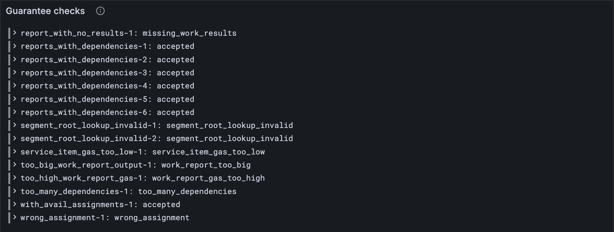

# Bad reports

[Lesson 12.4](./04-bad-guarantees.md) checked who vouched for each report, and when. Now the report itself. Is it a
sensible size? Was it built against a block the chain really had, as that block really
was? Does it lean on work that exists? Does it name real services, with the right code?
And is it new, or a package the chain has already seen? This lesson writes down those
rules, and with 12.4's, your client agrees with every reports test vector.

## New words

- **Report anchor.** The recent block a report was built against: its hash, slot, state
  root and belt root, all in the report's context. *Example:* a report anchored on a
  block the chain doesn't remember is refused.
- **Segment-root lookup.** A report's list of the work-packages whose exported segments it
  imported, each with the root of those segments. *Example:* "package A, segments root R".
- **Pipeline.** Every package the chain is already dealing with: accumulated recently,
  waiting in the ready queue, or pending on a core. The vectors hand these over as
  `known_packages`. *Example:* a package in the pipeline can't be reported again.

All three are in the [glossary](../glossary.md).

## What the Gray Paper says

§11, *Contextual Validity of Reports*, and the limits of §11's *Work Report*. Ten rules
making fourteen checks, in two groups.

**The report on its own:**

1. One to sixteen results (I = 16). (`missing_work_results`)
2. At most eight dependencies, prerequisites and lookups together (J = 8).
   (`too_many_dependencies`)
3. Its outputs, the authorizer's and every result's, fit in 48 KiB (W_R).
   (`work_report_too_big`)
4. Its results ask for at most 10,000,000 accumulation gas in all (G_A).
   (`work_report_gas_too_high`)

**The report against the chain:**

5. A new package: not twice in this block, not in the recent blocks' reported packages,
   not in the pipeline. (`duplicate_package`)
6. Its anchor is one of the recent blocks (β_H†, Part 9's history after this block's
   first step). (`anchor_not_recent`)
7. And matches it: the same state root (`bad_state_root`), belt root
   (`bad_beefy_mmr_root`) and slot (`bad_anchor_slot`).
8. Its prerequisites are packages this block or a recent one reported.
   (`dependency_missing`)
9. Every lookup names such a package, with that package's real segments root.
   (`segment_root_lookup_invalid`)
10. Every result names a service that exists (`bad_service_id`), with that service's
    code hash (`bad_code_hash`), and asks for at least the service's minimum gas
    (`service_item_gas_too_low`).

Rules 8 and 9 are one rule in the Gray Paper: every prerequisite and every looked-up
package must be known. The vectors give a looked-up package that isn't known its own
name, `segment_root_lookup_invalid`, so your client checks them separately.

Two more rules this lesson leaves out: the report's *lookup* anchor must be at most L slots
old, and must be one of the last L blocks' headers. Checking the second needs the header
chain itself, which no state holds, and no vector tests either. They wait in HARDENING.

## The tests

The vectors give the recent blocks, the services and the pipeline too:

**Replace in** `test/guarantors.test.ts`

```ts
/** A reports test vector: the parts of it this lesson uses. */
type ReportsVector = {
  input: { guarantees: unknown[]; slot: number; known_packages: string[] };
  pre_state: {
    curr_validators: unknown[];
    prev_validators: unknown[];
    entropy: string[];
    offenders: string[];
    avail_assignments: unknown;
    auth_pools: string[][];
    recent_blocks: { history: unknown[] };
    accounts: { id: number; data: { service: { code_hash: string; min_item_gas: number } } }[];
  };
  post_state: { avail_assignments: unknown };
  output: { err?: string; ok?: { reporters: string[]; reported: unknown[] } };
};
```

**Add to** `test/guarantors.test.ts`

```ts
import { reportError } from "../src/guarantors.ts";
import { RecentBlock } from "../src/history.ts";

/** What lesson 12.5's rules say of reports vector `name`: null (they pass) or the rule broken. */
function reportVerdict(name: string) {
  const { input, pre_state } = vectorJson(name) as ReportsVector;
  const reports = GuaranteesExtrinsic.fromJson(input.guarantees).map((g) => g.report);
  const history = pre_state.recent_blocks.history.map((b) => RecentBlock.fromJson(b));
  const services = new Map(pre_state.accounts.map(({ id, data: { service } }) => [id, {
    code_hash: fromHex(service.code_hash),
    min_item_gas: BigInt(service.min_item_gas),
  }]));
  return reportError(reports, history, new Set(input.known_packages), services);
}

test("a report anchored on a block nobody remembers is refused", () => {
  assert.equal(reportVerdict("stf/reports/tiny/anchor_not_recent-1.json"), "anchor_not_recent");
});

for (const config of [TINY, FULL]) {
  for (const name of vectorFiles(`stf/reports/${config.name}`)) {
    test(`${name}: accepted or refused, as the vector says`, () => {
      const { err } = (vectorJson(name) as ReportsVector).output;
      assert.equal(guaranteeVerdict(config, name) ?? reportVerdict(name), err ?? null);
    });
  }
}
```

The last test is the whole reports step: [lesson 12.4](./04-bad-guarantees.md)'s rules first, then these. Every
reports vector, tiny and full, must come out exactly as the vector says, accepted or
refused for the very same reason. The services come straight from the JSON: a report
only needs a service's code hash and minimum gas, and Part 14 builds the full service
account later.

**Run, expect it to fail**

```sh
npm test
# fails with: does not provide an export named
```

## The code

**Add to** `src/guarantors.ts`

```ts
import type { WorkDigest } from "./work.ts";
import type { RecentBlock } from "./history.ts";

/** I: the most work items (so digests) a report may carry. */
const MAX_DIGESTS = 16;
/** J: the most dependencies (prerequisites and segment-root lookups) a report may have. */
const MAX_DEPENDENCIES = 8;
/** W_R: the most bytes a report's outputs (its digests' and its authorizer's) may take. */
const MAX_OUTPUT = 48 * 1024;
/** G_A: the most accumulation gas a report may ask for, all its digests together. */
const REPORT_GAS = 10_000_000n;

/** What a report needs of a service: its code hash, and the least gas it accumulates on. */
export type ServiceNeeds = { code_hash: Bytes; min_item_gas: bigint };

/**
 * Are a block's reports valid (GP §11)? The first rule they break, under the test vectors'
 * name for it, or null if they keep every rule. `history` is the recent blocks (β_H†),
 * `known` the packages already in the pipeline (accumulated, waiting, or on a core: the
 * vectors' `known_packages`), and `services` what each service needs, by id.
 */
export function reportError(
  reports: WorkReport[], // 𝐈
  history: RecentBlock[],
  known: Set<string>,
  services: Map<number, ServiceNeeds>,
): string | null {
  const incoming = new Map(reports.map((r) => [toHex(r.package_spec.hash), r])); // 𝐩
  const reported = new Map(history.flatMap((b) => b.reported.map((p) => [toHex(p.hash), p])));
  const rootOf = (hash: Bytes) =>
    incoming.get(toHex(hash))?.package_spec.exports_root ?? reported.get(toHex(hash))?.exports_root;
  const anchor = (r: WorkReport) =>
    history.find((b) => toHex(b.header_hash) === toHex(r.context.anchor));
  const digests = reports.flatMap((r) => r.results);
  const outputOf = (d: WorkDigest) => ("ok" in d.result ? d.result.ok.length : 0);
  const output = (r: WorkReport) =>
    r.auth_output.length + r.results.reduce((n, d) => n + outputOf(d), 0);
  // the report on its own
  const someWork = (r: WorkReport) => r.results.length >= 1 && r.results.length <= MAX_DIGESTS;
  const fewDependencies = (r: WorkReport) =>
    r.context.prerequisites.length + r.segment_root_lookup.length <= MAX_DEPENDENCIES;
  const gas = (r: WorkReport) => r.results.reduce((n, d) => n + d.accumulate_gas, 0n);
  // the report against the chain
  const fresh = (hash: string) => !reported.has(hash) && !known.has(hash);
  const anchored = (r: WorkReport) => anchor(r) !== undefined;
  const sameRoot = (r: WorkReport) => toHex(anchor(r)!.state_root) === toHex(r.context.state_root);
  const sameBelt = (r: WorkReport) => toHex(anchor(r)!.beefy_root) === toHex(r.context.beefy_root);
  const sameSlot = (r: WorkReport) => anchor(r)!.slot === r.context.anchor_slot;
  const prerequisitesKnown = (r: WorkReport) =>
    r.context.prerequisites.every((p) => rootOf(p) !== undefined);
  const lookupsRight = (r: WorkReport) =>
    r.segment_root_lookup.every((l) => {
      const root = rootOf(l.work_package_hash);
      return root !== undefined && toHex(root) === toHex(l.segment_tree_root);
    });
  if (!reports.every(someWork)) return "missing_work_results";
  if (!reports.every(fewDependencies)) return "too_many_dependencies";
  if (!reports.every((r) => output(r) <= MAX_OUTPUT)) return "work_report_too_big";
  if (!reports.every((r) => gas(r) <= REPORT_GAS)) return "work_report_gas_too_high";
  if (incoming.size < reports.length || ![...incoming.keys()].every(fresh)) {
    return "duplicate_package";
  }
  if (!reports.every(anchored)) return "anchor_not_recent";
  if (!reports.every(sameRoot)) return "bad_state_root";
  if (!reports.every(sameBelt)) return "bad_beefy_mmr_root";
  if (!reports.every(sameSlot)) return "bad_anchor_slot";
  if (!reports.every(prerequisitesKnown)) return "dependency_missing";
  if (!reports.every(lookupsRight)) return "segment_root_lookup_invalid";
  if (!digests.every((d) => services.has(d.service_id))) return "bad_service_id";
  const service = (d: WorkDigest) => services.get(d.service_id)!;
  if (!digests.every((d) => toHex(service(d).code_hash) === toHex(d.code_hash))) {
    return "bad_code_hash";
  }
  if (!digests.every((d) => d.accumulate_gas >= service(d).min_item_gas)) {
    return "service_item_gas_too_low";
  }
  return null;
}
```

Fourteen checks, in the order above. `rootOf` looks a package up first in this block, then in
the recent blocks, and that one helper serves rules 8 and 9: a prerequisite needs any root,
a lookup the right one. The four limits get names, so the numbers say what they are.

**Run**

```sh
npm test
# prints: a report anchored on a block nobody remembers is refused
# prints: fail 0
# prints: reported
npm run typecheck
```

## Watch it

`bin/check-guarantees.ts` checks both lessons' rules now, and mentions the vector only
when the two disagree:

**Rewrite** `bin/check-guarantees.ts`

```ts
// Checks the guarantees and reports of every reports test vector of one size against the
// rules (the guarantees' first, then the reports'), and shows each verdict next to the
// vector's: accepted, or the first rule broken.
// Usage: node bin/check-guarantees.ts [tiny or full], tiny if not given

import { readdirSync, readFileSync } from "node:fs";
import { GuaranteesExtrinsic } from "../src/block.ts";
import { fromHex } from "../src/bytes.ts";
import { FULL, TINY } from "../src/config.ts";
import { PendingReports } from "../src/cores.ts";
import type { ServiceNeeds } from "../src/guarantors.ts";
import { guaranteeError, guarantorAssignments, reportError } from "../src/guarantors.ts";
import { RecentBlock } from "../src/history.ts";
import { Run } from "../src/obs.ts";
import { ValidatorKey } from "../src/state.ts";

type Service = { code_hash: string; min_item_gas: number };

const config = process.argv[2] === "full" ? FULL : TINY;
const dir = `../vectors/stf/reports/${config.name}`;
const keys = (list: unknown[]) => list.map((key) => ValidatorKey.fromJson(key));
const run = new Run("guarantee-check");
for (const file of readdirSync(dir).filter((f) => f.endsWith(".json")).sort()) {
  const { input, pre_state: pre, output } = JSON.parse(readFileSync(`${dir}/${file}`, "utf8"));
  const assignments = guarantorAssignments(config, input.slot, pre.entropy.map(fromHex),
    keys(pre.curr_validators), keys(pre.prev_validators), pre.offenders.map(fromHex));
  const guarantees = GuaranteesExtrinsic.fromJson(input.guarantees);
  const cores = PendingReports(config).fromJson(pre.avail_assignments);
  const pools = pre.auth_pools.map((pool: string[]) => pool.map(fromHex));
  const history = pre.recent_blocks.history.map((b: unknown) => RecentBlock.fromJson(b));
  const services = new Map<number, ServiceNeeds>();
  for (const { id, data } of pre.accounts as { id: number; data: { service: Service } }[]) {
    const { code_hash, min_item_gas } = data.service;
    services.set(id, { code_hash: fromHex(code_hash), min_item_gas: BigInt(min_item_gas) });
  }
  const error =
    guaranteeError(config, guarantees, input.slot, assignments, cores, pools,
      pre.curr_validators.length) ??
    reportError(guarantees.map((g) => g.report), history, new Set(input.known_packages), services);
  const ours = error ?? "accepted";
  const theirs = output.err ?? "accepted";
  const name = file.replace(".json", "");
  console.log(`${name}: ${ours}${ours === theirs ? "" : ` (the vector says ${theirs})`}`);
  run.event("vector", { name, ours, theirs, agree: ours === theirs });
}
const link = await run.report();
if (link) console.log(`reported to Grafana: ${link}`);
```

**Run**

```sh
node bin/check-guarantees.ts
# prints: anchor_not_recent-1: anchor_not_recent
# prints: segment_root_lookup_invalid-1: segment_root_lookup_invalid
```

Forty-four vectors, and not one "the vector says": your client's reports step agrees with
all of them. `node bin/check-guarantees.ts full` says the same of the full ones. The
*Guarantee checks* panel keeps the list.



<details>
<summary>lasair: a lookup, in <code>conformance/reports_stf.ml</code></summary>

```ocaml
                (match find_exports_root entry.work_package_hash with
                 | None -> true  (* Not in history = in current batch, can't verify yet *)
                 | Some exports_root -> Bytes.equal entry.segment_tree_root exports_root)
```

Rule 9 in lasair's reports harness. For a looked-up package from the recent blocks, it
checks the segments root, just like yours. For one reported in this same block, it says
"can't verify yet" and lets it through. But the root is right there, in that report's
`package_spec`, and the Gray Paper checks it: its lookup map is this block's packages and
the recent ones'. Your `rootOf` checks both. No vector has a wrong root for a package in
the same block, which is how a gap like this can sit unnoticed.

</details>

## What you have

The whole reports step, checked: thirteen checks on the guarantees, fourteen on the reports,
and every reports vector accepted or refused exactly as it should be. Parts 10 to 12's
validity rules are done.

Next: [Part 13 · Authorization](../13-authorization/index.md)
