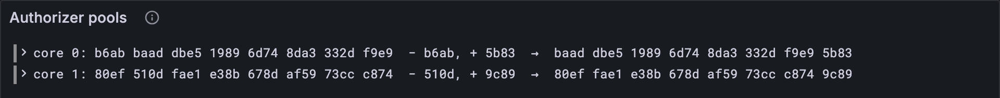

# The authorizer pools

Who is allowed to use a core? Not just anyone with a work-package. Each piece of work
must be *authorized*, by an **authorizer**: a small program, identified by a hash, that
decides whether a package may run. Each core keeps a short list of authorizers it
currently accepts, its **pool**, and a long line of them waiting their turn, its
**queue**. Every block, the pool changes a little: one goes out, one comes in. This
lesson keeps the pools moving, and it's all of Part 13.

## What the Gray Paper says

§8 (*Authorization*). For each core c:

- **α[c], the pool**: at most O = 8 authorizer hashes.
- **ϕ[c], the queue**: exactly Q = 80 of them. Only a privileged service can change the
  queue, during accumulation (Part 17).

Each block, α′[c] is made in three steps:

1. If a guarantee in this block used core c (Part 12), its report's authorizer is
   taken out of the pool: the *leftmost* copy, the one that's been there longest.
2. The queue's entry for this slot joins: ϕ′[c][τ′ mod Q]. The queue is a wheel, read
   one slot at a time and going round every 80 slots.
3. If the pool is now over O, the oldest drop off the front, leaving the newest O.

ϕ′, not ϕ: the queue *after* accumulation, which is why, in a real client, this step
comes late in the block. In C(1) and C(2) (lesson 6.2) the pools are lists with their
length in front, and the queues are 80 hashes exactly: 514 and 5,120 bytes on tiny.

## The code first

The tests read pools from real states as well as from vectors, so the codecs come first.

**New file** `src/authorization.ts`

```ts
// Authorization (GP §8): which authorizers each core will accept work for. Each core keeps
// a small pool of them, refilled one at a time from a long queue.

import type { ReportGuarantee } from "./block.ts";
import type { Bytes } from "./bytes.ts";
import { toHex } from "./bytes.ts";
import type { Value } from "./codec/codec.ts";
import { hash, record, seq, seqN, u16 } from "./codec/codec.ts";
import type { Config } from "./config.ts";

/** O: the most authorizers a core's pool holds. */
export const POOL_SIZE = 8;

/** Q: the length of each core's queue. */
export const QUEUE_SIZE = 80;

/** α, C(1): each core's pool of authorizers, up to O of them. */
export function AuthPools(config: Config) {
  return seqN(seq(hash), config.core_count);
}

/** ϕ, C(2): each core's queue of authorizers, exactly Q of them. */
export function AuthQueues(config: Config) {
  return seqN(seqN(hash, QUEUE_SIZE), config.core_count);
}

/** An authorizer a guarantee used on a core: its report's core and authorizer hash. */
export const UsedAuthorizer = record({
  core: u16,
  auth_hash: hash,
});
export type UsedAuthorizer = Value<typeof UsedAuthorizer>;

/**
 * α′ (GP §8): a core's used authorizer leaves its pool (its oldest copy), the queue's entry
 * for this slot joins, and the pool keeps its newest O.
 */
export function nextPools(
  pools: Bytes[][],
  queues: Bytes[][], // ϕ′
  used: UsedAuthorizer[],
  slot: number, // τ′
): Bytes[][] {
  return pools.map((pool, core) => {
    const left = [...pool];
    for (const { auth_hash } of used.filter((u) => u.core === core)) {
      const oldest = left.findIndex((a) => toHex(a) === toHex(auth_hash));
      if (oldest >= 0) left.splice(oldest, 1);
    }
    const next = queues[core][slot % QUEUE_SIZE]; // the queue goes round, a slot at a time
    return [...left, next].slice(-POOL_SIZE);
  });
}

/** The authorizers a block's guarantees used: one per guaranteed core. */
export function usedAuthorizers(guarantees: ReportGuarantee[]): UsedAuthorizer[] {
  return guarantees.map(({ report }) => ({
    core: report.core_index,
    auth_hash: report.authorizer_hash,
  }));
}
```

`usedAuthorizers` connects Part 12 to here: each guarantee says which core it used and
which authorizer let it in.

## The tests

**New file** `test/authorization.test.ts`

```ts
import { test } from "node:test";
import assert from "node:assert/strict";
import { AuthPools, AuthQueues, nextPools, UsedAuthorizer } from "../src/authorization.ts";
import { FULL, TINY } from "../src/config.ts";
import { traceState, vectorFiles, vectorJson } from "./vectors.ts";
import { Block } from "../src/block.ts";
import { usedAuthorizers } from "../src/authorization.ts";
import { readAuthPools, readAuthQueues } from "../src/state.ts";

/** An authorizer hash made of one repeated byte, so the test reads like letters. */
const auth = (byte: number) => new Uint8Array(32).fill(byte);
const [A, B, C] = [auth(0xaa), auth(0xbb), auth(0xcc)];

test("the used authorizer leaves, the queue's next one joins", () => {
  const queue = Array.from({ length: 80 }, (_, i) => (i === 3 ? C : A)); // C waits at 3
  assert.deepEqual(nextPools([[A, B]], [queue], [{ core: 0, auth_hash: B }], 3), [[A, C]]);
  assert.deepEqual(nextPools([[A, B]], [queue], [], 83), [[A, B, C]]); // 83 mod 80 = 3
});

test("a full pool keeps its newest eight", () => {
  const full = [A, A, A, A, A, A, A, B]; // eight already
  const queue = Array.from({ length: 80 }, () => C);
  assert.deepEqual(nextPools([full], [queue], [], 0), [[A, A, A, A, A, A, B, C]]);
});

test("α′ on the authorizations vectors", () => {
  let checked = 0;
  for (const config of [TINY, FULL]) {
    for (const name of vectorFiles(`stf/authorizations/${config.name}`)) {
      const { input, pre_state, post_state } = vectorJson(name) as {
        input: { slot: number; auths: unknown[] };
        pre_state: { auth_pools: unknown; auth_queues: unknown };
        post_state: { auth_pools: unknown };
      };
      const pools = AuthPools(config).fromJson(pre_state.auth_pools);
      const queues = AuthQueues(config).fromJson(pre_state.auth_queues);
      const used = input.auths.map((a) => UsedAuthorizer.fromJson(a));
      const after = nextPools(pools, queues, used, input.slot);
      assert.deepEqual(after, AuthPools(config).fromJson(post_state.auth_pools), name);
      checked++;
    }
  }
  assert.equal(checked, 6);
});

test("α′ through 99 real blocks, with the authorizers their own guarantees used", () => {
  let used = 0;
  for (let n = 1; n < 100; n++) {
    const before = traceState("preimages", n);
    const after = traceState("preimages", n + 1); // the state after block n
    const block = Block(TINY).fromJson(before.block);
    const auths = usedAuthorizers(block.extrinsic.guarantees);
    const pools = readAuthPools(TINY, before.entries);
    const queues = readAuthQueues(TINY, after.entries); // ϕ′: the queues after the block
    const next = nextPools(pools, queues, auths, block.header.slot);
    assert.deepEqual(next, readAuthPools(TINY, after.entries), `block ${n}`);
    used += auths.length;
  }
  assert.equal(used, 85);
});
```

Four tests: the rule by hand twice, with one-byte "letters" for hashes; the six
authorizations vectors; and then a real chain. Through 99 blocks of the `preimages`
trace, the pools after each block are worked out from the pools before it, the queues
after it, and the authorizers the block's *own guarantees* used: 85 of them. That's Part
12's guarantees and Part 13's pools, checked together on real state.

**Run, expect it to fail**

```sh
npm test
# fails with: does not provide an export named
```

## The readers

**Add to** `src/state.ts`

```ts
import { AuthPools, AuthQueues } from "./authorization.ts";
import type { Config } from "./config.ts";

/** α, C(1): each core's authorizer pool. */
export function readAuthPools(config: Config, entries: KeyValue[]): Bytes[][] {
  return component(entries, 1, AuthPools(config));
}

/** ϕ, C(2): each core's authorizer queue. */
export function readAuthQueues(config: Config, entries: KeyValue[]): Bytes[][] {
  return component(entries, 2, AuthQueues(config));
}
```

**Run**

```sh
npm test
# prints: the used authorizer leaves, the queue's next one joins
# prints: α′ through 99 real blocks, with the authorizers their own guarantees used
# prints: fail 0
# prints: reported
npm run typecheck
```

## Watch it

**New file** `bin/pools.ts`

```ts
// Shows each core's authorizer pool before and after the block of an authorizations test
// vector: which authorizer left, which joined. Each authorizer as its first 4 hex digits.
// Usage: node bin/pools.ts <vector.json>, e.g.
//        node bin/pools.ts ../vectors/stf/authorizations/tiny/progress_authorizations-2.json

import { readFileSync } from "node:fs";
import { AuthPools, AuthQueues, nextPools, QUEUE_SIZE, UsedAuthorizer } from "../src/authorization.ts";
import type { Bytes } from "../src/bytes.ts";
import { toHex } from "../src/bytes.ts";
import { FULL, TINY } from "../src/config.ts";
import { Run } from "../src/obs.ts";

const [file] = process.argv.slice(2);
const config = file.includes("/full/") ? FULL : TINY;
const { input, pre_state } = JSON.parse(readFileSync(file, "utf8"));
const pools = AuthPools(config).fromJson(pre_state.auth_pools);
const queues = AuthQueues(config).fromJson(pre_state.auth_queues);
const used: UsedAuthorizer[] = input.auths.map((a: unknown) => UsedAuthorizer.fromJson(a));
const after = nextPools(pools, queues, used, input.slot);
const short = (pool: Bytes[]) => pool.map((a) => toHex(a).slice(2, 6)).join(" ");
const run = new Run("pools");
const entry = input.slot % QUEUE_SIZE; // where each queue is up to
console.log(`slot ${input.slot}: each core's next authorizer is queue entry ${entry}`);
// tiny: every core; full: just the cores that used an authorizer
const shown = config === TINY ? pools.map((_, core) => core) : used.map((u) => u.core);
for (const core of shown) {
  const left = used.find((u) => u.core === core);
  const gone = left ? toHex(left.auth_hash).slice(2, 6) : "nothing";
  const joined = toHex(queues[core][entry]).slice(2, 6);
  console.log(`core ${core}: ${short(pools[core])}`);
  console.log(`  − ${gone}, + ${joined}  →  ${short(after[core])}`);
  run.event("pool", { core, before: short(pools[core]), gone, joined, after: short(after[core]) });
}
const link = await run.report();
if (link) console.log(`reported to Grafana: ${link}`);
```

**Run**

```sh
node bin/pools.ts ../vectors/stf/authorizations/tiny/progress_authorizations-2.json
# prints: core 0: b6ab baad dbe5 1989 6d74 8da3 332d f9e9
# prints: − b6ab, + 5b83
# prints: reported to Grafana
```

Core 0 used `b6ab`, its oldest, so it leaves from the front and `5b83` joins at the
back. Core 1 used `510d`, the *second* in its pool: only that one goes, and the rest close
up behind it. Then try
the full vector `progress_authorizations-3.json`: at slot 645 the queue entry is 5,
because 645 mod 80 = 5. The wheel has gone round eight times. The *Authorizer pools*
panel shows each change.



<details>
<summary>lasair: <code>next_pool</code>, in <code>conformance/authorizations_stf.ml</code></summary>

```ocaml
let next_pool ~(pool : bytes list) ~(used : bytes option) ~(queued : bytes option) : bytes list =
  ...
  let pool = match used with
    | Some hash -> remove_first (fun h -> Bytes.equal h hash) pool
    | None -> pool in
  let pool = match queued with Some q -> pool @ [ q ] | None -> pool in
  drop (List.length pool - pool_size) pool
```

The same three steps: remove the first match, append the queue's entry, drop down to
O. Its comment says this one function serves both lasair's test harness and its block
importer, so they can never disagree. Yet the same file opens with a comment
describing an older rule, "remove first pool entry, shift pool left". The code moved on
and that comment didn't. Comments go stale; tests don't.

</details>

## What you have

Part 13, done: every core's pool of authorizers, kept moving block by block, checked on
the vectors and on 99 real blocks.

Next: [Part 14 · Services and preimages](../14-services/index.md)
