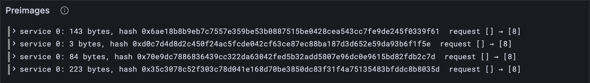

# Providing preimages

A JAM service can't download things. If it needs some data, say a new version of its
own code or a large file, it can only ask for it *by its hash and length*, and wait. Some
later block brings the data in its preimages extrinsic ([lesson 4.1](../04-blocks/01-tickets-and-preimages.md)), the chain checks
it really is what was asked for (its hash says so), and hands it over. This lesson is
that handover, and it starts Part 14.

## What the Gray Paper says

§9 and §12. For every piece of data a service has asked for, it keeps a **request**,
under [lesson 6.2](../06-state-and-merklization/02-state-keys.md)'s `requestKey(s, H(data), length)`. Its value is a short **history**,
the slots of its life so far:

| History | Means |
| --- | --- |
| `[]` | asked for, still waiting |
| `[x]` | provided at slot x |
| `[x, y]` | provided at x, forgotten at y |
| `[x, y, z]` | asked for again at z |

**Y, "providable"**: a preimage (s, data) is welcome if service s has a request for
(H(data), length) whose history is `[]`. **I, "provide"**: for each welcome preimage,
the data is stored under `preimageKey(s, data)` ([lesson 6.2](../06-state-and-merklization/02-state-keys.md)), and the request's history
becomes `[τ′]`, the slot of this block.

The data proves itself: its hash is in the key, so nobody can provide the wrong thing.

## The tests

**New file** `test/services.test.ts`

```ts
import { test } from "node:test";
import assert from "node:assert/strict";
import { Block, Preimage } from "../src/block.ts";
import { fromHex, toHex } from "../src/bytes.ts";
import { encode } from "../src/codec/codec.ts";
import { TINY } from "../src/config.ts";
import { blake2b256 } from "../src/hash.ts";
import { providePreimages, RequestHistory } from "../src/services.ts";
import { preimageKey, requestKey } from "../src/state.ts";
import type { KeyValue } from "../src/trie.ts";
import { traceState, vectorFiles, vectorJson } from "./vectors.ts";

test("a request's history: [] waiting, [x] provided at slot x", () => {
  assert.equal(toHex(encode(RequestHistory, [])), "0x00");
  assert.equal(toHex(encode(RequestHistory, [5])), "0x0105000000");
});

/** The value under a key in a state's entries, as hex, or undefined. */
function valueAt(entries: KeyValue[], key: Uint8Array): string | undefined {
  const entry = entries.find((e) => toHex(e.key) === toHex(key));
  return entry && toHex(entry.value);
}

test("67 real preimages: stored, and their requests marked with the block's slot", () => {
  let provided = 0;
  for (let n = 1; n < 100; n++) {
    const { entries, block } = traceState("preimages", n);
    const { header, extrinsic } = Block(TINY).fromJson(block);
    if (extrinsic.preimages.length === 0) continue;
    const after = providePreimages(entries, extrinsic.preimages, header.slot);
    const expected = traceState("preimages", n + 1).entries; // the state after block n
    for (const { requester, blob } of extrinsic.preimages) {
      const request = requestKey(requester, blake2b256(blob), blob.length);
      assert.equal(valueAt(after, request), valueAt(expected, request), `block ${n}`);
      const stored = preimageKey(requester, blob);
      assert.equal(valueAt(after, stored), valueAt(expected, stored), `block ${n}`);
      provided++;
    }
  }
  assert.equal(provided, 67); // blocks 1 to 99: each needs the next block's state to compare
});

/** A preimages vector's account, the way the vector writes it. */
type Account = {
  id: number;
  data: {
    preimage_blobs: { blob: string }[];
    preimage_requests: { key: { hash: string; length: number }; value: number[] }[];
  };
};

/** Accounts as state entries: every preimage and every request, under its key (lesson 6.2). */
function accountEntries(accounts: Account[]): KeyValue[] {
  const entries = accounts.flatMap(({ id, data }) => [
    ...data.preimage_blobs.map(({ blob }) => ({
      key: preimageKey(id, fromHex(blob)),
      value: fromHex(blob),
    })),
    ...data.preimage_requests.map(({ key, value }) => ({
      key: requestKey(id, fromHex(key.hash), key.length),
      value: encode(RequestHistory, value),
    })),
  ]);
  return entries.sort((a, b) => toHex(a.key).localeCompare(toHex(b.key)));
}

test("the preimages vectors, as state entries", () => {
  let accepted = 0;
  for (const size of ["tiny", "full"]) {
    for (const name of vectorFiles(`stf/preimages/${size}`)) {
      const { input, pre_state, post_state, output } = vectorJson(name) as {
        input: { preimages: unknown[]; slot: number };
        pre_state: { accounts: Account[] };
        post_state: { accounts: Account[] };
        output: { err?: string };
      };
      if (output.err) continue; // a rejected block changes nothing
      const preimages = input.preimages.map((p) => Preimage.fromJson(p));
      const after = providePreimages(accountEntries(pre_state.accounts), preimages, input.slot);
      const sorted = after.sort((a, b) => toHex(a.key).localeCompare(toHex(b.key)));
      assert.deepEqual(sorted, accountEntries(post_state.accounts), name);
      accepted++;
    }
  }
  assert.equal(accepted, 6); // 3 at each size
});
```

The second test is the big one: every preimage in blocks 1 to 99 of the `preimages`
trace, 67 of them, provided to real state, and compared with the state the chain
actually had after each block. (Block 100 has one more, but no next state in the trace
to compare against.) The third test turns the `preimages` vectors' accounts into state
entries with [lesson 6.2](../06-state-and-merklization/02-state-keys.md)'s keys, so the same `providePreimages` runs on both.

A stub that provides nothing. `RequestHistory` is real already, since the first test
checks its bytes, and the imports are the ones the real code will need:

**New file** `src/services.ts`

```ts
// Services and their preimages (GP §9, §12): a service asks for some data by its hash and
// length, and a later block provides it.

import type { Preimage } from "./block.ts";
import { toHex } from "./bytes.ts";
import { decode, encode, seq, u32 } from "./codec/codec.ts";
import { blake2b256 } from "./hash.ts";
import { preimageKey, requestKey } from "./state.ts";
import type { KeyValue } from "./trie.ts";

/**
 * A request's history (GP §9), the slots of its life so far: [] asked for, [x] provided
 * at x, [x, y] forgotten at y, [x, y, z] asked for again at z.
 */
export const RequestHistory = seq(u32);

export function providePreimages(
  entries: KeyValue[],
  preimages: Preimage[],
  slot: number, // τ′
): KeyValue[] {
  return entries;
}
```

**Run, expect it to fail**

```sh
npm test
```

```text
...
✔ a request's history: [] waiting, [x] provided at slot x (1.2ms)
✖ 67 real preimages: stored, and their requests marked with the block's slot (37.4ms)
✖ the preimages vectors, as state entries (18.1ms)
...
ℹ tests 385
ℹ suites 0
ℹ pass 383
ℹ fail 2
...
test at test/services.test.ts:24:1
✖ 67 real preimages: stored, and their requests marked with the block's slot (37.4ms)
  AssertionError [ERR_ASSERTION]: block 8
  + actual - expected

  + '0x00'
  - '0x0108000000'
...
```

The history test is green: `RequestHistory` is real. The other two are red, and the
first diff reads well once you know the codec. At block 8 the chain wrote `0x0108000000`,
a list of one slot, `[8]`, where your stub left `0x00`, the empty list, `[]`: the request
is still waiting.

## The code

**Replace in** `src/services.ts`

```ts
/**
 * I (GP §12): give each preimage to the service that asked for it, if it's still waiting
 * (Y, "providable"): store the data, and mark the request provided at this slot.
 */
export function providePreimages(
  entries: KeyValue[],
  preimages: Preimage[],
  slot: number, // τ′
): KeyValue[] {
  const state = new Map(entries.map((entry) => [toHex(entry.key), entry]));
  for (const { requester, blob } of preimages) {
    const request = requestKey(requester, blake2b256(blob), blob.length);
    const history = state.get(toHex(request));
    if (history === undefined) continue; // never asked for
    if (decode(RequestHistory, history.value).length !== 0) continue; // not waiting now
    state.set(toHex(request), { key: request, value: encode(RequestHistory, [slot]) });
    const key = preimageKey(requester, blob);
    state.set(toHex(key), { key, value: blob });
  }
  return [...state.values()];
}
```

`providePreimages` works on the state itself, [Part 6](../06-state-and-merklization/index.md)'s key-value entries, using its
key recipes. A `Map` keyed by hex finds entries quickly. A request that doesn't exist,
or isn't waiting, is skipped:

```ts
    if (history === undefined) continue; // never asked for
    if (decode(RequestHistory, history.value).length !== 0) continue; // not waiting now
```

> [!NOTE]
> **The simple road.** Skipping is right only for a preimage that accumulation made
> unneeded in this same block. The Gray Paper makes a block invalid if it carries a
> preimage nobody is waiting for, or if its preimages aren't sorted by service, then
> data, with no repeats. Five vectors at each size break those rules (both
> `preimage_not_needed` and three of the four `preimages_order_check`), and the test
> above skips refused vectors, so your client never meets them. The [hardening
> pass](https://github.com/abutlabs/gray-tutorial/blob/main/HARDENING.md) adds the refusals.

**Run**

```sh
npm test
npm run typecheck
```

```text
...
✔ the reported packages: each one's hash and exports root, sorted by hash (211.7ms)
...
✔ a request's history: [] waiting, [x] provided at slot x (0.7ms)
✔ 67 real preimages: stored, and their requests marked with the block's slot (295.3ms)
✔ the preimages vectors, as state entries (19.8ms)
...
ℹ tests 385
ℹ suites 0
ℹ pass 385
ℹ fail 0
...
reported 385 tests to Grafana: http://127.0.0.1:3300/d/gray-tutorial?var-client=you&var-run_id=test-1791736048893
...
```

## Watch it

**New file** `bin/preimages.ts`

```ts
// Provides the preimages of a trace's block to the services that asked for them, and shows
// each request's history before and after.
// Usage: node bin/preimages.ts <trace.json>, e.g.
//        node bin/preimages.ts ../vectors/traces/preimages/00000008.json

import { readFileSync } from "node:fs";
import { Block } from "../src/block.ts";
import type { Bytes } from "../src/bytes.ts";
import { fromHex, toHex } from "../src/bytes.ts";
import { decode } from "../src/codec/codec.ts";
import { TINY } from "../src/config.ts";
import { blake2b256 } from "../src/hash.ts";
import { Run } from "../src/obs.ts";
import { providePreimages, RequestHistory } from "../src/services.ts";
import { requestKey } from "../src/state.ts";
import type { KeyValue } from "../src/trie.ts";

const [file] = process.argv.slice(2);
const trace = JSON.parse(readFileSync(file, "utf8"));
const entries: KeyValue[] = trace.pre_state.keyvals.map((e: { key: string; value: string }) => ({
  key: fromHex(e.key),
  value: fromHex(e.value),
}));
const { header, extrinsic } = Block(TINY).fromJson(trace.block);
const after = providePreimages(entries, extrinsic.preimages, header.slot);

/** A request's history in a state, as a list of slots, or "none" if there's no request. */
function history(state: KeyValue[], key: Bytes): string {
  const entry = state.find((e) => toHex(e.key) === toHex(key));
  return entry ? `[${decode(RequestHistory, entry.value).join(", ")}]` : "none";
}

const run = new Run("preimages");
console.log(`block at slot ${header.slot}: ${extrinsic.preimages.length} preimages`);
for (const { requester, blob } of extrinsic.preimages) {
  const hash = blake2b256(blob);
  const request = requestKey(requester, hash, blob.length);
  const [was, now] = [history(entries, request), history(after, request)];
  const what = `${blob.length} bytes, hash ${toHex(hash).slice(0, 10)}…`;
  console.log(`service ${requester}: ${what}  request ${was} → ${now}`);
  run.event("provided", { service: requester, bytes: blob.length, hash, was, now });
}
const link = await run.report();
if (link) console.log(`reported to Grafana: ${link}`);
```

**Run**

```sh
node bin/preimages.ts ../vectors/traces/preimages/00000008.json
```

```text
block at slot 8: 4 preimages
service 0: 143 bytes, hash 0x6ae18b8b…  request [] → [8]
service 0: 3 bytes, hash 0xd0c7d4d8…  request [] → [8]
service 0: 84 bytes, hash 0x70e9dc78…  request [] → [8]
service 0: 223 bytes, hash 0x35c3078c…  request [] → [8]
reported to Grafana: http://127.0.0.1:3300/d/gray-tutorial?var-client=you&var-run_id=preimages-1791736053778
```

Four pieces of data that service 0 was waiting for, from 3 bytes to 223, each one's
request history going from `[]` to `[8]`. Block 14 has ten. The *Preimages* panel lists
every handover.



<details>
<summary>lasair: <code>integrate_preimage</code>, in <code>conformance/stf_guarantees.ml</code></summary>

```ocaml
let integrate_preimage (db : Lasair.State_db.t) (slot : int)
    (service_id : int) (blob : bytes) : Lasair.State_db.t =
  let h = hash_bytes blob in
  let rkey = make_request_state_key service_id h (Bytes.length blob) in
  match Lasair.State_db.get db rkey with
  | Some v when decode_request_value v = [] ->
    let db = Lasair.State_db.set db (make_preimage_state_key service_id h) blob in
    Lasair.State_db.set db rkey (encode_request_value [slot])
  | _ -> db
```

Line for line, your loop body: find the request by its key, check its history is
`[]`, store the data, write `[slot]`. lasair also works on its state store directly,
with the same key recipes as [lesson 6.2](../06-state-and-merklization/02-state-keys.md). When a rule is about the state, writing it
against the state keeps it short.

</details>

## What you have

Your client can hand services the data they asked for: checked by its hash, stored under
its key, and the request marked done, the same way the real chain did, 67 times over.
Who asked, though, and what do they own? [Lesson 14.2](./02-the-service-account.md) reads a service's account.

Next: [14.2 The service account](./02-the-service-account.md)
