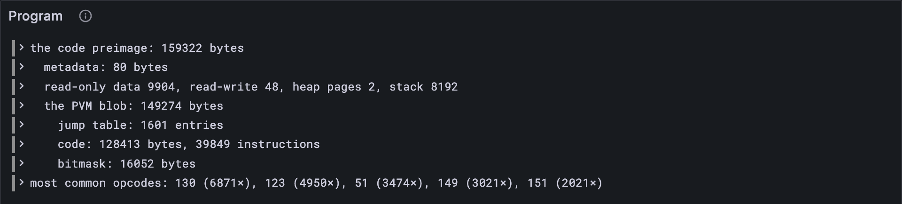

# The program blob

Part 15 is the big one: the **PVM**, the Polkadot Virtual Machine, the little computer
inside every JAM node that runs services' code. Before it can run anything, though, it
has to *unpack* it. A service's code arrives as one long preimage ([lesson 14.1](../14-services/01-providing-preimages.md)), and
inside it, like nesting dolls, are a label, a memory layout, and finally the program the
PVM steps through. This lesson opens all the dolls, on a real service's real code.

## New words

- **PVM.** The Polkadot Virtual Machine: a small, made-up computer, based on RISC-V, that
  runs every service's code exactly the same way on every validator. *Example:* a
  service's accumulate code, run in every block that has work for it.
- **Instruction and opcode.** An instruction is one small step (add, load, jump...); its
  opcode is the number that says which. *Example:* opcode 200 is `add_64`.
- **Program blob.** A service's code as bytes: the instructions, a bitmask saying where
  each starts, and a jump table. *Example:* the 149,274-byte blob inside service 0's code.

All three are in the [glossary](../glossary.md).

## What the Gray Paper says

Three layers, from the outside in.

**1. The code preimage** (§9): E(↕m) ⌢ c. First the **metadata** m, with its length in
front: a name, a version, a licence, for people rather than the PVM. Then the code c.

**2. The standard program** (App. A, the function Y): c holds what the program's memory
starts with. Four sizes, ℰ₃(|o|) ⌢ ℰ₃(|w|) ⌢ ℰ₂(z) ⌢ ℰ₃(s), then the data they size:

- o, **read-only data** the program may read;
- w, **read-write data**, followed by z pages of zeroed heap;
- s, the **stack** size;

and then ℰ₄(|p|) ⌢ p, the *program blob* itself. ([Lesson 15.4](./04-memory.md) lays these out in
memory.)

**3. The PVM blob** (App. A, deblob): ℰ(|j|) ⌢ ℰ₁(z) ⌢ ℰ(|c|), then:

- j, the **jump table**: |j| entries of z bytes each, the places an indirect jump may land;
- c, the **code**: the *instructions*, byte after byte;
- k, the **opcode bitmask**: one bit per byte of c, saying which bytes *start* an
  instruction. Instructions take 1 to 16 bytes, so without k you couldn't tell an
  opcode from an argument. Bits are packed least significant first, like [lesson 11.1](../11-assurances/01-available.md)'s
  bitfields.

## The tests

The tests need the trace's service code, and later lessons will too, so a helper finds
it, next to the other vector readers:

**Add to** `test/vectors.ts`

```ts
import { serviceCode } from "../src/services.ts";

/** The code of service 0, from the state before the first block of the fallback trace. */
export function bootstrapCode(): Uint8Array {
  const { entries } = traceState("fallback", 1);
  return serviceCode(entries, 0)!;
}
```

**New file** `test/program.test.ts`

```ts
import { test } from "node:test";
import assert from "node:assert/strict";
import { fromHex, toHex } from "../src/bytes.ts";
import { deblob, startsInstruction, unpackCode } from "../src/pvm/program.ts";
import { bootstrapCode } from "./vectors.ts";

test("deblob by hand: one jump, three bytes of code, two instructions", () => {
  // |j| = 1, z = 1, |c| = 3 | j = [2] | c = 00 01 02 | k = 0000 0101: bytes 0 and 2 start one
  const program = deblob(fromHex("0x01010302" + "000102" + "05"));
  assert.deepEqual(program.jumpTable, [2]);
  assert.equal(toHex(program.code), "0x000102");
  assert.deepEqual([0, 1, 2].map((i) => startsInstruction(program, i)), [true, false, true]);
});

test("a real service's code: metadata, then a standard program that ends it exactly", () => {
  const preimage = bootstrapCode();
  const code = unpackCode(preimage);
  assert.equal(new TextDecoder().decode(code.metadata).includes("jam-bootstrap-service"), true);
  assert.deepEqual([code.readOnly.length, code.readWrite.length], [9904, 48]);
  assert.deepEqual([code.heapPages, code.stackSize], [2, 8192]);
  const tail = preimage.subarray(preimage.length - code.program.length);
  assert.deepEqual(tail, code.program); // nothing left over after the PVM blob
});

test("its PVM blob: 39,849 instructions, and all 1,601 jumps land on one", () => {
  const program = deblob(unpackCode(bootstrapCode()).program);
  let instructions = 0;
  for (let i = 0; i < program.code.length; i++) if (startsInstruction(program, i)) instructions++;
  assert.equal(instructions, 39849);
  assert.equal(startsInstruction(program, 0), true); // the code starts with an instruction
  assert.equal(program.jumpTable.length, 1601);
  for (const target of program.jumpTable) assert.ok(startsInstruction(program, target));
});
```

The first test builds a blob by hand, eight bytes you can read: one jump to byte 2,
three bytes of code, and a bitmask of `0000 0101` that marks bytes 0 and 2 as
instructions. The others unpack the code of the trace's service 0, the 159,322-byte
preimage from [lesson 6.1](../06-state-and-merklization/01-the-state-trie.md), and check that every layer fits *exactly*: no bytes left over
at the end of the preimage, every jump landing on an instruction.

**Run, expect it to fail**

```sh
npm test
```

```text
...
Error [ERR_MODULE_NOT_FOUND]: Cannot find module '…/client/src/pvm/program.ts' imported from …/client/test/program.test.ts
...
✖ test/program.test.ts (173.8ms)
...
ℹ tests 388
ℹ suites 0
ℹ pass 387
ℹ fail 1
...
```

Red: `src/pvm/program.ts` doesn't exist yet. Unpacking is a few small readers, one per
layer, so they come as one file, and the next Run turns all the new tests green.

## The code

**New file** `src/pvm/program.ts`

```ts
// Programs (GP §9, App. A): how a service's code is packed, from its preimage down to the
// instructions the PVM runs.

import { bitAt } from "../assurances.ts";
import type { Bytes } from "../bytes.ts";
import { Reader } from "../codec/reader.ts";

/** A service's code, unpacked: its metadata, and the standard program's parts (GP App. A). */
export type ServiceCode = {
  metadata: Bytes; // a name, a version, a licence: for people, not the PVM
  readOnly: Bytes; // o: data the program may read
  readWrite: Bytes; // w: data it may read and write
  heapPages: number; // z: pages of zeroed heap after w
  stackSize: number; // s
  program: Bytes; // the PVM program blob
};

/** Unpacks a code preimage: E(↕m) ⌢ c (GP §9), and c is Y's standard program (App. A). */
export function unpackCode(preimage: Bytes): ServiceCode {
  const r = new Reader(preimage);
  const metadata = r.bytes(Number(r.natural()));
  const readOnlyLength = Number(r.fixed(3));
  const readWriteLength = Number(r.fixed(3));
  const heapPages = Number(r.fixed(2));
  const stackSize = Number(r.fixed(3));
  const readOnly = r.bytes(readOnlyLength);
  const readWrite = r.bytes(readWriteLength);
  const program = r.bytes(Number(r.fixed(4)));
  return { metadata, readOnly, readWrite, heapPages, stackSize, program };
}

/** A PVM program blob, unpacked: the jump table, the code, and the opcode bitmask. */
export type Program = { jumpTable: number[]; code: Bytes; bitmask: Bytes };

/** deblob (GP App. A): E(|j|) ⌢ E₁(z) ⌢ E(|c|) ⌢ j, each entry z bytes ⌢ c ⌢ k. */
export function deblob(blob: Bytes): Program {
  const r = new Reader(blob);
  const jumps = Number(r.natural());
  const z = Number(r.fixed(1)); // bytes per jump-table entry
  const codeLength = Number(r.natural());
  const jumpTable = Array.from({ length: jumps }, () => Number(r.fixed(z)));
  const code = r.bytes(codeLength);
  const bitmask = r.bytes(Math.ceil(codeLength / 8)); // one bit per byte of code
  return { jumpTable, code, bitmask };
}

/** Whether byte i of the code starts an instruction: bit i of k, least significant first. */
export function startsInstruction(program: Program, i: number): boolean {
  return i < program.code.length && bitAt(program.bitmask, i);
}
```

The PVM gets a folder of its own, `src/pvm/`, since several files are coming. All of
this is [lesson 2.3](../02-codec/03-writer-and-reader.md)'s `Reader`: `fixed(3)` for ℰ₃, `natural()` for ℰ, `bytes(n)` for the
data. `startsInstruction` reuses [lesson 11.1](../11-assurances/01-available.md)'s `bitAt`: the same packing, so the same
function.

> [!NOTE]
> **The simple road.** `unpackCode` and `deblob` trust the sizes they read. A blob
> shorter than its own sizes, a giant jump table, or a jump target off the end of the
> code all slip through, and a program comes from any service, so from anyone. The
> real service's code is well formed, so this is fine for now; the [hardening
> pass](https://github.com/abutlabs/gray-tutorial/blob/main/HARDENING.md) checks every size.

**Run**

```sh
npm test
npm run typecheck
```

```text
...
✔ the reported packages: each one's hash and exports root, sorted by hash (275.3ms)
...
✔ deblob by hand: one jump, three bytes of code, two instructions (1.6ms)
✔ a real service's code: metadata, then a standard program that ends it exactly (12.7ms)
✔ its PVM blob: 39,849 instructions, and all 1,601 jumps land on one (22.6ms)
...
ℹ tests 390
ℹ suites 0
ℹ pass 390
ℹ fail 0
...
reported 390 tests to Grafana: http://127.0.0.1:3300/d/gray-tutorial?var-client=you&var-run_id=test-1791736314079
...
```

## Watch it

**New file** `bin/program.ts`

```ts
// Unpacks a service's code from the state before a trace's block, layer by layer: the
// metadata, the standard program, and the PVM blob's jump table, code and bitmask.
// Usage: node bin/program.ts <trace.json> [service id, 0 unless you say], e.g.
//        node bin/program.ts ../vectors/traces/fallback/00000001.json

import { readFileSync } from "node:fs";
import { fromHex } from "../src/bytes.ts";
import { Run } from "../src/obs.ts";
import { deblob, startsInstruction, unpackCode } from "../src/pvm/program.ts";
import { serviceCode } from "../src/services.ts";
import type { KeyValue } from "../src/trie.ts";

const [file, id] = process.argv.slice(2);
const trace = JSON.parse(readFileSync(file, "utf8"));
const entries: KeyValue[] = trace.pre_state.keyvals.map((e: { key: string; value: string }) => ({
  key: fromHex(e.key),
  value: fromHex(e.value),
}));
const preimage = serviceCode(entries, Number(id ?? 0));
if (!preimage) throw new Error("the service's code isn't in this state");
const code = unpackCode(preimage);
const program = deblob(code.program);
const opcodes = new Map<number, number>(); // how often each opcode starts an instruction
for (let i = 0; i < program.code.length; i++) {
  if (!startsInstruction(program, i)) continue;
  const opcode = program.code[i];
  opcodes.set(opcode, (opcodes.get(opcode) ?? 0) + 1);
}
const instructions = [...opcodes.values()].reduce((a, b) => a + b, 0);
const common = [...opcodes.entries()].sort((a, b) => b[1] - a[1]).slice(0, 5);
const run = new Run("program");
const lines = [
  `the code preimage: ${preimage.length} bytes`,
  `  metadata: ${code.metadata.length} bytes`,
  `  read-only data ${code.readOnly.length}, read-write ${code.readWrite.length}, ` +
    `heap pages ${code.heapPages}, stack ${code.stackSize}`,
  `  the PVM blob: ${code.program.length} bytes`,
  `    jump table: ${program.jumpTable.length} entries`,
  `    code: ${program.code.length} bytes, ${instructions} instructions`,
  `    bitmask: ${program.bitmask.length} bytes`,
  `most common opcodes: ${common.map(([op, n]) => `${op} (${n}×)`).join(", ")}`,
];
for (const line of lines) {
  console.log(line);
  run.event("layer", { line });
}
const link = await run.report();
if (link) console.log(`reported to Grafana: ${link}`);
```

**Run**

```sh
node bin/program.ts ../vectors/traces/fallback/00000001.json
```

```text
the code preimage: 159322 bytes
  metadata: 80 bytes
  read-only data 9904, read-write 48, heap pages 2, stack 8192
  the PVM blob: 149274 bytes
    jump table: 1601 entries
    code: 128413 bytes, 39849 instructions
    bitmask: 16052 bytes
most common opcodes: 130 (6871×), 123 (4950×), 51 (3474×), 149 (3021×), 151 (2021×)
reported to Grafana: http://127.0.0.1:3300/d/gray-tutorial?var-client=you&var-run_id=program-1791736319548
```

159,322 bytes: 80 of metadata (it calls itself `jam-bootstrap-service`, version 0.1.29,
Apache-2.0 licensed), almost 10 kB of read-only data, and a PVM blob of 149,274 bytes
holding 39,849 instructions. 128,413 bytes of code over 39,849 instructions is about
3.2 bytes each. And a few opcodes do most of the work: 130, 123 and 51 alone start more
than a third of all instructions. Next lesson finds out what they are. The *Program* panel
shows the layers.



<details>
<summary>lasair: <code>parse_program</code>, in <code>lib/pvm.ml</code></summary>

```ocaml
        let code_len, pos3 = decode_natural blob pos2 in
        (* Z_J, Z_C; a count past 2^62 wraps negative in an int *)
        if jump_count < 0 || jump_count > Definitions.Constants.c_max_jump_table_entries
           || code_len < 0 || code_len > Definitions.Constants.c_max_code_size then None
        else
        let jump_table_size = jump_count * z in
        let bitmask_size = (code_len + 7) / 8 in
        let expected_size = pos3 + jump_table_size + code_len + bitmask_size in

        if Bytes.length blob < expected_size then None
```

The same three layers of sizes, plus the hardening: limits on the jump table and the
code, and a refusal when the blob is shorter than its own sizes promise. A program blob
comes from a service, so from anyone, and a client must survive a hostile one. A few
lines further down, lasair also *expands* the bitmask into a byte per code byte, trading
memory for a faster "does this byte start an instruction?". Both are hardening (the note
above); your `deblob` shows the shape.

</details>

## What you have

A real service's code, unpacked down to its instructions: metadata, memory layout, jump
table, code and bitmask, every byte accounted for. So far they're only opcode numbers,
though: [lesson 15.2](./02-instructions.md) reads each one, name and arguments.

Next: [15.2 Instructions](./02-instructions.md)
