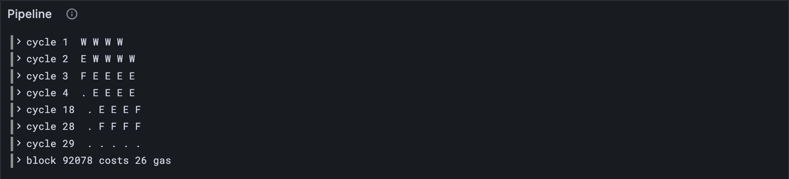

# The pipeline

[Lesson 15.9](./09-what-instructions-cost.md)'s block from the bootstrap service adds up to 91 cycles. Yet a real CPU would
run it in far fewer, because it doesn't do one thing at a time. While one instruction
waits on memory, others start; while a store crawls along, three more crawl beside it.
The Gray Paper's gas model builds exactly such a CPU, small and made up, and charges a
basic block the cycles that CPU needs. This lesson builds it.

## What the Gray Paper says

App. A.9 describes the model CPU, cycle by cycle:

1. **Decode.** Each cycle, the front end decodes instructions in order, up to 4 decode
   slots' worth ([lesson 15.9](./09-what-instructions-cost.md)'s ď), into a *reorder buffer*. At most 32 instructions can
   be in it, not yet retired. Decoding stops at the block's terminator.
2. **Wait.** The next cycle, a decoded instruction is waiting. It can start once every
   earlier instruction that writes a register it reads has finished its cycles, and once
   the units it needs are free. The CPU has 4 ALUs, 4 load units, 4 store units, 1
   multiplier and 1 divider. Up to 5 instructions start each cycle.
3. **Execute.** It runs for its cycles (č), then gives its units back and is finished.
4. **Retire.** Finished instructions leave the buffer *in order*: one retires only once
   everything before it has.

`move_reg` never enters the buffer at all: the front end just notes that whatever
produces its source register now produces its destination too, and anything that reads
the destination waits on that. It's free, but the wait follows the value through it.

When everything has been decoded and retired, the block's gas is the cycles taken, less
3, and at least 1. (Run one instruction alone and it costs exactly its own cycles: the 3
is the pipeline's own overhead.)

The Gray Paper writes this as a state 𝕊 (ı, c, d, e, t and the buffer r) and four
transitions: X′ decodes (X^mov for `move_reg`, X^dec for the rest), X″ starts the first
ready instruction S, X‴ ticks the clock, and X picks: decode if it can, else start if it
can, else stop if everything is retired, else tick.

## The tests

**Add to** `test/gas.test.ts`

```ts
import { blockCost } from "../src/pvm/gas.ts";
import { deblob, unpackCode } from "../src/pvm/program.ts";
import { bootstrapCode } from "./vectors.ts";
import type { Program, ServiceCode } from "../src/pvm/program.ts";

/** The gas a hand-made block costs, from its first instruction. */
const gas = (...instructions: number[][]) => blockCost(assemble(instructions), 0);

// load_ind_u64 is [130, A + 16·B]: φ_A from memory at φ_B. trap ends each block.
test("one instruction on its own costs its cycles: the 3 is the pipeline's overhead", () => {
  const trap: number = gas([0]); // trap
  assert.equal(trap, 2);
  const jump: number = gas([40, 0]); // jump
  assert.equal(jump, 15);
});

test("independent loads run side by side: four cost no more than one, a fifth waits", () => {
  const oneLoad: number = gas([130, 0x12], [0]); // r2 = [r1]
  assert.equal(oneLoad, 25);
  const fourLoads: number = gas([130, 0x12], [130, 0x13], [130, 0x14], [130, 0x15], [0]);
  assert.equal(fourLoads, 25);
  const fiveLoads: number = gas(
    [130, 0x12], [130, 0x13], [130, 0x14], [130, 0x15], [130, 0x16], [0],
  );
  assert.equal(fiveLoads, 50);
});

test("a load that needs another's answer waits for it", () => {
  const chainOfTwo: number = gas([130, 0x12], [130, 0x23], [0]); // r2 = [r1], then r3 = [r2]
  assert.equal(chainOfTwo, 50);
  const chainOfThree: number = gas([130, 0x12], [130, 0x23], [130, 0x34], [0]);
  assert.equal(chainOfThree, 75);
});

test("move_reg is free, and the wait follows the value through it", () => {
  const throughMove: number = gas([130, 0x12], [100, 0x25], [130, 0x53], [0]); // r5 = r2, r3 = [r5]
  assert.equal(throughMove, 50);
});

test("there's one divide unit: two divides take turns", () => {
  const oneDivide: number = gas([203, 0x10, 2], [0]); // div_u_64 r2 = r0 ÷ r1
  assert.equal(oneDivide, 60);
  const twoDivides: number = gas([203, 0x10, 2], [203, 0x10, 3], [0]);
  assert.equal(twoDivides, 120);
});

test("a real block: the bootstrap service's first costs 26, not the 91 its cycles add to", () => {
  const program: Program = deblob(unpackCode(bootstrapCode()).program);
  const first: number = blockCost(program, 92078);
  assert.equal(first, 26);
});
```

Loads make the clearest examples: 25 cycles each, and 4 load units. Four independent
loads cost what one does. A load whose address comes from another load must wait for it.

**Run, expect it to fail**

```sh
npm test
```

```text
...
SyntaxError: The requested module '../src/pvm/gas.ts' does not provide an export named 'blockCost'
...
✖ test/gas.test.ts (216.8ms)
...
ℹ tests 424
ℹ suites 0
ℹ pass 423
ℹ fail 1
...
```

Red: `src/pvm/gas.ts` doesn't export `blockCost` yet. The model CPU is four small
functions, one per Gray Paper transition, that only work together, so they come in one
snippet.

## The code

The model decodes until the block's terminator, so it needs [lesson 15.3](./03-the-machine.md)'s T:

**Replace in** `src/pvm/machine.ts`

```ts
/** T (GP App. A.3): the instructions that end a basic block. */
export const TERMINATORS = new Set([0, 1, 40, 50, 80, 180, 170, 171, 172, 173, 174, 175]);
for (let opcode = 81; opcode <= 90; opcode++) TERMINATORS.add(opcode); // the immediate branches
```

**Add to** `src/pvm/gas.ts`

```ts
import { decodeInstruction } from "./instructions.ts";
import { TERMINATORS } from "./machine.ts";

/** A reorder buffer entry's state: decoding, waiting, executing, finished, or retired. */
type State = "DEC" | "WAIT" | "EXE" | "FIN" | null;

/** An instruction in the reorder buffer (GP's ℝ): its state, cycles to go, what it waits on. */
type Entry = { state: State; cycles: number; deps: number[]; regs: number[]; units: Units };

/**
 * The model CPU (GP's 𝕊): where it's decoding, its clock, what's left this cycle, and the
 * reorder buffer, where decoded instructions wait, run and retire.
 */
export type Cpu = {
  pc: number | null; // ı: the next instruction to decode, or null once the block is decoded
  cycles: number; // c
  decode: number; // d: decode slots left this cycle
  start: number; // e: instructions that may still start this cycle
  units: Units; // t: execution units free
  rob: Entry[]; // r
};

/** Units added up, kind by kind (or taken away, with a sign of −1). */
const plus = (a: Units, b: Units, sign = 1) => a.map((u, k) => u + sign * b[k]) as Units;

/** S (GP App. A.9): the first waiting instruction whose units are free and inputs ready. */
function readyToStart(cpu: Cpu): number | null {
  const ready = cpu.rob.findIndex(
    (e) =>
      e.state === "WAIT" &&
      e.units.every((u, k) => u <= cpu.units[k]) &&
      e.deps.every((k) => cpu.rob[k].cycles === 0),
  );
  return ready === -1 ? null : ready;
}

/** X′ (GP App. A.9): decodes one instruction into the reorder buffer. */
function decode(cpu: Cpu, program: Program, ins: Instruction): void {
  const { reads, writes } = registersUsed(ins);
  if (ins.name === "move_reg") {
    // X^mov: no work at all. Whatever makes the register it reads now makes its destination.
    for (const e of cpu.rob) {
      const feeds = e.regs.some((r) => reads.includes(r));
      e.regs = feeds ? [...e.regs, ...writes] : e.regs.filter((r) => !writes.includes(r));
    }
    cpu.pc = ins.next;
    cpu.decode -= 1;
    return;
  }
  // X^dec: it waits on every entry that makes a register it reads.
  const { cycles, slots, units } = instructionCost(program, ins);
  const deps = cpu.rob.flatMap((e, i) => (e.regs.some((r) => reads.includes(r)) ? [i] : []));
  for (const e of cpu.rob) e.regs = e.regs.filter((r) => !writes.includes(r));
  cpu.rob.push({ state: "DEC", cycles, deps, regs: writes, units });
  cpu.pc = TERMINATORS.has(ins.opcode) ? null : ins.next;
  cpu.decode -= slots;
}

/** X″ (GP App. A.9): starts the first instruction that's ready. */
function startOne(cpu: Cpu, n: number): void {
  cpu.start -= 1;
  cpu.units = plus(cpu.units, cpu.rob[n].units, -1);
  cpu.rob[n].state = "EXE";
}

/** X‴ (GP App. A.9): one tick of the clock. */
function tick(cpu: Cpu): void {
  cpu.cycles += 1;
  cpu.decode = 4;
  cpu.start = 5;
  let retiring = true; // has everything up to here finished? Then it retires, in order
  for (const e of cpu.rob) {
    retiring &&= e.state === "FIN" || e.state === null;
    const executing = e.state === "EXE";
    if (executing && e.cycles === 1) cpu.units = plus(cpu.units, e.units); // done: units free
    if (retiring) e.state = null;
    else if (e.state === "DEC") e.state = "WAIT";
    else if (executing && e.cycles === 0) e.state = "FIN";
    if (executing && e.cycles > 0) e.cycles -= 1;
  }
}

/**
 * ϱ^Δ (GP App. A.9): the gas a basic block costs. The model CPU decodes up to 4 slots and
 * starts up to 5 instructions a cycle, runs them on (4, 4, 4, 1, 1) units, and retires
 * them in order. The cost is its cycles until all are retired, less 3, and at least 1.
 * `watch`, if given, sees the CPU after every tick.
 */
export function blockCost(program: Program, start: number, watch?: (cpu: Cpu) => void): number {
  const cpu: Cpu = { pc: start, cycles: 0, decode: 4, start: 5, units: [4, 4, 4, 1, 1], rob: [] };
  for (;;) {
    const live = cpu.rob.filter((e) => e.state !== null).length;
    const ins = cpu.pc === null ? null : decodeInstruction(program, cpu.pc);
    const ready = readyToStart(cpu);
    if (ins && instructionCost(program, ins).slots <= cpu.decode && live < 32) {
      decode(cpu, program, ins);
    } else if (ready !== null && cpu.start > 0) {
      startOne(cpu, ready);
    } else if (cpu.pc === null && live === 0) {
      return Math.max(cpu.cycles - 3, 1);
    } else {
      tick(cpu);
      watch?.(cpu); // lets a watcher see each cycle
    }
  }
}
```

Each Gray Paper function is one small function here. `decode` is X′, with X^mov as its
first branch. Its dependencies are worked out *before* the new instruction takes over its
registers, so it waits on the old writer, not on itself. `startOne` is X″, and `tick` is
X‴. In `tick`, `retiring` stays true only while every entry so far has finished: that's
"retire in order" in one line. `blockCost` is X, its four cases in the Gray Paper's
order.

**Run**

```sh
npm test
npm run typecheck
```

```text
...
✔ one instruction on its own costs its cycles: the 3 is the pipeline's overhead (0.3ms)
✔ independent loads run side by side: four cost no more than one, a fifth waits (0.3ms)
✔ a load that needs another's answer waits for it (0.3ms)
✔ move_reg is free, and the wait follows the value through it (0.2ms)
✔ there's one divide unit: two divides take turns (0.3ms)
✔ a real block: the bootstrap service's first costs 26, not the 91 its cycles add to (13.1ms)
...
✔ the reported packages: each one's hash and exports root, sorted by hash (254.0ms)
...
ℹ tests 435
ℹ suites 0
ℹ pass 435
ℹ fail 0
...
reported 435 tests to Grafana: http://127.0.0.1:3300/d/gray-tutorial?var-client=you&var-run_id=test-1791737113888
...
```

## Watch it

**New file** `bin/pipeline.ts`

```ts
// Runs a real basic block through the model CPU, the one the bootstrap service's
// accumulation jumps to first, and draws its reorder buffer cycle by cycle.
// Usage: node bin/pipeline.ts

import { readFileSync } from "node:fs";
import { fromHex } from "../src/bytes.ts";
import { Run } from "../src/obs.ts";
import { blockCost } from "../src/pvm/gas.ts";
import { decodeInstruction } from "../src/pvm/instructions.ts";
import { deblob, unpackCode } from "../src/pvm/program.ts";
import { serviceCode } from "../src/services.ts";
import type { KeyValue } from "../src/trie.ts";

const trace = JSON.parse(readFileSync("../vectors/traces/fallback/00000001.json", "utf8"));
const entries: KeyValue[] = trace.pre_state.keyvals.map((e: { key: string; value: string }) => ({
  key: fromHex(e.key),
  value: fromHex(e.value),
}));
const program = deblob(unpackCode(serviceCode(entries, 0)!).program);
const start = decodeInstruction(program, 5).target as number; // where accumulation jumps

const LETTER = { DEC: "D", WAIT: "W", EXE: "E", FIN: "F" } as const;
const run = new Run("pipeline");
let last = "";
const cost = blockCost(program, start, (cpu) => {
  const row = cpu.rob.map((e) => (e.state === null ? "." : LETTER[e.state])).join(" ");
  if (row === last) return; // only the cycles where something changes
  last = row;
  console.log(`cycle ${String(cpu.cycles).padStart(2)}  ${row}`);
  run.event("cycle", { cycle: cpu.cycles, row });
});
console.log(`the block at ${start} costs ${cost} gas`);
run.event("cost", { block: start, cost });
const link = await run.report();
if (link) console.log(`reported to Grafana: ${link}`);
```

**Run**

```sh
node bin/pipeline.ts
```

```text
cycle  1  W W W W
cycle  2  E W W W W
cycle  3  F E E E E
cycle  4  . E E E E
cycle 18  . E E E F
cycle 28  . F F F F
cycle 29  . . . . .
the block at 92078 costs 26 gas
reported to Grafana: http://127.0.0.1:3300/d/gray-tutorial?var-client=you&var-run_id=pipeline-1791737119776
```

One column per instruction in the buffer: the stack-pointer add, the three stores and the
call (the two `move_reg` instructions never get a column). W is waiting, E executing, F finished, and
a dot is retired. (Decoding lasts only until the next tick, so you never catch a D.) Read
it top down. At cycle 2 the add runs while the
stores wait: they need its r1. From cycle 3 all three stores run side by side, with the
15-cycle call beside them. The call finishes at 18 but can't retire before the stores
ahead of it. At 28 everything is finished, at 29 everything is retired: 29 − 3 = 26 gas.
The *Pipeline* panel keeps the picture.



<details>
<summary>lasair: the clock tick, in <code>lib/pvm_gas.ml</code></summary>

```ocaml
             let all_done = ref true in
             for j = !head to !rob_len - 1 do
               let en = !rob.(j) in
               let old_st = en.st and old_cyc = en.cycles_left in
               if not (old_st = Fin || old_st = Retired) then all_done := false;
               en.st <- (if !all_done then Retired
                         else if old_st = Dec then Wait
                         else if old_st = Exe && old_cyc = 0 then Fin
                         else old_st);
```

The same single pass as your `tick`, with `all_done` for your `retiring`. lasair adds
speed: it skips the retired entries at the front of the buffer with `head`, and
remembers each block's cost once worked out. On the bootstrap service's 6,229 basic
blocks, the two give the same cost every time.

</details>

## What you have

A price for every basic block, worked out the Gray Paper's way. One piece of gas is left:
the meter that charges those prices as the machine runs, and [lesson 15.11](./11-the-gas-meter.md) builds it.

Next: [15.11 The gas meter](./11-the-gas-meter.md)
