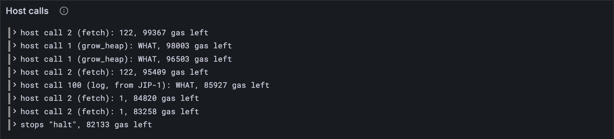

# Fetch

[Lesson 16.1](./01-calling-the-host.md) ended with a service asking for `fetch` and getting WHAT. `fetch` is how a
service learns about the world it's running in: the chain's rules, some fresh randomness,
and the work it has been handed. Answer it, and the service gets a lot further. Very
nearly all the way.

## What the Gray Paper says

**`fetch`** (host call 2, App. B.5, Ω_Y) hands out *items*, by number, in φ₁₀. Each
invocation has its own. During accumulation (App. B.4's F) there are four:

| Item | What it is |
| --- | --- |
| 0 | the protocol's constants, 29 of them, in 122 bytes |
| 1 | η′₀, the entropy ([lesson 8.1](../08-safrole/01-stirring-the-entropy.md)) |
| 14 | the service's inputs, all of them, as a sequence |
| 15 | one input, number φ₁₁ |

Every other item is nothing: φ₇ = NONE.

The registers say where the item goes. φ₇ is the address o, φ₈ the first byte wanted f,
and φ₉ how many bytes z. The host copies up to z bytes of the item, from byte f on, into
memory at o, and φ₇ becomes the item's *whole* length. So a service can ask for 0 bytes
first, to learn how big the item is, and then ask again with room for it. If the memory
there isn't writable, the machine panics.

The price depends on the item (App. B.5's table of M_Y): a base, plus a rate per 1,024
bytes *asked for*, rounded up (the Gray Paper's 𝔐). Item 0 is a flat 390, item 1 a flat
103.

Item 0 lists the constants in a fixed order, each in a fixed number of bytes: the three
deposits (B_I, B_L, B_S) in 8 bytes each, then C (the cores) in 2, D and E in 4, and so on
to Y. Nine of them differ between tiny and full, so `Config` grows to hold the five it
didn't have yet.

## The tests

**Add to** `test/host.test.ts`

```ts
import { accumulateHost, NONE, protocolConstants } from "../src/host.ts";
import { TINY } from "../src/config.ts";
import { addPages, readMemory } from "../src/pvm/memory.ts";

/** Accumulation's host, with an entropy of 32 sevens and no inputs. */
const accumulating = accumulateHost(TINY, new Uint8Array(32).fill(7), []);

/** ecalli 2 (fetch) with φ₇ to φ₁₀ as given, then a return; a writable page at 0x20000. */
function fetching(o: bigint, from: bigint, length: bigint, item: bigint) {
  const memory = new Map();
  addPages(memory, 0x20000, 4096, "W");
  const registers = [HALT_ADDRESS, 0n, 0n, 0n, 0n, 0n, 0n, o, from, length, item];
  return newMachine(assemble([[10, 2], [50, 0x00]]), registers, memory, 10_000n);
}

test("item 0: the protocol constants, 122 bytes, and tiny has 2 cores", () => {
  const constants = protocolConstants(TINY);
  assert.equal(constants.length, 122);
  assert.deepEqual([...constants.subarray(24, 26)], [2, 0]); // C, after three 8-byte deposits
});

test("fetch copies an item into memory, and says how long it is", () => {
  const machine = fetching(0x20000n, 0n, 122n, 0n);
  assert.equal(runWithHost(machine, accumulating), "halt");
  assert.equal(machine.registers[7], 122n);
  assert.deepEqual(readMemory(machine.memory, 0x20000n, 122), protocolConstants(TINY));
  assert.equal(machine.gas, 10_000n - 100n - 390n); // the block, then fetch's item 0
});

test("asking for no bytes at all: just the length", () => {
  const machine = fetching(0x20000n, 0n, 0n, 0n);
  runWithHost(machine, accumulating);
  assert.equal(machine.registers[7], 122n);
  assert.deepEqual(readMemory(machine.memory, 0x20000n, 1), Uint8Array.of(0)); // untouched
});

test("part of an item: from byte φ₈, and at most φ₉ bytes of it", () => {
  const machine = fetching(0x20000n, 30n, 10n, 1n); // the entropy, from byte 30: 2 bytes left
  runWithHost(machine, accumulating);
  assert.equal(machine.registers[7], 32n);
  assert.deepEqual(readMemory(machine.memory, 0x20000n, 3), Uint8Array.of(7, 7, 0));
});

test("an item accumulation doesn't have: NONE; nowhere to put it: panic", () => {
  const missing = fetching(0x20000n, 0n, 10n, 7n); // a work-package: refinement only
  runWithHost(missing, accumulating);
  assert.equal(missing.registers[7], NONE);
  assert.equal(runWithHost(fetching(0x50000n, 0n, 122n, 0n), accumulating), "panic");
});
```

**Run, expect it to fail**

```sh
npm test
```

```text
...
SyntaxError: The requested module '../src/host.ts' does not provide an export named 'accumulateHost'
...
✖ test/host.test.ts (241.1ms)
...
ℹ tests 439
ℹ suites 0
ℹ pass 438
ℹ fail 1
...
```

Red: `src/host.ts` doesn't export `fetch` or `accumulateHost` yet. Fetch needs the
constants, the items and the host that hands them out, so they come in one snippet,
after `Config` grows.

## The code

**Replace in** `src/config.ts`

```ts
/** The protocol constants that depend on the size of the network. */
export type Config = {
  name: string;
  validators_count: number; // V: validators in a set
  core_count: number; // C: cores doing work in parallel
  epoch_length: number; // E: timeslots in an epoch
  epoch_tail_start: number; // Y: the slot of an epoch at which the ticket lottery closes
  rotation_period: number; // R: slots between reshuffles of the guarantors
  expunge_period: number; // D: slots before a forgotten preimage may go
  max_tickets_per_extrinsic: number; // K: tickets a block may carry
  max_lookup_anchor_age: number; // L: how old a lookup anchor may be, in slots
  max_refine_gas: bigint; // G_R: gas for refining a work-package
  max_block_gas: bigint; // G_T: gas for all of a block's accumulation
};

export const TINY: Config = {
  name: "tiny",
  validators_count: 6,
  core_count: 2,
  epoch_length: 12,
  epoch_tail_start: 10,
  rotation_period: 4,
  expunge_period: 32,
  max_tickets_per_extrinsic: 3,
  max_lookup_anchor_age: 24,
  max_refine_gas: 1_000_000_000n,
  max_block_gas: 20_000_000n,
};

export const FULL: Config = {
  name: "full",
  validators_count: 1023,
  core_count: 341,
  epoch_length: 600,
  epoch_tail_start: 500,
  rotation_period: 10,
  expunge_period: 19_200,
  max_tickets_per_extrinsic: 16,
  max_lookup_anchor_age: 14_400,
  max_refine_gas: 5_000_000_000n,
  max_block_gas: 3_500_000_000n,
};
```

Tiny's values come from the test vectors' list of chain parameters, all but L, the oldest
a lookup anchor may be, which that list leaves out: tiny chains use 24.

`fetch` charges for bytes asked for, which can be any 64-bit number, so `charge` takes a
`bigint` too:

**Replace in** `src/host.ts`

```ts
/** Every host call costs gas: g is taken first, and if that leaves too little, oog. */
export function charge(m: Machine, g: number | bigint): boolean {
  m.gas -= BigInt(g);
  return m.gas >= 0n;
}
```

**Add to** `src/host.ts`

```ts
import type { Bytes } from "./bytes.ts";
import { concatBytes } from "./bytes.ts";
import { encodeFixed, encodeNatural } from "./codec/numbers.ts";
import type { Config } from "./config.ts";
import { writeMemory } from "./pvm/memory.ts";

/** 𝔐(L, ℓ) (GP App. B.5): gas for ℓ bytes, at L gas per 1,024 of them, rounded up. */
const memoryGas = (rate: number, length: bigint) => (BigInt(rate) * length + 1023n) / 1024n;

/** Fetch's item 0 (GP App. B.5): the protocol's constants, 29 of them in 122 bytes. */
export function protocolConstants(config: Config): Bytes {
  const fields: [number, number | bigint][] = [
    [8, 10], [8, 1], [8, 100], // B_I, B_L, B_S: deposits per item, per byte, per service
    [2, config.core_count], [4, config.expunge_period], [4, config.epoch_length], // C, D, E
    [8, 10_000_000], [8, 50_000_000], [8, config.max_refine_gas], [8, config.max_block_gas],
    [2, 8], [2, 16], [2, 8], [2, config.max_tickets_per_extrinsic], // H, I, J, K
    [4, config.max_lookup_anchor_age], [2, 8], [2, 6], [2, 80], [2, config.rotation_period],
    [2, 128], [2, 5], [4, 64_000], [4, 13_791_360], [4, 4_000_000], [4, 3072], // T to W_M
    [4, 48 * 1024], [4, 128], [4, 3072], [4, config.epoch_tail_start], // W_R, W_T, W_X, Y
  ];
  return concatBytes(...fields.map(([n, v]) => encodeFixed(BigInt(v), n)));
}

/** Fetch's gas (GP App. B.5): a base and a rate per 1,024 bytes asked for, item by item. */
const FETCH_GAS: [number, number][] = [
  [390, 0], [103, 0], [80, 96], [85, 96], [85, 96], [171, 0], [171, 0], [85, 96],
  [84, 0], [88, 0], [111, 0], [317, 0], [250, 0], [95, 96], [287, 400], [355, 344],
  [80, 0], // any other item: nothing there
];

/** What an invocation lets fetch hand out: item `kind` (and `index`), or nothing. */
export type Items = (kind: number, index: bigint) => Bytes | undefined;

/**
 * fetch (GP App. B.5, Ω_Y): copies item φ₁₀ (with index φ₁₁) to memory at φ₇: up to φ₉
 * bytes of it, from byte φ₈ on. φ₇ becomes the item's whole length, or NONE if there's no
 * such item. `find` says what each item is, so each invocation offers its own.
 */
export function fetch(m: Machine, find: Items): HostExit {
  const [o, from, z, kind, index] = m.registers.slice(7, 12);
  const [base, rate] = FETCH_GAS[kind < 16n ? Number(kind) : 16];
  if (!charge(m, BigInt(base) + memoryGas(rate, z))) return "oog";
  const v = kind < 16n ? find(Number(kind), index) : undefined;
  if (v === undefined) {
    m.registers[7] = NONE;
    return "continue";
  }
  const f = from < BigInt(v.length) ? Number(from) : v.length;
  const l = z < BigInt(v.length - f) ? Number(z) : v.length - f;
  if (writeMemory(m.memory, o, v.subarray(f, f + l))) return "panic"; // not writable
  m.registers[7] = BigInt(v.length);
  return "continue";
}

/**
 * F (GP App. B.4): the host for a service's accumulation. So far it answers gas and fetch,
 * whose items are the constants (0), the entropy η′₀ (1), and the service's inputs, all of
 * them (14) or one (15). Anything else: WHAT.
 */
export function accumulateHost(config: Config, entropy: Bytes, inputs: Bytes[]): Host {
  const items: Items = (kind, index) => {
    if (kind === 0) return protocolConstants(config);
    if (kind === 1) return entropy;
    if (kind === 14) return concatBytes(encodeNatural(BigInt(inputs.length)), ...inputs);
    if (kind === 15 && index < BigInt(inputs.length)) return inputs[Number(index)];
    return undefined;
  };
  return (call, m) => {
    switch (HOST_CALLS[call]) {
      case "gas":
        return gas(m);
      case "fetch":
        return fetch(m, items);
      default:
        return unknown(m);
    }
  };
}
```

`protocolConstants` is the Gray Paper's list read top to bottom: each pair is a size in
bytes and a value. `fetch` works out f and l exactly as the Gray Paper does, clamped so
they can't run past the end of the item, then writes, and [lesson 15.4](../15-the-pvm/04-memory.md)'s `writeMemory`
says whether it could. And `accumulateHost` is F, accumulation's own host: it decides what
the items are, then sends each host call to the function that answers it. As more host
calls arrive, they join its `switch`.

**Run**

```sh
npm test
npm run typecheck
```

```text
...
✔ the reported packages: each one's hash and exports root, sorted by hash (254.3ms)
...
✔ item 0: the protocol constants, 122 bytes, and tiny has 2 cores (0.3ms)
✔ fetch copies an item into memory, and says how long it is (0.6ms)
✔ asking for no bytes at all: just the length (0.2ms)
✔ part of an item: from byte φ₈, and at most φ₉ bytes of it (0.2ms)
✔ an item accumulation doesn't have: NONE; nowhere to put it: panic (0.6ms)
...
ℹ tests 447
ℹ suites 0
ℹ pass 447
ℹ fail 0
...
reported 447 tests to Grafana: http://127.0.0.1:3300/d/gray-tutorial?var-client=you&var-run_id=test-1791738018596
...
```

## Watch it

`bin/host.ts` now asks accumulation's host:

**Rewrite** `bin/host.ts`

```ts
// Runs a real service's accumulation with your client's host, and shows every host call it
// makes and the answer it gets. The service, 1729, comes from the accumulate test vector
// always_accumulate-1, with the 100,000 gas the vector gives it.
// Usage: node bin/host.ts

import { readFileSync } from "node:fs";
import { fromHex } from "../src/bytes.ts";
import { encodeNatural } from "../src/codec/numbers.ts";
import { TINY } from "../src/config.ts";
import type { Host } from "../src/host.ts";
import { accumulateHost, HOST_CALLS, NONE, runWithHost, WHAT } from "../src/host.ts";
import { Run } from "../src/obs.ts";
import { newMachine } from "../src/pvm/machine.ts";
import { deblob, unpackCode } from "../src/pvm/program.ts";
import { standardProgram } from "../src/pvm/standard.ts";

const file = "../vectors/stf/accumulate/tiny/always_accumulate-1.json";
const vector = JSON.parse(readFileSync(file, "utf8"));
const account = vector.pre_state.accounts[0]; // service 1729
const blobs: { hash: string; blob: string }[] = account.data.preimage_blobs;
const preimage = blobs.find((p) => p.hash === account.data.service.code_hash)!; // its code
const code = unpackCode(fromHex(preimage.blob));

// Accumulation's arguments: the slot, the service, and how many inputs (none here).
const [t, s] = [BigInt(vector.input.slot), BigInt(account.id)];
const args = Uint8Array.from([...encodeNatural(t), ...encodeNatural(s), ...encodeNatural(0n)]);
const { memory, registers } = standardProgram(code, args);
const machine = newMachine(deblob(code.program), registers, memory, 100_000n);
machine.pc = 5; // accumulation

const run = new Run("host");
const answer = accumulateHost(TINY, fromHex(vector.pre_state.entropy), []);
const host: Host = (call, m) => {
  const exit = answer(call, m);
  const name = HOST_CALLS[call] ?? (call === 100 ? "log, from JIP-1" : "?");
  const r7 = m.registers[7];
  const said = r7 === WHAT ? "WHAT" : r7 === NONE ? "NONE" : String(r7);
  console.log(`host call ${call} (${name}): φ₇ = ${said}, ${m.gas} gas left`);
  run.event("call", { call, name, said, gas: Number(m.gas) });
  return exit;
};
const exit = runWithHost(machine, host);
console.log(`the service stops: ${JSON.stringify(exit)}, with ${machine.gas} gas left`);
run.event("stop", { exit: JSON.stringify(exit), gas: Number(machine.gas) });
const link = await run.report();
if (link) console.log(`reported to Grafana: ${link}`);
```

**Run**

```sh
node bin/host.ts
```

```text
host call 2 (fetch): φ₇ = 122, 99367 gas left
host call 1 (grow_heap): φ₇ = WHAT, 98003 gas left
host call 1 (grow_heap): φ₇ = WHAT, 96503 gas left
host call 2 (fetch): φ₇ = 122, 95409 gas left
host call 100 (log, from JIP-1): φ₇ = WHAT, 85927 gas left
host call 2 (fetch): φ₇ = 1, 84820 gas left
host call 2 (fetch): φ₇ = 1, 83258 gas left
the service stops: "halt", with 82133 gas left
reported to Grafana: http://127.0.0.1:3300/d/gray-tutorial?var-client=you&var-run_id=host-1791738023798
```

Now there's a conversation. Service 1729 asks for the constants (122 bytes, so it asks a
second time with room for them), tries `grow_heap` twice, logs something, asks for its
inputs (one byte: a sequence of none), and halts. It spent 17,867 gas. The test vector
says it should have spent 16,417. The difference, 1,450, is hiding in those two WHATs:
each cost 1,000, and [lesson 16.3](./03-growing-the-heap.md) shows what `grow_heap` really costs. The *Host calls*
panel has the whole conversation.



<details>
<summary>lasair: the constants, in <code>lib/pvm_host.ml</code></summary>

```ocaml
  let fields : field list = Spec.[
    fixed "B_I" 8 b_i;
    fixed "B_L" 8 b_l;
    fixed "B_S" 8 b_s;
    param_int "C" 2 (fun c -> c.num_cores) (fun c v -> { c with num_cores = v });
```

The same list, as a table of fields that lasair uses both ways: to write the 122 bytes for
`fetch`, and to read a chain's parameters back from them. Its comments keep some history:
earlier versions of the list also carried the validator count and the erasure-coding
sizes, and were 134 bytes long.

</details>

## What you have

A host that answers two questions, gas and fetch, and a real service that runs to a clean
halt. 1,450 gas from matching the test vector, and [lesson 16.3](./03-growing-the-heap.md) closes the gap.

Next: [16.3 Growing the heap](./03-growing-the-heap.md)
