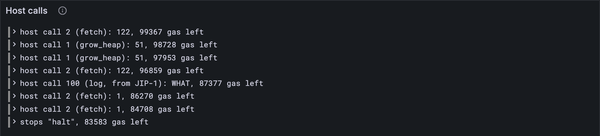

# Growing the heap

Service 1729 runs to a clean halt now, and spends 17,867 gas doing it. The test vector
says 16,417. Somewhere in there are 1,450 gas your client charges and the real thing
doesn't, and [lesson 16.2](./02-fetch.md) pointed at the culprit: two calls to `grow_heap`, each answered
WHAT, at 1,000 gas apiece. Teach your host `grow_heap`, and watch the number land.

## What the Gray Paper says

A program's heap is [lesson 15.8](../15-the-pvm/08-a-real-program.md)'s read-write zone: w, then z pages of zeros. **`grow_heap`**
(host call 1, App. B.5, Ω_♊︎, the Gemini sign) lets a program make it bigger, a page
at a time, up towards the stack. φ₇ is the page the heap should end at: one past its last page.

Three page numbers do the work:

- **a = (2Z_Z + Z(|o|)) / Z_P**: the zone's first page, one empty zone above o ([lesson
  15.8](../15-the-pvm/08-a-real-program.md)).
- **b = (2^32 − 3Z_Z − Z_I − P(s)) / Z_P**: as far as it may ever reach, a whole zone short
  of the stack.
- **h**: where the heap ends today: a, plus however many writable pages there are from a
  to b.

Then:

- **If φ₇ ≤ h** (the heap is already that big) **or φ₇ > b** (that's too big): nothing
  changes, φ₇ becomes h, and it costs 275. So asking for less is how a program asks
  "where does my heap end?".
- **Otherwise** it costs 275 plus 121 for each new page, the pages up to φ₇ become
  writable (all zeros), and φ₇ stays as asked. Without that much gas: out of gas, and
  φ₇ is h.

So `grow_heap` is the exception to [lesson 16.1](./01-calling-the-host.md)'s gas taken before anything else: its price
depends on how many pages it's asked for, so it works out the pages first, then the price.

To find a and b, `grow_heap` needs the program's o and s, so accumulation's F hands it the
service's code.

## The tests

The 16.2 tests' host now needs a program's code too, a tiny one:

**Replace in** `test/host.test.ts`

```ts
/** Accumulation's host, for a tiny program, with an entropy of 32 sevens and no inputs. */
const accumulating = accumulateHost(TINY, tinyCode(), new Uint8Array(32).fill(7), []);
```

**Add to** `test/host.test.ts`

```ts
import { growHeap } from "../src/host.ts";
import type { ServiceCode } from "../src/pvm/program.ts";
import { deblob, unpackCode } from "../src/pvm/program.ts";
import { writeMemory } from "../src/pvm/memory.ts";
import { standardProgram } from "../src/pvm/standard.ts";
import { fromHex } from "../src/bytes.ts";
import { encodeNatural } from "../src/codec/numbers.ts";
import { vectorJson } from "./vectors.ts";
import type { HostExit } from "../src/host.ts";
import type { Exit, Machine } from "../src/pvm/machine.ts";
import type { MemoryError } from "../src/pvm/memory.ts";

/** A tiny standard program's parts: 3 bytes of o, 2 of w, a heap page, a 100-byte stack. */
function tinyCode(): ServiceCode {
  return {
    metadata: new Uint8Array(0),
    readOnly: Uint8Array.of(1, 2, 3),
    readWrite: Uint8Array.of(4, 5),
    heapPages: 1,
    stackSize: 100,
    program: new Uint8Array(0),
  };
}

/** A machine laid out as tinyCode's program, asking grow_heap for the heap to end at `want`. */
function growing(want: bigint) {
  const { memory, registers } = standardProgram(tinyCode(), new Uint8Array(0));
  registers[7] = want;
  return newMachine(assemble([[0]]), registers, memory, 10_000n);
}

test("grow_heap: w starts at page 48, and with its heap page the heap ends at 50", () => {
  const machine: Machine = growing(0n); // asking for no more than it has: just the answer
  const exit: HostExit = growHeap(machine, tinyCode());
  assert.equal(exit, "continue");
  assert.deepEqual([machine.registers[7], machine.gas], [50n, 10_000n - 275n]);
});

test("growing it by 3 pages costs 121 more gas a page, and page 52 is writable now", () => {
  const machine: Machine = growing(53n);
  const exit: HostExit = growHeap(machine, tinyCode());
  assert.equal(exit, "continue");
  assert.deepEqual([machine.registers[7], machine.gas], [53n, 10_000n - 275n - 3n * 121n]);
  const written: MemoryError | null = writeMemory(machine.memory, 52n * 4096n, Uint8Array.of(1));
  assert.equal(written, null);
});

/** The parts of an accumulate test vector this test reads. */
type AccumulateVector = {
  input: { slot: number };
  pre_state: {
    entropy: string;
    accounts: {
      id: number;
      data: { service: { code_hash: string }; preimage_blobs: { hash: string; blob: string }[] };
    }[];
  };
  post_state: { statistics: { record: { accumulate_gas_used: number } }[] };
};

/** Service 1729's accumulation, set up as always_accumulate-1 has it: machine and host. */
function vectorService() {
  const vector = vectorJson("stf/accumulate/tiny/always_accumulate-1.json") as AccumulateVector;
  const { id, data } = vector.pre_state.accounts[0];
  const preimage = data.preimage_blobs.find((p) => p.hash === data.service.code_hash)!;
  const code = unpackCode(fromHex(preimage.blob));
  const [t, s] = [BigInt(vector.input.slot), BigInt(id)]; // the slot, the service, no inputs
  const args = Uint8Array.from([...encodeNatural(t), ...encodeNatural(s), ...encodeNatural(0n)]);
  const { memory, registers } = standardProgram(code, args);
  const machine = newMachine(deblob(code.program), registers, memory, 100_000n);
  machine.pc = 5; // accumulation
  const host = accumulateHost(TINY, code, fromHex(vector.pre_state.entropy), []);
  const expected = BigInt(vector.post_state.statistics[0].record.accumulate_gas_used);
  return { machine, host, expected };
}

test("service 1729 accumulates on exactly the 16,417 gas the test vector says", () => {
  const { machine, host, expected } = vectorService();
  const exit: Exit = runWithHost(machine, host);
  assert.equal(exit, "halt");
  const used: bigint = 100_000n - machine.gas;
  assert.equal(used, expected);
});
```

tinyCode's layout is easy to work out by hand. o is 3 bytes, so Z(|o|) is one zone, and a
is (2 · 65,536 + 65,536) / 4,096 = 48. w takes page 48 and the heap page 49, so h is 50.

The last test is the big one. `vectorService` sets up service 1729 exactly as the vector
does, and the test runs its accumulation through your host and compares the gas used with
the vector's own record.

## The code

`grow_heap` rounds sizes just as [lesson 15.8](../15-the-pvm/08-a-real-program.md)'s Y does, so Y shares its `roundUp`:

**Replace in** `src/pvm/standard.ts`

```ts
/** x rounded up to a whole number of `size`s: the GP's P (pages) and Q (zones). */
export const roundUp = (x: number, size: number) => Math.ceil(x / size) * size;
```

**Add to** `src/host.ts`

```ts
import { addPages, PAGE_SIZE } from "./pvm/memory.ts";
import type { ServiceCode } from "./pvm/program.ts";
import { INPUT_SIZE, roundUp, ZONE } from "./pvm/standard.ts";

/**
 * grow_heap (GP App. B.5, Ω_Gemini): makes the read-write zone's pages writable up to page
 * φ₇ (not including it), and says where the heap ends now. The zone starts at page a, may
 * reach b, and ends at h today. Asking for no more than h, or past b, just reports h.
 */
export function growHeap(m: Machine, code: ServiceCode): HostExit {
  const a = (2 * ZONE + roundUp(code.readOnly.length, ZONE)) / PAGE_SIZE;
  const b = (2 ** 32 - 3 * ZONE - INPUT_SIZE - roundUp(code.stackSize, PAGE_SIZE)) / PAGE_SIZE;
  const writable = [...m.memory].filter(([p, page]) => p >= a && p < b && page.access === "W");
  const h = a + writable.length;
  const want = m.registers[7];
  if (want <= BigInt(h) || want > BigInt(b)) {
    m.registers[7] = BigInt(h);
    return charge(m, 275) ? "continue" : "oog";
  }
  const g = 275n + (want - BigInt(h)) * 121n; // and 121 for each new page
  m.registers[7] = BigInt(h);
  if (m.gas < g) return "oog";
  m.gas -= g;
  addPages(m.memory, h * PAGE_SIZE, (Number(want) - h) * PAGE_SIZE, "W");
  m.registers[7] = want;
  return "continue";
}
```

`h` counts the writable pages between a and b. Only the pages a program has are in the
memory map, so that's a short walk, not a million steps. New pages come from [lesson 15.4](../15-the-pvm/04-memory.md)'s
`addPages`, zeroed and writable.

> [!NOTE]
> **The simple road, and a rule on the move.** When growing would cost more gas than is
> left, Gray Paper 0.8.0 leaves the gas as it was, and so does `growHeap`. The 0.8.0 test
> vectors already follow a later change to the Gray Paper, its pull request 533: the gas
> drains to zero, so all of it counts as used. Service 1729 never runs short while
> growing, so the two agree here. And the Gray Paper's own `h` counts writable pages,
> which would come out short if they ever had gaps between a and b. Both wait in the [hardening pass](https://github.com/abutlabs/the-gray-tutor/blob/main/HARDENING.md). The Gray Paper keeps
> changing, so a client says which version it follows.

**Replace in** `src/host.ts`

```ts
/**
 * F (GP App. B.4): the host for a service's accumulation. So far it answers gas, grow_heap
 * (which needs the service's code, to know its layout) and fetch, whose items are the
 * constants (0), the entropy η′₀ (1), and the service's inputs, all of them (14) or one
 * (15). Anything else: WHAT.
 */
export function accumulateHost(
  config: Config,
  code: ServiceCode,
  entropy: Bytes,
  inputs: Bytes[],
): Host {
  const items: Items = (kind, index) => {
    if (kind === 0) return protocolConstants(config);
    if (kind === 1) return entropy;
    if (kind === 14) return concatBytes(encodeNatural(BigInt(inputs.length)), ...inputs);
    if (kind === 15 && index < BigInt(inputs.length)) return inputs[Number(index)];
    return undefined;
  };
  return (call, m) => {
    switch (HOST_CALLS[call]) {
      case "gas":
        return gas(m);
      case "grow_heap":
        return growHeap(m, code);
      case "fetch":
        return fetch(m, items);
      default:
        return unknown(m);
    }
  };
}
```

`bin/host.ts` calls `accumulateHost` too, so it passes the service's code along:

**Replace in** `bin/host.ts`

```ts
const answer = accumulateHost(TINY, code, fromHex(vector.pre_state.entropy), []);
```

**Run**

```sh
npm test
npm run typecheck
```

```text
...
✔ the reported packages: each one's hash and exports root, sorted by hash (241.1ms)
...
✔ grow_heap: w starts at page 48, and with its heap page the heap ends at 50 (0.3ms)
✔ growing it by 3 pages costs 121 more gas a page, and page 52 is writable now (0.1ms)
✔ service 1729 accumulates on exactly the 16,417 gas the test vector says (45.7ms)
...
ℹ tests 458
ℹ suites 0
ℹ pass 458
ℹ fail 0
...
reported 458 tests to Grafana: http://127.0.0.1:3300/d/the-gray-tutor?var-client=you&var-run_id=test-1791738028819
...
```

## Watch it

**Replace in** `bin/host.ts`

```ts
const exit = runWithHost(machine, host);
console.log(`the service stops: ${JSON.stringify(exit)}, using ${100_000n - machine.gas} gas`);
console.log(`the test vector says: ${vector.post_state.statistics[0].record.accumulate_gas_used}`);
run.event("stop", { exit: JSON.stringify(exit), gas: Number(machine.gas) });
```

**Run**

```sh
node bin/host.ts
```

```text
host call 2 (fetch): φ₇ = 122, 99367 gas left
host call 1 (grow_heap): φ₇ = 51, 98728 gas left
host call 1 (grow_heap): φ₇ = 51, 97953 gas left
host call 2 (fetch): φ₇ = 122, 96859 gas left
host call 100 (log, from JIP-1): φ₇ = WHAT, 87377 gas left
host call 2 (fetch): φ₇ = 1, 86270 gas left
host call 2 (fetch): φ₇ = 1, 84708 gas left
the service stops: "halt", using 16417 gas
the test vector says: 16417
reported to Grafana: http://127.0.0.1:3300/d/the-gray-tutor?var-client=you&var-run_id=host-1791738033858
```

Now the bin compares its answer with the vector's. There it is: 16,417, to the last unit
of gas. Every instruction priced by the pipeline of [lesson 15.10](../15-the-pvm/10-the-pipeline.md), every block paid for by
the meter of 15.11, every host call charged its Gray Paper price. And the two `grow_heap` calls? Both ask for page 51, and the heap
already ends at 51 (a = 48, then w and its two heap pages), so each is the cheap kind: 275,
not 1,000. The *Host calls* panel, on **7 · Accumulation and import**, has the conversation, and its gas used is
now exactly the vector's.



<details>
<summary>lasair: finding a, in <code>lib/pvm_host.ml</code></summary>

```ocaml
  (* GP grow_heap: a = (2Z + rnq(|o|)) / P is fixed by the program LAYOUT. With
     an RW region present it is the lowest writable page at or above 2Z (the
     RO region and its guard zone lie below; the stack lies far above b).
```

lasair works a out backwards, from the memory rather than the program's sizes: the lowest
writable page above two zones, or, if there's none yet, from the top of the read-only
pages. Same answer, more detective work. Your `accumulateHost` simply hands
`growHeap` the code, as the Gray Paper's F does.

</details>

## Check your understanding

::: check
**Before this lesson, service 1729 spent 1,450 gas more than the vector. Where did 1,450 come from?**

- [x] Two `grow_heap` calls answered WHAT at 1,000 each, where the real thing costs 275: 2 × (1,000 − 275)
  > Yes: both calls ask for page 51, where the heap already ends, so each is the cheap
  > kind: 275.
- [ ] `grow_heap`'s 121 gas a page, for 12 pages
  > No: 12 × 121 is 1,452, close but wrong. Neither call adds a page, so neither pays 121.
- [ ] The `log` call, charged as an unknown host call
  > No: `log` still costs 1,000, and the vector charges it the same.

**In the test program the heap ends at page 50. It asks `grow_heap` for φ₇ = 53. What happens?**

- [ ] It pays 275 + 53 × 121
  > No: it pays only for new pages: 50, 51 and 52.
- [x] Pages 50, 51 and 52 become writable, for 275 + 3 × 121 = 638, and φ₇ stays 53
  > Yes: φ₇ is the page the heap should end at, one past its last page, and growing
  > leaves it as asked.
- [ ] Pages 50 to 53 become writable, for 275 + 4 × 121
  > No: 53 is one past the last page, so it isn't included.

**A program calls `grow_heap` with φ₇ = 0. Why would it?**

- [ ] To give its heap back
  > No: `grow_heap` never shrinks the heap. Asking for less than it has changes nothing.
- [ ] It wouldn't: 0 is an error, and the machine panics
  > No: asking for no more than the heap has is allowed. It's the cheap case.
- [x] To ask where its heap ends: for 275, φ₇ becomes h, 50 in the test
  > Yes: nothing changes, and φ₇ answers with the end of the heap.

**Why does accumulation's host hand `grow_heap` the service's code?**

- [x] To find a and b: a depends on the size of o, the read-only data, and b on the stack size
  > Yes: the heap starts one zone above o and may reach a zone short of the stack. Both
  > come from the code's sizes.
- [ ] To charge for how big the program is
  > No: the price is only 275, plus 121 for each page added.
- [ ] To copy w into the new pages
  > No: w is already in place. New pages are all zeros.
:::

## What you have

A host that answers gas, fetch and grow_heap, and a real service's accumulation that
matches the test vector to the last unit of gas. So far the host only answers questions;
[lesson 16.4](./04-info.md) starts on the host calls about service accounts, with `info`.

Next: [16.4 Info](./04-info.md)
