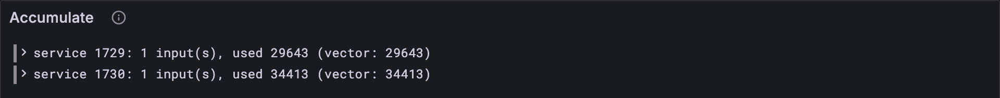

# A service's inputs

[Lesson 16.2](./02-fetch.md)'s `fetch` hands a service its inputs, items 14 and 15. So far every service
got none. But a service accumulates *because* work came in for it: the block's
work-reports carry the results of its work-items, refined on the cores. This lesson turns
those reports into the service's inputs, and with them, the matches the earlier lessons
could only describe become tests: eight services in seven vectors, each to the unit of
gas and the byte of storage.

## What the Gray Paper says

§12 calls each input an **operand**, U: what accumulation learns of one work-digest (the
result of one work-item, [lesson 3.2](../03-work-and-reports/02-work-digests.md)'s `WorkDigest`). It mixes the two:

| From the report | From the digest |
| --- | --- |
| p, the work-package's hash | y, the payload's hash |
| e, the root of its exported segments | g, its gas |
| a, the authorizer's hash | l, its result: an output, or an error |
| t, the authorizer's trace | |

App. C encodes it as **E(0, p, e, a, y, g, O(l), ↕t)**: the hashes as they are, the gas as
a compact natural, the result as [lesson 3.2](../03-work-and-reports/02-work-digests.md)'s O (a 0 and the output, or an error's tag),
and the trace with its length. The leading 0 says "operand": a service's inputs can also
be transfers, which start with a 1 (a later lesson).

**Δ₁** (§12) gathers service s's share of a block: an operand for each digest that names
s, report by report, in order (transfers would come first). Its gas is its free gas (the
always-accumulate privilege, `always_acc` in the vectors) plus the gas of every one of
those digests.

*Which* reports a block accumulates, and when, is Part 17's story: some must wait for
others. Here every report is accumulated at once, which is exactly what the seven vectors
below do.

## The tests

**New file** `test/accumulate.test.ts`

```ts
import { test } from "node:test";
import assert from "node:assert/strict";
import { Operand, serviceInputs } from "../src/accumulate.ts";
import { fromHex } from "../src/bytes.ts";
import { decode } from "../src/codec/codec.ts";
import { TINY } from "../src/config.ts";
import type { Accumulation } from "../src/host.ts";
import { accumulate } from "../src/host.ts";
import { unpackCode } from "../src/pvm/program.ts";
import type { AccountJson } from "../src/services.ts";
import { accountFromJson, copyAccounts } from "../src/services.ts";
import { WorkReport } from "../src/work.ts";
import { vectorJson } from "./vectors.ts";

/** The parts of an accumulate test vector these tests read. */
type Vector = {
  input: { slot: number; reports: unknown[] };
  pre_state: {
    entropy: string;
    privileges: { always_acc: { id: number; gas: number }[] };
    accounts: {
      id: number;
      data: AccountJson & {
        service: { code_hash: string };
        preimage_blobs: { hash: string; blob: string }[];
      };
    }[];
  };
  post_state: {
    statistics: { id: number; record: { accumulate_gas_used: number } }[];
    accounts: { id: number; data: AccountJson }[];
  };
};

/** A vector's work-reports, decoded. */
const reportsOf = (vector: Vector) => vector.input.reports.map((r) => WorkReport.fromJson(r));

test("an operand: a 0, the report's three hashes, the payload's, the gas, result and trace", () => {
  const vector = vectorJson("stf/accumulate/tiny/process_one_immediate_report-1.json") as Vector;
  const [report] = reportsOf(vector);
  const { inputs, gas } = serviceInputs([report], 1729);
  assert.equal(inputs.length, 1); // one digest for service 1729
  assert.equal(inputs[0][0], 0); // an operand, not a transfer
  const operand = decode(Operand, inputs[0].subarray(1));
  assert.deepEqual(operand.package_hash, report.package_spec.hash);
  assert.equal(gas, report.results[0].accumulate_gas); // the digest's gas, and no more
});

/** Service s's accumulation in test vector `name`, every report in it accumulated at once. */
function runVector(name: string, s: number) {
  const vector = vectorJson(`stf/accumulate/tiny/${name}.json`) as Vector;
  const accounts = new Map(vector.pre_state.accounts.map((a) => [a.id, accountFromJson(a.data)]));
  const { data } = vector.pre_state.accounts.find((a) => a.id === s)!;
  const preimage = data.preimage_blobs.find((p) => p.hash === data.service.code_hash)!;
  const free = vector.pre_state.privileges.always_acc.find((x) => x.id === s)?.gas ?? 0;
  const { inputs, gas } = serviceInputs(reportsOf(vector), s, BigInt(free));
  const a: Accumulation = {
    id: s,
    accounts,
    checkpoint: copyAccounts(accounts),
    code: unpackCode(fromHex(preimage.blob)),
    entropy: fromHex(vector.pre_state.entropy),
    inputs,
  };
  const post = vector.post_state;
  return {
    result: accumulate(TINY, a, vector.input.slot, gas),
    gas: BigInt(post.statistics.find((x) => x.id === s)!.record.accumulate_gas_used),
    after: accountFromJson(post.accounts.find((x) => x.id === s)!.data),
  };
}

/** The vectors whose services need no host calls beyond this part's so far. */
const CASES: [string, number][] = [
  ["always_accumulate-1", 1729],
  ["always_accumulate-2", 1729],
  ["process_one_immediate_report-1", 1729],
  ["queues_are_shifted-1", 1729],
  ["same_code_different_services-1", 1729],
  ["same_round_storage_isolation-1", 1729],
  ["same_round_storage_isolation-1", 1730],
  ["same_round_storage_isolation-2", 1730],
];

/** Checks service s's accumulation in test vector `name` against the vector's post-state. */
function checkVector(name: string, s: number) {
  const { result, gas, after } = runVector(name, s);
  assert.equal(result.gasUsed, gas);
  const mine = result.accounts.get(s)!;
  assert.deepEqual(mine.storage, after.storage);
}

for (const [name, s] of CASES) {
  test(`${name}: service ${s} ends as the vector says`, () => checkVector(name, s));
}
```

`runVector` sets a vector up the way Ψ_A wants it: the accounts, the service's code, its
inputs and gas from the reports, the entropy, the slot. `checkVector` compares two things
with the vector's post-state: the gas used, and the storage left behind, read with the
same `accountFromJson` as the accounts going in.

**Run, expect it to fail**

```sh
npm test
# fails with: Cannot find module
```

## The code

**New file** `src/accumulate.ts`

```ts
// Accumulation (GP §12): what a block's work-reports ask of each service. This file starts
// with one service's share of them: its inputs, and the gas to run them.

import type { Bytes } from "./bytes.ts";
import { concatBytes } from "./bytes.ts";
import { blob, encode, hash, natural, record } from "./codec/codec.ts";
import type { WorkReport } from "./work.ts";
import { WorkResult } from "./work.ts";

/**
 * An operand (GP §12, U): what accumulation learns of one work-digest. From its report:
 * the package, its exports' root and its authorizer; from the digest itself: its payload's
 * hash, its gas, its result; and the authorizer's trace.
 */
export const Operand = record({
  package_hash: hash,
  exports_root: hash,
  authorizer_hash: hash,
  payload_hash: hash,
  gas: natural,
  result: WorkResult,
  auth_trace: blob,
});

/**
 * Service s's share of a block's reports (GP §12, Δ₁): its inputs, one operand for each of
 * its digests, in order, and its gas: `free` gas, plus every one of those digests' gas.
 * Each input is encoded with a 0 in front: an operand, not a transfer.
 */
export function serviceInputs(reports: WorkReport[], s: number, free = 0n) {
  const inputs: Bytes[] = [];
  let gas = free;
  for (const report of reports) {
    for (const digest of report.results.filter((d) => d.service_id === s)) {
      const operand = {
        package_hash: report.package_spec.hash,
        exports_root: report.package_spec.exports_root,
        authorizer_hash: report.authorizer_hash,
        payload_hash: digest.payload_hash,
        gas: digest.accumulate_gas,
        result: digest.result,
        auth_trace: report.auth_output,
      };
      inputs.push(concatBytes(Uint8Array.of(0), encode(Operand, operand)));
      gas += digest.accumulate_gas;
    }
  }
  return { inputs, gas };
}
```

`Operand` is a plain record (Part 2), so `encode` does all the work; the 0 goes in front
by hand. `serviceInputs` walks the reports in order and keeps the digests for s.

**Run**

```sh
npm test
# prints: same_round_storage_isolation-2: service 1730 ends as the vector says
# prints: fail 0
# prints: reported
npm run typecheck
```

Nine tests pass, eight of them official test vectors, run end to end: Part 3's reports,
Part 14's accounts, Part 15's whole PVM with its gas, and this part's host, all agreeing
with the vectors at once.

## Watch it

**New file** `bin/accumulate.ts`

```ts
// Accumulates every service a test vector's block asks for, each with its share of the
// reports, and compares the gas each one used and the storage it left with the vector's.
// Usage: node bin/accumulate.ts [vector], same_round_storage_isolation-1 if not given

import { readFileSync } from "node:fs";
import { serviceInputs } from "../src/accumulate.ts";
import { fromHex, toHex } from "../src/bytes.ts";
import { TINY } from "../src/config.ts";
import { accumulate } from "../src/host.ts";
import { Run } from "../src/obs.ts";
import { unpackCode } from "../src/pvm/program.ts";
import type { AccountJson } from "../src/services.ts";
import { accountFromJson, copyAccounts } from "../src/services.ts";
import { WorkReport } from "../src/work.ts";

/** Where the vectors keep a service's code: among its preimages, by its code hash. */
type WithCode = {
  service: { code_hash: string };
  preimage_blobs: { hash: string; blob: string }[];
};
type Stat = { id: number; record: { accumulate_gas_used: number } };

const DEFAULT = "../vectors/stf/accumulate/tiny/same_round_storage_isolation-1.json";
const vector = JSON.parse(readFileSync(process.argv[2] ?? DEFAULT, "utf8"));
const reports: WorkReport[] = vector.input.reports.map((r: unknown) => WorkReport.fromJson(r));
const always: { id: number; gas: number }[] = vector.pre_state.privileges.always_acc;
const pre: { id: number; data: AccountJson & WithCode }[] = vector.pre_state.accounts;
const stats: Stat[] = vector.post_state.statistics;
const services = new Set([
  ...always.map((x) => x.id),
  ...reports.flatMap((r) => r.results.map((d) => d.service_id)),
]);

const run = new Run("accumulate");
for (const s of services) {
  const accounts = new Map(pre.map((a) => [a.id, accountFromJson(a.data)]));
  const { data } = pre.find((a) => a.id === s)!;
  const preimage = data.preimage_blobs.find((p) => p.hash === data.service.code_hash)!;
  const free = BigInt(always.find((x) => x.id === s)?.gas ?? 0);
  const { inputs, gas } = serviceInputs(reports, s, free);
  const a = {
    id: s,
    accounts,
    checkpoint: copyAccounts(accounts),
    code: unpackCode(fromHex(preimage.blob)),
    entropy: fromHex(vector.pre_state.entropy),
    inputs,
  };
  const { exit, gasUsed, accounts: after } = accumulate(TINY, a, vector.input.slot, gas);
  const expected = stats.find((x) => x.id === s)?.record.accumulate_gas_used;
  const storage = [...after.get(s)!.storage].map(([k, v]) => `${k} = ${toHex(v)}`).join(", ");
  console.log(`service ${s}: ${inputs.length} input(s), ${gas} gas, ${JSON.stringify(exit)}`);
  console.log(`  gas used ${gasUsed}; the vector says ${expected}`);
  console.log(`  storage: ${storage || "empty"}`);
  run.event("service", { s, inputs: inputs.length, used: Number(gasUsed), expected, storage });
}
const link = await run.report();
if (link) console.log(`reported to Grafana: ${link}`);
```

**Run**

```sh
node bin/accumulate.ts
# prints: service 1729: 1 input(s), 200000 gas, "halt"
# prints: gas used 29643; the vector says 29643
# prints: gas used 34413; the vector says 34413
# prints: reported to Grafana
```

`same_round_storage_isolation-1` accumulates two services in the same round. Each starts
from the same accounts and writes its own key: 1729 its "last", 1730 a key spelling
"fread". Neither sees the other's write: each has its own context, its own X and Y. Try
the other vectors in the list. The *Accumulate* panel lines up each service's gas with the
vector's.



<details>
<summary>lasair: the 0 in front, in <code>lib/pvm_host.ml</code></summary>

```ocaml
  Buffer.add_char buf '\x00';

  (* package_hash (32 bytes) *)
  Buffer.add_bytes buf item.ai_package_hash;

  (* exports_root (32 bytes) - stored in segment_root field *)
  Buffer.add_bytes buf item.ai_segment_root;
```

lasair writes an operand byte by byte, starting with the same 0. That byte has a history:
an earlier Gray Paper's text encoded an operand without it, yet the services in the test
vectors expect it, and without it they panic on their very first input, as the comment
just above these lines records. Gray Paper 0.8.0 writes the 0 in, so your client and the
paper agree from the start. Your `Operand` record does in one `encode` what these lines do
one field at a time.

</details>

## What you have

A service's inputs, built from a block's reports, and the first eight official accumulate
vectors passing end to end.

Next: [16.8 Lookup](./08-lookup.md)
