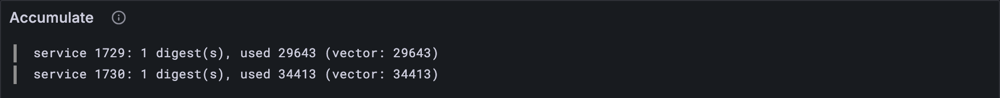

# A block's accumulation

[Part 16](../16-host-calls/index.md) ran one service at a time. A real block brings work for many services at once,
and every validator must accumulate all of it, the same way, to reach the same state.
This lesson accumulates a whole block, in its simplest form, and checks it against 29
official test vectors: every account, every statistic.

## New words

- **Prerequisite.** A work-package that a report says must be accumulated before it.
  *Example:* if package B names package A as a prerequisite, B's report waits until A's
  has been accumulated.
- **Round.** Several services accumulated side by side, all starting from the same state.
  None of them sees what the others do in that round. *Example:* two services each write
  a key in the same round; neither can read the other's.
- **Accumulation statistics.** For each service, per block: how many digests it
  accumulated, how many transfers it received, and how much gas it used. *Example:* (1,
  0, 29,643): one digest, no transfers, 29,643 gas.
- **Last-accumulation slot.** The slot in which a service last accumulated, kept in its
  account record. *Example:* a service that accumulates in slot 43 then says 43.

All four are in the [glossary](../glossary.md), with the rest.

## What the Gray Paper says

§12 in four plain steps:

1. **Which reports go now.** Of the reports that just became available ([lesson 11.1](../11-assurances/01-available.md)),
   the ones with no prerequisites, and no segment-root lookups (another kind of
   dependency), are accumulated straight away. The rest wait in a queue: [lesson 17.2](./02-waiting-reports.md).
2. **Which services run.** Every service named by a digest in those reports, plus the
   always-accumulate services, which run every block on free gas ([lesson 16.7](../16-host-calls/07-a-services-inputs.md)).
3. **One round.** Each service runs once, with its inputs and gas from [lesson 16.7](../16-host-calls/07-a-services-inputs.md),
   through [lesson 16.6](../16-host-calls/06-checkpoints.md)'s Ψ_A. All of them start from the same accounts, and each one keeps
   its own account as its run leaves it.
4. **Afterwards.** Every service that did anything (accumulated a digest, or used gas)
   gets its statistics, and its last-accumulation slot becomes this block's slot.

One case worth knowing: a service with a digest but no code to run (its code's preimage
isn't there) runs nothing and uses no gas, but its digest still counts.

Step 1's reports come at the end of a long trip: guaranteed onto a core, vouched for by
the validators, made available. [Lesson 11.2](../11-assurances/02-timeouts.md) lets you walk one report through that trip,
block by block, until it lands here.

Now the Gray Paper's names for those steps. The reports in step 1 are **R!**. The round
in step 3 is the parallel accumulation function **Δ\***, and one service's part of it,
[lesson 16.7](../16-host-calls/07-a-services-inputs.md)'s work, is **Δ₁**. The statistics are **S(s) = (N(s), T(s), G(s))**, and the
last-accumulation slot is an account's **a**, set to **τ′**.

Left for later in this part: the queue ([lesson 17.2](./02-waiting-reports.md)); transfers, and the rounds they make ([lessons 17.3](./03-sending-a-transfer.md)
and [17.4](./04-rounds.md)); a gas budget for the whole block, which may split it into more rounds ([lesson 17.9](./09-the-blocks-gas-budget.md)); privileges
(lessons [17.5](./05-privileges.md) and [17.6](./06-who-wins.md)); and services leaving and arriving (lessons [17.7](./07-ejecting-a-service.md) and
[17.8](./08-creating-a-service.md)).

## The tests

The vector's statistics have more fields now:

**Replace in** `test/accumulate.test.ts`

```ts
/** The parts of an accumulate test vector these tests read. */
type Vector = {
  input: { slot: number; reports: unknown[] };
  pre_state: {
    entropy: string;
    privileges: { always_acc: { id: number; gas: number }[] };
    accounts: {
      id: number;
      data: AccountJson & {
        service: { code_hash: string };
        preimage_blobs: { hash: string; blob: string }[];
      };
    }[];
  };
  post_state: {
    statistics: { id: number; record: Record<string, number> }[];
    accounts: { id: number; data: AccountJson }[];
  };
};
```

**Add to** `test/accumulate.test.ts`

```ts
import { accumulateBlock } from "../src/accumulate.ts";

/** Checks the whole block of test vector `name`: every account, and every service's stats. */
function checkBlock(name: string) {
  const vector = vectorJson(`stf/accumulate/tiny/${name}.json`) as Vector;
  const pre = vector.pre_state;
  const accounts = new Map(pre.accounts.map((a) => [a.id, accountFromJson(a.data)]));
  const free = new Map(pre.privileges.always_acc.map((x) => [x.id, BigInt(x.gas)]));
  const entropy = fromHex(pre.entropy);
  const reports = reportsOf(vector);
  const result = accumulateBlock(TINY, accounts, free, entropy, vector.input.slot, reports);
  const post = vector.post_state;
  const expected = new Map(post.accounts.map((a) => [a.id, accountFromJson(a.data)]));
  assert.deepEqual(result.accounts, expected);
  const stats = post.statistics.map(({ id, record: r }) => {
    const gasUsed = BigInt(r.accumulate_gas_used);
    return [id, { count: r.accumulate_count, transfers: r.accumulate_transfer_count, gasUsed }];
  });
  assert.deepEqual(result.statistics, new Map(stats as [number, unknown][]));
}

/** The vectors whose whole block needs nothing beyond this lesson. */
const BLOCK_CASES = [
  "always_accumulate-1", "always_accumulate-2", "enqueue_and_unlock_chain-1",
  "enqueue_and_unlock_chain-2", "enqueue_and_unlock_chain_wraps-1",
  "enqueue_and_unlock_chain_wraps-2", "enqueue_and_unlock_chain_wraps-3",
  "enqueue_and_unlock_chain_wraps-4", "enqueue_and_unlock_simple-1",
  "enqueue_and_unlock_with_sr_lookup-1", "enqueue_self_referential-1",
  "enqueue_self_referential-2", "enqueue_self_referential-3", "enqueue_self_referential-4",
  "lookup_foreign_preimage-1", "lookup_foreign_preimage-2", "no_available_reports-1",
  "preimage_len_bound-1", "preimage_len_bound-2", "preimage_len_bound-3",
  "process_one_immediate_report-1", "queues_are_shifted-1", "queues_are_shifted-2",
  "ready_queue_editing-1", "ready_queue_editing-2", "same_code_different_services-1",
  "same_round_storage_isolation-1", "same_round_storage_isolation-2",
  "work_for_ejected_service-1",
];

for (const name of BLOCK_CASES) {
  test(`${name}: the block ends as the vector says`, () => checkBlock(name));
}
```

`checkBlock` compares *everything* the vector records about the block's accounts: every
account, not only the ones that ran (the others must come out untouched), and every
service's statistics. Several vectors in the list have reports with prerequisites: they
pass only if those reports are left alone.

## The code

**Add to** `src/accumulate.ts`

```ts
import { toHex } from "./bytes.ts";
import type { Config } from "./config.ts";
import { accumulate } from "./host.ts";
import type { ServiceCode } from "./pvm/program.ts";
import { unpackCode } from "./pvm/program.ts";
import type { Account } from "./services.ts";
import { copyAccounts } from "./services.ts";

/** A service's code (GP §9, a_c): its preimage of its own code hash, unpacked. */
function codeOf(account: Account): ServiceCode | undefined {
  const preimage = account.preimages.get(toHex(account.info.code_hash));
  return preimage && unpackCode(preimage);
}

/**
 * S(s) (GP §12): what accumulation did for one service in a block: how many digests it
 * accumulated (N), how many transfers it received (T), and the gas it used (G).
 */
export type AccumulationStats = { count: number; transfers: number; gasUsed: bigint };

/**
 * A block's accumulation, at its simplest (GP §12): the reports with no prerequisites
 * (R!) are accumulated in one round (Δ*). Each service runs once, from the same accounts,
 * and keeps its own account as it leaves it. Every service that did anything then gets its
 * statistics, and its last-accumulation slot set to this block's.
 */
export function accumulateBlock(
  config: Config,
  accounts: Map<number, Account>,
  free: Map<number, bigint>, // χ_Z: the services that accumulate every block, and their gas
  entropy: Bytes,
  slot: number,
  reports: WorkReport[],
) {
  const now = reports.filter(
    (r) => r.context.prerequisites.length === 0 && r.segment_root_lookup.length === 0,
  );
  const digests = now.flatMap((r) => r.results);
  const services = new Set([...free.keys(), ...digests.map((d) => d.service_id)]);
  const after = copyAccounts(accounts);
  const statistics = new Map<number, AccumulationStats>();
  for (const s of services) {
    const count = digests.filter((d) => d.service_id === s).length;
    const account = accounts.get(s);
    const code = account && codeOf(account);
    let gasUsed = 0n;
    if (code) {
      const { inputs, gas } = serviceInputs(now, s, free.get(s) ?? 0n);
      const mine = copyAccounts(accounts); // every service starts from the same accounts
      const checkpoint = copyAccounts(accounts);
      const a = { id: s, accounts: mine, checkpoint, code, entropy, inputs };
      const result = accumulate(config, a, slot, gas);
      after.set(s, result.accounts.get(s)!);
      gasUsed = result.gasUsed;
    } // no code to run (or no such service): it used no gas, but its digests still count
    if (count > 0 || gasUsed > 0n) statistics.set(s, { count, transfers: 0, gasUsed });
  }
  for (const s of statistics.keys()) {
    const account = after.get(s);
    if (account) account.info.last_accumulation_slot = slot;
  }
  return { accounts: after, statistics };
}
```

`codeOf` finds a service's code where the Gray Paper keeps it: among its own preimages,
under its code hash. `accumulateBlock` is the four steps in order. Each service gets a
fresh copy of the starting accounts, which is all "the same starting state" takes, and
`after` collects each one's own account as it comes back.

**Run**

```sh
npm test
npm run typecheck
```

```text
...
✔ always_accumulate-1: the block ends as the vector says (8.8ms)
...
✔ same_round_storage_isolation-2: the block ends as the vector says (14.6ms)
...
✔ the reported packages: each one's hash and exports root, sorted by hash (205.5ms)
...
ℹ tests 515
ℹ suites 0
ℹ pass 515
ℹ fail 0
...
reported 515 tests to Grafana: http://127.0.0.1:3300/d/the-gray-tutor?var-client=you&var-run_id=test-1791738801360
...
```

## Watch it

`bin/accumulate.ts` now accumulates the whole block:

**Rewrite** `bin/accumulate.ts`

```ts
// Accumulates a test vector's block the way lesson 17.1 does, and shows what each service
// did next to what the vector says: its digests, the gas it used, its storage.
// Usage: node bin/accumulate.ts [vector], same_round_storage_isolation-1 if not given

import { readFileSync } from "node:fs";
import { accumulateBlock } from "../src/accumulate.ts";
import { fromHex, toHex } from "../src/bytes.ts";
import { TINY } from "../src/config.ts";
import { Run } from "../src/obs.ts";
import type { AccountJson } from "../src/services.ts";
import { accountFromJson } from "../src/services.ts";
import { WorkReport } from "../src/work.ts";

type Stat = { id: number; record: { accumulate_count: number; accumulate_gas_used: number } };

const DEFAULT = "../vectors/stf/accumulate/tiny/same_round_storage_isolation-1.json";
const vector = JSON.parse(readFileSync(process.argv[2] ?? DEFAULT, "utf8"));
const pre = vector.pre_state;
const json: { id: number; data: AccountJson }[] = pre.accounts;
const accounts = new Map(json.map((a) => [a.id, accountFromJson(a.data)]));
const always: { id: number; gas: number }[] = pre.privileges.always_acc;
const free = new Map(always.map((x) => [x.id, BigInt(x.gas)]));
const reports = vector.input.reports.map((r: unknown) => WorkReport.fromJson(r));
const slot = vector.input.slot;
const result = accumulateBlock(TINY, accounts, free, fromHex(pre.entropy), slot, reports);

const run = new Run("accumulate");
console.log(`${reports.length} report(s) at slot ${slot}: ${result.statistics.size} service(s)`);
for (const [s, { count, gasUsed }] of result.statistics) {
  const theirs = (vector.post_state.statistics as Stat[]).find((x) => x.id === s)?.record;
  const storage = [...result.accounts.get(s)!.storage].map(([k, v]) => `${k} = ${toHex(v)}`);
  console.log(`service ${s}: ${count} digest(s), ${gasUsed} gas`);
  const said = `${theirs?.accumulate_count} digest(s), ${theirs?.accumulate_gas_used} gas`;
  console.log(`  the vector says: ${said}`);
  console.log(`  storage: ${storage.join(", ") || "empty"}`);
  const expected = theirs?.accumulate_gas_used;
  run.event("service", { s, count, used: Number(gasUsed), expected, storage: storage.join(", ") });
}
const link = await run.report();
if (link) console.log(`reported to Grafana: ${link}`);
```

**Run**

```sh
node bin/accumulate.ts
```

```text
2 report(s) at slot 43: 2 service(s)
service 1729: 1 digest(s), 29643 gas
  the vector says: 1 digest(s), 29643 gas
  storage: 0x6c617374 = 0x033fde3d
service 1730: 1 digest(s), 34413 gas
  the vector says: 1 digest(s), 34413 gas
  storage: 0x6672656164 = 0x00
reported to Grafana: http://127.0.0.1:3300/d/the-gray-tutor?var-client=you&var-run_id=accumulate-1791738806530
```

Two services in one round, each writing its own key, each using exactly the vector's gas.
Try `node bin/accumulate.ts ../vectors/stf/accumulate/tiny/same_code_different_services-1.json`:
service 1730 has a digest but no code of its own, so it shows 1 digest and 0 gas, just as
the vector does. The *Accumulate* panel, on the **7 · Accumulation and import** dashboard (where all of
[Part 17](./index.md)'s panels are), lines the services up.



<details>
<summary>lasair: one round, in <code>conformance/accumulate_stf.ml</code></summary>

```ocaml
  (* accpar (eq. accpar): s = the digests' services UNION keys(f) UNION the
     transfers' destinations, ascending; every accone reads the round's
     pre-state d. The posterior is P((d UNION n) \ m, provisions), with n
     each invoked service's own posterior record plus the services it
     created, and m the ids of d its invocation removed. *)
```

The same round, with the parts this lesson leaves for later: transfers' destinations join
the services that run, new services join the accounts (n), removed ones leave them (m), and
provided preimages land at the end (the Gray Paper's I; lasair calls it P). "Every accone reads the round's pre-state d" is
your fresh copy for each service.

</details>

## What you have

A whole block's accumulation, in its simplest form, matching 29 official vectors on every
account and every statistic. Reports with prerequisites were left alone: [lesson 17.2](./02-waiting-reports.md)
gives them a queue to wait in.

Next: [17.2 Waiting reports](./02-waiting-reports.md)
