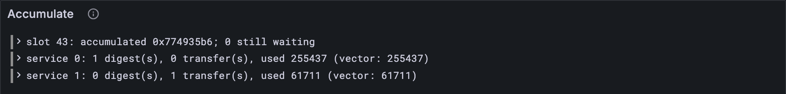

# Rounds

[Lesson 17.3](./03-sending-a-transfer.md)'s gift left service 0 and went nowhere. Time to deliver it. A block's
accumulation doesn't happen all at once: it happens in *rounds*, and the transfers sent in
one round arrive in the next. By the end of this lesson, the gift's whole block matches
its official vector, receiver and all.

## New words

- **Δ+ (accumulating in rounds).** The Gray Paper's loop over rounds: one round, then
  another for the transfers it sent, and so on until a round sends none (with the gas
  budget, [lesson 17.9](./09-the-blocks-gas-budget.md), reports left over make rounds too). *Example:* the gift's
  block takes two rounds.
- **Delivery.** What happens to a transfer in the round after it was sent: its money goes
  into the receiver's balance, and the transfer itself becomes one of the receiver's
  inputs. *Example:* service 1's balance grows by 100, then its code reads "gift".
- **Transfer input.** An input that starts with a 1, followed by one transfer, encoded.
  Operands start with a 0. *Example:* service 1's only input in round 2.

All three are in the [glossary](../glossary.md). (*Round* itself is from [lesson 17.1](./01-a-blocks-accumulation.md).)

## What the Gray Paper says

§12, in plain steps:

1. **Round 1 is the block you already have**: every report that can go, and the
   always-accumulate services. It may send transfers.
2. **If it did, round 2 runs, for those transfers only.** Every service a transfer was
   sent to runs once, all from the same accounts, as in any round. Its transfers come
   first among its inputs, then any operands; its gas is all of their gas added up.
3. **The money comes first.** Before a receiver's code runs, the amounts go into its
   balance. That happens even if it has no code at all, and then nothing else does.
4. **Again and again.** Round 2's transfers make round 3, and so on, until a round
   sends nothing.
5. **The statistics count every round.** G adds up each service's gas over all the
   rounds, and T counts the transfers it received ([lesson 17.1](./01-a-blocks-accumulation.md) left T at 0). A service
   that only received a transfer still counts, and gets its last-accumulation slot.

Inside a round the services go in order of their ids, and so do the transfers they send:
that's the order the next round hands them out in.


The Gray Paper's names: the loop is *Δ+*, one round *Δ\**, one service in a round
*Δ₁*. Δ₁'s inputs are *i^T ⌢ i^U*: transfers, then operands.

> [!NOTE]
> **The simple road.** Δ+ also keeps a gas budget for the whole block, max(G_T, G_A · C +
> the always-accumulate gas): reports join round 1 only while their gas still fits, and
> the rest wait for a later round. This lesson takes every report in round 1. One
> official vector needs the budget: in `recreate_service_ejected_in_earlier_round-1`, the
> two reports ask for 22,000,000 gas, tiny's budget is 20,000,000, so the second report
> waits for round 2. That vector waits for [lesson 17.9](./09-the-blocks-gas-budget.md), which builds the budget.

## The tests

One more official vector passes whole:

**Replace in** `test/accumulate.test.ts`

```ts
/** The vectors whose whole block needs nothing beyond this lesson. */
const BLOCK_CASES = [
  "accumulate_ready_queued_reports-1", "always_accumulate-1", "always_accumulate-2",
  "enqueue_and_unlock_chain-1", "enqueue_and_unlock_chain-2", "enqueue_and_unlock_chain-3",
  "enqueue_and_unlock_chain-4", "enqueue_and_unlock_chain_wraps-1",
  "enqueue_and_unlock_chain_wraps-2", "enqueue_and_unlock_chain_wraps-3",
  "enqueue_and_unlock_chain_wraps-4", "enqueue_and_unlock_chain_wraps-5",
  "enqueue_and_unlock_simple-1", "enqueue_and_unlock_simple-2",
  "enqueue_and_unlock_with_sr_lookup-1", "enqueue_and_unlock_with_sr_lookup-2",
  "enqueue_self_referential-1", "enqueue_self_referential-2", "enqueue_self_referential-3",
  "enqueue_self_referential-4", "lookup_foreign_preimage-1", "lookup_foreign_preimage-2",
  "no_available_reports-1", "preimage_len_bound-1", "preimage_len_bound-2",
  "preimage_len_bound-3", "process_one_immediate_report-1", "queues_are_shifted-1",
  "queues_are_shifted-2", "ready_queue_editing-1", "ready_queue_editing-2",
  "ready_queue_editing-3", "same_code_different_services-1", "same_round_storage_isolation-1",
  "same_round_storage_isolation-2", "transfer_for_live_service-1", "work_for_ejected_service-1",
];
```

**Add to** `test/accumulate.test.ts`

```ts
import { accumulateRound } from "../src/accumulate.ts";
import { toHex } from "../src/bytes.ts";
import type { Account, AccountJson } from "../src/services.ts";
import type { AccumulationState } from "../src/accumulate.ts";
import type { AccumulationStats } from "../src/accumulate.ts";
import type { Bytes } from "../src/bytes.ts";

test("the gift arrives a round later: the money first, then service 1 runs", () => {
  const vector = vectorJson("stf/accumulate/tiny/transfer_for_live_service-1.json") as BlockVector;
  const before: AccumulationState = accumulationStateFromJson(vector.pre_state);
  const { state, statistics } = accumulateBlock(TINY, before, vector.input.slot, reportsOf(vector));
  const receiver: Account = state.accounts.get(1)!;
  const received: bigint = receiver.info.balance; // the gift arrived
  assert.equal(received, 227_714n + 100n);
  const stats: AccumulationStats | undefined = statistics.get(1);
  assert.deepEqual(stats, { count: 0, transfers: 1, gasUsed: 61_711n });
  const note: Bytes = receiver.storage.get(toHex(new TextEncoder().encode("transfer0")))!;
  const memo: string = new TextDecoder().decode(note.subarray(12, 16)); // it read the memo
  assert.equal(memo, "gift");
});

test("a transfer to a service with no code: the money arrives, and nothing runs", () => {
  const vector = vectorJson("stf/accumulate/tiny/transfer_for_live_service-1.json") as BlockVector;
  const { accounts, entropy } = accumulationStateFromJson(vector.pre_state);
  accounts.get(1)!.preimages.clear(); // service 1 can't find its code now
  const gift: Transfer = { source: 0, dest: 1, amount: 100n, memo: new Uint8Array(128), gas: 10n };
  const round = accumulateRound(TINY, accounts, new Map(), entropy, 43, [], [gift]);
  const balance: bigint = round.accounts.get(1)!.info.balance; // the money, still
  assert.equal(balance, 227_714n + 100n);
  const used: bigint | undefined = round.used.get(1); // no code: no gas
  assert.equal(used, 0n);
  assert.deepEqual(round.transfers, []); // and nothing sent on
});
```

The first test follows the gift to the end: service 1's balance, its statistics (no
digests, one transfer, 61,711 gas) and the note its code wrote down, memo included. Bytes
12 to 16 of that note are the memo's first four: the service writes the sender (4 bytes)
and the amount (8) before it. The second test takes service 1's code away and delivers
by hand, with `accumulateRound`.

**Run, expect it to fail**

```sh
npm test
```

```text
...
✖ transfer_for_live_service-1: the block ends as the vector says (360.3ms)
...
✖ the gift arrives a round later: the money first, then service 1 runs (80.8ms)
✖ a transfer to a service with no code: the money arrives, and nothing runs (1.0ms)
...
ℹ tests 529
ℹ suites 0
ℹ pass 526
ℹ fail 3
...
test at test/accumulate.test.ts:184:1
✖ the gift arrives a round later: the money first, then service 1 runs (80.8ms)
  AssertionError [ERR_ASSERTION]: Expected values to be strictly equal:
  + actual - expected

  + 227714n
  - 227814n
...
```

Three red: the gift never arrives. Read the second: the receiver's balance is 227,714
where the vector has 227,814, the hundred that never came. These fail on an assertion,
not a missing name: the tests use only functions you already have, so the red is the
rule itself, missing.

## The code

First, a service's inputs: its transfers, then its operands.

**Replace in** `src/accumulate.ts`

```ts
import { accumulate, Transfer } from "./host.ts";

/**
 * Service s's share of a round (GP §12, Δ₁): its inputs, first the transfers sent to it,
 * then one operand for each of its digests, in order; and its gas: `free` gas, plus every
 * one of those transfers' and digests' gas. Each input starts with what it is: 1 for a
 * transfer, 0 for an operand.
 */
export function serviceInputs(
  reports: WorkReport[],
  s: number,
  free = 0n,
  transfers: Transfer[] = [],
) {
  const inputs: Bytes[] = [];
  let gas = free;
  for (const t of transfers.filter((t) => t.dest === s)) {
    inputs.push(concatBytes(Uint8Array.of(1), encode(Transfer, t)));
    gas += t.gas;
  }
  for (const report of reports) {
    for (const digest of report.results.filter((d) => d.service_id === s)) {
      const operand = {
        package_hash: report.package_spec.hash,
        exports_root: report.package_spec.exports_root,
        authorizer_hash: report.authorizer_hash,
        payload_hash: digest.payload_hash,
        gas: digest.accumulate_gas,
        result: digest.result,
        auth_trace: report.auth_output,
      };
      inputs.push(concatBytes(Uint8Array.of(0), encode(Operand, operand)));
      gas += digest.accumulate_gas;
    }
  }
  return { inputs, gas };
}
```

The new parameter has a default, `[]`, so every earlier caller still works unchanged.

Then a round. Three changes: the services a transfer is sent to run too, the money
arrives before anything else, and the round hands back what its services sent.

**Replace in** `src/accumulate.ts`

```ts
/**
 * Δ* (GP §12), one round: every service with work in `reports`, every always-accumulate
 * service, and every service a transfer is sent to, runs once from the same accounts and
 * keeps its own account as its run leaves it. The transfers' money arrives before its code
 * runs, even if it has none. Returns the accounts after the round, the gas each service
 * used, and the transfers they sent, service by service in order of id.
 */
export function accumulateRound(
  config: Config,
  accounts: Map<number, Account>,
  free: Map<number, bigint>, // χ_Z: the services that accumulate every block, and their gas
  entropy: Bytes,
  slot: number,
  reports: WorkReport[],
  transfers: Transfer[], // the transfers sent in the round before
) {
  const digests = reports.flatMap((r) => r.results);
  const ids = [...free.keys(), ...digests.map((d) => d.service_id)];
  const services = [...new Set([...ids, ...transfers.map((t) => t.dest)])].sort((x, y) => x - y);
  const after = copyAccounts(accounts);
  const used = new Map<number, bigint>();
  const sent: Transfer[] = [];
  for (const s of services) {
    const mine = copyAccounts(accounts); // every service starts from the same accounts
    const account = mine.get(s);
    const money = transfers.filter((t) => t.dest === s).reduce((n, t) => n + t.amount, 0n);
    if (account) account.info = { ...account.info, balance: account.info.balance + money };
    const code = account && codeOf(account);
    if (!code) {
      if (account) after.set(s, account); // no code to run: it keeps the money, that's all
      used.set(s, 0n);
      continue;
    }
    const { inputs, gas } = serviceInputs(reports, s, free.get(s) ?? 0n, transfers);
    const a = { id: s, accounts: mine, checkpoint: copyAccounts(mine), code, entropy, inputs };
    const result = accumulate(config, a, slot, gas);
    after.set(s, result.accounts.get(s)!);
    used.set(s, result.gasUsed);
    sent.push(...result.transfers);
  }
  return { accounts: after, used, transfers: sent };
}
```

Then the block: round after round, while there's anything to do.

**Replace in** `src/accumulate.ts`

```ts
/**
 * A block's accumulation (GP §12): the reports that can go now (R!, then what they and
 * the history unlock from the queue: R*) accumulate in a first round, and the transfers
 * each round sends are delivered in the next, until a round sends none (Δ+). Every
 * service that did anything gets its statistics and its last-accumulation slot; the
 * history ξ moves on one slot, and the reports still waiting go back into the queue ω.
 */
export function accumulateBlock(
  config: Config,
  state: AccumulationState,
  slot: number, // τ′
  reports: WorkReport[], // the reports that just became available
) {
  const E = config.epoch_length;
  const waits = (r: WorkReport) =>
    r.context.prerequisites.length > 0 || r.segment_root_lookup.length > 0;
  const dependencies = (r: WorkReport) => [
    ...r.context.prerequisites,
    ...r.segment_root_lookup.map((l) => l.work_package_hash),
  ];
  const history = new Set(state.accumulated.flatMap((x) => [...x])); // ξ∪
  const now = reports.filter((r) => !waits(r)); // R!
  const fresh = reports.filter(waits).map((r) => ({
    report: r,
    dependencies: new Set(dependencies(r).map(toHex)),
  }));
  const queued = edit(fresh, history); // R^Q
  const m = slot % E;
  const ring = [...state.ready.slice(m), ...state.ready.slice(0, m)].flat();
  const all = [...now, ...unlock(edit([...ring, ...queued], new Set(now.map(packageOf))))];

  let accounts = state.accounts;
  let todo = all; // the first round: every report that can go,
  let free = state.free; // the always-accumulate services,
  let transfers: Transfer[] = []; // and no transfers yet
  const used = new Map<number, bigint>(); // G: gas, over every round
  const received = new Map<number, number>(); // T: transfers delivered
  while (todo.length + free.size + transfers.length > 0) {
    for (const t of transfers) received.set(t.dest, (received.get(t.dest) ?? 0) + 1);
    const round = accumulateRound(config, accounts, free, state.entropy, slot, todo, transfers);
    for (const [s, gas] of round.used) used.set(s, (used.get(s) ?? 0n) + gas);
    accounts = round.accounts;
    todo = []; // from now on, only transfers
    free = new Map();
    transfers = round.transfers;
  }
  const digests = all.flatMap((r) => r.results);
  const statistics = new Map<number, AccumulationStats>();
  for (const [s, gasUsed] of used) {
    const count = digests.filter((d) => d.service_id === s).length;
    const transfersIn = received.get(s) ?? 0;
    if (count === 0 && transfersIn === 0 && gasUsed === 0n) continue; // S(s) = (0, 0, 0)
    statistics.set(s, { count, transfers: transfersIn, gasUsed });
    const account = accounts.get(s);
    if (account) account.info.last_accumulation_slot = slot;
  }

  const done = new Set(all.map(packageOf));
  const accumulated = [...state.accumulated.slice(1), done]; // ξ′: newest last
  const ready: Waiting[][] = []; // ω′, slot by slot back from m
  for (let i = 0; i < E; i++) {
    const at = (m - i + E) % E;
    if (i === 0) ready[at] = edit(queued, done); // this block's newcomers
    else if (i < slot - state.slot) ready[at] = []; // slots the chain skipped: emptied
    else ready[at] = edit(state.ready[at], done);
  }
  const after = { ...state, slot, accounts, ready, accumulated };
  return { state: after, statistics };
}
```

The `while` is Δ+. After the first round, `todo` and `free` are empty for good, so only
transfers can keep it going. And it always stops: a service in a later round has only the
gas its transfers brought, and every transfer it sends on costs at least 575 of that. So
each round has less gas to share than the one before.

**Run**

```sh
npm test
npm run typecheck
```

```text
...
✔ transfer_for_live_service-1: the block ends as the vector says (109.0ms)
...
✔ the gift arrives a round later: the money first, then service 1 runs (97.6ms)
✔ a transfer to a service with no code: the money arrives, and nothing runs (1.5ms)
...
✔ the reported packages: each one's hash and exports root, sorted by hash (280.6ms)
...
ℹ tests 529
ℹ suites 0
ℹ pass 529
ℹ fail 0
...
reported 529 tests to Grafana: http://127.0.0.1:3300/d/gray-tutorial?var-client=you&var-run_id=test-1791739179951
...
```

## Watch it

`bin/accumulate.ts` shows each service's digests and gas; now it shows the transfers it
received too.

**Rewrite** `bin/accumulate.ts`

```ts
// Accumulates a test vector's block the way Part 17 does so far, and shows the queue: what
// waited, which packages went, what still waits; then each service next to the vector:
// the digests it accumulated, the transfers it received, and the gas it used.
// Usage: node bin/accumulate.ts [vector], enqueue_and_unlock_simple-2 if not given

import { readFileSync } from "node:fs";
import { accumulateBlock, accumulationStateFromJson } from "../src/accumulate.ts";
import { TINY } from "../src/config.ts";
import { Run } from "../src/obs.ts";
import { WorkReport } from "../src/work.ts";

type Stat = {
  id: number;
  record: {
    accumulate_count: number;
    accumulate_transfer_count: number;
    accumulate_gas_used: number;
  };
};

const DEFAULT = "../vectors/stf/accumulate/tiny/enqueue_and_unlock_simple-2.json";
const vector = JSON.parse(readFileSync(process.argv[2] ?? DEFAULT, "utf8"));
const before = accumulationStateFromJson(vector.pre_state);
const reports = vector.input.reports.map((r: unknown) => WorkReport.fromJson(r));
const slot = vector.input.slot;
const { state, statistics } = accumulateBlock(TINY, before, slot, reports);

const run = new Run("accumulate");
const short = (hash: string) => hash.slice(0, 10);
const went = [...state.accumulated.at(-1)!].map(short);
console.log(`slot ${slot}: ${reports.length} new report(s), ${before.ready.flat().length} waiting`);
console.log(`accumulated: ${went.join(", ") || "nothing"}`);
console.log(`still waiting: ${state.ready.flat().length}`);
run.event("block", { slot, went: went.join(", "), waiting: state.ready.flat().length });
for (const [s, { count, transfers, gasUsed }] of statistics) {
  const theirs = (vector.post_state.statistics as Stat[]).find((x) => x.id === s)?.record;
  console.log(`service ${s}: ${count} digest(s), ${transfers} transfer(s), ${gasUsed} gas`);
  const said = `${theirs?.accumulate_count} digest(s), ${theirs?.accumulate_transfer_count} ` +
    `transfer(s), ${theirs?.accumulate_gas_used} gas`;
  console.log(`  the vector says: ${said}`);
  const expected = theirs?.accumulate_gas_used;
  run.event("service", { s, count, transfers, used: Number(gasUsed), expected });
}
const link = await run.report();
if (link) console.log(`reported to Grafana: ${link}`);
```

**Run**

```sh
node bin/accumulate.ts ../vectors/stf/accumulate/tiny/transfer_for_live_service-1.json
```

```text
slot 43: 1 new report(s), 0 waiting
accumulated: 0x774935b6
still waiting: 0
service 0: 1 digest(s), 0 transfer(s), 255437 gas
  the vector says: 1 digest(s), 0 transfer(s), 255437 gas
service 1: 0 digest(s), 1 transfer(s), 61711 gas
  the vector says: 0 digest(s), 1 transfer(s), 61711 gas
reported to Grafana: http://127.0.0.1:3300/d/gray-tutorial?var-client=you&var-run_id=accumulate-1791739188404
```

Two services, two rounds: service 0 with its one digest in round 1, service 1 with its
one transfer in round 2. Each line next to the vector's, in the *Accumulate* panel on
**7 · Accumulation and import**.



<details>
<summary>lasair: Δ+ calls itself, in <code>conformance/accumulate_stf.ml</code></summary>

The stop rule and the round:

```ocaml
    let n = List.length transfers + List.length round_reports
            + (if first then List.length always else 0) in
    if n = 0 then (state, gas_acc, stats_acc, yields_acc, n_acc)
    else begin
      let (state, used, stats, yields, new_transfers) =
        round state ~transfers ~first round_reports in
```

and, at the end of the round, the next one:

```ocaml
      let g' = Int64.sub (gas_add_u64 g (transfers_gas new_transfers)) used in
      go state g' new_transfers rest false
```

lasair writes Δ+ the way the Gray Paper does: as a function, `go`, that calls itself with
the transfers the round just sent. Your `while` loop is the same thing. `first` marks
round 1, the only one with the always-accumulate services. And `g'` is the gas budget your
first pass leaves out: what's left, plus the new transfers' gas, minus what the round
used.

</details>

## What you have

A block's accumulation in rounds: transfers sent, carried over, and delivered, the money
before the code. Thirty-seven official vectors now match as whole blocks. Money is one
thing a service can hand on; [lesson 17.5](./05-privileges.md) turns to rights.

Next: [17.5 Privileges](./05-privileges.md)
