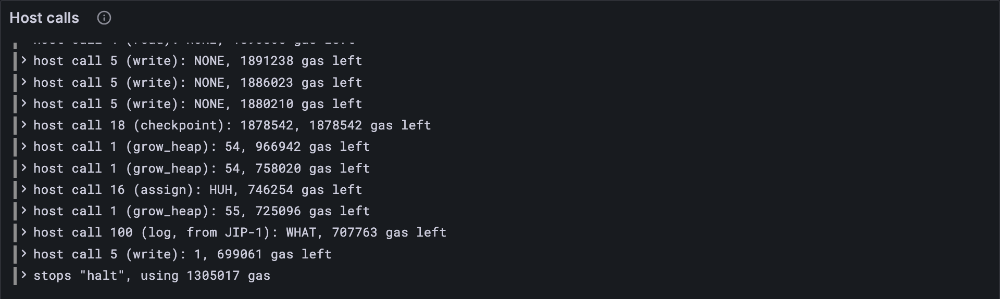

# Privileges

Some services are more equal than others. One may hand out privileges. One, for each core,
picks which authorizers that core will use. One picks the next validators. One may create
services with small ids. The chain keeps a record of who's who, and a privileged service
changes it from inside its own accumulation, with a host call. This lesson builds the
record and the first of those calls, `assign`. [Lesson 17.6](./06-who-wins.md) sorts out what happens when two
services change the same privilege in one round.

## New words

- **Privilege.** A right held by one service (or, for always-accumulate, by a list of
  them). The chain keeps who holds which in χ. *Example:* service 0 is core 0's assigner.
- **Assigner.** For each core, the service that may set the core's authorizer queue, and
  hand that right to another service. *Example:* service 0 hands core 0 to service 1.
- **Authorizer queue.** For each core, 80 authorizer hashes, one of which joins the core's
  pool every slot ([lesson 13.1](../13-authorization/01-the-authorizer-pools.md)). *Example:* the 80 hashes `assign` hands over with a core.

All three are in the [glossary](../glossary.md).

## What the Gray Paper says

§9 lists five privileges, χ:

- the *manager*, χ_M, may change all the others at once (with `bless`);
- an *assigner* for each core, χ_A, may set that core's authorizer queue (`assign`);
- the *delegator*, χ_V, may choose the next validators' keys (`designate`);
- the *registrar*, χ_R, may create services with small ids of its choosing (`new`);
- the *always-accumulate* services, χ_Z, accumulate every block ([lesson 17.1](./01-a-blocks-accumulation.md)'s `free`).

The test vectors name the first four after the host call each one allows: `bless`,
`assign`, `designate`, and `register` (though the registrar's call is `new`). Your client
uses the same names.

`assign` is host call 16 (Appendix B.7, Ω_A). In plain steps:

1. **Read the order.** The core is φ₇, its new queue is the 80 hashes (2,560 bytes) at
   φ₈ (unreadable: panic), and the next assigner is φ₉.
2. **Maybe refuse.** `CORE` if there's no such core; `HUH` if the caller isn't that
   core's assigner; `WHO` if φ₉ is too big to be a service id.
3. **Hand it over.** The core's queue becomes the 80 hashes, and its assigner becomes φ₉.
   φ₇ = `OK`. It costs 1,818 gas.

And the checkpoint rule holds again: the privileges and the queues are part of what a run
can change, so a failure undoes the changes made since its last checkpoint, and a
checkpoint keeps them. In the Gray Paper they sit in the run's partial state (e, in both X
and Y), next to the accounts: queues ϕ, privileges χ.

## The tests

**Add to** `test/host.test.ts`

```ts
import type { Privileges } from "../src/host.ts";
import { assign, collapsePowers, CORE, startPowers } from "../src/host.ts";
import type { Exit, Machine } from "../src/pvm/machine.ts";
import type { Bytes } from "../src/bytes.ts";
import type { Powers, Privileged } from "../src/host.ts";

/** Service 0 holds every privilege, on both of tiny's cores. */
const ZERO_HOLDS_ALL: Privileges = { bless: 0, assign: [0, 0], designate: 0, register: 0 };

/** A machine about to assign core `c` to service `to`, with a queue of 80 hashes of 7s. */
function assigning(c: bigint, to: bigint) {
  const memory = new Map();
  addPages(memory, 0x20000, 4096, "W");
  writeMemory(memory, 0x20000n, new Uint8Array(80 * 32).fill(7));
  const registers = [0n, 0n, 0n, 0n, 0n, 0n, 0n, c, 0x20000n, to];
  return newMachine(assemble([[0]]), registers, memory, 10_000n);
}

test("assign: the assigner hands a core on, and a checkpoint keeps the change", () => {
  const powers: Powers = startPowers(ZERO_HOLDS_ALL);
  const machine: Machine = assigning(0n, 1n); // core 0, to service 1
  const exit: HostExit = assign(machine, 0, powers, 2);
  assert.equal(exit, "continue");
  assert.equal(machine.registers[7], OK);
  assert.equal(machine.gas, 10_000n - 1818n);
  assert.deepEqual(powers.now.privileges.assign, [1, 0]); // core 0 is service 1's now
  const lastInQueue: Bytes = powers.now.queues.get(0)![79]; // its new queue
  assert.deepEqual(lastInQueue, new Uint8Array(32).fill(7));
  const undone: Privileged = collapsePowers(powers, "panic");
  assert.deepEqual(undone.privileges.assign, [0, 0]);
  checkpoint(storing(), bundle(), { transfers: [], kept: [] }, powers);
  const kept: Privileged = collapsePowers(powers, "panic");
  assert.deepEqual(kept.privileges.assign, [1, 0]);
});

test("assign refuses: no such core, not the core's assigner, not a service id", () => {
  const powers: Powers = startPowers(ZERO_HOLDS_ALL);
  const answer = (machine: ReturnType<typeof assigning>, s: number) => {
    assign(machine, s, powers, 2);
    return machine.registers[7];
  };
  const noSuchCore: bigint = answer(assigning(2n, 1n), 0); // tiny has cores 0 and 1
  assert.equal(noSuchCore, CORE);
  const notTheAssigner: bigint = answer(assigning(0n, 1n), 5); // service 5 isn't core 0's
  assert.equal(notTheAssigner, HUH);
  const noSuchService: bigint = answer(assigning(0n, 2n ** 32n), 0); // no service has that id
  assert.equal(noSuchService, WHO);
  assert.deepEqual(powers.now.privileges.assign, [0, 0]); // nothing changed
});
```

`ZERO_HOLDS_ALL` makes service 0 hold everything, so each refusal has exactly one reason.
After the hand-over, service 0 is no longer core 0's assigner: if it asked again, it would
get `HUH`.

The official vectors have three services that call `assign`. To run them, the test hands
each run the block's privileges, which the vectors keep under `privileges`:

**Replace in** `test/accumulate.test.ts`

```ts
import type { Privileges } from "../src/host.ts";

/** The parts of an accumulate test vector these tests read. */
type Vector = {
  input: { slot: number; reports: unknown[] };
  pre_state: {
    entropy: string;
    privileges: Privileges & { always_acc: { id: number; gas: number }[] };
    accounts: {
      id: number;
      data: AccountJson & {
        service: { code_hash: string };
        preimage_blobs: { hash: string; blob: string }[];
      };
    }[];
  };
  post_state: {
    statistics: { id: number; record: Record<string, number> }[];
    accounts: { id: number; data: AccountJson }[];
  };
};
```

**Replace in** `test/accumulate.test.ts`

```ts
/** Service s's accumulation in test vector `name`, every report in it accumulated at once. */
function runVector(name: string, s: number) {
  const vector = vectorJson(`stf/accumulate/tiny/${name}.json`) as Vector;
  const accounts = new Map(vector.pre_state.accounts.map((a) => [a.id, accountFromJson(a.data)]));
  const { data } = vector.pre_state.accounts.find((a) => a.id === s)!;
  const preimage = data.preimage_blobs.find((p) => p.hash === data.service.code_hash)!;
  const free = vector.pre_state.privileges.always_acc.find((x) => x.id === s)?.gas ?? 0;
  const { inputs, gas } = serviceInputs(reportsOf(vector), s, BigInt(free));
  const { bless, assign, designate, register } = vector.pre_state.privileges;
  const a: Accumulation = {
    id: s,
    accounts,
    checkpoint: copyAccounts(accounts),
    code: unpackCode(fromHex(preimage.blob)),
    entropy: fromHex(vector.pre_state.entropy),
    inputs,
    privileges: { bless, assign, designate, register },
  };
  const post = vector.post_state;
  return {
    result: accumulate(TINY, a, vector.input.slot, gas),
    gas: BigInt(post.statistics.find((x) => x.id === s)!.record.accumulate_gas_used),
    after: accountFromJson(post.accounts.find((x) => x.id === s)!.data),
  };
}
```

**Replace in** `test/accumulate.test.ts`

```ts
/** The vectors whose services need no host calls beyond this part's so far. */
const CASES: [string, number][] = [
  ["always_accumulate-1", 1729],
  ["always_accumulate-2", 1729],
  ["lookup_foreign_preimage-1", 0],
  ["lookup_foreign_preimage-2", 0],
  ["preimage_len_bound-1", 0],
  ["preimage_len_bound-2", 0],
  ["preimage_len_bound-3", 0],
  ["process_one_immediate_report-1", 1729],
  ["queues_are_shifted-1", 1729],
  ["same_code_different_services-1", 1729],
  ["same_round_storage_isolation-1", 1729],
  ["same_round_storage_isolation-1", 1730],
  ["same_round_storage_isolation-2", 1730],
  ["transfer_for_live_service-1", 0], // from here on: services that send a transfer
  ["transfer_for_ejected_service-1", 0],
  ["transfer_for_ejected_service_that_accumulates_high_ejector-1", 1],
  ["transfer_for_ejected_service_that_accumulates_low_ejector-1", 1],
  ["transfer_for_service_ejected_in_same_round_high_ejector-1", 1],
  ["transfer_for_service_ejected_in_same_round_low_ejector-1", 1],
  ["recreate_ejected_service_by_higher_registrar-1", 1],
  ["recreate_ejected_service_that_accumulates-1", 1],
  ["assign_from_non_assigner-1", 1], // from here on: services that call assign
  ["assign_from_non_assigner-2", 0],
  ["assign_from_non_assigner-3", 0],
];
```

**Add to** `test/accumulate.test.ts`

```ts
test("the assigner hands core 0 to service 1", () => {
  const { result } = runVector("assign_from_non_assigner-3", 0);
  const assigned: number[] = result.privileged.privileges.assign; // as the vector's χ_A ends
  assert.deepEqual(assigned, [1, 0]);
  const queueLength: number = result.privileged.queues.get(0)!.length; // core 0's new queue
  assert.equal(queueLength, 80);
});
```

**Run, expect it to fail**

```sh
npm test
```

```text
...
SyntaxError: The requested module '../src/host.ts' does not provide an export named 'CORE'
...
✖ test/host.test.ts (184.2ms)
...
ℹ tests 514
ℹ suites 0
ℹ pass 509
ℹ fail 5
...
```

Red: `src/host.ts` doesn't export `CORE` yet, nor the privileges and `assign`. The record,
a run's powers and the call come together, then the host learns to keep the powers
through a checkpoint.

## The code

The privileges, a run's powers (now, and as kept), and the call:

**Add to** `src/host.ts`

```ts
import { QUEUE_SIZE } from "./authorization.ts";

/**
 * χ (GP §9), under the test vectors' names: which services hold the privileges. The fifth
 * privilege, accumulating every block (χ_Z), is lesson 17.1's `free`.
 */
export type Privileges = {
  bless: number; // χ_M, the manager: may hand out the privileges themselves
  assign: number[]; // χ_A, one for each core: may set the core's authorizer queue
  designate: number; // χ_V, the delegator: may choose the next validators
  register: number; // χ_R, the registrar: may create services with small ids
};

/** No service has this id: the holder of a privilege nobody has been given. */
const NOBODY = 2 ** 32;

/** The privileges when nobody holds any: no manager, no assigners, and so on. */
export const NO_PRIVILEGES: Privileges = {
  bless: NOBODY, assign: [], designate: NOBODY, register: NOBODY,
};

/**
 * What a run's privileged calls change (part of the GP's ψ): the privileges, and the new
 * authorizer queue (80 hashes) of each core this run has set one for.
 */
export type Privileged = { privileges: Privileges; queues: Map<number, Bytes[]> };

/** A run's privileged state, the GP's X and Y: now, and as the last checkpoint kept it. */
export type Powers = { now: Privileged; kept: Privileged };

/** A copy of p that changes on its own. */
export function copyPrivileged(p: Privileged): Privileged {
  return {
    privileges: { ...p.privileges, assign: [...p.privileges.assign] },
    queues: new Map(p.queues),
  };
}

/** A run's powers as it starts: the privileges it was given, and no new queues yet. */
export function startPowers(privileges = NO_PRIVILEGES): Powers {
  const start = { privileges, queues: new Map<number, Bytes[]>() };
  return { now: copyPrivileged(start), kept: copyPrivileged(start) };
}

/** C (GP App. B.4), for the privileges: a halt keeps the run's; anything else, the kept. */
export function collapsePowers(powers: Powers, exit: Exit): Privileged {
  return exit === "halt" ? powers.now : powers.kept;
}

export const CORE = 2n ** 64n - 6n; // no such core

/**
 * assign (GP App. B.7, Ω_A): hands core φ₇ on. The 80 hashes at φ₈ become its authorizer
 * queue, and service φ₉ the one that may assign it next. Only the core's assigner may
 * (HUH for anyone else); CORE if there's no such core, WHO if φ₉ can't be a service id.
 */
export function assign(m: Machine, s: number, powers: Powers, cores: number): HostExit {
  if (!charge(m, 1818)) return "oog";
  const [c, o, to] = m.registers.slice(7, 10);
  const hashes = readMemory(m.memory, o, 32 * QUEUE_SIZE);
  if (!(hashes instanceof Uint8Array)) return "panic"; // the queue isn't readable
  if (c >= BigInt(cores)) return setTo(m, CORE);
  const { privileges, queues } = powers.now;
  if (privileges.assign[Number(c)] !== s) return setTo(m, HUH);
  if (to >= 2n ** 32n) return setTo(m, WHO);
  const queue = Array.from({ length: QUEUE_SIZE }, (_, i) => hashes.slice(32 * i, 32 * i + 32));
  queues.set(Number(c), queue);
  privileges.assign[Number(c)] = Number(to);
  return setTo(m, OK);
}
```

`startPowers` gives a run that wasn't handed any privileges `NO_PRIVILEGES`, a world
where nobody holds one: `NOBODY` is 2^32, an id no service can have, and no core has an
assigner. Every earlier test that builds a run without privileges keeps working.

Then the same small changes as in [lesson 17.3](./03-sending-a-transfer.md), so the powers go where they should. A run
may be given privileges:

**Replace in** `src/host.ts`

```ts
/**
 * What a service's accumulation runs with (GP App. B.4): which service it is, the accounts
 * twice over (as it changes them, and as they'll be if it fails), its code, the entropy
 * η′₀, and its inputs, each one encoded.
 */
export type Accumulation = {
  id: number;
  accounts: Map<number, Account>; // as the service changes them (the GP's X)
  checkpoint: Map<number, Account>; // as they were at the last checkpoint (Y)
  code: ServiceCode;
  entropy: Bytes;
  inputs: Bytes[];
  privileges?: Privileges; // χ as the run starts (lesson 17.5); nobody's, if left out
};
```

The host answers call 16:

**Replace in** `src/host.ts`

```ts
/**
 * F (GP App. B.4): the host for a service's accumulation. So far it answers gas, grow_heap,
 * fetch (whose items are the constants, 0; the entropy, 1; and the inputs, all of them, 14,
 * or one, 15), info, lookup, read, write, checkpoint, query, solicit and forget, the last
 * two at `slot`, the time of the block; transfer, into `outbox`; and assign, with `powers`.
 * Anything else: WHAT.
 */
export function accumulateHost(
  config: Config,
  a: Accumulation,
  slot: number,
  outbox: Outbox = { transfers: [], kept: [] },
  powers: Powers = startPowers(),
): Host {
  const items: Items = (kind, index) => {
    if (kind === 0) return protocolConstants(config);
    if (kind === 1) return a.entropy;
    if (kind === 14) return concatBytes(encodeNatural(BigInt(a.inputs.length)), ...a.inputs);
    if (kind === 15 && index < BigInt(a.inputs.length)) return a.inputs[Number(index)];
    return undefined;
  };
  return (call, m) => {
    switch (HOST_CALLS[call]) {
      case "gas":
        return gas(m);
      case "grow_heap":
        return growHeap(m, a.code);
      case "fetch":
        return fetch(m, items);
      case "info":
        return info(m, a.accounts, a.id);
      case "lookup":
        return lookup(m, a.accounts, a.id);
      case "read":
        return read(m, a.accounts, a.id);
      case "write":
        return write(m, a.accounts, a.id);
      case "checkpoint":
        return checkpoint(m, a, outbox, powers);
      case "query":
        return query(m, a);
      case "solicit":
        return solicit(m, a, slot);
      case "forget":
        return forget(m, a, slot, config.expunge_period);
      case "transfer":
        return transfer(m, a, outbox);
      case "assign":
        return assign(m, a.id, powers, config.core_count);
      default:
        return unknown(m);
    }
  };
}
```

A checkpoint keeps the privileges too:

**Replace in** `src/host.ts`

```ts
/** checkpoint (GP App. B.7, Ω_C): what the service has done so far is kept if it fails later. */
export function checkpoint(
  m: Machine,
  a: Accumulation,
  outbox: Outbox = { transfers: [], kept: [] },
  powers: Powers = startPowers(),
): HostExit {
  if (!charge(m, 103)) return "oog";
  a.checkpoint = copyAccounts(a.accounts); // Y′ = X
  outbox.kept = [...outbox.transfers]; // the transfers sent so far, too
  powers.kept = copyPrivileged(powers.now); // and the privileges
  m.registers[7] = m.gas;
  return "continue";
}
```

And the run hands back what it did with them:

**Replace in** `src/host.ts`

```ts
/** What an accumulation leaves: how it ended, the accounts after it, the gas it used, the
 * transfers it sent, and the privileges as it left them. */
export type Accumulated = {
  exit: Exit;
  accounts: Map<number, Account>;
  gasUsed: bigint;
  transfers: Transfer[];
  privileged: Privileged;
};
```

**Replace in** `src/host.ts`

```ts
/**
 * Ψ_A (GP App. B.4), so far: runs service a.id's accumulation at `slot` on `gas`, through
 * accumulation's host, and collapses what it did, the transfers it sent and the privileges
 * included. `watch`, if given, sees each host call.
 */
export function accumulate(
  config: Config,
  a: Accumulation,
  slot: number,
  gas: bigint,
  watch?: (call: number, m: Machine) => void,
): Accumulated {
  const [t, s, n] = [slot, a.id, a.inputs.length].map((x) => encodeNatural(BigInt(x)));
  const { memory, registers } = standardProgram(a.code, concatBytes(t, s, n)); // Ψ_M's Y
  const machine = newMachine(deblob(a.code.program), registers, memory, gas);
  machine.pc = 5; // accumulation's way in
  const outbox: Outbox = { transfers: [], kept: [] }; // every run starts with none sent
  const powers = startPowers(a.privileges);
  const host = accumulateHost(config, a, slot, outbox, powers);
  const exit = runWithHost(machine, (call, m) => {
    const answer = host(call, m);
    watch?.(call, m);
    return answer;
  });
  const gasUsed = gas - (machine.gas > 0n ? machine.gas : 0n); // u = g − max(ϱ′, 0)
  const accounts = collapse(a, exit);
  const transfers = collapseTransfers(outbox, exit);
  return { exit, accounts, gasUsed, transfers, privileged: collapsePowers(powers, exit) };
}
```

`privileges?:` with a question mark is an *optional* field: it may be there or not. When
it isn't, `startPowers` gets `undefined`, and its default steps in.

**Run**

```sh
npm test
npm run typecheck
```

```text
...
✔ assign_from_non_assigner-1: service 1 ends as the vector says (685.6ms)
✔ assign_from_non_assigner-2: service 0 ends as the vector says (654.0ms)
✔ assign_from_non_assigner-3: service 0 ends as the vector says (1486.2ms)
...
✔ the assigner hands core 0 to service 1 (576.3ms)
...
✔ the reported packages: each one's hash and exports root, sorted by hash (251.5ms)
...
✔ assign: the assigner hands a core on, and a checkpoint keeps the change (1.1ms)
✔ assign refuses: no such core, not the core's assigner, not a service id (2.7ms)
...
ℹ tests 543
ℹ suites 0
ℹ pass 543
ℹ fail 0
...
reported 543 tests to Grafana: http://127.0.0.1:3300/d/gray-tutorial?var-client=you&var-run_id=test-1791739196226
...
```

## Watch it

`bin/host.ts` hands its run the block's privileges now, and says the host's answers by
name, so `HUH` reads as `HUH` and not as 18446744073709551607:

**Replace in** `bin/host.ts`

```ts
import { CASH, CORE, FULL, HUH, LOW, WHO } from "../src/host.ts";

const a = {
  id: s,
  accounts,
  checkpoint: copyAccounts(accounts),
  code: unpackCode(fromHex(preimage.blob)),
  entropy: fromHex(pre.entropy),
  inputs,
  privileges: {
    bless: pre.privileges.bless,
    assign: pre.privileges.assign,
    designate: pre.privileges.designate,
    register: pre.privileges.register,
  },
};

const result = accumulate(TINY, a, vector.input.slot, gas, (call, m) => {
  const name = HOST_CALLS[call] ?? (call === 100 ? "log, from JIP-1" : "?");
  const said = answerName(m.registers[7]);
  console.log(`host call ${call} (${name}): φ₇ = ${said}, ${m.gas} gas left`);
  run.event("call", { call, name, said, gas: Number(m.gas) });
});
for (const t of result.transfers) {
  const memo = new TextDecoder().decode(t.memo).replace(/\0+$/, ""); // without trailing zeros
  console.log(`sent ${t.amount} to service ${t.dest}, with ${t.gas} gas and the memo "${memo}"`);
  run.event("sent", { dest: t.dest, amount: Number(t.amount), gas: Number(t.gas), memo });
}
```

**Add to** `bin/host.ts`

```ts
/** φ₇ as the host's answer, by name if it's one of them (GP App. B.1), or as a number. */
function answerName(r7: bigint): string {
  const names = { NONE, WHAT, WHO, FULL, CORE, CASH, LOW, HUH };
  const found = Object.entries(names).find(([, code]) => code === r7);
  return found ? found[0] : String(r7);
}
```

(The `for` loop comes along because it sits right under `const result`, with no blank
line between: a Replace takes both.) `answerName` is a function declaration, so it can be
used above the line it's written on.
(Its `const` cousins can't.)

**Run**

```sh
node bin/host.ts ../vectors/stf/accumulate/tiny/assign_from_non_assigner-3.json 0
```

```text
host call 2 (fetch): φ₇ = 122, 1999367 gas left
...
host call 16 (assign): φ₇ = 0, 742165 gas left
host call 1 (grow_heap): φ₇ = 55, 721031 gas left
host call 100 (log, from JIP-1): φ₇ = WHAT, 703828 gas left
host call 5 (write): φ₇ = 1, 695155 gas left
the service stops: "halt", using 1308944 gas
the test vector says: 1308944
reported to Grafana: http://127.0.0.1:3300/d/gray-tutorial?var-client=you&var-run_id=host-1791739203939
```

**Run**

```sh
node bin/host.ts ../vectors/stf/accumulate/tiny/assign_from_non_assigner-1.json 1
```

```text
host call 2 (fetch): φ₇ = 122, 1999367 gas left
...
host call 16 (assign): φ₇ = HUH, 746254 gas left
host call 1 (grow_heap): φ₇ = 55, 725096 gas left
host call 100 (log, from JIP-1): φ₇ = WHAT, 707763 gas left
host call 5 (write): φ₇ = 1, 699061 gas left
the service stops: "halt", using 1305017 gas
the test vector says: 1305017
reported to Grafana: http://127.0.0.1:3300/d/gray-tutorial?var-client=you&var-run_id=host-1791739204669
```

The first service holds core 0 and hands it over: φ₇ = 0, `OK`. The second isn't core
0's assigner, so it gets `HUH`, and its code, written to expect that, carries on. Both
runs in the *Host calls* panel, on **7 · Accumulation and import**, answers by name.



<details>
<summary>lasair: <code>host_assign</code>, in <code>lib/pvm_host.ml</code></summary>

The order, read from the registers:

```ocaml
  let c = reg_int regs 7 in
  let o = get_reg regs 8 in
  let a = get_reg regs 9 in
  let qbytes = 32 * Config.q_queue in
  if not (is_range_readable mem o qbytes) then None
```

and, a little further down, the two refusals after `CORE`:

```ocaml
      if live_assigner <> Int64.of_int ctx.service_id then ret result_huh None
      else if Int64.unsigned_compare a 0x100000000L >= 0 then ret result_who None
```

`None` is lasair's panic. The interesting word is `live_assigner`. lasair doesn't keep a
working copy of the privileges the way your `powers.now` does: it keeps a list of every
`assign` (and `bless`) the run has made, and works out from that list who the assigner is
right now. Same answers; your way is shorter to read.

</details>

## What you have

A record of who holds which privilege, and the first privileged call: a core's assigner
can hand it on, with a new queue, and a failure takes it back. Three more official
service runs match. Every service in a round starts from the same privileges, though, so
two can change the same one: [lesson 17.6](./06-who-wins.md) decides who wins.

Next: [17.6 Who wins](./06-who-wins.md)
