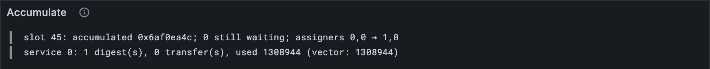

# Who wins

Every service in a round starts from the same privileges, so two of them can change the
same one. Say the manager gives core 0 to service 5, while core 0's own assigner gives it
to service 7. Both runs finish happily. Which one does the chain believe? This lesson
settles it the Gray Paper's way, keeps the privileges in the block's state from round to
round, and three more official vectors pass whole.

## New words

- **Holder.** The service holding a privilege when the round starts. *Example:* service 1
  holds core 0's assignment.
- **Merge.** Turning every run's version of something into one, after a round. *Example:*
  two runs left different assigners for core 0; the merge picks one.
- **R (replace if changed).** The Gray Paper's merge rule for a privilege: the manager's
  change wins; if the manager left it alone, the holder's own change. *Example:*
  R(1, 5, 7) = 5, R(1, 1, 7) = 7.

All three are in the [glossary](../glossary.md).

## What the Gray Paper says

§12, after a round (Δ*), in plain steps:

1. **The manager's run decides the manager.** Whoever the manager's run left as manager
   is the manager now.
2. **Every other privilege: the manager first, then the holder.** For each core's
   assigner, and for the delegator and the registrar: if the manager's run changed it, the
   manager's choice wins. If not, whatever the holder's own run left it as (perhaps
   unchanged).
3. **Each core's new authorizer queue comes from its holder**: the core's assigner at the
   round's start, if its run set one. Not from the manager, ever.
4. **A service that didn't run changed nothing.**
5. **The next round starts from the merged privileges**, and the last round's are the
   block's.

Why this rule? The Gray Paper's own reason: it lets privileges be *owned*, each holder
changing its own, and it makes it possible to remove the manager altogether.

In symbols, with o the holder at the start, a the manager's choice and b the holder's:

  R(o, a, b) = b if a = o, otherwise a

and χ′_A[c] = R(χ_A[c], e*_A[c], (Δ₁(χ_A[c]))_A[c]), where e* is the manager's run.

## The tests

The merge on its own first, with the example from the top of the lesson:

**Add to** `test/accumulate.test.ts`

```ts
import { mergePrivileges } from "../src/accumulate.ts";

test("who wins: the manager's change over the holder's, the holder's over nobody's", () => {
  const before: Privileges = { bless: 0, assign: [1, 1], designate: 0, register: 0 };
  const left = (assign: number[], queues = new Map()) => ({
    privileges: { ...before, assign },
    queues,
  });
  const queue = [new Uint8Array(32).fill(9)]; // service 1's new queue for core 1
  const runs = new Map([
    [0, left([5, 1])], // the manager gives core 0 to service 5, and leaves core 1 alone
    [1, left([7, 7], new Map([[1, queue]]))], // service 1 gives both cores to service 7
  ]);
  const after = mergePrivileges(before, runs);
  assert.deepEqual(after.privileges.assign, [5, 7]); // core 0: the manager's; core 1: its own
  assert.deepEqual([...after.queues], [[1, queue]]); // the queue its assigner set
});
```

Then whole blocks. `checkBlock` compares the privileges too now:

**Replace in** `test/accumulate.test.ts`

```ts
/** Checks the whole block of test vector `name`: accounts, privileges, statistics, queue
 * and history. */
function checkBlock(name: string) {
  const vector = vectorJson(`stf/accumulate/tiny/${name}.json`) as BlockVector;
  const before = accumulationStateFromJson(vector.pre_state);
  const { state, statistics } = accumulateBlock(TINY, before, vector.input.slot, reportsOf(vector));
  const expected = accumulationStateFromJson(vector.post_state);
  assert.deepEqual(state.accounts, expected.accounts);
  assert.deepEqual(state.privileges, expected.privileges);
  assert.deepEqual(state.ready, expected.ready);
  assert.deepEqual(state.accumulated, expected.accumulated);
  const stats = vector.post_state.statistics.map(({ id, record: r }) => {
    const gasUsed = BigInt(r.accumulate_gas_used);
    return [id, { count: r.accumulate_count, transfers: r.accumulate_transfer_count, gasUsed }];
  });
  assert.deepEqual(statistics, new Map(stats as [number, unknown][]));
}
```

**Replace in** `test/accumulate.test.ts`

```ts
/** The vectors whose whole block needs nothing beyond this lesson. */
const BLOCK_CASES = [
  "accumulate_ready_queued_reports-1", "always_accumulate-1", "always_accumulate-2",
  "assign_from_non_assigner-1", "assign_from_non_assigner-2", "assign_from_non_assigner-3",
  "enqueue_and_unlock_chain-1", "enqueue_and_unlock_chain-2", "enqueue_and_unlock_chain-3",
  "enqueue_and_unlock_chain-4", "enqueue_and_unlock_chain_wraps-1",
  "enqueue_and_unlock_chain_wraps-2", "enqueue_and_unlock_chain_wraps-3",
  "enqueue_and_unlock_chain_wraps-4", "enqueue_and_unlock_chain_wraps-5",
  "enqueue_and_unlock_simple-1", "enqueue_and_unlock_simple-2",
  "enqueue_and_unlock_with_sr_lookup-1", "enqueue_and_unlock_with_sr_lookup-2",
  "enqueue_self_referential-1", "enqueue_self_referential-2", "enqueue_self_referential-3",
  "enqueue_self_referential-4", "lookup_foreign_preimage-1", "lookup_foreign_preimage-2",
  "no_available_reports-1", "preimage_len_bound-1", "preimage_len_bound-2",
  "preimage_len_bound-3", "process_one_immediate_report-1", "queues_are_shifted-1",
  "queues_are_shifted-2", "ready_queue_editing-1", "ready_queue_editing-2",
  "ready_queue_editing-3", "same_code_different_services-1", "same_round_storage_isolation-1",
  "same_round_storage_isolation-2", "transfer_for_live_service-1", "work_for_ejected_service-1",
];
```

And one block where a core changes hands:

**Add to** `test/accumulate.test.ts`

```ts
test("a core changes hands for the whole block, with a new queue", () => {
  const vector = vectorJson("stf/accumulate/tiny/assign_from_non_assigner-3.json") as BlockVector;
  const before = accumulationStateFromJson(vector.pre_state);
  const { state, queues } = accumulateBlock(TINY, before, vector.input.slot, reportsOf(vector));
  assert.deepEqual([before.privileges.assign, state.privileges.assign], [[0, 0], [1, 0]]);
  assert.equal(queues.get(0)!.length, 80); // for Part 13's ϕ
});
```

**Run, expect it to fail**

```sh
npm test
# fails with: does not provide an export named
```

## The code

The block's state keeps the privileges, read from the vectors:

**Replace in** `src/accumulate.ts`

```ts
import type { Privileged, Privileges } from "./host.ts";
import { NO_PRIVILEGES } from "./host.ts";

/** What a block's accumulation reads from the state, and gives back changed (GP §12). */
export type AccumulationState = {
  slot: number; // τ: the slot of the block before
  accounts: Map<number, Account>; // δ
  free: Map<number, bigint>; // χ_Z
  privileges: Privileges; // the rest of χ: manager, assigners, delegator, registrar
  entropy: Bytes; // η′₀
  ready: Waiting[][]; // ω: for each slot of an epoch, the reports that wait
  accumulated: Set<string>[]; // ξ: for each of the last E slots, the packages accumulated
};
```

**Replace in** `src/accumulate.ts`

```ts
/** A block's accumulation state, as the accumulate test vectors write it. */
export type AccumulationStateJson = {
  slot: number;
  entropy: string;
  accounts: { id: number; data: AccountJson }[];
  privileges: Privileges & { always_acc: { id: number; gas: number }[] };
  ready_queue: { report: unknown; dependencies: string[] }[][];
  accumulated: string[][];
};
```

**Replace in** `src/accumulate.ts`

```ts
/** An AccumulationState from the accumulate test vectors' JSON. */
export function accumulationStateFromJson(json: AccumulationStateJson): AccumulationState {
  const waiting = (w: { report: unknown; dependencies: string[] }) => ({
    report: WorkReport.fromJson(w.report),
    dependencies: new Set(w.dependencies),
  });
  return {
    slot: json.slot,
    accounts: new Map(json.accounts.map((a) => [a.id, accountFromJson(a.data)])),
    free: new Map(json.privileges.always_acc.map((x) => [x.id, BigInt(x.gas)])),
    privileges: {
      bless: json.privileges.bless,
      assign: json.privileges.assign,
      designate: json.privileges.designate,
      register: json.privileges.register,
    },
    entropy: fromHex(json.entropy),
    ready: json.ready_queue.map((slot) => slot.map(waiting)),
    accumulated: json.accumulated.map((hashes) => new Set(hashes)),
  };
}
```

The merge:

**Add to** `src/accumulate.ts`

```ts
/**
 * R (GP §12): a privilege after a round, from its holder o at the start, the manager's
 * choice for it, and its holder's own choice. The manager's change wins; if the manager
 * left it alone, the holder's own change (perhaps none).
 */
const R = (o: number, manager: number, holder: number) => (manager === o ? holder : manager);

/**
 * The privileges after a round (GP §12, Δ*), from those at its start and each run's, as
 * it left them. A service that didn't run changed nothing. Each core's new authorizer
 * queue is the one its assigner at the start set, if it set one.
 */
export function mergePrivileges(before: Privileges, after: Map<number, Privileged>) {
  const post = (s: number) => after.get(s)?.privileges ?? before;
  const manager = post(before.bless); // what the manager left
  const privileges: Privileges = {
    bless: manager.bless,
    assign: before.assign.map((o, c) => R(o, manager.assign[c], post(o).assign[c])),
    designate: R(before.designate, manager.designate, post(before.designate).designate),
    register: R(before.register, manager.register, post(before.register).register),
  };
  const queues = new Map<number, Bytes[]>();
  before.assign.forEach((o, c) => {
    const queue = after.get(o)?.queues.get(c);
    if (queue) queues.set(c, queue);
  });
  return { privileges, queues };
}
```

`post(s)` is service s's privileges as its run left them, or the round's start if it
didn't run (step 4). The rest is the five steps, one line each.

A round hands every run the round's privileges, and merges what they leave:

**Replace in** `src/accumulate.ts`

```ts
/**
 * Δ* (GP §12), one round: every service with work in `reports`, every always-accumulate
 * service, and every service a transfer is sent to, runs once from the same accounts and
 * keeps its own account as its run leaves it. The transfers' money arrives before its code
 * runs, even if it has none. Every run starts from the same privileges too, and they are
 * merged after the round. Returns the accounts after the round, the gas each service used,
 * the transfers they sent (service by service in order of id), the privileges after the
 * round, and the cores' new authorizer queues.
 */
export function accumulateRound(
  config: Config,
  accounts: Map<number, Account>,
  free: Map<number, bigint>, // χ_Z: the services that accumulate every block, and their gas
  entropy: Bytes,
  slot: number,
  reports: WorkReport[],
  transfers: Transfer[], // the transfers sent in the round before
  privileges = NO_PRIVILEGES, // χ as the round starts
) {
  const digests = reports.flatMap((r) => r.results);
  const ids = [...free.keys(), ...digests.map((d) => d.service_id)];
  const services = [...new Set([...ids, ...transfers.map((t) => t.dest)])].sort((x, y) => x - y);
  const after = copyAccounts(accounts);
  const used = new Map<number, bigint>();
  const sent: Transfer[] = [];
  const powers = new Map<number, Privileged>(); // each run's privileges, as it left them
  for (const s of services) {
    const mine = copyAccounts(accounts); // every service starts from the same accounts
    const account = mine.get(s);
    const money = transfers.filter((t) => t.dest === s).reduce((n, t) => n + t.amount, 0n);
    if (account) account.info = { ...account.info, balance: account.info.balance + money };
    const code = account && codeOf(account);
    if (!code) {
      if (account) after.set(s, account); // no code to run: it keeps the money, that's all
      used.set(s, 0n);
      continue;
    }
    const { inputs, gas } = serviceInputs(reports, s, free.get(s) ?? 0n, transfers);
    const checkpoint = copyAccounts(mine);
    const a = { id: s, accounts: mine, checkpoint, code, entropy, inputs, privileges };
    const result = accumulate(config, a, slot, gas);
    after.set(s, result.accounts.get(s)!);
    used.set(s, result.gasUsed);
    sent.push(...result.transfers);
    powers.set(s, result.privileged);
  }
  const { privileges: next, queues } = mergePrivileges(privileges, powers);
  return { accounts: after, used, transfers: sent, privileges: next, queues };
}
```

And the block carries them from round to round:

**Replace in** `src/accumulate.ts`

```ts
/**
 * A block's accumulation (GP §12): the reports that can go now (R!, then what they and
 * the history unlock from the queue: R*) accumulate in a first round, and the transfers
 * each round sends are delivered in the next, until a round sends none (Δ+). Every
 * service that did anything gets its statistics and its last-accumulation slot; the
 * history ξ moves on one slot, and the reports still waiting go back into the queue ω.
 * The privileges carry from round to round; the cores' new authorizer queues come back
 * beside the statistics.
 */
export function accumulateBlock(
  config: Config,
  state: AccumulationState,
  slot: number, // τ′
  reports: WorkReport[], // the reports that just became available
) {
  const E = config.epoch_length;
  const waits = (r: WorkReport) =>
    r.context.prerequisites.length > 0 || r.segment_root_lookup.length > 0;
  const dependencies = (r: WorkReport) => [
    ...r.context.prerequisites,
    ...r.segment_root_lookup.map((l) => l.work_package_hash),
  ];
  const history = new Set(state.accumulated.flatMap((x) => [...x])); // ξ∪
  const now = reports.filter((r) => !waits(r)); // R!
  const fresh = reports.filter(waits).map((r) => ({
    report: r,
    dependencies: new Set(dependencies(r).map(toHex)),
  }));
  const queued = edit(fresh, history); // R^Q
  const m = slot % E;
  const ring = [...state.ready.slice(m), ...state.ready.slice(0, m)].flat();
  const all = [...now, ...unlock(edit([...ring, ...queued], new Set(now.map(packageOf))))];

  let accounts = state.accounts;
  let todo = all; // the first round: every report that can go,
  let free = state.free; // the always-accumulate services,
  let transfers: Transfer[] = []; // and no transfers yet
  let privileges = state.privileges;
  const queues = new Map<number, Bytes[]>(); // the cores' new authorizer queues, for ϕ′
  const used = new Map<number, bigint>(); // G: gas, over every round
  const received = new Map<number, number>(); // T: transfers delivered
  while (todo.length + free.size + transfers.length > 0) {
    for (const t of transfers) received.set(t.dest, (received.get(t.dest) ?? 0) + 1);
    const round = accumulateRound(
      config, accounts, free, state.entropy, slot, todo, transfers, privileges,
    );
    for (const [s, gas] of round.used) used.set(s, (used.get(s) ?? 0n) + gas);
    for (const [c, queue] of round.queues) queues.set(c, queue);
    accounts = round.accounts;
    privileges = round.privileges;
    todo = []; // from now on, only transfers
    free = new Map();
    transfers = round.transfers;
  }
  const digests = all.flatMap((r) => r.results);
  const statistics = new Map<number, AccumulationStats>();
  for (const [s, gasUsed] of used) {
    const count = digests.filter((d) => d.service_id === s).length;
    const transfersIn = received.get(s) ?? 0;
    if (count === 0 && transfersIn === 0 && gasUsed === 0n) continue; // S(s) = (0, 0, 0)
    statistics.set(s, { count, transfers: transfersIn, gasUsed });
    const account = accounts.get(s);
    if (account) account.info.last_accumulation_slot = slot;
  }

  const done = new Set(all.map(packageOf));
  const accumulated = [...state.accumulated.slice(1), done]; // ξ′: newest last
  const ready: Waiting[][] = []; // ω′, slot by slot back from m
  for (let i = 0; i < E; i++) {
    const at = (m - i + E) % E;
    if (i === 0) ready[at] = edit(queued, done); // this block's newcomers
    else if (i < slot - state.slot) ready[at] = []; // slots the chain skipped: emptied
    else ready[at] = edit(state.ready[at], done);
  }
  const after = { ...state, slot, accounts, privileges, ready, accumulated };
  return { state: after, statistics, queues };
}
```

The new queues go back beside the statistics. Part 13's ϕ will take them when Part 19
puts a whole block together.

**Run**

```sh
npm test
# prints: who wins: the manager's change over the holder's, the holder's over nobody's
# prints: fail 0
# prints: reported
npm run typecheck
```

## Watch it

**Replace in** `bin/accumulate.ts`

```ts
const went = [...state.accumulated.at(-1)!].map(short);
console.log(`slot ${slot}: ${reports.length} new report(s), ${before.ready.flat().length} waiting`);
console.log(`accumulated: ${went.join(", ") || "nothing"}`);
console.log(`still waiting: ${state.ready.flat().length}`);
console.log(`assigners: ${before.privileges.assign} → ${state.privileges.assign}`);
run.event("block", {
  slot,
  went: went.join(", "),
  waiting: state.ready.flat().length,
  assigners: `${before.privileges.assign} → ${state.privileges.assign}`,
});
for (const [s, { count, transfers, gasUsed }] of statistics) {
  const theirs = (vector.post_state.statistics as Stat[]).find((x) => x.id === s)?.record;
  console.log(`service ${s}: ${count} digest(s), ${transfers} transfer(s), ${gasUsed} gas`);
  const said = `${theirs?.accumulate_count} digest(s), ${theirs?.accumulate_transfer_count} ` +
    `transfer(s), ${theirs?.accumulate_gas_used} gas`;
  console.log(`  the vector says: ${said}`);
  const expected = theirs?.accumulate_gas_used;
  run.event("service", { s, count, transfers, used: Number(gasUsed), expected });
}
```

(The lines under `const went` come along: they sit right under it with no blank line, up
to the end of the `for` loop.)

**Run**

```sh
node bin/accumulate.ts ../vectors/stf/accumulate/tiny/assign_from_non_assigner-3.json
# prints: assigners: 0,0 → 1,0
# prints: service 0: 1 digest(s), 0 transfer(s), 1308944 gas
```

Service 0 held both cores, gave core 0 to service 1, and the block agrees: core 0's
assigner is 1 now. The *Accumulate* panel shows the assigners on the block's line.



<details>
<summary>lasair: the assigners, in <code>conformance/stf_guarantees.ml</code></summary>

```ocaml
  let owns_core c =
    c < Array.length pv0.pv_assigners && pv0.pv_assigners.(c) = inv in
  let pv = List.fold_left (fun pv (c, _, a) ->
    if c < Array.length pv.pv_assigners && (is_manager || owns_core c)
    then begin
      let arr = Array.copy pv.pv_assigners in
      arr.(c) <- a;
      { pv with pv_assigners = arr }
    end else pv) pv assign_moves in
```

lasair gets there a different way. Instead of comparing every run's privileges after the
round, it goes through each run's `assign`s (`assign_moves`) and keeps a move only if it
came from the manager (`is_manager`) or from the core's assigner at the round's start
(`owns_core`, which reads `pv0`, the round's start). Those are exactly the two services
R listens to.

</details>

## What you have

Privileges that survive the round they're changed in, settled the Gray Paper's way: the
manager first, then the holder. Forty official vectors match as whole blocks.

Next: [17.7 Ejecting a service](./07-ejecting-a-service.md)
