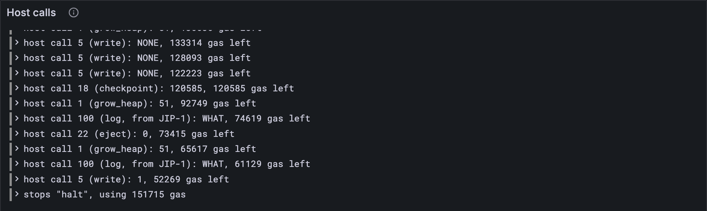

# Ejecting a service

Services don't live for ever. When one is done, it can arrange to be removed: it names
another service as its ejector, lets go of everything it keeps, and waits. Later, the
ejector calls `eject`: the finished service is gone, and its leftover balance goes to the
ejector. This lesson builds the call, and teaches a round to remove an account. Ten more
official vectors pass whole.

## New words

- **Eject.** Removing a finished service from the state, for good. *Example:* service 0
  ejects service 2, and service 2 is gone.
- **Ejector.** The service a finished service has named to remove it. It names it in an
  odd place: its code hash becomes the ejector's id, in 32 bytes. *Example:* a code hash of
  32 zero bytes names service 0.
- **Expunge period (D).** How many slots a forgotten preimage must wait before it can go:
  32 on tiny, 19,200 on full. *Example:* forgotten at slot 10, gone from slot 43 on tiny.

All three are in the [glossary](../glossary.md).

## What the Gray Paper says

`eject` is host call 22 (Appendix B.7, Ω_J). Service s asks to eject service d, naming a
preimage hash h:

1. **Read.** d is φ₇, the hash h is the 32 bytes at φ₈ (unreadable: panic).
2. **Who.** d must exist, must not be s itself, and its code hash must be s's id as 32
   bytes (ℰ₃₂(s)): d named s as its ejector. Otherwise `WHO`.
3. **Ready.** d must keep nothing but one request (2 items), for h, as long as d's
   footprint minus 81 bytes, and it must have forgotten that preimage ([lesson 16.9](../16-host-calls/09-asking-for-preimages.md)) more
   than D slots ago. Otherwise `HUH`.
4. **Go.** d is removed, and d's balance is added to s's. φ₇ = `OK`. It costs 458 gas.

Why such a fuss? An account holds a deposit for everything it keeps. Making d let go of
everything first, and wait out the expunge period, means nothing is lost that someone
might still need.

**The round** needs one more rule. Each run works on its own copy of the accounts, so a
run that ejected d left a copy without it. After the round, any account some run removed
is removed, whatever the other runs' copies say: the Gray Paper's **(d ∪ n) \ m**, where
m is every account some run removed. (n is each run's own account as it left it, plus any
it created: [lesson 17.8](./08-creating-a-service.md).)

## The tests

Two hand-made tests, with a service ready to be ejected:

**Add to** `test/host.test.ts`

```ts
import { eject } from "../src/host.ts";
import type { Exit, Machine } from "../src/pvm/machine.ts";

/**
 * Service 0, and service 1 ready to be ejected by it: its code hash names service 0, and
 * its one request, for HASH, was forgotten at slot 10.
 */
function ejectable() {
  const a = bundle();
  const zombie = copyAccounts(a.accounts).get(0)!;
  zombie.info = { ...zombie.info, code_hash: new Uint8Array(32), items: 2, bytes: 81n + 20n };
  zombie.requests = new Map([[`${toHex(HASH)}:20`, [5, 10]]]); // provided at 5, forgotten at 10
  a.accounts.set(1, zombie);
  return a;
}

/** A machine about to eject service `d`, naming the preimage HASH. */
function ejecting(d: bigint) {
  const memory = new Map();
  addPages(memory, 0x20000, 4096, "W");
  writeMemory(memory, 0x20000n, HASH);
  return newMachine(assemble([[0]]), [0n, 0n, 0n, 0n, 0n, 0n, 0n, d, 0x20000n], memory, 10_000n);
}

test("eject: a service that named its ejector goes, and its balance goes to the ejector", () => {
  const a: Accumulation = ejectable();
  const machine: Machine = ejecting(1n);
  const exit: HostExit = eject(machine, a, 100, TINY.expunge_period);
  assert.equal(exit, "continue");
  assert.equal(machine.registers[7], OK);
  assert.equal(machine.gas, 10_000n - 458n);
  assert.equal(a.accounts.has(1), false); // gone
  assert.equal(a.accounts.get(0)!.info.balance, 2000n); // its 1000 and the other's 1000
  const again: Machine = ejecting(1n);
  eject(again, a, 100, TINY.expunge_period);
  assert.equal(again.registers[7], WHO); // gone means gone: no second helping
  assert.equal(a.accounts.get(0)!.info.balance, 2000n);
});

test("eject refuses: itself, a stranger, or a preimage forgotten too recently", () => {
  const answer = (d: bigint, t: number) => {
    const machine = ejecting(d);
    eject(machine, ejectable(), t, TINY.expunge_period);
    return machine.registers[7];
  };
  const itself: bigint = answer(0n, 100); // a service can't eject itself
  assert.equal(itself, WHO);
  const stranger: bigint = answer(5n, 100); // there's no service 5
  assert.equal(stranger, WHO);
  const tooRecent: bigint = answer(1n, 10 + TINY.expunge_period); // forgotten at 10: too soon
  assert.equal(tooRecent, HUH);
});
```

`ejectable` builds service 1 ready to go: its code hash names service 0 (32 zero bytes are
0 as ℰ₃₂), it keeps one request of 20 bytes (so its footprint is 81 + 20), provided at slot
5 and forgotten at slot 10. At slot 100 that's long enough ago; at slot 42 it isn't, by one
slot: 10 < 42 − 32 is false. The first test also ejects service 1 twice, and the second
try must find nobody.

Then whole blocks. Ten more official vectors pass now:

**Replace in** `test/accumulate.test.ts`

```ts
/** The vectors whose whole block needs nothing beyond this lesson. */
const BLOCK_CASES = [
  "accumulate_ready_queued_reports-1", "always_accumulate-1", "always_accumulate-2",
  "assign_from_non_assigner-1", "assign_from_non_assigner-2", "assign_from_non_assigner-3",
  "enqueue_and_unlock_chain-1", "enqueue_and_unlock_chain-2", "enqueue_and_unlock_chain-3",
  "enqueue_and_unlock_chain-4", "enqueue_and_unlock_chain_wraps-1",
  "enqueue_and_unlock_chain_wraps-2", "enqueue_and_unlock_chain_wraps-3",
  "enqueue_and_unlock_chain_wraps-4", "enqueue_and_unlock_chain_wraps-5",
  "enqueue_and_unlock_simple-1", "enqueue_and_unlock_simple-2",
  "enqueue_and_unlock_with_sr_lookup-1", "enqueue_and_unlock_with_sr_lookup-2",
  "enqueue_self_referential-1", "enqueue_self_referential-2", "enqueue_self_referential-3",
  "enqueue_self_referential-4", "lookup_foreign_preimage-1", "lookup_foreign_preimage-2",
  "no_available_reports-1", "preimage_len_bound-1", "preimage_len_bound-2", "preimage_len_bound-3",
  "process_one_immediate_report-1", "queues_are_shifted-1", "queues_are_shifted-2",
  "ready_queue_editing-1", "ready_queue_editing-2", "ready_queue_editing-3",
  "same_code_different_services-1", "same_round_storage_isolation-1",
  "same_round_storage_isolation-2", "transfer_for_ejected_service-1",
  "transfer_for_ejected_service_that_accumulates_high_ejector-1",
  "transfer_for_ejected_service_that_accumulates_low_ejector-1", "transfer_for_live_service-1",
  "transfer_for_service_ejected_in_same_round_high_ejector-1",
  "transfer_for_service_ejected_in_same_round_low_ejector-1",
  "transfer_to_service_ejected_by_sender_eject_first-1",
  "transfer_to_service_ejected_by_sender_transfer_first-1", "work_for_ejected_service-1",
  "work_for_ejected_service-2", "work_for_service_ejected_in_same_round_high_ejector-1",
  "work_for_service_ejected_in_same_round_low_ejector-1",
];
```

**Add to** `test/accumulate.test.ts`

```ts
import type { AccumulationState } from "../src/accumulate.ts";
test("an ejected service is gone, and its ejector has its balance", () => {
  const vector = vectorJson("stf/accumulate/tiny/work_for_ejected_service-2.json") as BlockVector;
  const before: AccumulationState = accumulationStateFromJson(vector.pre_state);
  const { state } = accumulateBlock(TINY, before, vector.input.slot, reportsOf(vector));
  const stillThere: boolean = state.accounts.has(2); // service 2 named service 0 as its ejector
  assert.equal(stillThere, false);
  const ejectorBalance: bigint = state.accounts.get(0)!.info.balance; // and 0 ejected it
  assert.equal(ejectorBalance, 227_714n + 227_714n);
});
```

## The code

The call:

**Add to** `src/host.ts`

```ts
/**
 * eject (GP App. B.7, Ω_J): removes service φ₇ and takes its balance, if this service may.
 * The other service must have named this one as its ejector (its code hash is this
 * service's id, in 32 bytes), hold nothing but one request, for the preimage at φ₈ (as
 * long as its footprint minus 81), and have forgotten that preimage more than D slots ago.
 * WHO if it doesn't exist or names someone else, HUH if it isn't ready; nothing changes.
 */
export function eject(m: Machine, a: Accumulation, t: number, D: number): HostExit {
  if (!charge(m, 458)) return "oog";
  const [d, o] = m.registers.slice(7, 9);
  const hash = readMemory(m.memory, o, 32);
  if (!(hash instanceof Uint8Array)) return "panic"; // the hash isn't readable
  const other = Number(d) === a.id ? undefined : a.accounts.get(Number(d));
  const ejector = toHex(encodeFixed(BigInt(a.id), 32)); // E₃₂(this service's id)
  if (!other || toHex(other.info.code_hash) !== ejector) return setTo(m, WHO);
  const length = (other.info.bytes > 81n ? other.info.bytes : 81n) - 81n; // l
  const slots = other.requests.get(`${toHex(hash)}:${length}`);
  if (other.info.items !== 2 || !slots) return setTo(m, HUH);
  if (slots.length !== 2 || slots[1] >= t - D) return setTo(m, HUH); // not forgotten long ago
  const self = a.accounts.get(a.id)!;
  self.info = { ...self.info, balance: self.info.balance + other.info.balance };
  a.accounts.delete(Number(d));
  return setTo(m, OK);
}
```

`a.accounts.delete` removes d from this run's copy of the accounts, which is also why a
second `eject` of d finds nobody: it's gone from the very accounts the next call reads.

The host answers call 22:

**Replace in** `src/host.ts`

```ts
/**
 * F (GP App. B.4): the host for a service's accumulation. So far it answers gas, grow_heap,
 * fetch (whose items are the constants, 0; the entropy, 1; and the inputs, all of them, 14,
 * or one, 15), info, lookup, read, write, checkpoint, query, solicit and forget, the last
 * two at `slot`, the time of the block; transfer, into `outbox`; assign, with `powers`;
 * and eject. Anything else: WHAT.
 */
export function accumulateHost(
  config: Config,
  a: Accumulation,
  slot: number,
  outbox: Outbox = { transfers: [], kept: [] },
  powers: Powers = startPowers(),
): Host {
  const items: Items = (kind, index) => {
    if (kind === 0) return protocolConstants(config);
    if (kind === 1) return a.entropy;
    if (kind === 14) return concatBytes(encodeNatural(BigInt(a.inputs.length)), ...a.inputs);
    if (kind === 15 && index < BigInt(a.inputs.length)) return a.inputs[Number(index)];
    return undefined;
  };
  return (call, m) => {
    switch (HOST_CALLS[call]) {
      case "gas":
        return gas(m);
      case "grow_heap":
        return growHeap(m, a.code);
      case "fetch":
        return fetch(m, items);
      case "info":
        return info(m, a.accounts, a.id);
      case "lookup":
        return lookup(m, a.accounts, a.id);
      case "read":
        return read(m, a.accounts, a.id);
      case "write":
        return write(m, a.accounts, a.id);
      case "checkpoint":
        return checkpoint(m, a, outbox, powers);
      case "query":
        return query(m, a);
      case "solicit":
        return solicit(m, a, slot);
      case "forget":
        return forget(m, a, slot, config.expunge_period);
      case "transfer":
        return transfer(m, a, outbox);
      case "assign":
        return assign(m, a.id, powers, config.core_count);
      case "eject":
        return eject(m, a, slot, config.expunge_period);
      default:
        return unknown(m);
    }
  };
}
```

And a round removes what its runs removed:

**Replace in** `src/accumulate.ts`

```ts
/**
 * Δ* (GP §12), one round: every service with work in `reports`, every always-accumulate
 * service, and every service a transfer is sent to, runs once from the same accounts and
 * keeps its own account as its run leaves it. The transfers' money arrives before its code
 * runs, even if it has none. Every run starts from the same privileges too, and they are
 * merged after the round. Returns the accounts after the round, the gas each service used,
 * the transfers they sent (service by service in order of id), the privileges after the
 * round, and the cores' new authorizer queues.
 */
export function accumulateRound(
  config: Config,
  accounts: Map<number, Account>,
  free: Map<number, bigint>, // χ_Z: the services that accumulate every block, and their gas
  entropy: Bytes,
  slot: number,
  reports: WorkReport[],
  transfers: Transfer[], // the transfers sent in the round before
  privileges = NO_PRIVILEGES, // χ as the round starts
) {
  const digests = reports.flatMap((r) => r.results);
  const ids = [...free.keys(), ...digests.map((d) => d.service_id)];
  const services = [...new Set([...ids, ...transfers.map((t) => t.dest)])].sort((x, y) => x - y);
  const after = copyAccounts(accounts);
  const used = new Map<number, bigint>();
  const sent: Transfer[] = [];
  const powers = new Map<number, Privileged>(); // each run's privileges, as it left them
  const removed = new Set<number>(); // accounts some run ejected
  for (const s of services) {
    const mine = copyAccounts(accounts); // every service starts from the same accounts
    const account = mine.get(s);
    const money = transfers.filter((t) => t.dest === s).reduce((n, t) => n + t.amount, 0n);
    if (account) account.info = { ...account.info, balance: account.info.balance + money };
    const code = account && codeOf(account);
    if (!code) {
      if (account) after.set(s, account); // no code to run: it keeps the money, that's all
      used.set(s, 0n);
      continue;
    }
    const { inputs, gas } = serviceInputs(reports, s, free.get(s) ?? 0n, transfers);
    const checkpoint = copyAccounts(mine);
    const a = { id: s, accounts: mine, checkpoint, code, entropy, inputs, privileges };
    const result = accumulate(config, a, slot, gas);
    const left = result.accounts; // the accounts as this run left them
    after.set(s, left.get(s)!);
    for (const [id, account] of left) if (!accounts.has(id)) after.set(id, account); // new
    for (const id of accounts.keys()) if (!left.has(id)) removed.add(id); // ejected
    used.set(s, result.gasUsed);
    sent.push(...result.transfers);
    powers.set(s, result.privileged);
  }
  for (const id of removed) after.delete(id); // a removal wins over any run's own copy
  const { privileges: next, queues } = mergePrivileges(privileges, powers);
  return { accounts: after, used, transfers: sent, privileges: next, queues };
}
```

`left` is the accounts as a run left them. An id in `left` that wasn't in the round's
accounts is new ([lesson 17.8](./08-creating-a-service.md) makes some). An id in the round's accounts that isn't in
`left` was ejected, and goes once every run is done.

**Run**

```sh
npm test
npm run typecheck
```

```text
...
✔ work_for_ejected_service-2: the block ends as the vector says (58.2ms)
...
✔ the reported packages: each one's hash and exports root, sorted by hash (211.7ms)
...
✔ eject: a service that named its ejector goes, and its balance goes to the ejector (0.3ms)
✔ eject refuses: itself, a stranger, or a preimage forgotten too recently (0.1ms)
...
ℹ tests 561
ℹ suites 0
ℹ pass 561
ℹ fail 0
...
reported 561 tests to Grafana: http://127.0.0.1:3300/d/the-gray-tutor?var-client=you&var-run_id=test-1791740202859
...
```

## Watch it

No new program: `bin/host.ts` already names every call.

**Run**

```sh
npm pkg set scripts.host-eject="node bin/host.ts ../vectors/stf/accumulate/tiny/work_for_ejected_service-2.json 0"
npm run host-eject
```

```text
host call 2 (fetch): φ₇ = 122, 199367 gas left
...
host call 22 (eject): φ₇ = 0, 73415 gas left
host call 1 (grow_heap): φ₇ = 51, 65617 gas left
host call 100 (log, from JIP-1): φ₇ = WHAT, 61129 gas left
host call 5 (write): φ₇ = 1, 52269 gas left
the service stops: "halt", using 151715 gas
the test vector says: 151715
reported to Grafana: http://127.0.0.1:3300/d/the-gray-tutor?var-client=you&var-run_id=host-1791740212297
```

Service 0 ejects service 2 (`OK`), using exactly the vector's gas. The *Host calls* panel,
on **7 · Accumulation and import**,
has the call by name, and `npm run accumulate` on the same vector shows the block.



<details>
<summary>lasair: who's the ejector, in <code>lib/pvm_host.ml</code></summary>

```ocaml
         let expected_ch = Bytes.make 32 '\x00' in
         Bytes.set_int32_le expected_ch 0 (Int32.of_int ctx.service_id);
         if not (Bytes.equal d.code_hash expected_ch) then ret result_who None None
```

ℰ₃₂(s), built by hand: 32 zero bytes, then the id written into the first four, little end
first. Your `encodeFixed(BigInt(a.id), 32)` is the same bytes. The comment just above this
code in lasair tells a story worth knowing: an older version looked the target up in a
copy of the accounts from before the round, so a service ejecting the same account twice
found it both times, and got its balance twice. The official fuzzer caught it. Your
client removes d from the very accounts the next call reads, and your first test checks
that the second try finds nobody.

</details>

## Check your understanding

::: check
**Service 1's code hash is 32 zero bytes. What does that say?**

- [ ] It has been ejected already
  > No: an ejected service isn't in the state at all. Service 1 is still there,
  > waiting.
- [x] It has named service 0 as its ejector
  > Yes: its code hash is ℰ₃₂(0), service 0's id in 32 bytes, all zeros. Only
  > service 0 may eject it.
- [ ] Its code is empty
  > No: empty code hashes to something else (Blake2b of nothing starts `0x0e5751c0`).
  > These 32 bytes are an id, not the hash of any code.

**Service 1 forgot its last preimage at slot 10. On tiny, where D is 32, service 0 tries to eject it at slot 42. What happens?**

- [ ] `OK`: 32 slots have passed
  > No: it needs more than D slots. 10 < 42 − 32 is false: one slot short.
- [x] `HUH`: it was forgotten too recently
  > Yes: the forget has to be more than 32 slots back. At slot 43 it is, and the eject
  > goes.
- [ ] `WHO`: service 1 isn't ready to go
  > No: `WHO` means no such service, or one that didn't name this ejector. Service 1
  > named service 0, so the answer is `HUH`.

**In `work_for_ejected_service-2`, service 0 ejects service 2. Each had 227,714. How much does service 0 have afterwards?**

- [x] 455,428
  > Yes: the ejected service's balance goes to its ejector: 227,714 + 227,714.
- [ ] 227,714: service 2's balance goes with it
  > No: nothing is thrown away. The balance is passed on to the ejector.
- [ ] 227,714: service 2's balance goes to the service that created it
  > No: the ejector gets it, the service 2 named in its code hash, whoever created it.

**Service 0 ejects service 2 in round 1. Service 5 runs in the same round, and its copy of the accounts still has service 2. After the round?**

- [ ] Service 2 is still there: service 5's copy has it
  > No: service 5 did nothing to service 2. Its copy just started from the round's
  > accounts, like every run's.
- [ ] It depends on which of the two runs went last
  > No: the order doesn't matter. The round puts every run's accounts together
  > afterwards.
- [x] Service 2 is gone
  > Yes: any account some run removed is removed, whatever the other copies say:
  > (d ∪ n) \ m, with 2 in m.
:::

## What you have

Services that can leave: ejected by the service they named, their balance passed on, and
rounds that remove what their runs removed. Fifty official vectors now pass as whole
blocks. What leaves can also arrive: [lesson 17.8](./08-creating-a-service.md) lets a service create another.

Next: [17.8 Creating a service](./08-creating-a-service.md)
