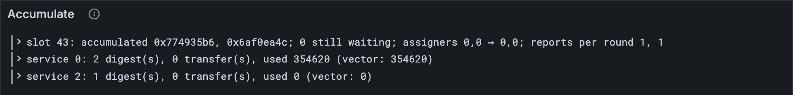

# The block's gas budget

Accumulation runs on gas, and a block has only so much of it. Until now your client ran
every report in round 1, as if the tank were bottomless. The Gray Paper gives the block a
budget: a round takes reports only while they fit, and the rest wait for the next round,
which gets whatever the last one didn't spend. By the end of this lesson your client keeps
that budget, and an official vector that depends on it passes: a service is ejected in
round 1 and created again in round 2.

## New words

- **Gas budget (g).** The gas a block's accumulation may use, all rounds together: the
  bigger of *G_T*, the block's own limit, and G_A for every core plus the
  always-accumulate services' gas. *Example:* on tiny, max(20M, 10M × 2 + 0) = 20M.
- **G_T.** The protocol's gas limit for a whole block's accumulation, `max_block_gas` in
  your config. *Example:* 20,000,000 on tiny, 3,500,000,000 on full.
- **Leftover budget (g\*).** The next round's budget: the last round's budget, plus the
  gas its new transfers carry, minus the gas it used. *Example:* 20M + 0 − 0.35M = 19.65M.

All three are in the [glossary](../glossary.md).

## What the Gray Paper says

§12, Δ+ in full, in plain steps:

1. **The budget.** g = max(G_T, G_A × C + the always-accumulate services' gas). G_A is
   the most gas one report may ask for ([lesson 12.5](../12-guarantees/05-bad-reports.md)), C the number of cores.
2. **A round takes what fits.** Count the transfers' gas and the always-accumulate gas
   first. Then take reports in order while their gas still fits in g: the longest such
   run of reports. The first that doesn't fit, and everything after it, waits.
3. **Stop when there's nothing to do**: no report fits, no transfers, no free gas.
4. **The next round's budget** is g\* = g + the new transfers' gas − the gas the round
   used.
5. **Only reports that ran count.** The history ξ′ and the queue ω′ learn of the reports
   that accumulated, not of any left over.

Why give every core a whole G_A? So a block can always fit one maximal report per core:
the budget is sized for the busiest block guarantees allow. Reports unlocked from the queue
can push past it, and then the rounds share the work out.

Here's the vector that needs it. Its two reports ask for 19,800,000 + 200,000 and 2,000,000
gas. (That first one is twice G_A, more than a guaranteed report may ask for: the vector
breaks the limit on purpose, to force a second round.) The first takes the whole 20M, so the second waits for round 2. And the order matters:
round 1 ejects service 2, round 2 creates a service 2 again. Squeezed into one round, both
would happen in the same run of service 0, which ends with *a* service 2 in its accounts,
just as the round began. [Lesson 17.7](./07-ejecting-a-service.md)'s merge looks at which ids are there, not at what they
hold, so the old service 2 would survive and the new one would be lost.

## A red you can read

Before the new vector, a fix to the test that checks whole blocks. Run this vector through
your client as it is, and `checkBlock` finds the accounts differ, as it should. Then
`assert.deepEqual` sets out to print the difference between two whole sets of accounts,
each holding its service's code: hundreds of thousands of bytes, compared line by line.
On a laptop that takes over a minute and a gigabyte of memory, and then the test runner
gives up without a word about what differed. A red you can't read is barely a red.

So `checkBlock` compares the accounts piece by piece: their info first, then storage,
requests and their preimages' hashes, each as a small map by service id. The code itself
is compared last, when everything else already agrees.

**Add to** `test/accumulate.test.ts`

```ts
/** Each account's `part`, by service id: small enough for a diff you can read. */
function each<T>(accounts: Map<number, Account>, part: (a: Account) => T): Map<number, T> {
  return new Map([...accounts].map(([s, a]) => [s, part(a)]));
}
```

**Replace in** `test/accumulate.test.ts`

```ts
/** Checks the whole block of test vector `name`: accounts, privileges, statistics, queue
 * and history. The accounts go piece by piece, their code last, so a red has a short diff. */
function checkBlock(name: string) {
  const vector = vectorJson(`stf/accumulate/tiny/${name}.json`) as BlockVector;
  const before: AccumulationState = accumulationStateFromJson(vector.pre_state);
  const { state, statistics } = accumulateBlock(TINY, before, vector.input.slot, reportsOf(vector));
  const expected: AccumulationState = accumulationStateFromJson(vector.post_state);
  const infos: Map<number, ServiceInfo> = each(state.accounts, (a) => a.info);
  const expectedInfos: Map<number, ServiceInfo> = each(expected.accounts, (a) => a.info);
  assert.deepEqual(infos, expectedInfos);
  const storage: Map<number, Map<string, Bytes>> = each(state.accounts, (a) => a.storage);
  const expectedStorage: Map<number, Map<string, Bytes>> =
    each(expected.accounts, (a) => a.storage);
  assert.deepEqual(storage, expectedStorage);
  const requests: Map<number, Map<string, number[]>> = each(state.accounts, (a) => a.requests);
  const expectedRequests: Map<number, Map<string, number[]>> =
    each(expected.accounts, (a) => a.requests);
  assert.deepEqual(requests, expectedRequests);
  const hashes = (a: Account) => [...a.preimages.keys()].sort(); // the preimages' hashes
  const preimages: Map<number, string[]> = each(state.accounts, hashes);
  const expectedPreimages: Map<number, string[]> = each(expected.accounts, hashes);
  assert.deepEqual(preimages, expectedPreimages);
  assert.deepEqual(state.accounts, expected.accounts); // all of it, the code included
  assert.deepEqual(state.privileges, expected.privileges);
  assert.deepEqual(state.ready, expected.ready);
  assert.deepEqual(state.accumulated, expected.accumulated);
  const stats = vector.post_state.statistics.map(({ id, record: r }) => {
    const gasUsed = BigInt(r.accumulate_gas_used);
    return [id, { count: r.accumulate_count, transfers: r.accumulate_transfer_count, gasUsed }];
  });
  assert.deepEqual(statistics, new Map(stats as [number, unknown][]));
}
```

`each` picks one part out of every account, keeping the ids, so a diff says which service
went wrong:

```ts
  const infos: Map<number, ServiceInfo> = each(state.accounts, (a) => a.info);
  const expectedInfos: Map<number, ServiceInfo> = each(expected.accounts, (a) => a.info);
  assert.deepEqual(infos, expectedInfos);
```

**Run**

```sh
npm test
```

Still green: the same checks, in a better order.

## The tests

One more official vector, and a test that names the rounds:

**Replace in** `test/accumulate.test.ts`

```ts
/** The vectors whose whole block needs nothing beyond this lesson. */
const BLOCK_CASES = [
  "accumulate_ready_queued_reports-1", "always_accumulate-1", "always_accumulate-2",
  "assign_from_non_assigner-1", "assign_from_non_assigner-2", "assign_from_non_assigner-3",
  "create_service-1", "enqueue_and_unlock_chain-1", "enqueue_and_unlock_chain-2",
  "enqueue_and_unlock_chain-3", "enqueue_and_unlock_chain-4", "enqueue_and_unlock_chain_wraps-1",
  "enqueue_and_unlock_chain_wraps-2", "enqueue_and_unlock_chain_wraps-3",
  "enqueue_and_unlock_chain_wraps-4", "enqueue_and_unlock_chain_wraps-5",
  "enqueue_and_unlock_simple-1", "enqueue_and_unlock_simple-2",
  "enqueue_and_unlock_with_sr_lookup-1", "enqueue_and_unlock_with_sr_lookup-2",
  "enqueue_self_referential-1", "enqueue_self_referential-2", "enqueue_self_referential-3",
  "enqueue_self_referential-4", "lookup_foreign_preimage-1", "lookup_foreign_preimage-2",
  "no_available_reports-1", "preimage_len_bound-1", "preimage_len_bound-2", "preimage_len_bound-3",
  "process_one_immediate_report-1", "queues_are_shifted-1", "queues_are_shifted-2",
  "ready_queue_editing-1", "ready_queue_editing-2", "ready_queue_editing-3",
  "recreate_ejected_service-1", "recreate_ejected_service_by_higher_registrar-1",
  "recreate_ejected_service_that_accumulates-1", "recreate_service_ejected_in_earlier_round-1",
  "same_code_different_services-1", "same_round_storage_isolation-1",
  "same_round_storage_isolation-2", "transfer_for_ejected_service-1",
  "transfer_for_ejected_service_that_accumulates_high_ejector-1",
  "transfer_for_ejected_service_that_accumulates_low_ejector-1", "transfer_for_live_service-1",
  "transfer_for_service_ejected_in_same_round_high_ejector-1",
  "transfer_for_service_ejected_in_same_round_low_ejector-1",
  "transfer_to_service_ejected_by_sender_eject_first-1",
  "transfer_to_service_ejected_by_sender_transfer_first-1", "work_for_ejected_service-1",
  "work_for_ejected_service-2", "work_for_service_ejected_in_same_round_high_ejector-1",
  "work_for_service_ejected_in_same_round_low_ejector-1",
];
```

**Add to** `test/accumulate.test.ts`

```ts
test("a block over budget: the second report waits a round, after the eject it needs", () => {
  const name = "stf/accumulate/tiny/recreate_service_ejected_in_earlier_round-1.json";
  const vector = vectorJson(name) as BlockVector;
  const before: AccumulationState = accumulationStateFromJson(vector.pre_state);
  const { state, rounds } = accumulateBlock(TINY, before, vector.input.slot, reportsOf(vector));
  assert.deepEqual(rounds, [1, 1]); // round 1 takes all 20M of the budget, so one report each
  const created: number = state.accounts.get(2)!.info.creation_slot; // was 0
  assert.equal(created, 43); // round 1 ejected service 2, round 2 made a new one
});
```

**Run, expect it to fail**

```sh
npm test
```

```text
...
✖ recreate_service_ejected_in_earlier_round-1: the block ends as the vector says (142.776875ms)
...
✖ a block over budget: the second report waits a round, after the eject it needs (121.250583ms)
...
ℹ tests 571
ℹ suites 0
ℹ pass 569
ℹ fail 2
...
✖ recreate_service_ejected_in_earlier_round-1: the block ends as the vector says (142.776875ms)
  AssertionError [ERR_ASSERTION]: Expected values to be strictly deep-equal:
  + actual - expected
...
  +     balance: 128714n,
  +     bytes: 127594n,
  -     balance: 1201n,
  -     bytes: 1081n,
...
✖ a block over budget: the second report waits a round, after the eject it needs (121.250583ms)
  AssertionError [ERR_ASSERTION]: Expected values to be strictly deep-equal:
  + actual - expected

  + undefined
  - [
  -   1,
  -   1
  - ]
...
```

Two reds, and both say why. The block's account 2 should be a newborn (1,201 balance, 1,081
bytes: just its code request), but yours is the old service 2, alive and well. And
`rounds` is `undefined`: `accumulateBlock` doesn't count rounds yet.

## The code

G_A is [lesson 12.5](../12-guarantees/05-bad-reports.md)'s limit, so the block reads it from there:

**Replace in** `src/guarantors.ts`

```ts
/** G_A: the most accumulation gas a report may ask for, all its digests together. */
export const REPORT_GAS = 10_000_000n;
```

**Replace in** `src/accumulate.ts`

```ts
import { REPORT_GAS } from "./guarantors.ts";

/**
 * A block's accumulation (GP §12): the reports that can go now (R!, then what they and
 * the history unlock from the queue: R*) accumulate in a first round, and the transfers
 * each round sends are delivered in the next, until a round sends none (Δ+). Every
 * service that did anything gets its statistics and its last-accumulation slot; the
 * history ξ moves on one slot, and the reports still waiting go back into the queue ω.
 * The privileges carry from round to round; the cores' new authorizer queues come back
 * beside the statistics. Each round takes as many reports as the block's gas budget
 * allows; `rounds` says how many it took.
 */
export function accumulateBlock(
  config: Config,
  state: AccumulationState,
  slot: number, // τ′
  reports: WorkReport[], // the reports that just became available
) {
  const E = config.epoch_length;
  const waits = (r: WorkReport) =>
    r.context.prerequisites.length > 0 || r.segment_root_lookup.length > 0;
  const dependencies = (r: WorkReport) => [
    ...r.context.prerequisites,
    ...r.segment_root_lookup.map((l) => l.work_package_hash),
  ];
  const history = new Set(state.accumulated.flatMap((x) => [...x])); // ξ∪
  const now = reports.filter((r) => !waits(r)); // R!
  const fresh = reports.filter(waits).map((r) => ({
    report: r,
    dependencies: new Set(dependencies(r).map(toHex)),
  }));
  const queued = edit(fresh, history); // R^Q
  const m = slot % E;
  const ring = [...state.ready.slice(m), ...state.ready.slice(0, m)].flat();
  const all = [...now, ...unlock(edit([...ring, ...queued], new Set(now.map(packageOf))))];

  const gasOf = (r: WorkReport) => sum(r.results.map((d) => d.accumulate_gas));
  const freeGas = sum([...state.free.values()]);
  const floor = REPORT_GAS * BigInt(config.core_count) + freeGas;
  let budget = config.max_block_gas > floor ? config.max_block_gas : floor; // g
  let accounts = state.accounts;
  let todo = all; // the reports still to accumulate,
  let free = state.free; // the always-accumulate services (first round only),
  let transfers: Transfer[] = []; // and the transfers to deliver
  let privileges = state.privileges;
  const done: WorkReport[] = []; // the reports that did accumulate
  const rounds: number[] = []; // how many reports each round took
  const queues = new Map<number, Bytes[]>(); // the cores' new authorizer queues, for ϕ′
  const used = new Map<number, bigint>(); // G: gas, over every round
  const received = new Map<number, number>(); // T: transfers delivered
  for (;;) {
    // as many of the reports as fit the budget, with the transfers and the free gas
    let spent = sum(transfers.map((t) => t.gas)) + sum([...free.values()]);
    let fit = 0;
    while (fit < todo.length && spent + gasOf(todo[fit]) <= budget) {
      spent += gasOf(todo[fit]);
      fit++;
    }
    if (fit + transfers.length + free.size === 0) break; // nothing to do: done
    for (const t of transfers) received.set(t.dest, (received.get(t.dest) ?? 0) + 1);
    const round = accumulateRound(
      config, accounts, free, state.entropy, slot, todo.slice(0, fit), transfers, privileges,
    );
    done.push(...todo.slice(0, fit));
    rounds.push(fit);
    for (const [s, gas] of round.used) used.set(s, (used.get(s) ?? 0n) + gas);
    for (const [c, queue] of round.queues) queues.set(c, queue);
    accounts = round.accounts;
    privileges = round.privileges;
    budget += sum(round.transfers.map((t) => t.gas)) - sum([...round.used.values()]); // g*
    todo = todo.slice(fit); // the rest wait for the next round, if any
    free = new Map();
    transfers = round.transfers;
  }
  const digests = done.flatMap((r) => r.results);
  const statistics = new Map<number, AccumulationStats>();
  for (const [s, gasUsed] of used) {
    const count = digests.filter((d) => d.service_id === s).length;
    const transfersIn = received.get(s) ?? 0;
    if (count === 0 && transfersIn === 0 && gasUsed === 0n) continue; // S(s) = (0, 0, 0)
    statistics.set(s, { count, transfers: transfersIn, gasUsed });
    const account = accounts.get(s);
    if (account) account.info.last_accumulation_slot = slot;
  }

  const finished = new Set(done.map(packageOf));
  const accumulated = [...state.accumulated.slice(1), finished]; // ξ′: newest last
  const ready: Waiting[][] = []; // ω′, slot by slot back from m
  for (let i = 0; i < E; i++) {
    const at = (m - i + E) % E;
    if (i === 0) ready[at] = edit(queued, finished); // this block's newcomers
    else if (i < slot - state.slot) ready[at] = []; // slots the chain skipped: emptied
    else ready[at] = edit(state.ready[at], finished);
  }
  const after = { ...state, slot, accounts, privileges, ready, accumulated };
  return { state: after, statistics, queues, rounds };
}
```

**Add to** `src/accumulate.ts`

```ts
/** The sum of some amounts of gas. */
const sum = (amounts: bigint[]) => amounts.reduce((n, x) => n + x, 0n);
```

The round loop again, with four changes. `fit` counts the reports the budget allows,
adding them up one at a time:

```ts
    while (fit < todo.length && spent + gasOf(todo[fit]) <= budget) {
      spent += gasOf(todo[fit]);
      fit++;
    }
```

The loop stops when a round would have nothing to do (step 3). `budget` becomes g\* after
each round (step 4). And `done` keeps the reports that actually ran, for the statistics,
the history and the queue (step 5); `rounds` counts how many each round took.

**Run**

```sh
npm test
npm run typecheck
```

```text
...
✔ recreate_service_ejected_in_earlier_round-1: the block ends as the vector says (146.705875ms)
...
✔ a block over budget: the second report waits a round, after the eject it needs (133.31825ms)
...
ℹ tests 571
ℹ suites 0
ℹ pass 571
ℹ fail 0
...
reported 571 tests to Grafana: http://127.0.0.1:3300/d/the-gray-tutor?var-client=you&var-run_id=test-1791769462885
...
```

## Watch it

`bin/accumulate.ts` shows the rounds now:

**Rewrite** `bin/accumulate.ts`

```ts
// Accumulates a test vector's block the way Part 17 does so far, and shows the queue (what
// waited, which packages went, what still waits) and the rounds it took; then each service
// next to the vector: the digests it accumulated, the transfers it received, its gas.
// Usage: node bin/accumulate.ts [vector], enqueue_and_unlock_simple-2 if not given

import { readFileSync } from "node:fs";
import { accumulateBlock, accumulationStateFromJson } from "../src/accumulate.ts";
import { TINY } from "../src/config.ts";
import { Run } from "../src/obs.ts";
import { WorkReport } from "../src/work.ts";

type Stat = {
  id: number;
  record: {
    accumulate_count: number;
    accumulate_transfer_count: number;
    accumulate_gas_used: number;
  };
};

const DEFAULT = "../vectors/stf/accumulate/tiny/enqueue_and_unlock_simple-2.json";
const vector = JSON.parse(readFileSync(process.argv[2] ?? DEFAULT, "utf8"));
const before = accumulationStateFromJson(vector.pre_state);
const reports = vector.input.reports.map((r: unknown) => WorkReport.fromJson(r));
const slot = vector.input.slot;
const { state, statistics, rounds } = accumulateBlock(TINY, before, slot, reports);

const run = new Run("accumulate");
const short = (hash: string) => hash.slice(0, 10);
const went = [...state.accumulated.at(-1)!].map(short);
console.log(`slot ${slot}: ${reports.length} new report(s), ${before.ready.flat().length} waiting`);
console.log(`accumulated: ${went.join(", ") || "nothing"}`);
console.log(`still waiting: ${state.ready.flat().length}`);
console.log(`rounds: ${rounds.length}, taking ${rounds.join(", then ")} report(s)`);
console.log(`assigners: ${before.privileges.assign} → ${state.privileges.assign}`);
run.event("block", {
  slot,
  went: went.join(", "),
  waiting: state.ready.flat().length,
  assigners: `${before.privileges.assign} → ${state.privileges.assign}`,
  rounds: rounds.join(", "),
});
for (const [s, { count, transfers, gasUsed }] of statistics) {
  const theirs = (vector.post_state.statistics as Stat[]).find((x) => x.id === s)?.record;
  console.log(`service ${s}: ${count} digest(s), ${transfers} transfer(s), ${gasUsed} gas`);
  const said = `${theirs?.accumulate_count} digest(s), ${theirs?.accumulate_transfer_count} ` +
    `transfer(s), ${theirs?.accumulate_gas_used} gas`;
  console.log(`  the vector says: ${said}`);
  const expected = theirs?.accumulate_gas_used;
  run.event("service", { s, count, transfers, used: Number(gasUsed), expected });
}
const link = await run.report();
if (link) console.log(`reported to Grafana: ${link}`);
```

**Run**

```sh
node bin/accumulate.ts ../vectors/stf/accumulate/tiny/recreate_service_ejected_in_earlier_round-1.json
```

```text
slot 43: 2 new report(s), 0 waiting
accumulated: 0x774935b6, 0x6af0ea4c
still waiting: 0
rounds: 2, taking 1, then 1 report(s)
assigners: 0,0 → 0,0
service 0: 2 digest(s), 0 transfer(s), 354620 gas
  the vector says: 2 digest(s), 0 transfer(s), 354620 gas
service 2: 1 digest(s), 0 transfer(s), 0 gas
  the vector says: 1 digest(s), 0 transfer(s), 0 gas
reported to Grafana: http://127.0.0.1:3300/d/the-gray-tutor?var-client=you&var-run_id=accumulate-1791769474334
```

Two rounds, one report each: the budget at work. [Lesson 17.4](./04-rounds.md)'s gift shows the other way
to a second round, `rounds: 2, taking 1, then 0 report(s)`, round 2 being for the transfer
alone. The *Accumulate* panel, on **7 · Accumulation and import**, has the rounds on the
block's line.



<details>
<summary>lasair: the budget, in <code>conformance/accumulate_stf.ml</code></summary>

```ocaml
  let g_top =
    let floor_ = gas_add_u64 (Int64.mul 10_000_000L
      (Int64.of_int (Stf_config.num_cores ()))) f_sum in
    if Int64.compare (Stf_config.block_acc_gas ()) floor_ > 0
    then (Stf_config.block_acc_gas ()) else floor_
  in
```

Your `floor` and `budget`, line for line: G_A (10,000,000) per core plus the free gas, or
G_T if that's bigger. Each round then takes `affordable_prefix ~g ~fixed`, the reports that
fit after the `fixed` gas of the transfers and the free services. The comment above it
records an old bug (lasair#87): the first round once left the free gas out of `fixed`,
and so took reports the Gray Paper defers. Your `spent` starts with it.

</details>

## Check your understanding

::: check
**On tiny, G_T is 20,000,000 and G_A is 10,000,000. If the always-accumulate services had 5,000,000 gas between them, what would the block's budget be?**

- [ ] 20,000,000: G_T is the block's limit
  > No: the budget is the bigger of two numbers, and here the other one is bigger:
  > 10M × 2 + 5M = 25M.
- [x] 25,000,000
  > Yes: max(20M, 10M × 2 cores + 5M) = 25M. Every core's G_A, and the free gas on top,
  > must fit.
- [ ] 45,000,000
  > No: the two are compared, not added. The budget is max(20M, 25M).

**Four reports can go, asking for 6M, 9M, 7M and 2M gas, in that order. The budget is 20M, with nothing else to pay for. What does round 1 take?**

- [ ] The 6M, 9M and 2M: they make 17M, so skip the 7M
  > No: a round never skips ahead. The first report that doesn't fit waits, and so
  > does everything after it, even the 2M that would fit.
- [ ] All four: the budget is checked once the block is done
  > No: it's checked before each round. All four make 24M, over the 20M.
- [x] The 6M and the 9M
  > Yes: 6 + 9 = 15M fits; 15 + 7 = 22M doesn't. So the 7M and the 2M wait for the
  > next round.

**Round 1 had a 20M budget, used 350,000 gas, and sent no transfers. Reports are left over. What is round 2's budget?**

- [ ] 20M again: each round gets the whole budget
  > No: the budget is for all the rounds together. What round 1 spent is gone.
- [x] 19,650,000
  > Yes: g\* = 20M + 0 (the new transfers' gas) − 0.35M (what round 1 used).
- [ ] 350,000: what round 1 used is what round 2 may use
  > No: it's the other way round. Round 2 gets what round 1 didn't use.

**`recreate_service_ejected_in_earlier_round-1` ends with a newborn service 2, created at slot 43. Why a new one, not the old?**

- [ ] Service 0 ejects and creates in one run, and the creation comes last
  > No: in one run the old service 2 would survive: the id is there before and after,
  > so the merge sees no change ([lesson 17.8](./08-creating-a-service.md)).
- [x] The eject ran in round 1, and the creation in round 2
  > Yes: round 1's merge removed service 2. Round 2 started without it, so its new
  > service 2 joined the accounts.
- [ ] A new service always replaces an old one with the same id
  > No: inside one round it's the other way, and the old one stays. Only a round
  > between the two makes the difference.
:::

## What you have

The block's gas budget: rounds take what fits, the rest wait, and leftover gas carries
over. Fifty-five official vectors pass as whole blocks. Each of the eight left needs a host call
your client doesn't answer yet, and the simplest is a service replacing its own code:
[lesson 17.10](./10-upgrading-a-service.md).

Next: [17.10 Upgrading a service](./10-upgrading-a-service.md)
