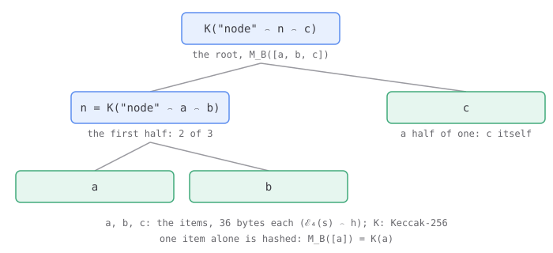
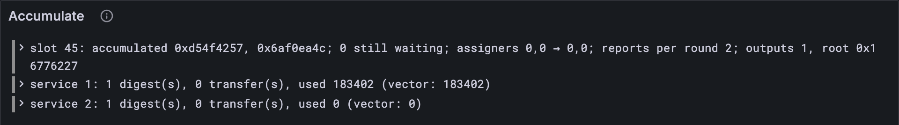

# What a service yields

JAM wants other chains to be able to check what happened on it, without running a JAM
client. So a service can end its run by handing the chain a hash, its *yield*: a 32-byte
summary of whatever it wants the outside world to trust. Every block gathers its
services' yields, sorts them, and commits to them with one Merkle root, built with
Keccak, the hash Ethereum uses. By the end of this lesson your client builds that root,
and checks it against every accumulate vector's output.

## New words

- **Yield.** The hash a run hands the chain as its accumulation output: set by the
  `yield` host call, or by halting with a 32-byte output. *Example:* service 1 yields
  `0xb8fe9f7f…` in `work_for_ejected_service-3`.
- **Accumulation outputs.** θ′. A block's yields, each with the service that yielded it,
  sorted by service, then by hash. *Example:* one output, (service 1, `0xb8fe…`).
- **Well-balanced Merkle root.** M_B. One hash for a list of items: split the list in
  half (the first half rounded up), take each half's root, and hash the two together
  with the word "node" in front. One item alone is simply hashed. *Example:* the root of
  two items a and b is Keccak("node" ⌢ a ⌢ b).

All three are in the [glossary](../glossary.md).

## What the Gray Paper says

`yield` is host call 26 (Appendix B.7, Ω_♉). It costs 98 gas, reads 32 bytes at φ₇
(unreadable: panic), and makes them the run's yield; φ₇ = `OK`. A second yield replaces
the first.

The yield is part of what a run leaves behind, so it collapses like the rest
([lesson 16.6](../16-host-calls/06-checkpoints.md)'s C), with one twist:

1. **A panic or out of gas:** the yield the last checkpoint kept.
2. **A halt whose output is 32 bytes:** that output is the yield, whatever `yield` said.
   A halt's output is the φ₈ bytes at φ₇, the machine's way to return a value.
3. **Any other halt:** the run's last yield, if any.

Then the block (§12 and §7):

1. **Each round** collects b, the pairs (service, its yield) of the runs that yielded.
2. **The block** gathers every round's pairs into one set: a pair counts once.
3. **θ′** is that set as a list. Each output is encoded as ℰ₄(s) ⌢ h, 36 bytes.
4. **The root** is M_B of those encodings, with Keccak. [Part 9](../09-recent-history/index.md)'s belt appends it, as
   `accumulate_root` ([lesson 9.2](../09-recent-history/02-recent-blocks.md)).

One honest note: the Gray Paper turns the set into a list without saying in which order,
and the order changes the root. The test vectors and lasair sort by service, then by hash,
and so does your client.



## The tests

First M_B, by hand:

**Add to** `test/belt.test.ts`

```ts
import { wellBalancedRoot } from "../src/belt.ts";
import { concatBytes } from "../src/bytes.ts";

test("M_B: nothing is zeros, one item its hash, two items joined under \"node\"", () => {
  const [a, b] = [Uint8Array.of(1), Uint8Array.of(2)];
  const none: Bytes = wellBalancedRoot([]);
  assert.deepEqual(none, new Uint8Array(32));
  const one: Bytes = wellBalancedRoot([a]);
  assert.deepEqual(one, keccak256(a));
  const two: Bytes = wellBalancedRoot([a, b]); // the items themselves, not their hashes
  assert.deepEqual(two, keccak256(concatBytes(new TextEncoder().encode("node"), a, b)));
});
```

Two items are joined as they are, not hashed first. That's why one item alone *is* hashed:
otherwise a single 36-byte output would be its own "root", and not a hash at all.

Then the call, and how a run's yield collapses:

**Add to** `test/host.test.ts`

```ts
import { yieldHash, collapseYield } from "../src/host.ts";

test("yield: a hash for the chain; a halt's 32-byte output takes its place", () => {
  const outbox: Outbox = { transfers: [], kept: [] };
  const machine: Machine = upgrading(); // φ₇ points at HASH, as yield wants
  const exit: HostExit = yieldHash(machine, outbox);
  assert.equal(exit, "continue");
  assert.equal(machine.registers[7], OK);
  const halted: Bytes | undefined = collapseYield(outbox, "halt");
  assert.deepEqual(halted, HASH);
  const output: Bytes = new Uint8Array(32).fill(1);
  const fromOutput: Bytes | undefined = collapseYield(outbox, "halt", output);
  assert.deepEqual(fromOutput, output);
  const panicked: Bytes | undefined = collapseYield(outbox, "panic"); // nothing checkpointed
  assert.equal(panicked, undefined);
});
```

`yield` is a word JavaScript keeps for itself, so the function is `yieldHash`.

Then the block: `checkBlock` learns to compare the root of the outputs with the vector's
`output`, the one part of every accumulate vector it hasn't checked so far.

**Replace in** `test/accumulate.test.ts`

```ts
import { outputsRoot } from "../src/accumulate.ts";

/** Checks the whole block of test vector `name`: accounts, privileges, statistics, queue
 * and history, and the root of its outputs. The accounts go piece by piece, their code
 * last, so a red has a short diff. */
function checkBlock(name: string) {
  const vector = vectorJson(`stf/accumulate/tiny/${name}.json`) as BlockVector;
  const before: AccumulationState = accumulationStateFromJson(vector.pre_state);
  const { state, statistics, outputs } =
    accumulateBlock(TINY, before, vector.input.slot, reportsOf(vector));
  const expected: AccumulationState = accumulationStateFromJson(vector.post_state);
  const root: string = toHex(outputsRoot(outputs)); // the vector's output: θ′'s root
  assert.equal(root, vector.output.ok);
  const infos: Map<number, ServiceInfo> = each(state.accounts, (a) => a.info);
  const expectedInfos: Map<number, ServiceInfo> = each(expected.accounts, (a) => a.info);
  assert.deepEqual(infos, expectedInfos);
  const storage: Map<number, Map<string, Bytes>> = each(state.accounts, (a) => a.storage);
  const expectedStorage: Map<number, Map<string, Bytes>> =
    each(expected.accounts, (a) => a.storage);
  assert.deepEqual(storage, expectedStorage);
  const requests: Map<number, Map<string, number[]>> = each(state.accounts, (a) => a.requests);
  const expectedRequests: Map<number, Map<string, number[]>> =
    each(expected.accounts, (a) => a.requests);
  assert.deepEqual(requests, expectedRequests);
  const hashes = (a: Account) => [...a.preimages.keys()].sort(); // the preimages' hashes
  const preimages: Map<number, string[]> = each(state.accounts, hashes);
  const expectedPreimages: Map<number, string[]> = each(expected.accounts, hashes);
  assert.deepEqual(preimages, expectedPreimages);
  assert.deepEqual(state.accounts, expected.accounts); // all of it, the code included
  assert.deepEqual(state.privileges, expected.privileges);
  assert.deepEqual(state.ready, expected.ready);
  assert.deepEqual(state.accumulated, expected.accumulated);
  const stats = vector.post_state.statistics.map(({ id, record: r }) => {
    const gasUsed = BigInt(r.accumulate_gas_used);
    return [id, { count: r.accumulate_count, transfers: r.accumulate_transfer_count, gasUsed }];
  });
  assert.deepEqual(statistics, new Map(stats as [number, unknown][]));
}
```

**Replace in** `test/accumulate.test.ts`

```ts
/** The vectors whose whole block needs nothing beyond this lesson. */
const BLOCK_CASES = [
  "accumulate_ready_queued_reports-1", "always_accumulate-1", "always_accumulate-2",
  "assign_from_non_assigner-1", "assign_from_non_assigner-2", "assign_from_non_assigner-3",
  "create_service-1", "enqueue_and_unlock_chain-1", "enqueue_and_unlock_chain-2",
  "enqueue_and_unlock_chain-3", "enqueue_and_unlock_chain-4", "enqueue_and_unlock_chain_wraps-1",
  "enqueue_and_unlock_chain_wraps-2", "enqueue_and_unlock_chain_wraps-3",
  "enqueue_and_unlock_chain_wraps-4", "enqueue_and_unlock_chain_wraps-5",
  "enqueue_and_unlock_simple-1", "enqueue_and_unlock_simple-2",
  "enqueue_and_unlock_with_sr_lookup-1", "enqueue_and_unlock_with_sr_lookup-2",
  "enqueue_self_referential-1", "enqueue_self_referential-2", "enqueue_self_referential-3",
  "enqueue_self_referential-4", "lookup_foreign_preimage-1", "lookup_foreign_preimage-2",
  "no_available_reports-1", "preimage_len_bound-1", "preimage_len_bound-2", "preimage_len_bound-3",
  "process_one_immediate_report-1", "queues_are_shifted-1", "queues_are_shifted-2",
  "ready_queue_editing-1", "ready_queue_editing-2", "ready_queue_editing-3",
  "recreate_ejected_service-1", "recreate_ejected_service_by_higher_registrar-1",
  "recreate_ejected_service_that_accumulates-1", "recreate_service_ejected_in_earlier_round-1",
  "same_code_different_services-1", "same_round_storage_isolation-1",
  "same_round_storage_isolation-2", "transfer_for_ejected_service-1",
  "transfer_for_ejected_service_that_accumulates_high_ejector-1",
  "transfer_for_ejected_service_that_accumulates_low_ejector-1", "transfer_for_live_service-1",
  "transfer_for_service_ejected_in_same_round_high_ejector-1",
  "transfer_for_service_ejected_in_same_round_low_ejector-1",
  "transfer_to_service_ejected_by_sender_eject_first-1",
  "transfer_to_service_ejected_by_sender_transfer_first-1", "upgrade_service-1",
  "work_for_ejected_service-1", "work_for_ejected_service-2", "work_for_ejected_service-3",
  "work_for_service_ejected_in_same_round_high_ejector-1",
  "work_for_service_ejected_in_same_round_low_ejector-1",
];
```

**Replace in** `test/accumulate.test.ts`

```ts
/** A whole accumulate test vector: the input, the state before and after. */
type BlockVector = {
  input: { slot: number; reports: unknown[] };
  output: { ok: string };
  pre_state: AccumulationStateJson;
  post_state: AccumulationStateJson & { statistics: Vector["post_state"]["statistics"] };
};
```

**Add to** `test/accumulate.test.ts`

```ts
import { AccumulationOutput } from "../src/accumulate.ts";
import { encode } from "../src/codec/codec.ts";
import { keccak256 } from "../src/hash.ts";

test("service 1 yields a hash: the block's one output, and its root", () => {
  const name = "stf/accumulate/tiny/work_for_ejected_service-3.json";
  const vector = vectorJson(name) as BlockVector;
  const before: AccumulationState = accumulationStateFromJson(vector.pre_state);
  const { outputs } = accumulateBlock(TINY, before, vector.input.slot, reportsOf(vector));
  const [output]: AccumulationOutput[] = outputs;
  assert.equal(outputs.length, 1);
  assert.equal(output.service, 1);
  const leaf: Bytes = encode(AccumulationOutput, output); // E₄(1) ⌢ h: 36 bytes
  const root: Bytes = outputsRoot(outputs); // one output: the root is its leaf's hash
  assert.deepEqual(root, keccak256(leaf));
});
```

## The code

M_B first, next to the belt it feeds:

**Add to** `src/belt.ts`

```ts
/** "$node" in the Gray Paper: the prefix of a Merkle tree's inner nodes. */
const NODE = new TextEncoder().encode("node");

/**
 * N (GP App. E): the node over `items`: none, the zero hash; one, the item itself; more,
 * the hash of "node" and the nodes over the first half (rounded up) and the rest.
 */
function node(items: Bytes[]): Bytes {
  if (items.length === 0) return new Uint8Array(32);
  if (items.length === 1) return items[0];
  const half = Math.ceil(items.length / 2);
  return keccak256(concatBytes(NODE, node(items.slice(0, half)), node(items.slice(half))));
}

/** M_B (GP App. E): the well-balanced Merkle root of `items`, with Keccak. A single item is
 * hashed, so the root is always a hash; more items are joined by N. */
export function wellBalancedRoot(items: Bytes[]): Bytes {
  return items.length === 1 ? keccak256(items[0]) : node(items);
}
```

The yield travels in the outbox, next to the transfers, and a checkpoint keeps it too:

**Replace in** `src/host.ts`

```ts
/** What an accumulation has sent (the GP's 𝐭 and y, in X and Y): every transfer so far,
 * and the ones the last checkpoint keeps if the run fails; the same for its yield. */
export type Outbox = {
  transfers: Transfer[];
  kept: Transfer[];
  yielded?: Bytes;
  keptYield?: Bytes;
};
```

**Replace in** `src/host.ts`

```ts
/** checkpoint (GP App. B.7, Ω_C): what the service has done so far is kept if it fails later. */
export function checkpoint(
  m: Machine,
  a: Accumulation,
  outbox: Outbox = { transfers: [], kept: [] },
  powers: Powers = startPowers(),
): HostExit {
  if (!charge(m, 103)) return "oog";
  a.checkpoint = copyAccounts(a.accounts); // Y′ = X
  outbox.kept = [...outbox.transfers]; // the transfers sent so far, too
  outbox.keptYield = outbox.yielded; // and the yield
  powers.kept = copyPrivileged(powers.now); // and the privileges
  m.registers[7] = m.gas;
  return "continue";
}
```

**Add to** `src/host.ts`

```ts
/**
 * yield (GP App. B.7, Ω_♉): the 32 bytes at φ₇ become this run's yield, the hash it hands
 * the chain as its accumulation output. A later yield replaces an earlier one. An
 * unreadable hash: panic.
 */
export function yieldHash(m: Machine, outbox: Outbox): HostExit {
  if (!charge(m, 98)) return "oog";
  const hash = readMemory(m.memory, m.registers[7], 32);
  if (!(hash instanceof Uint8Array)) return "panic"; // the hash isn't readable
  outbox.yielded = hash;
  return setTo(m, OK);
}

/**
 * C (GP App. B.4), for the yield: a halt whose output is 32 bytes yields that output; any
 * other halt, the run's last yield; a panic or running out of gas, the yield the last
 * checkpoint kept.
 */
export function collapseYield(outbox: Outbox, exit: Exit, output?: Bytes): Bytes | undefined {
  if (exit !== "halt") return outbox.keptYield;
  return output ?? outbox.yielded;
}
```

`accumulate` reads a halt's output and collapses the yield with everything else:

**Replace in** `src/host.ts`

```ts
/** What an accumulation leaves: how it ended, the accounts after it, the gas it used, the
 * transfers it sent, the privileges as it left them, and the hash it yielded, if any. */
export type Accumulated = {
  exit: Exit;
  accounts: Map<number, Account>;
  gasUsed: bigint;
  transfers: Transfer[];
  privileged: Privileged;
  yielded?: Bytes;
};
```

**Replace in** `src/host.ts`

```ts
/**
 * Ψ_A (GP App. B.4), so far: runs service a.id's accumulation at `slot` on `gas`, through
 * accumulation's host, and collapses what it did, the transfers it sent and the privileges
 * included. `watch`, if given, sees each host call.
 */
export function accumulate(
  config: Config,
  a: Accumulation,
  slot: number,
  gas: bigint,
  watch?: (call: number, m: Machine) => void,
): Accumulated {
  const [t, s, n] = [slot, a.id, a.inputs.length].map((x) => encodeNatural(BigInt(x)));
  const { memory, registers } = standardProgram(a.code, concatBytes(t, s, n)); // Ψ_M's Y
  const machine = newMachine(deblob(a.code.program), registers, memory, gas);
  machine.pc = 5; // accumulation's way in
  const outbox: Outbox = { transfers: [], kept: [] }; // every run starts with none sent
  const powers = startPowers(a.privileges);
  const host = accumulateHost(config, a, slot, outbox, powers);
  const exit = runWithHost(machine, (call, m) => {
    const answer = host(call, m);
    watch?.(call, m);
    return answer;
  });
  const gasUsed = gas - (machine.gas > 0n ? machine.gas : 0n); // u = g − max(ϱ′, 0)
  const accounts = collapse(a, exit);
  const transfers = collapseTransfers(outbox, exit);
  const [o, length] = machine.registers.slice(7, 9); // a halt's output: `length` bytes at o
  const output = exit === "halt" && length === 32n ? readMemory(machine.memory, o, 32) : null;
  const yielded = collapseYield(outbox, exit, output instanceof Uint8Array ? output : undefined);
  const privileged = collapsePowers(powers, exit);
  return { exit, accounts, gasUsed, transfers, privileged, yielded };
}
```

```ts
  const [o, length] = machine.registers.slice(7, 9); // a halt's output: `length` bytes at o
  const output = exit === "halt" && length === 32n ? readMemory(machine.memory, o, 32) : null;
```

Only a 32-byte output can be a yield, so `accumulate` reads one only then.

**Replace in** `src/host.ts`

```ts
/**
 * F (GP App. B.4): the host for a service's accumulation. So far it answers gas, grow_heap,
 * fetch (whose items are the constants, 0; the entropy, 1; and the inputs, all of them, 14,
 * or one, 15), info, lookup, read, write, checkpoint, query, solicit and forget, the last
 * two at `slot`, the time of the block; transfer, into `outbox`; assign, with `powers`;
 * eject; new; upgrade; and yield, into `outbox` too. Anything else: WHAT.
 */
export function accumulateHost(
  config: Config,
  a: Accumulation,
  slot: number,
  outbox: Outbox = { transfers: [], kept: [] },
  powers: Powers = startPowers(),
): Host {
  const ids = newIds(a.id, a.entropy, slot, new Set(a.accounts.keys())); // for `new`
  const items: Items = (kind, index) => {
    if (kind === 0) return protocolConstants(config);
    if (kind === 1) return a.entropy;
    if (kind === 14) return concatBytes(encodeNatural(BigInt(a.inputs.length)), ...a.inputs);
    if (kind === 15 && index < BigInt(a.inputs.length)) return a.inputs[Number(index)];
    return undefined;
  };
  return (call, m) => {
    switch (HOST_CALLS[call]) {
      case "gas":
        return gas(m);
      case "grow_heap":
        return growHeap(m, a.code);
      case "fetch":
        return fetch(m, items);
      case "info":
        return info(m, a.accounts, a.id);
      case "lookup":
        return lookup(m, a.accounts, a.id);
      case "read":
        return read(m, a.accounts, a.id);
      case "write":
        return write(m, a.accounts, a.id);
      case "checkpoint":
        return checkpoint(m, a, outbox, powers);
      case "query":
        return query(m, a);
      case "solicit":
        return solicit(m, a, slot);
      case "forget":
        return forget(m, a, slot, config.expunge_period);
      case "transfer":
        return transfer(m, a, outbox);
      case "assign":
        return assign(m, a.id, powers, config.core_count);
      case "eject":
        return eject(m, a, slot, config.expunge_period);
      case "new":
        return newService(m, a, slot, ids, powers.now.privileges);
      case "upgrade":
        return upgrade(m, a);
      case "yield":
        return yieldHash(m, outbox);
      default:
        return unknown(m);
    }
  };
}
```

The round collects its outputs, and the block gathers, sorts and roots them:

**Add to** `src/accumulate.ts`

```ts
import { u32 } from "./codec/codec.ts";
import type { Value } from "./codec/codec.ts";
import { wellBalancedRoot } from "./belt.ts";

/** An accumulation output (GP §12, a pair in b): service `service` yielded `hash`. */
export const AccumulationOutput = record({ service: u32, hash });
export type AccumulationOutput = Value<typeof AccumulationOutput>;

/** Whether two outputs are the same pair: b is a set, so a pair counts once. */
const sameOutput = (x: AccumulationOutput, y: AccumulationOutput) =>
  x.service === y.service && toHex(x.hash) === toHex(y.hash);

/**
 * The root of a block's accumulation outputs (GP §7): each output encoded, E₄(s) ⌢ h,
 * then the well-balanced Merkle root of them all, with Keccak. It joins the belt (Part 9).
 */
export function outputsRoot(outputs: AccumulationOutput[]): Bytes {
  return wellBalancedRoot(outputs.map((o) => encode(AccumulationOutput, o)));
}
```

**Replace in** `src/accumulate.ts`

```ts
/**
 * Δ* (GP §12), one round: every service with work in `reports`, every always-accumulate
 * service, and every service a transfer is sent to, runs once from the same accounts and
 * keeps its own account as its run leaves it. The transfers' money arrives before its code
 * runs, even if it has none. Every run starts from the same privileges too, and they are
 * merged after the round. Returns the accounts after the round, the gas each service used,
 * the transfers they sent (service by service in order of id), the privileges after the
 * round, and the cores' new authorizer queues.
 */
export function accumulateRound(
  config: Config,
  accounts: Map<number, Account>,
  free: Map<number, bigint>, // χ_Z: the services that accumulate every block, and their gas
  entropy: Bytes,
  slot: number,
  reports: WorkReport[],
  transfers: Transfer[], // the transfers sent in the round before
  privileges = NO_PRIVILEGES, // χ as the round starts
) {
  const digests = reports.flatMap((r) => r.results);
  const ids = [...free.keys(), ...digests.map((d) => d.service_id)];
  const services = [...new Set([...ids, ...transfers.map((t) => t.dest)])].sort((x, y) => x - y);
  const after = copyAccounts(accounts);
  const used = new Map<number, bigint>();
  const sent: Transfer[] = [];
  const powers = new Map<number, Privileged>(); // each run's privileges, as it left them
  const removed = new Set<number>(); // accounts some run ejected
  const outputs: AccumulationOutput[] = []; // b: what each run yielded
  for (const s of services) {
    const mine = copyAccounts(accounts); // every service starts from the same accounts
    const account = mine.get(s);
    const money = transfers.filter((t) => t.dest === s).reduce((n, t) => n + t.amount, 0n);
    if (account) account.info = { ...account.info, balance: account.info.balance + money };
    const code = account && codeOf(account);
    if (!code) {
      if (account) after.set(s, account); // no code to run: it keeps the money, that's all
      used.set(s, 0n);
      continue;
    }
    const { inputs, gas } = serviceInputs(reports, s, free.get(s) ?? 0n, transfers);
    const checkpoint = copyAccounts(mine);
    const a = { id: s, accounts: mine, checkpoint, code, entropy, inputs, privileges };
    const result = accumulate(config, a, slot, gas);
    const left = result.accounts; // the accounts as this run left them
    after.set(s, left.get(s)!);
    for (const [id, account] of left) if (!accounts.has(id)) after.set(id, account); // new
    for (const id of accounts.keys()) if (!left.has(id)) removed.add(id); // ejected
    used.set(s, result.gasUsed);
    sent.push(...result.transfers);
    powers.set(s, result.privileged);
    if (result.yielded) outputs.push({ service: s, hash: result.yielded });
  }
  for (const id of removed) after.delete(id); // a removal wins over any run's own copy
  const { privileges: next, queues } = mergePrivileges(privileges, powers);
  return { accounts: after, used, transfers: sent, privileges: next, queues, outputs };
}
```

**Replace in** `src/accumulate.ts`

```ts
/**
 * A block's accumulation (GP §12): the reports that can go now (R!, then what they and
 * the history unlock from the queue: R*) accumulate in a first round, and the transfers
 * each round sends are delivered in the next, until a round sends none (Δ+). Every
 * service that did anything gets its statistics and its last-accumulation slot; the
 * history ξ moves on one slot, and the reports still waiting go back into the queue ω.
 * The privileges carry from round to round; the cores' new authorizer queues come back
 * beside the statistics. Each round takes as many reports as the block's gas budget
 * allows; `rounds` says how many it took. `outputs` are the hashes services yielded, θ′.
 */
export function accumulateBlock(
  config: Config,
  state: AccumulationState,
  slot: number, // τ′
  reports: WorkReport[], // the reports that just became available
) {
  const E = config.epoch_length;
  const waits = (r: WorkReport) =>
    r.context.prerequisites.length > 0 || r.segment_root_lookup.length > 0;
  const dependencies = (r: WorkReport) => [
    ...r.context.prerequisites,
    ...r.segment_root_lookup.map((l) => l.work_package_hash),
  ];
  const history = new Set(state.accumulated.flatMap((x) => [...x])); // ξ∪
  const now = reports.filter((r) => !waits(r)); // R!
  const fresh = reports.filter(waits).map((r) => ({
    report: r,
    dependencies: new Set(dependencies(r).map(toHex)),
  }));
  const queued = edit(fresh, history); // R^Q
  const m = slot % E;
  const ring = [...state.ready.slice(m), ...state.ready.slice(0, m)].flat();
  const all = [...now, ...unlock(edit([...ring, ...queued], new Set(now.map(packageOf))))];

  const gasOf = (r: WorkReport) => sum(r.results.map((d) => d.accumulate_gas));
  const freeGas = sum([...state.free.values()]);
  const floor = REPORT_GAS * BigInt(config.core_count) + freeGas;
  let budget = config.max_block_gas > floor ? config.max_block_gas : floor; // g
  let accounts = state.accounts;
  let todo = all; // the reports still to accumulate,
  let free = state.free; // the always-accumulate services (first round only),
  let transfers: Transfer[] = []; // and the transfers to deliver
  let privileges = state.privileges;
  const done: WorkReport[] = []; // the reports that did accumulate
  const rounds: number[] = []; // how many reports each round took
  const outputs: AccumulationOutput[] = []; // b, over every round: θ′
  const queues = new Map<number, Bytes[]>(); // the cores' new authorizer queues, for ϕ′
  const used = new Map<number, bigint>(); // G: gas, over every round
  const received = new Map<number, number>(); // T: transfers delivered
  for (;;) {
    // as many of the reports as fit the budget, with the transfers and the free gas
    let spent = sum(transfers.map((t) => t.gas)) + sum([...free.values()]);
    let fit = 0;
    while (fit < todo.length && spent + gasOf(todo[fit]) <= budget) {
      spent += gasOf(todo[fit]);
      fit++;
    }
    if (fit + transfers.length + free.size === 0) break; // nothing to do: done
    for (const t of transfers) received.set(t.dest, (received.get(t.dest) ?? 0) + 1);
    const round = accumulateRound(
      config, accounts, free, state.entropy, slot, todo.slice(0, fit), transfers, privileges,
    );
    done.push(...todo.slice(0, fit));
    rounds.push(fit);
    for (const [s, gas] of round.used) used.set(s, (used.get(s) ?? 0n) + gas);
    for (const [c, queue] of round.queues) queues.set(c, queue);
    for (const o of round.outputs) if (!outputs.some((x) => sameOutput(x, o))) outputs.push(o);
    accounts = round.accounts;
    privileges = round.privileges;
    budget += sum(round.transfers.map((t) => t.gas)) - sum([...round.used.values()]); // g*
    todo = todo.slice(fit); // the rest wait for the next round, if any
    free = new Map();
    transfers = round.transfers;
  }
  const digests = done.flatMap((r) => r.results);
  const statistics = new Map<number, AccumulationStats>();
  for (const [s, gasUsed] of used) {
    const count = digests.filter((d) => d.service_id === s).length;
    const transfersIn = received.get(s) ?? 0;
    if (count === 0 && transfersIn === 0 && gasUsed === 0n) continue; // S(s) = (0, 0, 0)
    statistics.set(s, { count, transfers: transfersIn, gasUsed });
    const account = accounts.get(s);
    if (account) account.info.last_accumulation_slot = slot;
  }

  const finished = new Set(done.map(packageOf));
  const accumulated = [...state.accumulated.slice(1), finished]; // ξ′: newest last
  const ready: Waiting[][] = []; // ω′, slot by slot back from m
  for (let i = 0; i < E; i++) {
    const at = (m - i + E) % E;
    if (i === 0) ready[at] = edit(queued, finished); // this block's newcomers
    else if (i < slot - state.slot) ready[at] = []; // slots the chain skipped: emptied
    else ready[at] = edit(state.ready[at], finished);
  }
  const after = { ...state, slot, accounts, privileges, ready, accumulated };
  outputs.sort((x, y) => x.service - y.service || (toHex(x.hash) < toHex(y.hash) ? -1 : 1));
  return { state: after, statistics, queues, rounds, outputs };
}
```

Two new lines in the round loop and two at the end:

```ts
    for (const o of round.outputs) if (!outputs.some((x) => sameOutput(x, o))) outputs.push(o);
```

```ts
  outputs.sort((x, y) => x.service - y.service || (toHex(x.hash) < toHex(y.hash) ? -1 : 1));
```

Hashes in hex sort the same way as their bytes, so comparing the strings is enough.

**Run**

```sh
npm test
npm run typecheck
```

```text
...
✔ work_for_ejected_service-3: the block ends as the vector says (71.527416ms)
...
✔ service 1 yields a hash: the block's one output, and its root (76.5645ms)
...
✔ M_B: nothing is zeros, one item its hash, two items joined under "node" (0.446959ms)
...
✔ yield: a hash for the chain; a halt's 32-byte output takes its place (0.248916ms)
...
ℹ tests 577
ℹ suites 0
ℹ pass 577
ℹ fail 0
...
reported 577 tests to Grafana: http://127.0.0.1:3300/d/gray-tutorial?var-client=you&var-run_id=test-1791769507532
...
```

Every block vector's output root matches, the 56 that passed before (all zeros: nobody
yielded) and the new one.

## Watch it

**Rewrite** `bin/accumulate.ts`

```ts
// Accumulates a test vector's block the way Part 17 does so far, and shows the queue (what
// waited, which packages went, what still waits), the rounds it took and the outputs and
// their root; then each service next to the vector: its digests, transfers in, and gas.
// Usage: node bin/accumulate.ts [vector], enqueue_and_unlock_simple-2 if not given

import { readFileSync } from "node:fs";
import { accumulateBlock, accumulationStateFromJson, outputsRoot } from "../src/accumulate.ts";
import { toHex } from "../src/bytes.ts";
import { TINY } from "../src/config.ts";
import { Run } from "../src/obs.ts";
import { WorkReport } from "../src/work.ts";

type Stat = {
  id: number;
  record: {
    accumulate_count: number;
    accumulate_transfer_count: number;
    accumulate_gas_used: number;
  };
};

const DEFAULT = "../vectors/stf/accumulate/tiny/enqueue_and_unlock_simple-2.json";
const vector = JSON.parse(readFileSync(process.argv[2] ?? DEFAULT, "utf8"));
const before = accumulationStateFromJson(vector.pre_state);
const reports = vector.input.reports.map((r: unknown) => WorkReport.fromJson(r));
const slot = vector.input.slot;
const { state, statistics, rounds, outputs } = accumulateBlock(TINY, before, slot, reports);

const run = new Run("accumulate");
const short = (hash: string) => hash.slice(0, 10);
const went = [...state.accumulated.at(-1)!].map(short);
console.log(`slot ${slot}: ${reports.length} new report(s), ${before.ready.flat().length} waiting`);
console.log(`accumulated: ${went.join(", ") || "nothing"}`);
console.log(`still waiting: ${state.ready.flat().length}`);
console.log(`rounds: ${rounds.length}, taking ${rounds.join(", then ")} report(s)`);
console.log(`assigners: ${before.privileges.assign} → ${state.privileges.assign}`);
const yields = outputs.map((o) => `service ${o.service} yielded ${short(toHex(o.hash))}`);
const root = short(toHex(outputsRoot(outputs)));
const theirs = short(vector.output.ok); // the root the vector expects
console.log(`outputs: ${yields.join(", ") || "none"}; root ${root} (vector: ${theirs})`);
run.event("block", {
  slot,
  went: went.join(", "),
  waiting: state.ready.flat().length,
  assigners: `${before.privileges.assign} → ${state.privileges.assign}`,
  rounds: rounds.join(", "),
  outputs: outputs.length,
  root,
});
for (const [s, { count, transfers, gasUsed }] of statistics) {
  const theirs = (vector.post_state.statistics as Stat[]).find((x) => x.id === s)?.record;
  console.log(`service ${s}: ${count} digest(s), ${transfers} transfer(s), ${gasUsed} gas`);
  const said = `${theirs?.accumulate_count} digest(s), ${theirs?.accumulate_transfer_count} ` +
    `transfer(s), ${theirs?.accumulate_gas_used} gas`;
  console.log(`  the vector says: ${said}`);
  const expected = theirs?.accumulate_gas_used;
  run.event("service", { s, count, transfers, used: Number(gasUsed), expected });
}
const link = await run.report();
if (link) console.log(`reported to Grafana: ${link}`);
```

**Run**

```sh
node bin/accumulate.ts ../vectors/stf/accumulate/tiny/work_for_ejected_service-3.json
```

```text
slot 45: 1 new report(s), 1 waiting
accumulated: 0xd54f4257, 0x6af0ea4c
still waiting: 0
rounds: 1, taking 2 report(s)
assigners: 0,0 → 0,0
outputs: service 1 yielded 0xb8fe9f7f; root 0x16776227 (vector: 0x16776227)
service 1: 1 digest(s), 0 transfer(s), 183402 gas
  the vector says: 1 digest(s), 0 transfer(s), 183402 gas
service 2: 1 digest(s), 0 transfer(s), 0 gas
  the vector says: 1 digest(s), 0 transfer(s), 0 gas
reported to Grafana: http://127.0.0.1:3300/d/gray-tutorial?var-client=you&var-run_id=accumulate-1791769522327
```

Service 1 yields; the root is the vector's. The *Accumulate* panel, on **7 · Accumulation
and import**, shows the outputs and the root on the block's line.



<details>
<summary>lasair: M_B, in <code>conformance/stf_transitions.ml</code></summary>

```ocaml
        let rec node v = match v with
          | [] -> Bytes.make 32 '\x00'
          | [x] -> x
          | _ ->
            let half = (List.length v + 1) / 2 in
            let rec split i acc = function
              | x :: rest when i < half -> split (i + 1) (x :: acc) rest
              | rest -> (List.rev acc, rest)
            in
            let (l, r) = split 0 [] v in
            keccak (Bytes.concat Bytes.empty
              [Bytes.of_string "node"; node l; node r])
        in
        match leaves with
        | [] -> Bytes.make 32 '\x00'
        | [x] -> keccak x
        | v -> node v
```

Your `node` and `wellBalancedRoot`, case for case. `(List.length v + 1) / 2` is the half
rounded up, as your `Math.ceil` is, and the last three lines are M_B: zeros for nothing,
one item hashed, more joined by `node`. lasair reads the leaves back from θ′ in the state,
where a comment in `conformance/stf_guarantees.ml` records why they're sorted by service,
then hash: a service that accumulates in two rounds can yield twice, so a tie on the
service must break on the hash.

</details>

## What you have

Yields, collapsed like everything else a run leaves, gathered per block, sorted, and
committed to with a Keccak Merkle root that matches every accumulate vector's output.
Fifty-seven official vectors pass as whole blocks. Services can hand things to each other
too, not only money: [lesson 17.12](./12-providing-a-preimage.md) delivers a preimage a service asked for.

Next: [17.12 Providing a preimage](./12-providing-a-preimage.md)
