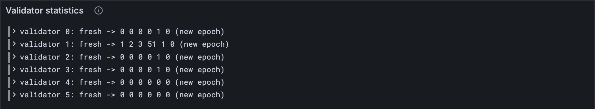

# Who did what

Validators do the chain's work: they make blocks, vouch for work-reports, and confirm they
hold their share of the data. JAM doesn't pay them itself; it keeps a tally of who did
what, so that whoever pays (Polkadot's staking system, in the Gray Paper's picture) can see
who earned it. This lesson keeps that tally, and checks it against every statistics test
vector, tiny and full.

## New words

- **Validator statistics.** A tally of each validator's work: blocks made, tickets and
  preimages put into blocks (and the preimages' bytes), reports guaranteed, assurances
  made. *Example:* validator 1: 1 block, 2 tickets, 3 preimages of 51 bytes, 1 guarantee,
  0 assurances.
- **Author.** The validator that made a block; the header names it by its index.
  *Example:* `author_index: 1`.
- **Reporters.** Every validator who signed a guarantee in a block, each counted once.
  *Example:* two guarantees, signed by validators 0 and 1 and by 2 and 3: four reporters.

All three are in the [glossary](../glossary.md).

## What the Gray Paper says

§13, *Validator Activity*. The chain keeps two tallies: one for the epoch in progress,
and the finished one from the epoch before. Each block moves them on, in this order:

1. **Assurances count first.** Every validator who made an assurance in the block gets one
   more. They count towards the epoch the block's parent was in.
2. **A new epoch turns the page.** If this block is the first of a new epoch, the tally in
   progress becomes "the last epoch's", and a fresh one, all zeros, begins. The old "last
   epoch's" is forgotten.
3. **Then the rest.** The author gets one more block, plus as many tickets and preimages
   (and preimage bytes) as the block carries. Every reporter gets one more guarantee.

Why track only these? They're the work the chain can see for itself. Other work, such as
voting on finality or auditing, happens off the chain, and the Gray Paper leaves it out.

The Gray Paper's names: the tally in progress is **π_V** (its "accumulator"), the last
epoch's **π_L**. The six fields are **b, t, p, d, g, a**. The author is **H_I**, the
reporters **𝐆** (lesson 12.2's set), and "a new epoch" means ⌊τ′/E⌋ ≠ ⌊τ/E⌋.

## The tests

**New file** `test/statistics.test.ts`

```ts
import { test } from "node:test";
import assert from "node:assert/strict";
import { Extrinsic } from "../src/block.ts";
import type { Config } from "../src/config.ts";
import { FULL, TINY } from "../src/config.ts";
import { ValidatorKey } from "../src/state.ts";
import { updateValidatorStats, ValidatorStats } from "../src/statistics.ts";
import { vectorFiles, vectorJson } from "./vectors.ts";

/** A statistics test vector: one block's slot, author and extrinsic; the tallies around it. */
type StatsVector = {
  input: { slot: number; author_index: number; extrinsic: unknown };
  pre_state: {
    slot: number;
    curr_validators: unknown[];
    vals_curr_stats: unknown[];
    vals_last_stats: unknown[];
  };
  post_state: { vals_curr_stats: unknown[]; vals_last_stats: unknown[] };
};

/** One block of statistics vector `name`: the tallies your code gives, and the vector's. */
function runStats(config: Config, name: string) {
  const v = vectorJson(name) as StatsVector;
  const tallies = (json: unknown[]) => json.map((s) => ValidatorStats.fromJson(s));
  const pre = v.pre_state;
  const before = {
    slot: pre.slot,
    current: tallies(pre.vals_curr_stats),
    last: tallies(pre.vals_last_stats),
  };
  const validators = pre.curr_validators.map((k) => ValidatorKey.fromJson(k));
  const extrinsic = Extrinsic(config).fromJson(v.input.extrinsic);
  const author = v.input.author_index;
  const after = updateValidatorStats(config, before, v.input.slot, author, extrinsic, validators);
  const post = v.post_state;
  const expected = { current: tallies(post.vals_curr_stats), last: tallies(post.vals_last_stats) };
  return { before, after, expected };
}

test("an empty block: its author makes one more block, and that's all", () => {
  const { before, after } = runStats(TINY, "stf/statistics/tiny/stats_with_empty_extrinsic-1.json");
  assert.equal(after.current[1].blocks, before.current[1].blocks + 1); // validator 1 made it
  assert.deepEqual(after.current[0], before.current[0]); // validator 0 did nothing
});

test("an epoch's first block: assurances close the old tally, the rest opens the new one", () => {
  const name = "stf/statistics/tiny/stats_with_epoch_change-1.json";
  const { before, after } = runStats(TINY, name);
  assert.equal(after.last[0].assurances, before.current[0].assurances + 1); // into the old one
  assert.deepEqual([after.current[0].blocks, after.current[0].assurances], [0, 0]); // fresh
  assert.equal(after.current[1].blocks, 1); // the author's block starts the fresh tally
});

for (const config of [TINY, FULL]) {
  for (const name of vectorFiles(`stf/statistics/${config.name}`)) {
    test(`${name}: every validator's tallies end as the vector says`, () => {
      const { after, expected } = runStats(config, name);
      assert.deepEqual(after, expected);
    });
  }
}
```

The epoch-change test pins down the one surprise in the order: the block's assurances end up
in the *old* tally, while its author's block opens the new one.

**Run, expect it to fail**

```sh
npm test
# fails with: Cannot find module
```

## The code

**New file** `src/statistics.ts`

```ts
// Statistics (GP §13): who did what. The chain keeps a tally of each validator's work, for
// this epoch and the last, so that whoever pays validators knows who earned it.

import type { Extrinsic } from "./block.ts";
import { toHex } from "./bytes.ts";
import type { Value } from "./codec/codec.ts";
import { record, u32 } from "./codec/codec.ts";
import type { Config } from "./config.ts";
import { reporters, signerKeys } from "./guarantors.ts";
import type { ValidatorKey } from "./state.ts";

/** One validator's tally for one epoch (GP §13), under the test vectors' names. */
export const ValidatorStats = record({
  blocks: u32, // b: blocks it made
  tickets: u32, // t: tickets it put in its blocks
  pre_images: u32, // p: preimages it put in its blocks
  pre_images_size: u32, // d: their bytes, all together
  guarantees: u32, // g: reports it guaranteed
  assurances: u32, // a: availability assurances it made
});
export type ValidatorStats = Value<typeof ValidatorStats>;

/** A tally with nothing in it yet. */
const fresh = (): ValidatorStats => ({
  blocks: 0, tickets: 0, pre_images: 0, pre_images_size: 0, guarantees: 0, assurances: 0,
});

/**
 * π_V and π_L, one block on (GP §13). First the block's assurances count, in the epoch they
 * were made in. Then, if the block starts a new epoch, this epoch's tally becomes the last
 * one and a fresh one begins. Then the author gets its block, tickets and preimages, and
 * every validator who signed a guarantee gets one guarantee. `validators` is κ′.
 */
export function updateValidatorStats(
  config: Config,
  before: { slot: number; current: ValidatorStats[]; last: ValidatorStats[] },
  slot: number, // τ′
  author: number, // the header's author index
  extrinsic: Extrinsic,
  validators: ValidatorKey[],
) {
  let current = before.current.map((s) => ({ ...s }));
  let last = before.last;
  for (const a of extrinsic.assurances) current[a.validator_index].assurances += 1;
  const epoch = (t: number) => Math.floor(t / config.epoch_length);
  if (epoch(slot) !== epoch(before.slot)) {
    last = current;
    current = validators.map(fresh);
  }
  const mine = current[author];
  mine.blocks += 1;
  mine.tickets += extrinsic.tickets.length;
  mine.pre_images += extrinsic.preimages.length;
  mine.pre_images_size += extrinsic.preimages.reduce((n, p) => n + p.blob.length, 0);
  const signers = extrinsic.guarantees.flatMap((g) => signerKeys(g, validators));
  const signed = new Set(reporters(signers).map(toHex)); // 𝐆, once each
  validators.forEach((key, v) => {
    if (signed.has(toHex(key.ed25519))) current[v].guarantees += 1;
  });
  return { current, last };
}
```

The three steps, in order. Note the copy at the top: `before`'s tallies stay as they were,
so a test can still compare with them. `reporters` and `signerKeys` come from lesson 12.2.

**Run**

```sh
npm test
# prints: an epoch's first block: assurances close the old tally, the rest opens the new one
# prints: fail 0
# prints: reported
npm run typecheck
```

Eight official vectors, tiny and full: every validator's tallies, before and after.

## Watch it

**New file** `bin/statistics.ts`

```ts
// Moves the validators' tallies on by one block, as a statistics test vector sets it up,
// and shows what changed for whom.
// Usage: node bin/statistics.ts [vector], stats_with_epoch_change-1 (tiny) if not given

import { readFileSync } from "node:fs";
import { Extrinsic } from "../src/block.ts";
import { FULL, TINY } from "../src/config.ts";
import { Run } from "../src/obs.ts";
import { ValidatorKey } from "../src/state.ts";
import type { ValidatorStats } from "../src/statistics.ts";
import { updateValidatorStats } from "../src/statistics.ts";

const DEFAULT = "../vectors/stf/statistics/tiny/stats_with_epoch_change-1.json";
const file = process.argv[2] ?? DEFAULT;
const config = file.includes("/full/") ? FULL : TINY;
const v = JSON.parse(readFileSync(file, "utf8"));
const pre = v.pre_state;
const before = { slot: pre.slot, current: pre.vals_curr_stats, last: pre.vals_last_stats };
const validators = pre.curr_validators.map((k: unknown) => ValidatorKey.fromJson(k));
const extrinsic = Extrinsic(config).fromJson(v.input.extrinsic);
const after = updateValidatorStats(config, before, v.input.slot, v.input.author_index, extrinsic,
  validators);

const run = new Run("statistics");
const epoch = (t: number) => Math.floor(t / config.epoch_length);
const turned = epoch(v.input.slot) !== epoch(pre.slot);
console.log(`slot ${pre.slot} → ${v.input.slot}${turned ? ": a new epoch begins" : ""}`);
console.log(`author: validator ${v.input.author_index}`);
console.log("columns: blocks, tickets, preimages, preimage bytes, guarantees, assurances");
/** The tally's fields, side by side. */
const show = (s: ValidatorStats) => Object.values(s).join(" ");
for (let i = 0; i < Math.min(after.current.length, 6); i++) {
  const was = turned ? "fresh" : show(pre.vals_curr_stats[i]);
  console.log(`validator ${i}: ${was} → ${show(after.current[i])}`);
  run.event("validator", { i, before: was, after: show(after.current[i]), epoch_turned: turned });
}
const link = await run.report();
if (link) console.log(`reported to Grafana: ${link}`);
```

**Run**

```sh
node bin/statistics.ts
# prints: a new epoch begins
# prints: validator 1: fresh → 1 2 3 51 1 0
# prints: reported to Grafana
```

The first block of a new epoch: every tally starts fresh, the author, validator 1, gets its
block, its 2 tickets and its 3 preimages of 51 bytes, and the four validators who signed
guarantees get one each. The block's assurances aren't there: they went into the tally that
just closed. The *Validator statistics* panel keeps the table.



<details>
<summary>lasair: turning the page, in <code>lib/statistics.ml</code></summary>

```ocaml
(** Check if epoch changed *)
let is_new_epoch (old_time : int) (new_time : int) : bool =
  let epoch_len = Definitions.Constants.c_epoch_len in
  old_time / epoch_len <> new_time / epoch_len

(** Rotate stats at epoch boundary *)
let rotate_epoch (state : activity_state) : activity_state =
  let val_count = Definitions.Constants.c_val_count in
  {
    state with
    previous = state.accumulator;
    accumulator = Array.make val_count empty_validator_stats;
  }
```

The same page-turn, under the Gray Paper's own word: the tally in progress is the
`accumulator`, the finished one `previous`. lasair then updates the accumulator one field
at a time, with a small function for each.

</details>

## What you have

Every validator's tally, kept the Gray Paper's way, and matching every statistics vector.

Next: [18.2 What cores and services did](./02-what-cores-and-services-did.md)
