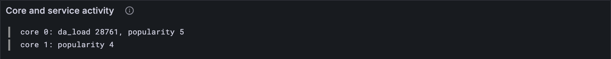

# What cores and services did

[Lesson 18.1](./01-who-did-what.md) kept score for validators, epoch by epoch. Cores and services get a scorecard
too, but a short-lived one: it covers a single block, and the next block starts again
from zero. This lesson builds both cards and checks them against every reports and
preimages test vector. No reports, assurances or statistics vector checks a core's data
load (the block-import traces carry it, for when real blocks run through), so you'll work
one out by hand as well.

## New words

- **Core statistics.** One block's scorecard for each core: the work in the reports it
  took on, the bytes it now has to keep available, and how many assurances named it.
  *Example:* core 0 took on one report: 821 gas, and a 17180-byte bundle.
- **Service statistics.** One block's scorecard for each service that did something: its
  share of that work, the preimages provided for it, and its accumulation. *Example:*
  service 42: 2 digests refined, 1518 gas.
- **Data load.** The bytes a core's newly available reports ask the validators to keep:
  each report's bundle, plus every segment it exported, plus their proof pages.
  *Example:* a 12345-byte bundle with 3 segments: 12345 + 4 × 4104 = 28761 bytes.
- **Popularity.** How many of the block's assurances say "I hold my piece" of a core's
  data. *Example:* 4 of 6 validators assure core 1: popularity 4, even though 4 isn't
  enough to make its report available.

Two words this lesson leans on: a **bundle** is a work-package together with everything
needed to refine it, and a **segment** is a 4104-byte piece of data a work-item exports
for later packages to import. All of them are in the [glossary](../glossary.md).

## What the Gray Paper says

§13, *Cores and Services*. Unlike the validators' tallies, these two "are tracked only on
a per-block basis": nothing carries over from the block before.

**Each core's card** is filled from three places:

1. **The work it took on.** Every report this block's guarantees put on the core ([lesson
   12.3](../12-guarantees/03-onto-the-cores.md)): add up its digests' imports, exports, gas and extrinsics (how many, and their
   bytes), and its bundle's length. A work-item's *extrinsics* are data blobs sent along
   with it for refine to read; nothing to do with the block's extrinsic.
2. **Its data load.** Every report of the core's that became available in this block
   ([lesson 11.1](../11-assurances/01-available.md)): its bundle's length, plus 4104 bytes for every segment it exported,
   plus one more segment for every 64 of them, rounded up. That last one is a *proof
   page*: hashes that let anyone check later that a segment is the real one.
3. **Its popularity.** How many of the block's assurances have the core's bit set.

**Each service's card** is filled from three places as well:

1. **Its share of the work.** Every digest for the service in the reports taken on: how
   many, their gas, imports, extrinsics and exports.
2. **Its provisions.** The preimages provided for it in this block ([lesson 14.1](../14-services/01-providing-preimages.md)): how
   many, and their bytes.
3. **Its accumulation.** [Lesson 17.1](../17-accumulation/01-a-blocks-accumulation.md)'s (count, transfers, gas), or zeros if it didn't
   accumulate.

A service gets a card only if it appears in at least one of the three.

The Gray Paper's names: the cores' cards are **π_C**, the services' **π_S**. The reports
taken on are **𝐈** (a bold I: the incoming reports, the ones [lesson 12.3](../12-guarantees/03-onto-the-cores.md) put onto
cores), the newly available ones **𝐑** (a bold R,
[lesson 11.1](../11-assurances/01-available.md)). For core c, it writes the work as R(c), with a plain R: a different thing,
the sum of step 1. The bundle lengths are L(c), and the data load is

  D(c) = Σ over 𝐑's reports for core c of: bundle length + W_G · ⌈segments · 65/64⌉

with W_G = 4104. Why 65/64? For n segments, n · 65/64 = n + n/64: the segments
themselves, and a proof page for every 64. Three segments: ⌈3.046875⌉ = 4.

## The tests

**Add to** `test/statistics.test.ts`

```ts
import { Assurance, Preimage } from "../src/block.ts";
import { coreStats, CoreStats, serviceStats, ServiceStats } from "../src/statistics.ts";
import { WorkReport } from "../src/work.ts";

/** The vectors in `dir` whose block is valid: a block that fails changes no tally. */
function validVectors(dir: string) {
  const valid = (name: string) => "ok" in (vectorJson(name) as { output: object }).output;
  return vectorFiles(dir).filter(valid);
}

/** Service tallies as the vectors write them: a list of ids, each with its tally. */
type ServiceTallies = { id: number; record: unknown }[];

/** The vectors' service tallies, as a map from service id to tally. */
const serviceTallies = (json: ServiceTallies) =>
  new Map(json.map((s) => [s.id, ServiceStats.fromJson(s.record)]));

/** A reports test vector, as far as statistics go: the new reports, and the tallies after. */
type ReportsVector = {
  input: { guarantees: { report: unknown }[] };
  post_state: { cores_statistics: unknown[]; services_statistics: ServiceTallies };
};

/** One block of reports vector `name`: core and service tallies, yours and the vector's. */
function runWork(config: Config, name: string) {
  const v = vectorJson(name) as ReportsVector;
  const incoming = v.input.guarantees.map((g) => WorkReport.fromJson(g.report));
  const cores = coreStats(config, incoming, [], []);
  const services = serviceStats(incoming, [], new Map());
  const post = v.post_state;
  const expected = {
    cores: post.cores_statistics.map((c) => CoreStats.fromJson(c)),
    services: serviceTallies(post.services_statistics),
  };
  return { cores, services, expected };
}

test("one big report: its core and its service take on all its work", () => {
  const { cores, services } = runWork(TINY, "stf/reports/tiny/big_work_report_output-1.json");
  assert.deepEqual([cores[0].bundle_size, cores[0].gas_used], [17180, 821n]);
  assert.equal(services.get(42)?.refinement_count, 2); // the report's two digests
  assert.equal(cores[1].gas_used, 0n); // core 1 took on nothing
});

/** An assurances test vector: the block's assurances, and the reports they made available. */
type AssurancesVector = {
  input: { assurances: unknown[] };
  output: { ok: { reported: unknown[] } };
};

test("assured data: each core's load, and how many assurances name it", () => {
  const v = vectorJson("stf/assurances/tiny/some_assurances-1.json") as AssurancesVector;
  const assurances = v.input.assurances.map((a) => Assurance(TINY).fromJson(a));
  const available: WorkReport[] = v.output.ok.reported.map((r) => WorkReport.fromJson(r));
  const cores: CoreStats[] = coreStats(TINY, [], available, assurances);
  // core 0's report became available: a 12345-byte bundle, and 3 segments plus 1 proof page
  assert.deepEqual([cores[0].da_load, cores[0].popularity], [12345 + 4104 * 4, 5]);
  assert.deepEqual([cores[1].da_load, cores[1].popularity], [0, 4]); // 4 of 6 isn't enough
});

for (const config of [TINY, FULL]) {
  for (const name of validVectors(`stf/reports/${config.name}`)) {
    test(`${name}: every core's and service's work ends as the vector says`, () => {
      const { cores, services, expected } = runWork(config, name);
      assert.deepEqual({ cores, services }, expected);
    });
  }
}

/** A preimages test vector, as far as statistics go: the preimages, and the tallies after. */
type PreimagesVector = {
  input: { preimages: unknown[] };
  post_state: { statistics: ServiceTallies };
};

for (const config of [TINY, FULL]) {
  for (const name of validVectors(`stf/preimages/${config.name}`)) {
    test(`${name}: every service's provided preimages end as the vector says`, () => {
      const v = vectorJson(name) as PreimagesVector;
      const preimages: Preimage[] = v.input.preimages.map((p) => Preimage.fromJson(p));
      const services: Map<number, ServiceStats> = serviceStats([], preimages, new Map());
      const expected: Map<number, ServiceStats> = serviceTallies(v.post_state.statistics);
      assert.deepEqual(services, expected);
    });
  }
}
```

Three kinds of vector, each checking one piece:

- The **reports** vectors put new reports on cores, so they check the work. Only the
  valid ones count: a block that fails changes nothing.
- The **preimages** vectors provide preimages, so they check provisions.
- The **assurances** vectors make reports available, but they don't keep statistics.
  So the second test works its numbers out by hand. In `some_assurances-1`, five of
  the six validators assure core 0, and four assure core 1. More than two thirds of 6
  means at least 5, so only core 0's report becomes available.

Accumulation's part was checked against the accumulate vectors in [lesson 17.1](../17-accumulation/01-a-blocks-accumulation.md).

**Run, expect it to fail**

```sh
npm test
```

```text
...
SyntaxError: The requested module '../src/statistics.ts' does not provide an export named 'CoreStats'
...
✖ test/statistics.test.ts (196.1ms)
...
ℹ tests 589
ℹ suites 0
ℹ pass 588
ℹ fail 1
...
```

Red: `src/statistics.ts` doesn't export `CoreStats` yet. The two cards and the two
functions that fill them come in one snippet.

## The code

**Add to** `src/statistics.ts`

```ts
import type { Assurance, Preimage } from "./block.ts";
import type { AccumulationStats } from "./accumulate.ts";
import { assuredCount } from "./assurances.ts";
import { natural, natural32 } from "./codec/codec.ts";
import type { RefineLoad, WorkReport } from "./work.ts";

/** One core's work in one block (GP §13, π_C), under the test vectors' names. */
export const CoreStats = record({
  da_load: natural32, // D: bytes it must keep available, for reports that became available
  popularity: natural32, // assurances that it holds a report's data
  imports: natural32, // from here down: the work in the reports it took on (R(c))
  extrinsic_count: natural32,
  extrinsic_size: natural32,
  exports: natural32,
  bundle_size: natural32, // L: those reports' bundles, all together
  gas_used: natural,
});
export type CoreStats = Value<typeof CoreStats>;

/** W_G: the size of a segment, an exported piece of data (GP App. I). */
const SEGMENT_SIZE = 4104;

/** What a report's data costs to keep available: its bundle, and its exported segments
 * with one more for every 64 of them (their proofs), rounded up. */
const dataLoad = (spec: { length: number; exports_count: number }) =>
  spec.length + SEGMENT_SIZE * Math.ceil((spec.exports_count * 65) / 64);

/**
 * π_C′ (GP §13): what each core did in this block. Its work: the digests of the reports it
 * took on (I), summed. Its data load: the reports of its that became available (R), each
 * bundle plus its exported segments. Its popularity: how many assurances name it.
 */
export function coreStats(
  config: Config,
  incoming: WorkReport[], // I: the reports guaranteed in this block
  available: WorkReport[], // R: the reports that became available in this block
  assurances: Assurance[],
): CoreStats[] {
  return Array.from({ length: config.core_count }, (_, c) => {
    const mine = incoming.filter((r) => r.core_index === c);
    const loads = mine.flatMap((r) => r.results.map((d) => d.refine_load));
    const sum = (f: (l: RefineLoad) => number) => loads.reduce((n, l) => n + f(l), 0);
    const kept = available.filter((r) => r.core_index === c).map((r) => r.package_spec);
    return {
      da_load: kept.reduce((n, spec) => n + dataLoad(spec), 0),
      popularity: assuredCount(assurances, c),
      imports: sum((l) => l.imports),
      extrinsic_count: sum((l) => l.extrinsic_count),
      extrinsic_size: sum((l) => l.extrinsic_size),
      exports: sum((l) => l.exports),
      bundle_size: mine.reduce((n, r) => n + r.package_spec.length, 0),
      gas_used: loads.reduce((n, l) => n + l.gas_used, 0n),
    };
  });
}

/** One service's activity in one block (GP §13, π_S), under the test vectors' names. */
export const ServiceStats = record({
  provided_count: natural32, // preimages provided for it
  provided_size: natural32, // their bytes
  refinement_count: natural32, // its digests in the reports guaranteed (R(s))
  refinement_gas_used: natural,
  imports: natural32,
  extrinsic_count: natural32,
  extrinsic_size: natural32,
  exports: natural32,
  accumulate_count: natural32, // from here down: lesson 17.1's accumulation statistics
  accumulate_transfer_count: natural32,
  accumulate_gas_used: natural,
});
export type ServiceStats = Value<typeof ServiceStats>;

/**
 * π_S′ (GP §13): every service active in this block, and what it did: preimages provided
 * for it, its share of the guaranteed reports' work, and its accumulation (lesson 17.1).
 */
export function serviceStats(
  incoming: WorkReport[],
  preimages: Preimage[],
  accumulation: Map<number, AccumulationStats>,
): Map<number, ServiceStats> {
  const digests = incoming.flatMap((r) => r.results);
  const active = new Set([
    ...digests.map((d) => d.service_id),
    ...preimages.map((p) => p.requester),
    ...accumulation.keys(),
  ]);
  const stats = new Map<number, ServiceStats>();
  for (const s of active) {
    const mine = digests.filter((d) => d.service_id === s).map((d) => d.refine_load);
    const sum = (f: (l: RefineLoad) => number) => mine.reduce((n, l) => n + f(l), 0);
    const provided = preimages.filter((p) => p.requester === s);
    const acc = accumulation.get(s) ?? { count: 0, transfers: 0, gasUsed: 0n };
    stats.set(s, {
      provided_count: provided.length,
      provided_size: provided.reduce((n, p) => n + p.blob.length, 0),
      refinement_count: mine.length,
      refinement_gas_used: mine.reduce((n, l) => n + l.gas_used, 0n),
      imports: sum((l) => l.imports),
      extrinsic_count: sum((l) => l.extrinsic_count),
      extrinsic_size: sum((l) => l.extrinsic_size),
      exports: sum((l) => l.exports),
      accumulate_count: acc.count,
      accumulate_transfer_count: acc.transfers,
      accumulate_gas_used: acc.gasUsed,
    });
  }
  return stats;
}
```

Both are sums, done once for each core or service. A few things to notice:

- `assuredCount` is [lesson 11.1](../11-assurances/01-available.md)'s, which counted the same bits to decide availability.
- Gas is a `bigint`, as it has been since [Part 3](../03-work-and-reports/index.md)'s `gas_used`, so its sums start from `0n`.
- `Math.ceil` on `n * 65 / 64` is exact: dividing by 64, a power of two, never rounds in
  floating point.
- `active` is a `Set`, so a service that both refined and accumulated gets one card,
  not two.

**Run**

```sh
npm test
npm run typecheck
```

```text
...
✔ the reported packages: each one's hash and exports root, sorted by hash (582.3ms)
...
✔ one big report: its core and its service take on all its work (0.9ms)
✔ assured data: each core's load, and how many assurances name it (0.3ms)
...
ℹ tests 636
ℹ suites 0
ℹ pass 636
ℹ fail 0
...
reported 636 tests to Grafana: http://127.0.0.1:3300/d/gray-tutorial?var-client=you&var-run_id=test-1791740899975
...
```

## Watch it

**New file** `bin/activity.ts`

```ts
// One block's core and service activity, from a reports test vector (new work taken on) or
// an assurances one (data now available), and what each core and service did.
// Usage: node bin/activity.ts [vector], multiple_reports-1 (tiny) if not given

import { readFileSync } from "node:fs";
import { Assurance } from "../src/block.ts";
import { FULL, TINY } from "../src/config.ts";
import { Run } from "../src/obs.ts";
import { coreStats, serviceStats } from "../src/statistics.ts";
import { WorkReport } from "../src/work.ts";

const DEFAULT = "../vectors/stf/reports/tiny/multiple_reports-1.json";
const file = process.argv[2] ?? DEFAULT;
const config = file.includes("/full/") ? FULL : TINY;
const v = JSON.parse(readFileSync(file, "utf8"));
let incoming: WorkReport[] = []; // I
let available: WorkReport[] = []; // R
let assurances: Assurance[] = [];
if (file.includes("/assurances/")) {
  // a block of assurances: some reports' data is now available
  available = v.output.ok.reported.map((r: unknown) => WorkReport.fromJson(r));
  assurances = v.input.assurances.map((a: unknown) => Assurance(config).fromJson(a));
} else {
  // a block of guarantees: new reports, new work for their cores
  incoming = v.input.guarantees.map((g: { report: unknown }) => WorkReport.fromJson(g.report));
}
const cores = coreStats(config, incoming, available, assurances);
const services = serviceStats(incoming, [], new Map());

const run = new Run("activity");
/** A tally's fields that aren't zero, by name: the ones worth reading. */
const busy = (tally: object) =>
  Object.entries(tally).filter(([, n]) => Number(n) !== 0).map(([k, n]) => `${k} ${n}`).join(", ");
const show = (who: string, tally: object) => {
  const did = busy(tally) || "nothing";
  console.log(`${who}: ${did}`);
  run.event("tally", { who, did });
};
cores.forEach((tally, c) => show(`core ${c}`, tally));
for (const [s, tally] of services) show(`service ${s}`, tally);
const link = await run.report();
if (link) console.log(`reported to Grafana: ${link}`);
```

**Run**

```sh
node bin/activity.ts
```

```text
core 0: imports 8, extrinsic_count 8, extrinsic_size 1526, exports 17, bundle_size 17180, gas_used 821
core 1: imports 1, extrinsic_count 3, extrinsic_size 1926, exports 18, bundle_size 12487, gas_used 697
service 42: refinement_count 2, refinement_gas_used 1518, imports 9, extrinsic_count 11, extrinsic_size 3452, exports 35
reported to Grafana: http://127.0.0.1:3300/d/gray-tutorial?var-client=you&var-run_id=activity-1791740914594
```

A block of two guarantees, one report for each core, both for service 42. Each core's
card shows its own report's work. Service 42's card shows both reports' work added up:
821 + 697 = 1518 gas. Now a block of assurances:

**Run**

```sh
node bin/activity.ts ../vectors/stf/assurances/tiny/some_assurances-1.json
```

```text
core 0: da_load 28761, popularity 5
core 1: popularity 4
reported to Grafana: http://127.0.0.1:3300/d/gray-tutorial?var-client=you&var-run_id=activity-1791740914740
```

Core 0's report became available, so core 0 carries its data load: 12345 + 4 × 4104.
Core 1 is popular too, with 4 assurances, but not popular enough: it carries nothing yet.
Both runs land in the *Core and service activity* panel, on the **7 · Accumulation and
import** dashboard, one line per card.



<details>
<summary>lasair: the data load, in <code>lib/statistics.ml</code></summary>

```ocaml
(** Calculate DA load for a report *)
let calculate_da_load (bundle_len : int) (segment_count : int) : int =
  let segment_overhead =
    c_segment_size * ((segment_count * c_da_overhead_num + c_da_overhead_den - 1)
                      / c_da_overhead_den)
  in
  bundle_len + segment_overhead
```

The same sum, in whole numbers only: `c_segment_size` is 4104, and the two
`c_da_overhead_` constants are 65 and 64, defined at the top of the file. Adding 63 before
dividing by 64 rounds up without fractions, the classic way to write ⌈x/64⌉ when you
only have integers. Try it: 3 segments, (195 + 63) / 64 = 4.

</details>

## What you have

All three scorecards: each validator's for the epoch ([lesson 18.1](./01-who-did-what.md)), and each core's
and each service's for the block, matching every reports and preimages vector. [Part 18](./index.md) is
done. Every part so far built one piece of a block's state transition on its own;
[Part 19](../19-block-import/index.md) starts putting them together, with the order the Gray Paper asks for.

Next: [Part 19 · Block import](../19-block-import/index.md)
