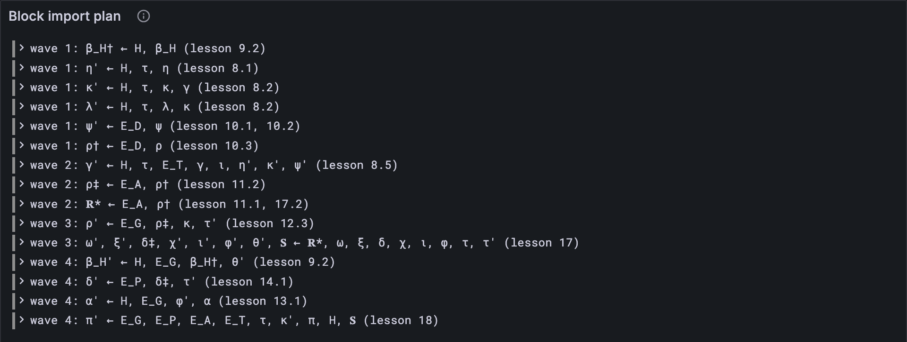

# The order of things

Eighteen parts, and you've built nearly every piece of a block import: the clock, Safrole,
disputes, assurances, guarantees, accumulation, statistics. A real block runs them all.
But in what order? Safrole's new state needs the new entropy, accumulation needs to know
which reports became available, the statistics need what accumulation did. The Gray Paper
answers with a list of what each new piece of state is made from. This lesson writes that
list down, works out an order from it, and turns it into a map of the client you've built.

## New words

- **Intermediate value.** A value halfway through a block, marked with a dagger. *Example:*
  ρ† is the cores after the judgments, ρ‡ the cores after the assurances too, and ρ′ the
  cores after the whole block.
- **Dependency graph.** A list of what each value is made from. *Example:* γ′ is made
  from the header, τ, the tickets, γ, ι, η′, κ′ and ψ′.
- **Wave.** This client's name for a group of steps whose ingredients are all ready. Steps
  in one wave don't need each other, so they could run side by side. *Example:* wave 1 is
  everything made only from the block and the state before it.

All three are in the [glossary](../glossary.md).

## What the Gray Paper says

§4.2, *State Transition Dependency Graph*. For every new piece of state, one line says what
it's made from. Read `x ≺ (a, b, c)` as "x is made from a, b and c". Two of them, in plain
English:

- ρ‡ ≺ (E_A, ρ†): the cores after the assurances are made from the assurances, and the
  cores after the judgments.
- γ′ ≺ (H, τ, E_T, γ, ι, η′, κ′, ψ′): Safrole's next state needs the new entropy, the new
  validators and the new offenders (so an offender can be kept out of the next set).

A prime (′) is a value after the block, a dagger a value halfway through it. Anything
without one is either part of the block (the header H and the extrinsic's parts E_T, E_D,
E_P, E_A, E_G) or the state before it, which is there from the start.

Why write it this way? The Gray Paper's own reason is to help clients do the work in
parallel, *"we minimize the depth of the dependency graph"*: the fewer steps that wait for
others, the more can run at once.

Two things to watch for. The list is in the Gray Paper's order, not an order you can run:
γ′ comes first, before η′, which it needs. And it's a summary: 𝐑*, the reports ready to
accumulate, is listed as made from E_A and ρ† alone, but its full definition ([lesson 17.2](../17-accumulation/02-waiting-reports.md))
also reads the ready queue ω. That's state from before the block, there from the start, so
the order doesn't change.

## The tests

**New file** `test/import.test.ts`

```ts
import { test } from "node:test";
import assert from "node:assert/strict";
import type { Step } from "../src/import.ts";
import { STEPS, waves } from "../src/import.ts";

/** The values each wave makes, wave by wave. */
const made = (ws: Step[][]) => ws.map((w) => w.flatMap((s) => s.makes));

test("the Gray Paper's list isn't a recipe: γ′ comes before η′, which it's made from", () => {
  const at = (x: string) => STEPS.findIndex((s) => s.makes.includes(x));
  assert.ok(at("γ′") < at("η′"));
  assert.ok(STEPS[at("γ′")].from.includes("η′"));
});

test("four waves: the first needs only the block and the state before it", () => {
  const ws = made(waves(STEPS));
  assert.equal(ws.length, 4);
  assert.deepEqual(ws[0], ["τ′", "β_H†", "η′", "κ′", "λ′", "ψ′", "ρ†"]);
  assert.ok(ws[1].includes("γ′")); // Safrole waits for the new entropy, keys and offenders
  assert.deepEqual(ws[3], ["β_H′", "δ′", "α′", "π′"]); // all waiting for accumulation
});

test("every step comes after everything it's made from", () => {
  const ws = waves(STEPS);
  const madeBy = new Map(ws.flatMap((w, i) => w.flatMap((s) => s.makes.map((x) => [x, i]))));
  ws.forEach((wave, i) => {
    for (const step of wave) for (const x of step.from) assert.ok((madeBy.get(x) ?? -1) < i, x);
  });
});

test("steps that wait for each other are caught", () => {
  const loop = [
    { makes: ["a′"], from: ["b′"], lesson: "" },
    { makes: ["b′"], from: ["a′"], lesson: "" },
  ];
  assert.throws(() => waves(loop), /wait for each other/);
});
```

The second test pins down the waves. The first wave is seven steps that need nothing but
the block and the old state. Safrole waits until wave 2, and the last wave is everything
waiting for accumulation.

**Run, expect it to fail**

```sh
npm test
# fails with: Cannot find module
```

## The code

**New file** `src/import.ts`

```ts
// Block import (GP §4): the state transition Υ, one block at a time. This file starts with
// its plan: every new piece of state, what it's made from, and an order to make them in.

/**
 * One step of Υ (GP §4.2): the values it makes, the values it's made from, and the lesson
 * that builds it. A prime (′) is a value after the block, a dagger (†, ‡) a value halfway
 * through it; H and the E_ are the block's header and extrinsic parts; the rest is the
 * state before the block.
 */
export type Step = { makes: string[]; from: string[]; lesson: string };

/** The Gray Paper's dependency graph (§4.2, equation transitionfunctioncomposition), in the
 * order it lists the steps. */
export const STEPS: Step[] = [
  { makes: ["τ′"], from: ["H"], lesson: "4.6" },
  { makes: ["β_H†"], from: ["H", "β_H"], lesson: "9.2" },
  { makes: ["γ′"], from: ["H", "τ", "E_T", "γ", "ι", "η′", "κ′", "ψ′"], lesson: "8.5" },
  { makes: ["η′"], from: ["H", "τ", "η"], lesson: "8.1" },
  { makes: ["κ′"], from: ["H", "τ", "κ", "γ"], lesson: "8.2" },
  { makes: ["λ′"], from: ["H", "τ", "λ", "κ"], lesson: "8.2" },
  { makes: ["ψ′"], from: ["E_D", "ψ"], lesson: "10.1, 10.2" },
  { makes: ["ρ†"], from: ["E_D", "ρ"], lesson: "10.3" },
  { makes: ["ρ‡"], from: ["E_A", "ρ†"], lesson: "11.2" },
  { makes: ["ρ′"], from: ["E_G", "ρ‡", "κ", "τ′"], lesson: "12.3" },
  { makes: ["𝐑*"], from: ["E_A", "ρ†"], lesson: "11.1, 17.2" },
  {
    makes: ["ω′", "ξ′", "δ‡", "χ′", "ι′", "ϕ′", "θ′", "𝐒"],
    from: ["𝐑*", "ω", "ξ", "δ", "χ", "ι", "ϕ", "τ", "τ′"],
    lesson: "17",
  },
  { makes: ["β_H′"], from: ["H", "E_G", "β_H†", "θ′"], lesson: "9.2" },
  { makes: ["δ′"], from: ["E_P", "δ‡", "τ′"], lesson: "14.1" },
  { makes: ["α′"], from: ["H", "E_G", "ϕ′", "α"], lesson: "13.1" },
  {
    makes: ["π′"],
    from: ["E_G", "E_P", "E_A", "E_T", "τ", "κ′", "π", "H", "𝐒"],
    lesson: "18",
  },
];

/**
 * The steps in waves: first every step made only from the block and the state before it,
 * then every step whose inputs the first wave made, and so on. Steps in one wave don't
 * need each other, so a client could run them side by side. Throws if some steps can
 * never run because they wait for each other.
 */
export function waves(steps: Step[]): Step[][] {
  const madeByAStep = new Set(steps.flatMap((s) => s.makes));
  const made = new Set<string>();
  const ready = (s: Step) => s.from.every((x) => made.has(x) || !madeByAStep.has(x));
  const out: Step[][] = [];
  let left = steps;
  while (left.length > 0) {
    const wave = left.filter(ready);
    if (wave.length === 0) throw new Error("these steps wait for each other");
    out.push(wave);
    for (const step of wave) for (const x of step.makes) made.add(x);
    left = left.filter((s) => !wave.includes(s));
  }
  return out;
}
```

`STEPS` is the Gray Paper's list, line for line, with the lesson that built each step.
`waves` finds the order. `madeByAStep` is everything some step makes. Anything else (the
block, the old state) counts as ready from the start. Each time round, every step whose
ingredients are all ready forms the next wave. If a round finds nothing ready while steps
are left, they're waiting for each other, and no order exists.

**Run**

```sh
npm test
# prints: four waves: the first needs only the block and the state before it
# prints: fail 0
# prints: reported
npm run typecheck
```

## Watch it

**New file** `bin/plan.ts`

```ts
// Prints the plan of a block import: the Gray Paper's steps in waves, each with what it's
// made from and the lesson that builds it.
// Usage: node bin/plan.ts

import { STEPS, waves } from "../src/import.ts";
import { Run } from "../src/obs.ts";

const run = new Run("plan");
waves(STEPS).forEach((wave, i) => {
  console.log(`wave ${i + 1}:`);
  for (const step of wave) {
    const makes = step.makes.join(", ");
    const from = step.from.join(", ");
    console.log(`  ${makes} ← ${from}  (lesson ${step.lesson})`);
    run.event("step", { wave: i + 1, makes, from, lesson: step.lesson });
  }
});
const link = await run.report();
if (link) console.log(`reported to Grafana: ${link}`);
```

**Run**

```sh
node bin/plan.ts
# prints: wave 1:
# prints: γ′ ← H, τ, E_T, γ, ι, η′, κ′, ψ′  (lesson 8.5)
# prints: π′ ← E_G, E_P, E_A, E_T, τ, κ′, π, H, 𝐒  (lesson 18)
```

That's the map of your client: every step of a block, in four waves, with the lesson that
built it. The *Block import plan* panel keeps it.



## What's next

The next lessons of this part run real blocks through these waves and compare the whole
state after each one with the official block-import traces. One step can't run on a real
block yet: η′ mixes in randomness that only the block's header can give, the output of
its entropy signature H_V, a Bandersnatch VRF signature ([lesson 8.1](../08-safrole/01-stirring-the-entropy.md) took that output
ready-made from the test vectors). That's the cryptography Part 8 left for later.

<details>
<summary>lasair: one long function, in <code>conformance/trace_runner.ml</code></summary>

lasair's `import_block` takes the steps one after another, each `let state = ...` handing
the next step the state the last one left:

```ocaml
  (* Update timeslot *)
  let state = Stf_transitions.update_timeslot state header.slot in
```

and a few lines later:

```ocaml
  (* Update entropy (with rotation at epoch boundaries) *)
  let state = Stf_transitions.update_entropy ~new_epoch state header.slot header.entropy_source header.epoch_mark in
```

One order, no waves running side by side: simpler, and fast enough. Note
`header.entropy_source`: that's H_V, the header's VRF signature, the piece your client
still needs for η′.

</details>

## What you have

The plan of a block import: every step the Gray Paper lists, what it's made from, the
order to run them in, and where you built each one.
