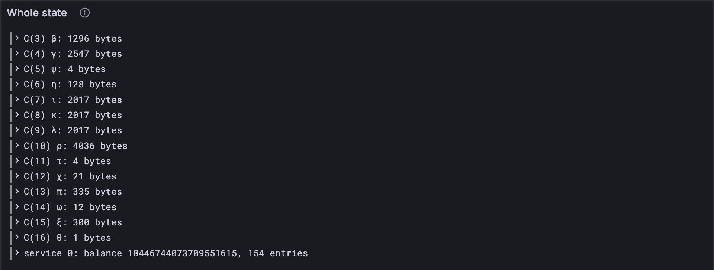

# The whole state

Every part so far has read the few state components it needs. Importing a block needs all
of them at once, and then all of them written back, byte for byte, because the state root
fingerprints every byte. This lesson builds that: the whole state, σ, read from a real
state's entries and written back. Five components get a codec for the first time, and
every account comes along with everything it keeps. By the end of it, 80 real states from
all eight block-import traces come back exactly as they went in.

## New words

- **Account entry.** One thing a service keeps in the state, under its own key: a storage
  value, a preimage, or a request's history. *Example:* service 0 of the `storage` trace
  keeps 154 entries before block 50.
- **Dictionary encoding.** How the state writes a map: the number of pairs, then each pair,
  sorted by key. *Example:* χ_Z, the always-accumulate services, each a service id and its
  gas.

Both are in the [glossary](../glossary.md).

## What the Gray Paper says

Appendix D, T(σ): the state is sixteen components, C(1) to C(16) ([lesson 6.2](../06-state-and-merklization/02-state-keys.md)), and every
service account. Most components already have a codec in your client. Five don't:

1. **χ, C(12)**: the manager, each core's assigner, the delegator and the registrar, four
   bytes each, then χ_Z as a dictionary: each always-accumulate service's id (four bytes)
   and its gas (eight).
2. **π, C(13)**: this epoch's and the last epoch's validator tallies, each a sequence with
   its length in front, then the cores' records, then the services' as a dictionary
   ([Part 18](../18-statistics/index.md)'s records, all four).
3. **ω, C(14)**: for each slot of an epoch, the waiting reports, each with what it waits for
   ([lesson 17.2](../17-accumulation/02-waiting-reports.md)).
4. **ξ, C(15)**: for each slot, the work-packages accumulated in it.
5. **θ, C(16)**: the last block's accumulation outputs ([lesson 17.11](../17-accumulation/11-what-a-service-yields.md)).

And the accounts: a service s has its record at C(255, s) ([lesson 14.2](../14-services/02-the-service-account.md)) and an entry for
each thing it keeps, at C(s, …) with ℰ₄(s) woven into bytes 0, 2, 4 and 6 of the key. The
rest of each key is a hash, of a storage key, a preimage's hash, or a request's hash and
length. A hash can't be undone, so from the state alone your client can't tell a storage
value from a preimage. It doesn't need to yet: an account read from the state keeps its
entries by their keys, as they come, and [lesson 19.3](./03-accounts-from-the-state.md) teaches the client to find things in
them.

## The tests

**New file** `test/whole-state.test.ts`

```ts
import { test } from "node:test";
import assert from "node:assert/strict";
import { toHex } from "../src/bytes.ts";
import { TINY } from "../src/config.ts";
import type { State } from "../src/whole-state.ts";
import { readState, writeState } from "../src/whole-state.ts";
import type { KeyValue } from "../src/trie.ts";
import { readService } from "../src/services.ts";
import type { ServiceInfo } from "../src/services.ts";
import { traceState } from "./vectors.ts";

/** The eight block-import trace families. */
export const FAMILIES = [
  "fallback", "safrole", "storage", "storage_light",
  "preimages", "preimages_light", "fuzzy", "fuzzy_light",
];

/** A state's entries as hex, key → value: two states are the same if these are. */
const asHex = (entries: KeyValue[]) =>
  new Map(entries.map((e) => [toHex(e.key), toHex(e.value)]));

test("states of all eight traces, read whole and written back, byte for byte", () => {
  let states = 0;
  for (const family of FAMILIES) {
    for (let n = 1; n <= 100; n += 11) {
      const { entries } = traceState(family, n);
      const state: State = readState(TINY, entries);
      const written: KeyValue[] = writeState(TINY, state);
      assert.deepEqual(asHex(written), asHex(entries), `${family} block ${n}`);
      states++;
    }
  }
  assert.equal(states, 80);
});

test("each account: its record, and every entry it keeps, by its state key", () => {
  const { entries } = traceState("storage", 50);
  const { accounts } = readState(TINY, entries);
  const info: ServiceInfo = accounts.get(0)!.info;
  assert.deepEqual(info, readService(entries, 0));
  const items: number = [...accounts.values()].reduce((n, a) => n + a.items!.size, 0);
  const components = 16;
  assert.equal(components + accounts.size + items, entries.length); // nothing left over
});
```

The first test is a round trip for the whole state: every 11th state of each trace, read
and written back, must be the same entries. The second checks that reading leaves nothing
out: sixteen components, one record per account, and every entry belongs to some account.

## The code

An account read from the state carries its entries:

**Replace in** `src/services.ts`

```ts
/**
 * A service account (GP §9) as accumulation sees it: its record, its storage, the
 * preimages it keeps, each under its hash, and its requests for preimages: for each hash
 * and length ("hash:length"), the slots it was asked for, provided, and so on. Keys in hex.
 */
export type Account = {
  info: ServiceInfo;
  storage: Map<string, Bytes>;
  preimages: Map<string, Bytes>;
  requests: Map<string, number[]>;
  items?: Map<string, Bytes>; // read from the state: every entry, by its state key (19.3)
};
```

**Replace in** `src/services.ts`

```ts
/** A copy of the accounts that changes to the originals can't reach. */
export function copyAccounts(accounts: Map<number, Account>): Map<number, Account> {
  const copy = (a: Account) => ({
    info: { ...a.info },
    storage: new Map(a.storage),
    preimages: new Map(a.preimages),
    requests: new Map([...a.requests].map(([k, slots]) => [k, [...slots]])),
    ...(a.items && { items: new Map(a.items) }), // only an account read from the state
  });
  return new Map([...accounts].map(([id, a]) => [id, copy(a)]));
}
```

```ts
    ...(a.items && { items: new Map(a.items) }), // only an account read from the state
```

`...(x && { … })` adds the field only when there is one: the test vectors' accounts don't
gain an `items` they never had, so they compare as before.

Then the whole state:

**New file** `src/whole-state.ts`

```ts
// The whole state, σ (GP App. D): every component and every service account, read from
// the state's entries and written back, so that a block can be imported into a real state.

import type { Bytes } from "./bytes.ts";
import { fromHex, toHex } from "./bytes.ts";
import type { Codec, Value } from "./codec/codec.ts";
import { decode, encode, hash, record, seq, seqN, u32, u64 } from "./codec/codec.ts";
import type { Config } from "./config.ts";
import { AuthPools, AuthQueues } from "./authorization.ts";
import { Recent } from "./history.ts";
import { SafroleState, ValidatorKey, accountKey, componentKey } from "./state.ts";
import { PastJudgements } from "./disputes.ts";
import { PendingReports } from "./cores.ts";
import { ValidatorStats, CoreStats, ServiceStats } from "./statistics.ts";
import { AccumulationOutput } from "./accumulate.ts";
import { ServiceInfo } from "./services.ts";
import type { Account } from "./services.ts";
import { WorkReport } from "./work.ts";
import type { KeyValue } from "./trie.ts";

/** χ, C(12): the privileged services, then the always-accumulate ones with their gas. */
export function PrivilegesCodec(config: Config) {
  return record({
    bless: u32, // χ_M
    assign: seqN(u32, config.core_count), // χ_A
    designate: u32, // χ_V
    register: u32, // χ_R
    always_acc: seq(record({ id: u32, gas: u64 })), // χ_Z, by service id
  });
}

/** π, C(13): this epoch's and the last's validator tallies, the cores', the services'. */
export function StatisticsCodec(config: Config) {
  return record({
    vals_curr: seq(ValidatorStats), // π_V
    vals_last: seq(ValidatorStats), // π_L
    cores: seqN(CoreStats, config.core_count), // π_C
    services: seq(record({ id: u32, record: ServiceStats })), // π_S, by service id
  });
}

/** ω, C(14): for each slot of an epoch, the reports waiting, and what each waits for. */
export function ReadyQueueCodec(config: Config) {
  const waiting = record({ report: WorkReport, dependencies: seq(hash) });
  return seqN(seq(waiting), config.epoch_length);
}

/** ξ, C(15): for each of the last E slots, the work-packages accumulated in it. */
export function AccumulatedCodec(config: Config) {
  return seqN(seq(hash), config.epoch_length);
}

/** θ, C(16): the last block's accumulation outputs. */
export const OutputsCodec = seq(AccumulationOutput);


/** σ: every component of the state, by its Gray Paper letter, and the accounts, δ. */
export function StateComponents(config: Config) {
  return {
    1: AuthPools(config), // α
    2: AuthQueues(config), // ϕ
    3: Recent, // β
    4: SafroleState(config), // γ
    5: PastJudgements, // ψ
    6: seqN(hash, 4), // η
    7: seq(ValidatorKey), // ι
    8: seq(ValidatorKey), // κ
    9: seq(ValidatorKey), // λ
    10: PendingReports(config), // ρ
    11: u32, // τ
    12: PrivilegesCodec(config), // χ
    13: StatisticsCodec(config), // π
    14: ReadyQueueCodec(config), // ω
    15: AccumulatedCodec(config), // ξ
    16: OutputsCodec, // θ
  } satisfies Record<number, Codec<unknown>>;
}

type Components = ReturnType<typeof StateComponents>;

/** The whole state: each component, decoded, and the service accounts. */
export type State = { [i in keyof Components]: Value<Components[i]> } & {
  accounts: Map<number, Account>; // each read with its entries, `items` (lesson 19.3)
};

/** The service an entry belongs to, if it is one of a service's entries, C(s, h): ℰ₄(s) is
 * woven into bytes 0, 2, 4 and 6. Component keys and account records are not. */
function ownerOf(key: Bytes): number | undefined {
  if (key.subarray(1).every((b) => b === 0)) return undefined; // C(i): a component
  const record = [2, 4, 6].every((i) => key[i] === 0) && key.subarray(8).every((b) => b === 0);
  if (key[0] === 255 && record) {
    return undefined; // C(255, s): an account's record
  }
  return (key[0] | (key[2] << 8) | (key[4] << 16) | (key[6] << 24)) >>> 0;
}

/** σ, read from the state's entries: every component decoded, every account gathered. */
export function readState(config: Config, entries: KeyValue[]): State {
  const byKey = new Map(entries.map((e) => [toHex(e.key), e.value]));
  const components = StateComponents(config);
  const state = {} as Record<number, unknown>;
  for (const [i, codec] of Object.entries(components)) {
    const value = byKey.get(toHex(componentKey(Number(i))));
    if (value === undefined) throw new Error(`the state has no component ${i}`);
    state[Number(i)] = decode(codec as Codec<unknown>, value);
  }
  const accounts = new Map<number, Account>();
  for (const { key, value } of entries) {
    if (key[0] !== 255 || toHex(key) !== toHex(accountKey(serviceOfAccountKey(key)))) continue;
    const info = decode(ServiceInfo, value);
    const empty = { storage: new Map(), preimages: new Map(), requests: new Map() };
    accounts.set(serviceOfAccountKey(key), { info, ...empty, items: new Map() });
  }
  for (const { key, value } of entries) {
    const s = ownerOf(key);
    if (s !== undefined) accounts.get(s)?.items?.set(toHex(key), value);
  }
  return { ...(state as Omit<State, "accounts">), accounts };
}

/** The service s an account record's key C(255, s) names. */
function serviceOfAccountKey(key: Bytes): number {
  return (key[1] | (key[3] << 8) | (key[5] << 16) | (key[7] << 24)) >>> 0;
}

/** σ, written as the state's entries: each component encoded, each account's record and
 * entries. */
export function writeState(config: Config, state: State): KeyValue[] {
  const entries: KeyValue[] = [];
  for (const [i, codec] of Object.entries(StateComponents(config))) {
    const value = state[Number(i) as keyof Components];
    entries.push({ key: componentKey(Number(i)), value: encode(codec as Codec<unknown>, value) });
  }
  for (const [s, account] of state.accounts) {
    entries.push({ key: accountKey(s), value: encode(ServiceInfo, account.info) });
    for (const [key, value] of account.items ?? []) entries.push({ key: fromHex(key), value });
  }
  return entries;
}
```

`StateComponents` lists every component's codec by its number, and `State` gets its type
from that list: `state[6]` is η, a list of four hashes. Reading decodes each component;
then every account record, then every entry, each to its owner, found by `ownerOf`.
Writing goes the other way.

**Run**

```sh
npm test
npm run typecheck
```

```text
...
✔ states of all eight traces, read whole and written back, byte for byte (314.581417ms)
✔ each account: its record, and every entry it keeps, by its state key (2.566875ms)
...
ℹ tests 642
ℹ suites 0
ℹ pass 642
ℹ fail 0
...
reported 642 tests to Grafana: http://127.0.0.1:3300/d/gray-tutorial?var-client=you&var-run_id=test-1791773578784
...
```

## Watch it

**New file** `bin/whole-state.ts`

```ts
// Reads a real state whole: each of its sixteen components, by the Gray Paper's letter,
// with its size; then each service account, with how many entries it keeps.
// Usage: node bin/whole-state.ts [family] [block], before block 50 of "storage" if not given

import { encode } from "../src/codec/codec.ts";
import type { Codec } from "../src/codec/codec.ts";
import { TINY } from "../src/config.ts";
import { Run } from "../src/obs.ts";
import { StateComponents, readState } from "../src/whole-state.ts";
import { traceState } from "../test/vectors.ts";

/** Each component's Gray Paper letter, by its number. */
const LETTERS = " αϕβγψηικλρτχπωξθ";
const family = process.argv[2] ?? "storage";
const n = Number(process.argv[3] ?? 50);
const { entries } = traceState(family, n);
const state = readState(TINY, entries);
const run = new Run("state");
for (const [i, codec] of Object.entries(StateComponents(TINY))) {
  const value = state[Number(i) as keyof ReturnType<typeof StateComponents>];
  const size = encode(codec as Codec<unknown>, value).length;
  console.log(`C(${i}) ${LETTERS[Number(i)]}: ${size} bytes`);
  run.event("component", { i: Number(i), letter: LETTERS[Number(i)], size });
}
for (const [s, account] of state.accounts) {
  const items = account.items?.size ?? 0;
  console.log(`service ${s}: balance ${account.info.balance}, ${items} entries`);
  run.event("account", { s, balance: String(account.info.balance), items });
}
console.log(`${entries.length} entries in all, every one read`);
const link = await run.report();
if (link) console.log(`reported to Grafana: ${link}`);
```

**Run**

```sh
node bin/whole-state.ts
```

```text
C(1) α: 514 bytes
C(2) ϕ: 5120 bytes
C(3) β: 1296 bytes
C(4) γ: 2547 bytes
C(5) ψ: 4 bytes
C(6) η: 128 bytes
C(7) ι: 2017 bytes
C(8) κ: 2017 bytes
C(9) λ: 2017 bytes
C(10) ρ: 4036 bytes
C(11) τ: 4 bytes
C(12) χ: 21 bytes
C(13) π: 335 bytes
C(14) ω: 12 bytes
C(15) ξ: 300 bytes
C(16) θ: 1 bytes
service 0: balance 18446744073709551615, 154 entries
171 entries in all, every one read
reported to Grafana: http://127.0.0.1:3300/d/gray-tutorial?var-client=you&var-run_id=state-1791773590083
```

The state before block 50 of the `storage` trace: sixteen components, and service 0
keeping 154 entries, for 171 in all. The *Whole state* panel, on **7 · Accumulation and
import**, lists them.



<details>
<summary>lasair: no state type at all, in <code>conformance/trace_runner.ml</code></summary>

```ocaml
let load_state (state : trace_state) : Lasair.State_db.t =
  let kvs = List.map (fun (k, v) ->
    { Lasair.State_db.key = k; value = v }
  ) state.keyvals in
  Lasair.State_db.of_list kvs
```

lasair takes the other road: it never reads the whole state into one value. Its state is
the entries themselves, in a database keyed by state key, and each step reads and writes
the few bytes it needs, at fixed offsets (you saw it read γ_S that way in [lesson 8.9](../08-safrole/09-seals.md)).
That's fast, and every step must know every byte's place. Your client decodes the state
into values once, and encodes it again at the end: slower, and every step works on plain
values, as it did against the test vectors.

</details>

## What you have

The whole state, read and written, byte for byte, for every trace. Its accounts keep
their entries by their keys, which the host calls, written for the test vectors' accounts,
can't use yet: [lesson 19.3](./03-accounts-from-the-state.md) teaches them.

Next: [19.3 Accounts from the state](./03-accounts-from-the-state.md)
