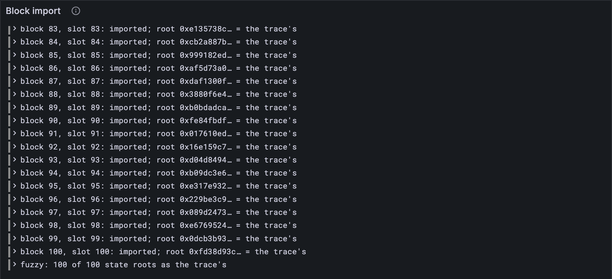

# Blocks to refuse

The last two traces come from the conformance fuzzer's own service: work-packages with
random work, and in `fuzzy`, a few blocks that must be refused. An importer that takes a
bad block is as wrong as one that refuses a good one. This lesson runs them, finds one
last difference from the traces, in an out-of-gas rule [lesson 16.3](../16-host-calls/03-growing-the-heap.md) kept as the Gray Paper
wrote it, and ends with your client importing all eight traces, 800 blocks, chained, and
refusing exactly the three it should. That's a block importer: JAM's first milestone.

## New words

- **Fuzzy trace.** A block-import trace made with a service that does random work, from the
  conformance fuzzer's tool kit, with some blocks meant to be refused. *Example:* `fuzzy`
  blocks 37 to 39, each refused with `bad_code_hash`.

It's in the [glossary](../glossary.md).

## The tests

The blocks around `fuzzy`'s three bad ones, and the first 25 of `fuzzy_light`:

**Add to** `test/import.test.ts`

```ts
test("blocks the fuzzy trace refuses, and the ones around them", () => {
  const refused: string[] = [];
  for (let n = 30; n <= 41; n++) {
    const { root, expected, after } = importTrace("fuzzy", n);
    if ("error" in after) refused.push(`${n}: ${after.error}`);
    else assert.equal(root, expected, `fuzzy block ${n}`);
  }
  assert.deepEqual(refused, ["37: bad_code_hash", "38: bad_code_hash", "39: bad_code_hash"]);
});

test("Υ on the first 25 blocks of the fuzzy_light trace", () => {
  for (let n = 1; n <= 25; n++) {
    const { root, expected } = importTrace("fuzzy_light", n);
    assert.equal(root, expected, `fuzzy_light block ${n}`);
  }
});
```

**Run, expect it to fail**

```sh
npm test
```

```text
...
ℹ tests 648
ℹ suites 0
ℹ pass 647
ℹ fail 1
...
  AssertionError [ERR_ASSERTION]: fuzzy block 31
  + actual - expected

  + '0xceb4a36500ea7090eca1842a25647b343e79d9f5d2bb49542b6aaa338624d2a5'
  - '0x74cc2dcbfec453d25471897a5f71fee6d1f54b980f49bb79bb5c141aaab3eb45'
...
```

Block 31's root isn't the trace's. The component that differs is C(13), the statistics:
one service used 1,545,786 gas, and the trace says 2,000,000, every drop it had. That
service grew its heap without enough gas left to pay for it.

## What the Gray Paper says

`grow_heap` ([lesson 16.3](../16-host-calls/03-growing-the-heap.md)), when growing would cost more gas than is left: Gray Paper 0.8.0 stops
the machine out of gas, with the gas as it was. The 0.8.0 test vectors, and the traces,
follow a later change to the paper (pull request 533): the gas is spent, all of it, as for
any other host call that runs out. [HARDENING.md](https://github.com/abutlabs/gray-tutorial/blob/main/HARDENING.md) listed this from [lesson 16.3](../16-host-calls/03-growing-the-heap.md) on, with
exactly this case: "traces that run a service out of gas while it grows its heap".

Your `charge` ([lesson 16.1](../16-host-calls/01-calling-the-host.md)) already spends gas that way: it takes the gas off first, and
only then says whether there was enough. `growHeap` checked first, and took nothing.

## The code

**Replace in** `src/host.ts`

```ts
/**
 * grow_heap (GP App. B.5, Ω_Gemini): makes the read-write zone's pages writable up to page
 * φ₇ (not including it), and says where the heap ends now. The zone starts at page a, may
 * reach b, and ends at h today. Asking for no more than h, or past b, just reports h.
 */
export function growHeap(m: Machine, code: ServiceCode): HostExit {
  const a = (2 * ZONE + roundUp(code.readOnly.length, ZONE)) / PAGE_SIZE;
  const b = (2 ** 32 - 3 * ZONE - INPUT_SIZE - roundUp(code.stackSize, PAGE_SIZE)) / PAGE_SIZE;
  const writable = [...m.memory].filter(([p, page]) => p >= a && p < b && page.access === "W");
  const h = a + writable.length;
  const want = m.registers[7];
  if (want <= BigInt(h) || want > BigInt(b)) {
    m.registers[7] = BigInt(h);
    return charge(m, 275) ? "continue" : "oog";
  }
  const g = 275n + (want - BigInt(h)) * 121n; // and 121 for each new page
  m.registers[7] = BigInt(h);
  if (!charge(m, g)) return "oog"; // all the gas is gone, as for any host call (19.6)
  addPages(m.memory, h * PAGE_SIZE, (Number(want) - h) * PAGE_SIZE, "W");
  m.registers[7] = want;
  return "continue";
}
```

```ts
  if (!charge(m, g)) return "oog"; // all the gas is gone, as for any host call (19.6)
```

**Run**

```sh
npm test
npm run typecheck
```

```text
...
✔ blocks the fuzzy trace refuses, and the ones around them (4755.47ms)
✔ Υ on the first 25 blocks of the fuzzy_light trace (1764.883416ms)
...
ℹ tests 648
ℹ suites 0
ℹ pass 648
ℹ fail 0
...
reported 648 tests to Grafana: http://127.0.0.1:3300/d/gray-tutorial?var-client=you&var-run_id=test-1791773731003
...
```

The three refusals, as the trace has them, and every other root right.

## Watch it

**Run**

```sh
node bin/import.ts fuzzy
```

```text
...
block 36, slot 36: imported; root 0xe9a2c0ff… = the trace's
block 37, slot 37: refused: bad_code_hash; root 0xe9a2c0ff… = the trace's
block 38, slot 38: refused: bad_code_hash; root 0xe9a2c0ff… = the trace's
block 39, slot 39: refused: bad_code_hash; root 0xe9a2c0ff… = the trace's
block 40, slot 40: imported; root 0x09189a2a… = the trace's
...
100 of 100 state roots as the trace's
reported to Grafana: http://127.0.0.1:3300/d/gray-tutorial?var-client=you&var-run_id=import-1791773751077
```

Blocks 37, 38 and 39 are refused, and the state stays as it was, as the trace's does: the
same root three times. The *Block import* panel lists every block, and ends with the tally.



<details>
<summary>lasair: the out-of-gas rule, in <code>lib/pvm_host.ml</code></summary>

```ocaml
      if Int64.compare ctx.gas_remaining g < 0 then
        (* deviation GP #533 (jam-test-vectors 0.8.0): drain to zero, exit OOG *)
        Some { new_gas = 0L; new_regs = set_reg regs 7 (Int64.of_int h); new_mem = mem;
               new_service = None; new_context = Some { ctx with gas_remaining = 0L; heap_limit = -1L } }
```

lasair sets the gas to zero, `new_gas = 0L`, where your `charge` takes it below zero. The
gas used comes out the same either way: [lesson 16.6](../16-host-calls/06-checkpoints.md)'s u = g − max(ϱ′, 0) counts anything
at or below zero as all of it. lasair's comment calls it what it is, a deviation: Gray
Paper 0.8.0 says otherwise, and the vectors follow the paper's next version.

</details>

## What you have

A JAM block importer. All eight official block-import traces, 800 blocks, each imported
into the state your client made from the one before, every state root right; the bad
blocks refused, the state left as it was. Every state-transition test vector passes too,
safrole's proofs and ring roots included. That's what JAM's first milestone, M1, asks of a
client: the conformance tests, and importing blocks. One thing is left: the official
fuzzer doesn't run your tests, it talks to your client over a socket. That's the last part
[still to be written](../index.md#still-to-be-written).
